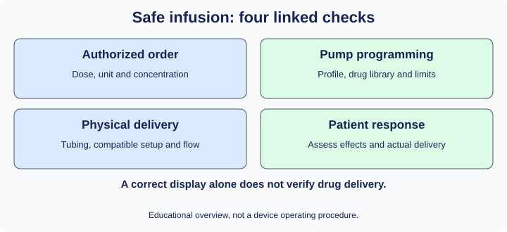

# Critical-care infusion device safety

Draft educational material. [20 MCQs](../MCQs/19-Critical-Care-Infusion-Device-Safety-20-MCQs.md). Local trained practice and manufacturer instructions apply.

Smart pump ki drug library standardized concentrations aur DERS limits provide karti hai. Correct patient profile, drug entry, dose units, concentration aur VTBI verify karna zaroori hai. Hard limit routine continuation prevent karta hai; soft warning ko authorized policy ke according investigate karte hain. High-risk independent check mein clinicians separately verify karte hain, phir findings compare karte hain.

Device input error, unit mismatch aur wrong concentration actual dose affect kar sakte hain. Dose-programmed pump lower-than-actual entered concentration par excess volume calculate kar sakta hai. EHR linkage physical secondary line setup ko automatically verify nahi karta. Compatible gravity-dependent secondary setup mein wrong height ya closed clamp actual medication delivery interrupt kar sakte hain. Patient aur real delivery ko display ke saath assess karo.

Low-rate syringe infusion mein start-up lag, vertical displacement, syringe compliance aur downstream dead volume clinically important ho sakte hain. Validated compatible syringe size, stable relative height aur trained setup use karo. Programmed dose change ka patient tak arrival delayed ho sakta hai. Never change critical infusion settings independently outside authorized protocol.

Quality team drug library version coverage, soft-limit override context, actual medication orders aur workflow barriers review karti hai. Existing Foundations equipment bank covers basic failure and occlusion response; this bank focuses on programming and delivery reliability.

Evidence: [FDA pump problems](https://www.fda.gov/medical-devices/infusion-pumps/examples-reported-infusion-pump-problems), [FDA clinical risk reduction](https://www.fda.gov/medical-devices/infusion-pumps/infusion-pump-risk-reduction-strategies-clinicians) direct HTML inspected. [ISMP 2020 guidance](https://www.ismp.org/system/files/resources/2020-10/ISMP176C-Smart%20Infusion%20Pumps-100620.pdf) text checked, printed page 7 screenshot inspected. [2023 microinfusion review](https://doi.org/10.1097/EJA.0000000000001839) indexed text checked; direct PMC access blocked. [Delivery lag study](https://pubmed.ncbi.nlm.nih.gov/34878612/) indexed abstract. Specific practice videos and independent review pending.
