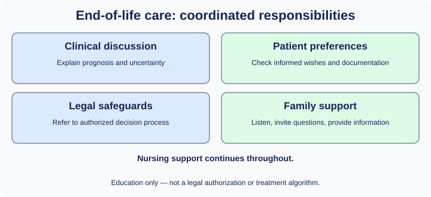

# ICU end-of-life communication aur legal safeguards — India

Draft educational material. [20 MCQs](../MCQs/20-ICU-End-of-Life-Communication-and-Legal-Safeguards-20-MCQs.md). Nursing role is assessment, advocacy, communication and authorized care, not independent legal approval or implementation of treatment limitation.

ICMR 2020 DNAR guidance CPR-specific hai; other treatment limitation aur advance directive alag topics hain. Anticipatory physician-led discussion private setting mein patient/surrogate ke saath hoti hai. Benefit, harm, prognosis aur guilt concerns discuss karo. Actual signatures aur discussion accurately document karo. Resuscitation plan authorized team ke liye accessible rakho. Existing Foundations Q9 covers basic DNAR scope; this bank avoids duplicating that task.

Indian Supreme Court ka Common Cause framework (2018, modified 2023) March 11, 2026 Harish Rana judgment mein restated hai. Article 21 dignity principle relevant hai. Adult with capacity voluntary informed written advance medical directive execute kar sakta hai through prescribed procedure. Clear instructions, nominee and revocation provisions matter karte hain. Paragraph 101 mein two attesting witnesses (preferably independent) aur notary ya gazetted officer attestation specified hai. Designated local-government custodian ko copy dena required hai; optional digital record inclusion se ye requirement remove nahi hoti. Nominee aur family physician if any ko copies dene ke provisions bhi apply hote hain. Authorized legal team validity verify karti hai. Valid unrevoked multiple directives mein latest signed one last wishes represent karta hai. Capacity ke saath prescribed written revocation possible hai. Ambiguous directive ko authorized boards implement nahi karte; applicable no-directive process follow hota hai. Nominee consent clear directive instructions ke consistent hona chahiye. Full process, medical board safeguards, current judgment directions and institutional legal oversight always required. Ye guide independent treatment withdrawal authorization nahi hai.

Family conference ke liye VALUE approach emotions respect karta hai, active listening, patient ko individual ke roop mein understand karna aur questions invite karna include karta hai. Team consistent clinical understanding prepare kare. ESICM 2024 flexible visiting expert suggestion hai with limited evidence. Structured family conference plus bereavement information leaflet recommended hai. Routine condolence letters ke against conditional suggestion hai; individualized support continue hota hai.

References: [ICMR DNAR 2020](https://ijmr.org.in/icmr-consensus-guidelines-on-do-not-attempt-resuscitation/) direct text inspected; [Harish Rana 2026 official Supreme Court judgment](https://api.sci.gov.in/supremecourt/2025/60980/60980_2025_7_1501_69246_Judgement_11-Mar-2026.pdf) paragraphs 98–103 extracted text checked, screenshot timed out; [Supreme Court landmark summaries](https://temp.sci.nic.in/landmark-judgment-summaries/) indexed official summary; [ESICM 2024](https://link.springer.com/article/10.1007/s00134-024-07579-1) direct text inspected, domains 4–5; [ISCCM-IAPC 2024](https://pubmed.ncbi.nlm.nih.gov/38477011/) indexed abstract, PMC direct access blocked. Independent legal/clinical review and exact practice video mappings pending.
