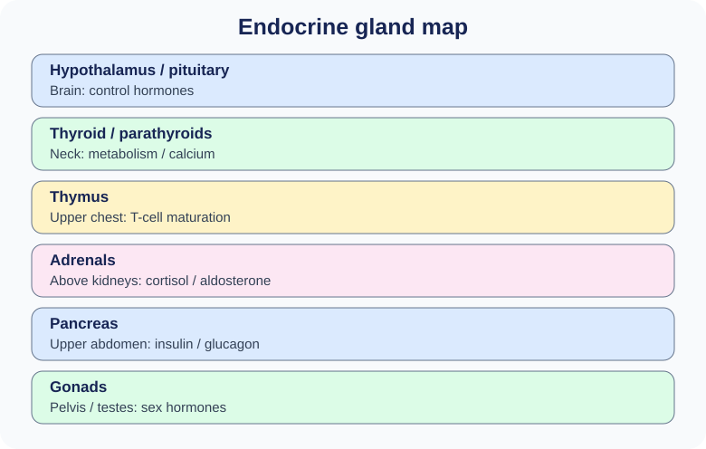
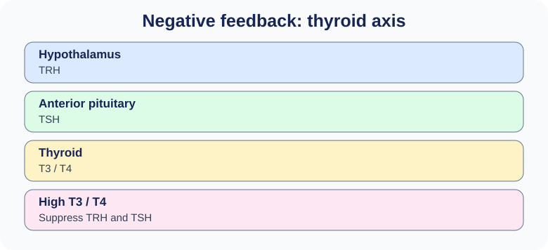
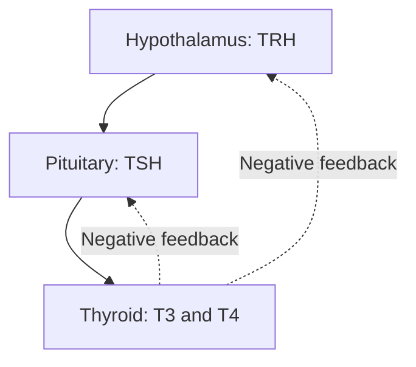
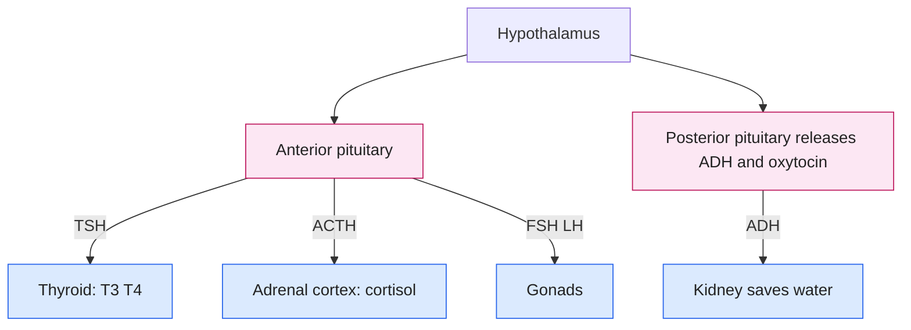

# Part 1 — Endocrine anatomy, hormones, feedback and assessment

[🏠 Chapter](../README.md) · [📚 All concept files](Endocrine-System-Master-Guide.md) · [📝 MCQs](../MCQs/Endocrine-Topic-Wise.md) · [🎯 Mocks](../MCQs/Endocrine-Mixed-Mocks.md) · [🏥 Previous Year Questions](../Previous-Year-Questions/Endocrine-Previous-Year-Questions-Index.md) · [⚡ Revision](../Revision/Endocrine-Quick-Revision.md) · [Sources](../References.md)

**Study-ready | NORCET / PGIMER / Staff Nurse / CHO.** Not marked studied. 🔴 Very High · 🟠 High · 🟡 Important · 🟢 Foundation = preparation priority, not verified exam frequency.

**Topics:** 1. Glands and anatomy · 2. Hormones and receptors · 3. Feedback · 4. Assessment and tests

## 🧭 Start here — 60-second priority map

| Study priority | Is part mein pehle kya padhein? |
|---|---|
| 🔴 **VERY HIGH — first revise** | Feedback axes, primary vs central failure |
| 🟠 **HIGH — next revise** | Hormone receptors, investigations and assessment |
| 🟢 **FOUNDATION — understand first** | Gland locations and basic hormone functions |

> [!TIP]
> **🧠 Memory trick:** Hormone = message, receptor = lock. Negative feedback = AC thermostat.

> [!IMPORTANT]
> **🏥 Nursing / exam alert:** TSH ko FT4 ke saath interpret karo; sirf ek result se diagnosis nahi.

**Reading route:** 🧩 Basic concept → 🔬 mechanism → 📋 signs & tests → 💊 management → 🏥 nursing priorities → 📝 MCQ practice.

*Priority is a study recommendation, not a verified PYQ frequency ranking. Read all detailed sections below.*

---

### 🗺️ Step-by-step study sequence

1. **Gland location** → hormone → target organ → function
2. **Hormone types and receptors** → feedback mechanism
3. **Primary vs central disorder** → lab patterns
4. **Assessment** → investigations → nursing care

> [!NOTE]
> **⚡ Quick recall — exam-focused clues**
>
> - Hormone = message; receptor = lock.
> - Endocrine = ductless; exocrine = duct present.
> - Primary disorder = gland problem; central disorder = control signal problem.

### Pehle bilkul basic se samjho

- Gland body ka ek chhota hissa hai jo koi zaroori cheez banata hai. Hormone ek chemical message hai. Ye blood ke saath doosri jagah jaakar body ko batata hai ki kya karna hai.
- Duct ka matlab chhoti nali. Endocrine gland hormone seedha blood mein chhodti hai. Exocrine gland apni banayi hui cheez nali se bhejti hai. Jaise salivary gland muh mein laar bhejti hai.
- Receptor ko tala samjho aur hormone ko chaabi. Sahi hormone sahi receptor se judta hai. Tab cell ko message milta hai.
- Feedback ko AC ka temperature control samjho. Room thanda ho gaya toh AC kam chalta hai. Body mein thyroid hormone zyada hua toh brain TSH ka signal kam kar deta hai. Ye negative feedback hai.
- Primary ka matlab main gland khud kharab hai. Central ka matlab brain se aane wala control signal kharab hai. Dono mein final hormone kam ho sakta hai, par test ka pattern alag hoga.
- Assessment ka matlab patient ki baat sunna, body ko dekhna aur zaroori test karna. Sirf ek symptom dekhkar disease ka naam decide nahi karna.

## Contents
- [1. 🟢 Endocrine system kya hai?](#1--endocrine-system-kya-hai)
- [2. 🟠 Feedback mechanism](#2--feedback-mechanism)
- [🟠 Hormone action and diagnostic reasoning](#-hormone-action-and-diagnostic-reasoning)
- [🟠 HIGH | Anatomy ko visualize karo](#-high--anatomy-ko-visualize-karo)
- [🟠 HIGH | Hormone classification](#-high--hormone-classification)
- [🔴 VERY HIGH | Feedback axes — exam reasoning](#-very-high--feedback-axes--exam-reasoning)
- [🟠 HIGH | Assessment and investigation](#-high--assessment-and-investigation)

---

## 1. 🟢 Endocrine system kya hai?

- Hamari body mein kuch glands hormones banati hain.
  - Hormones blood ke through doosre organs tak pahunchte hain aur unka kaam control karte hain.

- Endocrine glands ki ducts nahi hoti. Exocrine glands apna secretion duct ke through bhejti hain, jaise salivary glands.
- **Pancreas dono tarah ka gland hai:** insulin blood mein aur digestive enzymes duct mein jaate hain.

| Gland | Hormone | Kaam |
|---|---|---|
| Anterior pituitary | GH, TSH, ACTH, FSH, LH, prolactin | Growth, thyroid, adrenal aur reproduction control |
| Posterior pituitary | ADH, oxytocin release | Paani bachana, uterine contraction aur milk ejection |
| Thyroid | T3, T4, calcitonin | Metabolism aur calcium regulation |
| Parathyroid | PTH | Blood calcium badhana |
| Adrenal cortex | Aldosterone, cortisol, androgens | Salt-water balance, stress response |
| Adrenal medulla | Adrenaline, noradrenaline | Fight-or-flight response |
| Pancreas | Insulin, glucagon, somatostatin | Blood glucose control |
| Pineal | Melatonin | Sleep-wake timing |
| Ovaries/testes | Estrogen, progesterone/testosterone | Reproduction |
| Thymus | Thymic factors | T-cell development |

---

## 2. 🟠 Feedback mechanism

- Jab thyroid hormones kam hote hain, hypothalamus TRH aur pituitary TSH badha sakte hain.
  - TSH thyroid ko hormone banane ka signal deta hai.

- Jab T3/T4 ka level badhta hai, TRH aur TSH kam ho jaate hain. Ise negative feedback kehte hain.

- **Primary hypothyroidism:** thyroid mein problem, TSH usually high aur free T4 low.
- **Central hypothyroidism:** pituitary/hypothalamus mein problem, free T4 low aur TSH low ya inappropriate normal.

### Diagram — hormone map

### 🟠 Hormone physiology and assessment
- Hypothalamus ke TRH, CRH, GnRH, GHRH pituitary ko stimulate karte hain.
  - dopamine prolactin ko inhibit karta hai, somatostatin GH aur TSH ko inhibit kar sakta hai.
  - Pulsatile GnRH FSH/LH release support karta hai.

- Peptide hormones (insulin, ADH) generally cell surface receptors par act karte hain.
  - steroid (cortisol) aur thyroid hormones intracellular/nuclear receptors se gene expression change karte hain.
  - Thyroid hormones amino-acid derived hote hue bhi nuclear action karte hain.

- **Positive feedback example:** labor mein cervical stretch → oxytocin → stronger uterine contraction → more stretch, until birth.
- **Endocrine history:** thirst, urine frequency/nocturia, appetite, weight change, heat/cold tolerance, sleep, menstrual/sexual symptoms, growth, steroid/thyroid/diabetes drug history.
  - Examine pulse/BP including orthostatic BP if indicated, BMI, skin/hair, tremor, thyroid size, eye findings, hydration and feet.
  - Document trends rather than a single observation.

### 🟠 Universal endocrine nursing care
- **Assess baseline and trends:** BP, pulse, RR, temperature, SpO2, consciousness, pain, hydration, weight, intake/output, glucose and relevant laboratory tests.
  - Review medicine history, allergies, pregnancy possibility where relevant and saath mein maujood doosri diseases.

- Observe changes in skin, hair, appetite, bowel habits, vision, mobility and sleep.
  - Record orthostatic symptoms.
  - use fall precautions if indicated.

- Explain tests, fasting/medicine instructions as ordered, obtain baseline samples correctly, label and report critical results promptly.
  - do not independently withhold essential hormones.

- Use medication rights, patient identification and infection prevention.
  - Communicate deterioration with SBAR (situation, background, assessment, recommendation).
  - Document intervention, response and handover.

- **Discharge:** written action plan, warning signs, medicine schedule, follow-up and teach-back (patient apne shabdon mein samjhaye).

---

## 🟠 Hormone action and diagnostic reasoning
- Hormone ko message samjho, receptor ko lock.
  - Peptide hormone (insulin) cell surface receptor se signal bhejta hai.
  - steroid (cortisol) cell ke andar receptor se gene expression change karta hai.
  - Thyroid hormones nuclear receptors se act karte hain.

- Hypothalamus anterior pituitary ko portal blood se control karta hai.
  - posterior pituitary axons se ADH/oxytocin release karta hai.
  - Primary gland failure mein final hormone low aur upstream stimulating hormone usually high.
  - central failure mein signal inadequate.

- Cortisol normally morning higher.
  - random cortisol se Cushing diagnose nahi.
  - Steroid medicines, biotin, pregnancy aur acute illness test interpretation change kar sakte hain.
  - Sample time aur medicine history document karo.

- **Exam trick:** Normal TSH central hypothyroidism exclude nahi karta. low FT4 ignore mat karo.

---

## 🟠 HIGH | Anatomy ko visualize karo
- Hypothalamus brain mein pituitary ke upar hai.
  - Pituitary sella turcica mein, optic chiasm ke paas.
  - Isliye tumor side vision ko affect kar sakta hai.

- Thyroid neck mein larynx ke neeche trachea ke front mein.
  - two lobes connected by isthmus.
  - Parathyroids usually four tiny glands posterior surface par.
  - Neck surgery mein airway, voice aur calcium teen alag risks.

- Adrenals kidneys ke upar, pancreas stomach ke peeche.
  - islets blood mein hormones release karte hain, acini pancreatic duct mein enzymes.

- **Analogy:** Endocrine gland = message sender, blood = delivery route, target receptor = correct address.
  - Har cell har hormone ka response nahi deta.

- Nervous system usually rapid electrical signal.
  - endocrine chemical messages often slower and longer lasting.
  - Adrenaline jaise hormones seconds mein act bhi karte hain.

---

## 🟠 HIGH | Hormone classification
| Type | Example | Receptor / action |
|---|---|---|
| Peptide/protein | Insulin, GH, ADH, PTH | Cell surface. second messengers or signaling pathways |
| Steroid | Cortisol, aldosterone, estrogen | Intracellular. gene transcription |
| Amino-acid derived | T3/T4, adrenaline | Thyroid hormone nuclear. catecholamines membrane |
- Insulin receptor tyrosine kinase.
  - many peptide hormones G-protein pathways use karte hain.
  - GH receptor JAK-STAT.
  - exam mein basic location pehle.

- T4 largely protein-bound.
  - free hormone biological signal ka useful measure.
  - Binding proteins pregnancy/illness se change ho sakte hain.
  - Total and free hormone same nahi.

- Hormone ka half-life batata hai kitni jaldi blood concentration half hoti hai.
  - T4 long half-life, catecholamines short.
  - medicine baar-baar check karna timing alag hoti hai.

---

## 🔴 VERY HIGH | Feedback axes — exam reasoning
| Axis | Hypothalamus | Anterior pituitary | Target |
|---|---|---|---|
| HPT | TRH | TSH | Thyroid T3/T4 |
| HPA | CRH | ACTH | Adrenal cortisol |
| HPG | GnRH | FSH/LH | Gonadal hormones |
| Growth | GHRH (stimulates), somatostatin (inhibits) | GH | Liver IGF-1, other tissues |
| Lactation | Dopamine inhibits | Prolactin | Milk synthesis |
- **Example:** Thyroid gland fails → FT4 falls → pituitary TSH rises.
  - Pituitary fails → TSH response inadequate → FT4 low.
  - Yahi primary vs central logic adrenal/gonadal axes mein bhi useful.

- **Positive feedback labor example:** cervical stretch → oxytocin → contraction → more stretch. Birth ke baad loop ends.
- **Pulsatile secretion:** ek random GH result acromegaly diagnose nahi karta.
  - Cortisol timing, recent steroid doses, illness aur stress test affect karte hain.

---

## 🟠 HIGH | Assessment and investigation
- **History:** weight trend, appetite, thirst, urine zyada aana (polyuria), heat/cold intolerance, bowel changes, periods, sexual function, growth, sleep, medication and family history.

- **Physical:** HR, BP (standing BP when safe), RR, temperature, hydration, BMI, skin pigmentation, tremor, eyes, thyroid swelling, visual fields, foot sensation and pulses as relevant.

- **Lab:** Na 135–145 mmol/L, K 3.5–5.0, total Ca ~8.5–10.5 mg/dL.
  - lab and age dependent.
  - Glucose, HbA1c, hormone assays, electrolytes and kidney function symptom-based.

- **Dynamic tests:** stimulation test = signal do aur response dekho (ACTH stimulation).
  - suppression test = brake lagao aur hormone kam hua ya nahi (dexamethasone).
  - Imaging anatomy dikhata hai, hormone function independently establish karo.

- **Nursing steps:** check identity and order → explain test → confirm fasting/timing/drug instructions → label collection time → monitor symptoms → document and escalate critical results.

- **Case:** Patient cold, constipated, fatigued.
  - Sirf fatigue se hypothyroid confirm nahi.
  - TSH and FT4 patterns, anemia and other causes assess.
  - Severe drowsiness with saans kam chalna routine clinic visit nahi, emergency.

- **Exam traps:** posterior pituitary hormones hypothalamus mein made.
  - PTH vs calcitonin.
  - cortisol circadian rhythm.
  - primary vs central failure.
  - endocrine vs exocrine.

---

## 🎬 Study resources

[NORCET endocrine introduction](https://www.youtube.com/watch?v=BalA29k0tuM) · [Mixed endocrine MCQ rationales](https://www.youtube.com/watch?v=xcwJd5RbBb4)

[All topic-wise teaching and MCQ videos](../Endocrine-YouTube-Teaching-and-MCQ-Practice.md). Video ka title aur description check kiya hai. Poora video nahi dekha gaya.

[Chapter video table](Endocrine-System-Master-Guide.md) · [Topic-wise English MCQs](../MCQs/Endocrine-Topic-Wise.md). Video ka title aur description check kiya hai. Poora video nahi dekha gaya.

---

## Clinical references
[OpenStax endocrine A&P](https://openstax.org/books/medical-surgical-nursing/pages/21-1-review-of-endocrine-anatomy-and-physiology)

[All references](../References.md). Ye adult nursing exam ki padhai ke liye hai. Patient ki treatment doctor ke order aur hospital protocol se hoti hai.

[🏠 Chapter](../README.md) · [📚 All concept files](Endocrine-System-Master-Guide.md) · [📝 MCQs](../MCQs/Endocrine-Topic-Wise.md) · [🎯 Mocks](../MCQs/Endocrine-Mixed-Mocks.md) · [🏥 Previous Year Questions](../Previous-Year-Questions/Endocrine-Previous-Year-Questions-Index.md) · [⚡ Revision](../Revision/Endocrine-Quick-Revision.md) · [Sources](../References.md)
