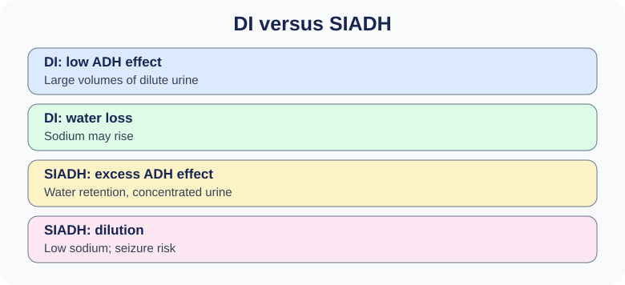
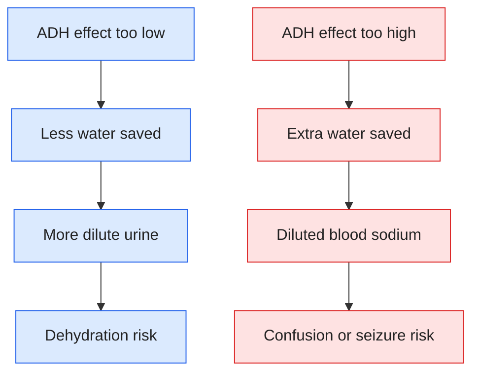

# Part 2 — Pituitary disorders, diabetes insipidus and SIADH

[🏠 Chapter](../README.md) · [📚 All concept files](Endocrine-System-Master-Guide.md) · [📝 MCQs](../MCQs/Endocrine-Topic-Wise.md) · [🎯 Mocks](../MCQs/Endocrine-Mixed-Mocks.md) · [🏥 Previous Year Questions](../Previous-Year-Questions/README.md) · [⚡ Revision](../Revision/Endocrine-Quick-Revision.md) · [Sources](../References.md)

**Study-ready | NORCET / PGIMER / Staff Nurse / CHO.** Not marked studied. 🔴 Very High · 🟠 High · 🟡 Important · 🟢 Foundation = preparation priority, not verified exam frequency.

**Topics:** 1. Anterior pituitary disorders · 2. Pituitary tumors and surgery · 3. DI · 4. SIADH

## Contents
- [3. 🟠 Pituitary gland](#3--pituitary-gland)
- [4. 🔴 ADH, Diabetes insipidus aur SIADH](#4--adh-diabetes-insipidus-aur-siadh)
- [🔴 Water balance — numerical and clinical reasoning](#-water-balance--numerical-and-clinical-reasoning)
- [🔴 VERY HIGH | GH excess and deficiency](#-very-high--gh-excess-and-deficiency)
- [🟠 HIGH | Prolactin, hypopituitarism and tumors](#-high--prolactin-hypopituitarism-and-tumors)
- [🔴 VERY HIGH | Water balance — mechanism not just definition](#-very-high--water-balance--mechanism-not-just-definition)

## 3. 🟠 Pituitary gland

🔴 **MOST IMPORTANT:** ADH kahan banta hai aur kahan se release hota hai; anterior vs posterior pituitary; Sheehan syndrome; post-surgery urine output. 🟠 HP 2026 source reports posterior pituitary question ([source register](../Previous-Year-Questions/README.md)).

- Brain ke base par sella turcica mein hoti hai. Hypothalamus isko control karta hai.
- Anterior pituitary apne hormones banati hai. ADH aur oxytocin hypothalamus mein bante hain aur posterior pituitary se release hote hain.
- GH growth mein help karta hai. Bachpan mein excess GH se gigantism, adults mein acromegaly. Acromegaly mein haath, pair aur jaw bade ho sakte hain. IGF-1 screening aur specialist testing useful hain.
- GH ki childhood deficiency se short stature ho sakta hai.
- Prolactinoma: prolactin badhta hai; galactorrhea, irregular periods, infertility ho sakti hai. Cabergoline commonly used hoti hai.
- Pituitary tumor optic chiasm par pressure daale toh bitemporal hemianopia ho sakti hai.
- Hypopituitarism mein multiple hormones kam ho sakte hain. Cortisol deficiency exclude/treat karna thyroid replacement se pehle important hai.
- Sheehan syndrome: severe postpartum bleeding ke baad pituitary damage; milk na banna aur periods na aana clues hain.
- Transsphenoidal surgery ke baad urine output, sodium, neurological status aur clear nasal drainage monitor karo; CSF leak suspect ho toh report karo. Nose blowing/straining se bachne ki advice surgeon ke protocol ke hisaab se.

## 4. 🔴 ADH, Diabetes insipidus aur SIADH

🔴 **HIGH PRIORITY — EXAM LEAD:** DI mein dilute urine, SIADH mein low sodium. NORCET 2023 DI presentation source, HP 2026 related pituitary hormone source ([source register](../Previous-Year-Questions/README.md)).

- ADH kidney ko paani bachane mein help karta hai.
- ADH kam ho ya kidney respond na kare toh bahut dilute urine aata hai. Pyaas badhti hai. Ise diabetes insipidus (DI) kehte hain; glucose wali diabetes se alag hai.
- Central DI mein ADH ki kami; nephrogenic DI mein kidney ka response kam. Central DI mein desmopressin useful ho sakta hai.
- SIADH mein body extra paani rok leti hai; blood sodium dilute hokar kam ho jaata hai. Headache, confusion, seizures ho sakte hain.

| Finding | DI | SIADH |
|---|---|---|
| Urine | Zyada, dilute | Relatively concentrated |
| Serum sodium | High ho sakta hai | Low |
| Serum osmolality | High ho sakti hai | Low |
| Nursing | I/O, weight, hydration, sodium | I/O, weight, sodium, neurological signs |

- SIADH mein fluid restriction selected stable cases mein; severe symptomatic hyponatremia emergency hai, protocol-based hypertonic saline aur close sodium monitoring chahiye. Sodium ko bahut jaldi correct karna harmful hai.
- Water deprivation test supervised setting mein hota hai, ghar par nahi.

### Diagram — DI versus SIADH

### 🟠 Investigation and treatment — one-look table

| Condition | Key test and interpretation | Treatment/nursing link |
|---|---|---|
| Acromegaly | Age-adjusted IGF-1; specialist GH suppression after oral glucose if needed; pituitary MRI | Surgery often first-line for resectable tumor; somatostatin analogues/pegvisomant as indicated; assess airway, sleep apnea, glucose, vision |
| Prolactinoma | Prolactin; exclude pregnancy, medicines, hypothyroidism; MRI as indicated | Dopamine agonist; monitor orthostatic symptoms and vision |
| DI | Serum/urine osmolality and sodium, supervised water deprivation/desmopressin or specialist copeptin testing | Central DI generally responds to desmopressin; excess dosing/water can cause hyponatremia; lithium-associated nephrogenic DI requires cause-directed care |
| SIADH | Hypotonic hyponatremia with inappropriately concentrated urine; exclude adrenal/thyroid causes and other mimics | Monitor neurological state, fluid balance and sodium correction |

### 🔴 Pituitary disorders and postoperative care
- **Acromegaly/gigantism:** monitor BP, glucose, headache, visual field symptoms, sleep apnea and airway risk; protect painful joints, assist mobility, monitor treatment effects and body-image concerns. New severe headache or vision loss requires urgent escalation.
- **Hypopituitarism/Sheehan syndrome:** assess fatigue, hypotension, hypoglycemia, menstrual history and lactation; monitor prescribed hormone replacement. Suspected cortisol deficiency must be addressed before thyroid hormone initiation by the medical team. Teach steroid emergency plan when prescribed.
- **Prolactinoma:** monitor headache, visual symptoms, menstrual/lactation changes; check dizziness and orthostatic BP with dopamine agonists; reinforce follow-up.
- **Transsphenoidal surgery:** baseline/post-op neuro and visual checks, strict I/O and sodium trend; report new polyuria, thirst, confusion, clear nasal drainage or sudden visual changes. Keep head elevated as ordered, avoid nose blowing/straining and nasal instrumentation unless authorized by surgical team; provide oral care, stool-softener teaching if ordered. Delayed hyponatremia may develop after discharge; reinforce symptoms and follow-up sodium testing.

### 🔴 Diabetes insipidus (DI)
- **Assessment:** measure urine volume, concentration/specific gravity, fluid intake, daily weight, pulse, BP, serum sodium and osmolality. Look for dry mucosa, tachycardia, orthostatic hypotension and altered consciousness.
- **Action:** provide access to water if alert and permitted; support ordered fluid replacement, monitor response and administer prescribed desmopressin in central DI. Inability to drink or missed desmopressin in hospital can lead to severe dehydration; escalate early.
- **Safety:** excessive desmopressin/water can cause hyponatremia. Monitor urine and sodium after treatment; supervised diagnostic water deprivation only.
- **Goal:** stable circulation, hydration, sodium and urine trends. **Exam priority:** prevent dehydration and hypernatremia.

### 🔴 SIADH
- Measure strict I/O and daily weight on same scale, track sodium and neurologic status. Check for headache, nausea, confusion, decreased consciousness or seizure; assess cause/medicines.
- Implement ordered fluid restriction including oral/IV sources; explain rationale, provide mouth care. Severe symptomatic hyponatremia is an emergency: protect airway, seizure safety, rapid escalation, ordered hypertonic saline with close sodium checks. Avoid overly rapid correction.
- Monitor improvement in consciousness and sodium; report rapid changes. **Exam priority:** neurologic safety and controlled sodium correction.

## 🔴 Water balance — numerical and clinical reasoning
- Total serum osmolality approximate = 2 × Na + glucose/18 + BUN/2.8 (glucose and BUN mg/dL). Effective osmolality excludes BUN. Example Na 140, glucose 90, BUN 14: total ~290 mOsm/kg, effective ~285.
- DI mein urine dilute hota hai despite water loss. Patient freely drink kare toh sodium normal bhi ho sakta hai. SIADH usually hypotonic euvolemic hyponatremia with inappropriately concentrated urine; adrenal/thyroid failure and other causes exclude karte hain. Water deprivation supervised specialist test hai.
- Severe symptomatic hyponatremia mein airway/seizure safety first, prescribed hypertonic saline and close sodium monitoring. Overly rapid correction se osmotic demyelination ho sakti hai; correction limits clinical context par depend karti hain.

## 🔴 VERY HIGH | GH excess and deficiency
- GH protein synthesis, growth and fat metabolism mein role karta hai; liver IGF-1 GH ke growth effects mediate karta hai.
- Gigantism: growth plate closure se pehle excess GH → excessive linear height. Acromegaly: closure ke baad bones length mein nahi, thickness aur soft tissue increase; ring/shoe size badhna, jaw protrusion, coarse facial features, sweating, sleep apnea, hypertension, diabetes risk.
- GH deficiency children: slow growth velocity, proportionate short stature; growth chart important. Adults mein fatigue/body composition changes nonspecific. Specialist stimulation testing and treatment.
- **Investigations:** age-adjusted IGF-1, sometimes oral glucose suppression GH, pituitary MRI. Acromegaly mein glucose ke baad GH appropriate suppress nahi hota. Treatment resectable adenoma surgery, somatostatin analogues, pegvisomant or selected radiotherapy. Monitor glucose, airway, cardiovascular and vision.
## 🟠 HIGH | Prolactin, hypopituitarism and tumors
- Prolactin milk banata, oxytocin milk let-down. Dopamine normally prolactin inhibit karta hai. Dopamine-blocking drugs, pregnancy or hypothyroidism prolactin increase kar sakte hain; every elevation = tumor nahi.
- Prolactinoma: galactorrhea, amenorrhea, infertility, low libido; cabergoline prescribed, monitor dizziness/orthostatic BP. Visual field assessment if mass effect.
- Hypopituitarism multiple hormone deficiency; replacement sequence important: suspected adrenal deficiency treat/exclude before thyroid hormone. Otherwise metabolism badhne se adrenal crisis ho sakta hai.
- Sheehan syndrome postpartum major hemorrhage → ischemic pituitary damage → failed lactation, amenorrhea, fatigue; may present late.
- Pituitary apoplexy sudden severe headache, visual impairment, eye movement problem or shock = urgent evaluation. Acute cortisol deficiency possible.
- Transsphenoidal surgery nose/sphenoid route se. Pre-op baseline vision, sodium, hormones. Post-op neuro observations, strict I/O, daily weight, urine concentration and serum sodium; clear watery nasal fluid/metallic salty taste report possible CSF leak. No independent nasal instrumentation/nose blowing; follow surgeon restrictions. Early DI and delayed SIADH can both occur.
## 🔴 VERY HIGH | Water balance — mechanism not just definition
- ADH collecting duct V2 receptor activate karta hai → aquaporin-2 water channels → water returns to blood → urine concentrates. DI mein signal absent (central) or kidney resistance (nephrogenic, e.g. lithium). Primary polydipsia also dilute urine, so specialist test differentiates.
- **Case:** 5 L dilute urine/day after pituitary surgery, increasing thirst, sodium 150: suspect DI; assess perfusion, I/O, notify team and give prescribed replacement/desmopressin. Fluid restriction is wrong for uncontrolled DI.
- Desmopressin central DI mein works; excess effect and drinking too much may cause hyponatremia. Nephrogenic DI cause-directed treatment, e.g. drug review, dietary guidance and selected thiazide/amiloride per specialist.
- SIADH: body retains free water; sodium concentration falls, brain cells swell especially rapid severe fall. Causes include CNS/lung disease, small-cell lung cancer, drugs and postoperative state. Urine remains inappropriately concentrated despite low serum osmolality.
- **Case:** Na 118, confusion/seizure → emergency airway/seizure safety, sodium monitoring and ordered hypertonic saline. Stable SIADH may receive fluid restriction. Isotonic saline is not universal treatment for SIADH; cause and severity matter.
- **Exam comparison:** DI = water OUT, urine dilute; SIADH = water IN, urine concentrated. Serum sodium normal in compensated DI possible; SIADH often clinically euvolemic, not necessarily visible edema.
- **Nursing evaluation:** stable mental status, perfusion, safe sodium trend, correct fluid intake and medication teach-back.

## 🎬 Study resources
[Chapter video table](Endocrine-System-Master-Guide.md) · [Topic-wise English MCQs](../MCQs/Endocrine-Topic-Wise.md). Video title/description only checked previously; full playback not reviewed.

## Clinical references
[OpenStax pituitary nursing](https://openstax.org/books/medical-surgical-nursing/pages/21-4-pituitary-disorders) · [NIDDK acromegaly](https://www.niddk.nih.gov/health-information/endocrine-diseases/acromegaly)

[All references](../References.md). Adult exam education; bedside treatment follows clinician orders/current local protocol.

[🏠 Chapter](../README.md) · [📚 All concept files](Endocrine-System-Master-Guide.md) · [📝 MCQs](../MCQs/Endocrine-Topic-Wise.md) · [🎯 Mocks](../MCQs/Endocrine-Mixed-Mocks.md) · [🏥 Previous Year Questions](../Previous-Year-Questions/README.md) · [⚡ Revision](../Revision/Endocrine-Quick-Revision.md) · [Sources](../References.md)
