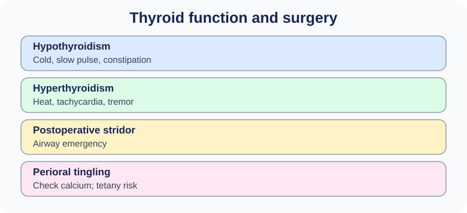

# Part 3 — Thyroid physiology, disorders, emergencies and surgery

[🏠 Chapter](../README.md) · [📚 All concept files](Endocrine-System-Master-Guide.md) · [📝 MCQs](../MCQs/Endocrine-Topic-Wise.md) · [🎯 Mocks](../MCQs/Endocrine-Mixed-Mocks.md) · [🏥 Previous Year Questions](../Previous-Year-Questions/Endocrine-Previous-Year-Questions-Index.md) · [⚡ Revision](../Revision/Endocrine-Quick-Revision.md) · [Sources](../References.md)

**Study-ready | NORCET / PGIMER / Staff Nurse / CHO.** Not marked studied. 🔴 Very High · 🟠 High · 🟡 Important · 🟢 Foundation = preparation priority, not verified exam frequency.

**Topics:** 1. Thyroid physiology and tests · 2. Hypo/hyperthyroidism and goiter · 3. Thyroiditis/nodules/tumors · 4. Emergencies and surgery

## 🧭 Start here — 60-second priority map

| Study priority | Is part mein pehle kya padhein? |
|---|---|
| 🔴 **VERY HIGH — first revise** | Hypo/hyperthyroidism, thyroid storm, myxedema coma, thyroidectomy |
| 🟠 **HIGH — next revise** | Hormone synthesis, tests, thyroiditis and tumors |
| 🟢 **FOUNDATION — understand first** | T3, T4, calcitonin and gland location |

> [!TIP]
> **🧠 Memory trick:** Hypo = slow and cold; hyper = fast and hot.

> [!IMPORTANT]
> **🏥 Nursing / exam alert:** Thyroidectomy ke baad stridor ya expanding neck swelling → emergency airway escalation.

**Reading route:** 🧩 Basic concept → 🔬 mechanism → 📋 signs & tests → 💊 management → 🏥 nursing priorities → 📝 MCQ practice.

*Priority is a study recommendation, not a verified PYQ frequency ranking. Read all detailed sections below.*

---

### 🗺️ Step-by-step study sequence

1. **Thyroid location** → T3/T4 → feedback and investigations
2. **Hypothyroidism vs hyperthyroidism** → causes → symptoms → medicines
3. **Goiter, thyroiditis and tumors** → distinguishing clues
4. **Thyroid storm vs myxedema** → thyroidectomy → nursing priorities

> [!NOTE]
> **⚡ Quick recall — exam-focused clues**
>
> - Primary hypothyroidism: TSH ↑, FT4 ↓; slow and cold.
> - Primary hyperthyroidism: TSH ↓, FT4 and/or T3 ↑; fast and hot.
> - Post-thyroidectomy: stridor or expanding neck swelling → emergency airway escalation.

### Pehle bilkul basic se samjho

- Thyroid gale ke saamne butterfly jaisi gland hai. T3 aur T4 hormones body ke kaam karne ki speed control karte hain. Metabolism ka matlab body khane se energy banakar kaise use karti hai.
- Hypo ka matlab kam. Thyroid kam kaam kare toh pulse slow, thand, constipation aur thakan ho sakti hai. Hyper ka matlab zyada. Thyroid zyada kaam kare toh pulse tez, garmi, paseena aur weight loss ho sakta hai.
- Goiter sirf thyroid ka size badhna hai. Isse ye decide nahi hota ki hormone kam hai ya zyada. Iske liye blood tests chahiye.
- Autoimmune ka matlab body ki defence system galti se apni hi gland ko nuksan pahunchaye ya usko zyada kaam karne ka signal de. Hashimoto mein gland damage hoti hai. Graves mein gland zyada hormone banati hai.
- Thyroid storm mein body bahut tezi se kaam kar rahi hoti hai aur patient ki jaan ko khatra ho sakta hai. Myxedema emergency mein body ka kaam bahut slow ho jaata hai. Dono mein nurse ko saans aur blood circulation pehle dekhna hai.
- Thyroidectomy ka matlab thyroid ki surgery. Surgery ke baad gale mein swelling saans ka rasta daba sakti hai. Calcium bhi gir sakta hai kyunki paas mein parathyroid glands hoti hain.

## Contents
- [5. 🟠 Thyroid gland](#5--thyroid-gland)
- [🔴 Thyroid and calcium — clinical why](#-thyroid-and-calcium--clinical-why)
- [🟠 HIGH | Thyroid hormone synthesis and investigations](#-high--thyroid-hormone-synthesis-and-investigations)
- [🔴 VERY HIGH | Hypothyroidism vs hyperthyroidism — why symptoms?](#-very-high--hypothyroidism-vs-hyperthyroidism--why-symptoms)
- [🟠 HIGH | Thyroid tumors](#-high--thyroid-tumors)
- [🔴 VERY HIGH | Emergency nursing — comparison and sequence](#-very-high--emergency-nursing--comparison-and-sequence)

---

## 5. 🟠 Thyroid gland

🔴 **MOST IMPORTANT:** Thyroidectomy ke baad airway aur calcium. thyroid storm vs myxedema coma. TSH/T4 pattern. 🔁 Postoperative hypocalcemia reported in 2022 and 2024 NORCET collections.

- Neck mein trachea ke saamne butterfly-shaped gland. Follicular cells T3/T4 banati hain. C cells calcitonin.
- T3/T4 body ki energy use aur heat production ko regulate karte hain. Iodine hormone synthesis ke liye chahiye.
- Goiter ka matlab gland ka size badhna hai. thyroid function normal, low ya high ho sakta hai.

| Sign | Hypothyroidism | Hyperthyroidism |
|---|---|---|
| Weight | Badhta hai | Kam ho sakta hai |
| Temperature | Thand lagna | Garmi lagna |
| Pulse | Slow | Fast |
| Bowel | Constipation | Frequent stools |
| Skin | Dry | Warm, moist |
| Common cause | Hashimoto thyroiditis | Graves disease |

- Graves autoimmune disease hai. eye signs ho sakte hain. Hyperthyroidism mein tremor, palpitations aur anxiety bhi hoti hai.
- **Tests:** TSH, free T4, kabhi T3, antibodies.
  - Ultrasound nodule ki structure dikhata hai.
  - suspicious nodules mein FNAC specialist decide karta hai.

- **Hypothyroidism:** levothyroxine doctor ke order ki dose mein, consistently empty stomach.
  - iron/calcium se usually 4 hours ka gap.

- **Hyperthyroidism:** antithyroid medicines, beta blockers for symptoms, selected patients mein radioiodine ya surgery.
  - Fever/sore throat on antithyroid drug ko urgently report karo (agranulocytosis risk).

- Radioiodine pregnancy mein dena ya karna mana hai hai.
  - breastfeeding aur radiation precautions specialist instructions ke according.

- **Congenital hypothyroidism:** early newborn screening aur treatment brain development ke liye important.

### 🔴 Thyroid emergencies aur surgery
- **Thyroid storm:** high fever, severe tachycardia, agitation/confusion, possible heart failure.
  - ABC, emergency escalation, ECG, cooling, fluids patient ki condition ke hisaab se aur doctor ke order ki treatment.
  - Iodine antithyroid medicine ke baad protocol ke according.

- **Myxedema coma:** severe hypothyroidism, hypothermia, bradycardia, saans kam chalna aur altered consciousness.
  - ABC, ventilatory support as needed, urgent escalation.
  - IV thyroid hormone aur glucocorticoid medical team ke protocol se.

- Thyroidectomy ke baad neck swelling, bleeding, stridor ya respiratory distress ko emergency samjho.
  - Airway first.
  - Semi-Fowler position if appropriate, neck supported, voice, wound aur calcium monitor karo.

- Lips ke aas-paas tingling ya muscle spasm calcium kam hone ka sign ho sakta hai.

### 🟠 Investigation and treatment — one-look table

| Condition | Key test and interpretation | Treatment/nursing link |
|---|---|---|
| Primary hypothyroid | TSH ↑, free T4 ↓ | Levothyroxine. assess adherence, pulse, symptom trends |
| Primary hyperthyroid | TSH ↓, free T4 and/or T3 ↑. TRAb supports Graves | Monitor treatment adverse effects, eye symptoms, cardiovascular status |

### 🔴 Hypothyroidism and myxedema coma
- **Routine care:** monitor HR/BP, temperature, weight, fatigue, constipation and skin.
  - provide comfortable warmth, skin care, gradual activity and bowel support appropriate to condition.

- Give doctor ke order ki levothyroxine consistently, usually on empty stomach.
  - separate iron/calcium by about 4 hours.
  - explain long-term follow-up and symptoms of excess replacement (palpitations, tremor).

- **Myxedema coma:** altered mental status + hypothermia + slow breathing/bradycardia.
  - Activate emergency team, assess airway/ventilation, monitor ECG, glucose and electrolytes, maintain gentle/passive warmth, administer ordered IV thyroid hormone/glucocorticoid and supportive care.
  - Avoid unprescribed sedatives or aggressive external warming.

- **Goal:** adequate ventilation, stable circulation, improving mental status.

### 🔴 Hyperthyroidism, Graves disease and thyroid storm
- Monitor HR/rhythm, BP, temperature, weight, hydration, tremor, diarrhea and rest/sleep.
  - quiet environment, comfortable cooling, nutrition support and activity paced to symptoms.

- Administer doctor ke order ki antithyroid drugs and beta blockers.
  - report fever/sore throat promptly (agranulocytosis concern) and jaundice/dark urine (liver injury concern).
  - Teach medication adherence and labs.

- **Graves eye care:** lubricants as ordered, head elevation, protect eyes and report new diplopia or loss of vision/color vision.
- **Thyroid storm:** high fever, severe tachycardia, agitation/confusion.
  - ABC, urgent escalation, ECG, oxygen if indicated, cooling, fluid support as ordered.
  - give doctor ke order ki drugs in correct sequence (iodine after thionamide when applicable).
  - Avoid aspirin for fever in thyroid storm unless specifically directed for another indication.

- **Goal:** falling temperature/HR and improved mental status. prevent cardiac failure.

### 🔴 Thyroidectomy — preoperative, postoperative, discharge
- **Pre-op:** review thyroid status, vital signs, voice/swallow baseline, allergies, consent process and preparation orders.
  - Teach supported neck movement, breathing exercises and warning signs.

- **Post-op:** airway first.
  - assess breathing, stridor, swallowing, voice, neck swelling/tightness and bleeding.
  - Maintain semi-Fowler if appropriate with neck supported.
  - Ensure oxygen/suction and emergency airway equipment accessible per policy.
  - sudden neck swelling or respiratory distress → emergency surgical/airway escalation immediately.

- Monitor calcium/PTH as ordered and tingling around mouth/fingers, cramps, carpal spasm, tetany.
  - report promptly, administer ordered calcium and monitor ECG zaroorat aur doctor ke order ke hisaab se.
  - Voice change may indicate laryngeal nerve dysfunction.
  - persistent change needs evaluation.

- Wound/pain care, safe oral intake after swallowing assessment patient ki condition ke hisaab se, medication teaching (thyroid hormone or calcium if doctor ke order ki).
  - Return urgently for breathing difficulty, progressive swelling or severe spasms.

- **Exam trap:** stridor/neck swelling overrides routine pain assessment. symptomatic hypocalcemia also requires prompt action.

---

## 🔴 Thyroid and calcium — clinical why
- T3/T4 metabolism accelerate karte hain.
  - Low hormone means slow gut, cold intolerance, bradycardia.
  - high means heat, fast HR, frequent stool.
  - Graves antibodies TSH receptor stimulate karte hain.
  - Hashimoto autoimmune destruction.
  - Graves eye disease har thyrotoxicosis mein nahi hoti.

- Goiter size hormone level nahi batata.
  - euthyroid goiter possible.
  - Ultrasound structural nodule ko assess karta hai.
  - uptake testing selected cases, radioactive iodine pregnancy mein avoid.
  - FNA nodule risk/size ke hisaab se.

- Thyroid storm severe systemic decompensation hai.
  - myxedema coma mein coma mandatory nahi.
  - Postoperative expanding hematoma airway compress kar sakta hai.

- Low magnesium PTH release/action impair kar sakta hai.
  - Low albumin total calcium ko kam dikha sakta hai even with normal ionized Ca.
  - Symptoms and ionized Ca matter.

---

## 🟠 HIGH | Thyroid hormone synthesis and investigations
- Follicles colloid store karte hain.
  - thyroglobulin protein par iodine attach hota hai.
  - Thyroid peroxidase iodination and coupling mein help.
  - MIT + DIT = T3, DIT + DIT = T4.
  - Thyroid mostly T4 releases.
  - peripheral conversion produces active T3.

- Iodine deficiency → thyroid hormone synthesis limited → TSH stimulation → goiter possible.
  - Goiter toxic/nontoxic, diffuse/nodular.
  - Iodine excess bhi susceptible patient mein thyroid dysfunction trigger kar sakta hai.

| Pattern | TSH | FT4 |
|---|---|---|
| Primary hypothyroidism | High | Low |
| Subclinical hypothyroidism | High | Normal |
| Primary hyperthyroidism | Low | High (or T3 high) |
| Subclinical hyperthyroidism | Low | Normal FT4/T3 |
| Central hypothyroidism | Low/inappropriate normal | Low |
- Anti-TPO supports autoimmune thyroiditis.
  - TRAb supports Graves.
  - Ultrasound structure, uptake functional activity, FNAC suspicious nodule cytology.
  - High uptake often Graves/toxic nodules.
  - low uptake thyroiditis/exogenous hormone (context matters).

---

## 🔴 VERY HIGH | Hypothyroidism vs hyperthyroidism — why symptoms?
- **Hypothyroid:** cellular heat production low → cold intolerance.
  - gut motility slow → constipation.
  - cardiac rate slows → bradycardia.
  - dry skin, fatigue, menstrual changes.
  - Causes Hashimoto, thyroidectomy, radioiodine, iodine imbalance, some medicines, central pituitary disease.

- Levothyroxine replacement consistent timing, generally empty stomach 30–60 min before breakfast or bedtime sufficiently after food per instructions.
  - calcium/iron ~4 h separation.
  - TSH recheck commonly 6–8 weeks after dose change (primary disease).
  - Central disease FT4 guides therapy.

- **Hyperthyroid:** increased metabolism → heat intolerance, weight loss despite appetite.
  - sympathetic sensitivity → tachycardia, tremor.
  - Graves diffuse autoimmune stimulation.
  - eye signs due orbital inflammation, not just T3/T4 level.
  - Toxic multinodular goiter and toxic adenoma autonomous.

- Methimazole/carbimazole decrease synthesis.
  - PTU also reduces peripheral conversion.
  - PTU preferred in selected first-trimester pregnancy or storm protocols.
  - specialist selection due liver risk.
  - Fever/sore throat → urgent CBC/medical review before further dosing.
  - jaundice/dark urine urgent liver assessment.
  - Beta blockers reduce symptoms, not hormone synthesis itself.

- Subacute painful thyroiditis hormone leakage may give temporary thyrotoxicosis then hypo phase.
  - Thionamide usually not useful in destructive thyroiditis.
  - Postpartum thyroiditis may have transient phases.
  - Follow tests.

---

## 🟠 HIGH | Thyroid tumors
| Type | Key exam clue |
|---|---|
| Papillary | Common differentiated. lymphatic spread |
| Follicular | Hematogenous spread, bone/lung possible |
| Medullary | C cells. calcitonin marker. MEN2 |
| Anaplastic | Aggressive, rapidly enlarging mass, airway risk |
- Thyroid nodule normal hormone tests ke saath bhi cancer ho sakta hai.
  - New hoarseness, compressive symptoms, rapid growth evaluate.
  - Ultrasound-guided FNA selection.
  - follicular carcinoma invasion histology se differentiate hota hai.
  - Radioiodine selected differentiated cancers, not routine medullary.

- Congenital hypothyroidism early screening and treatment neurodevelopment protect karte hain.
  - Older exam term for untreated severe congenital disease is historical, use current respectful clinical terminology.

---

## 🔴 VERY HIGH | Emergency nursing — comparison and sequence
| Feature | Thyroid storm | Myxedema emergency |
|---|---|---|
| Temperature | High fever | Low temperature |
| HR | Very fast / arrhythmia | Slow |
| Mental state | Agitation/delirium | Drowsiness/coma possible |
| GI | Vomiting/diarrhea possible | Slow gut |
| Priorities | ABC, cardiac monitoring, cooling, prescribed treatment | ABC, ventilation, cautious warming, prescribed hormones/steroid |
- Storm may precipitate infection, surgery or medication interruption.
  - Iodine after thionamide in standard pathway.
  - avoid aspirin as antipyretic because free thyroid hormone may rise.
  - Treat precipitant.

- Myxedema may precipitate cold, infection, sedatives.
  - Respiratory failure and hypotension risk.
  - passive warming generally preferred, avoid aggressive heating.
  - Cortisol coverage before/with thyroid replacement per team.

- **Thyroidectomy:** pre-op baseline voice/calcium, optimize hormone state as ordered.
  - Post-op neck hematoma can compress trachea quickly.
  - sudden stridor/tight swelling → emergency surgical/airway response.
  - Tracheostomy/emergency airway equipment according to local policy, not a reason to delay escalation.

- Hoarseness may reflect recurrent laryngeal nerve dysfunction.
  - high-pitch voice changes can reflect superior laryngeal nerve.
  - Tingling around lips/fingers and carpal spasm suggest hypocalcemia.
  - see Part 4.

- **Case:** Stridor + neck swelling immediately after thyroidectomy.
  - Airway assessment and emergency response first, not routine calcium lab or dressing.

- **Reported exam evidence:** postoperative calcium concept reported in two NORCET-labelled collections (2022/2024). Official exact papers not verified. [Source register](../Previous-Year-Questions/Endocrine-Previous-Year-Questions-Index.md).

---

## 🎬 Study resources

[NORCET thyroid teaching](https://www.youtube.com/watch?v=BalA29k0tuM) · [Mixed endocrine MCQ rationales](https://www.youtube.com/watch?v=xcwJd5RbBb4)

[All topic-wise teaching and MCQ videos](../Endocrine-YouTube-Teaching-and-MCQ-Practice.md). Video ka title aur description check kiya hai. Poora video nahi dekha gaya.

[Chapter video table](Endocrine-System-Master-Guide.md) · [Topic-wise English MCQs](../MCQs/Endocrine-Topic-Wise.md). Video ka title aur description check kiya hai. Poora video nahi dekha gaya.

---

## Clinical references
[OpenStax thyroid/parathyroid](https://openstax.org/books/medical-surgical-nursing/pages/21-3-thyroid-and-parathyroid-disorders) · [American Thyroid Association](https://www.thyroid.org/)

[All references](../References.md). Ye adult nursing exam ki padhai ke liye hai. Patient ki treatment doctor ke order aur hospital protocol se hoti hai.

[🏠 Chapter](../README.md) · [📚 All concept files](Endocrine-System-Master-Guide.md) · [📝 MCQs](../MCQs/Endocrine-Topic-Wise.md) · [🎯 Mocks](../MCQs/Endocrine-Mixed-Mocks.md) · [🏥 Previous Year Questions](../Previous-Year-Questions/Endocrine-Previous-Year-Questions-Index.md) · [⚡ Revision](../Revision/Endocrine-Quick-Revision.md) · [Sources](../References.md)
