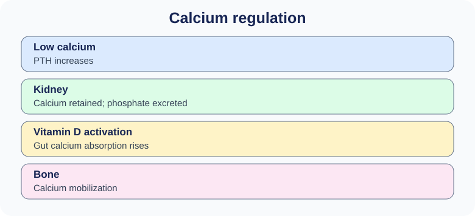
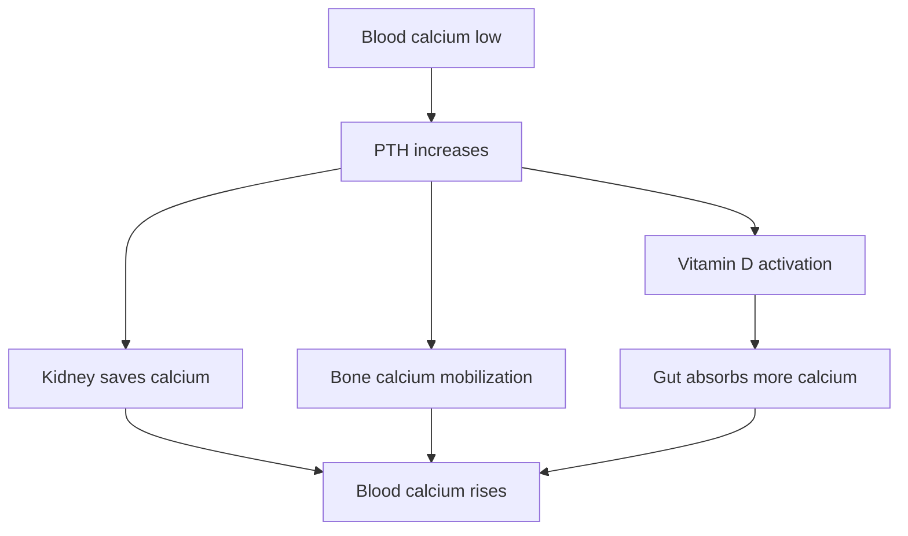

# Part 4 — Parathyroid, calcium, vitamin D and bone disorders

[🏠 Chapter](../README.md) · [📚 All concept files](Endocrine-System-Master-Guide.md) · [📝 MCQs](../MCQs/Endocrine-Topic-Wise.md) · [🎯 Mocks](../MCQs/Endocrine-Mixed-Mocks.md) · [🏥 Previous Year Questions](../Previous-Year-Questions/Endocrine-Previous-Year-Questions-Index.md) · [⚡ Revision](../Revision/Endocrine-Quick-Revision.md) · [Sources](../References.md)

**Study-ready | NORCET / PGIMER / Staff Nurse / CHO.** Not marked studied. 🔴 Very High · 🟠 High · 🟡 Important · 🟢 Foundation = preparation priority, not verified exam frequency.

**Topics:** 1. PTH and calcium control · 2. Hypo/hyperparathyroidism · 3. Calcium emergencies and postoperative care · 4. Bone/mineral disorders

## Contents
- [6. 🔴 Parathyroid aur calcium](#6--parathyroid-aur-calcium)
- [🟠 Bone and mineral disorders](#-bone-and-mineral-disorders)
- [🔴 VERY HIGH | Calcium control](#-very-high--calcium-control)
- [🔴 VERY HIGH | Parathyroid disease](#-very-high--parathyroid-disease)
- [🔴 VERY HIGH | Emergency and postoperative nursing](#-very-high--emergency-and-postoperative-nursing)
- [🟠 HIGH | Bone mineral differential](#-high--bone-mineral-differential)

## 6. 🔴 Parathyroid aur calcium

🔴 **MOST IMPORTANT / REPORTED REPEAT:** Hypocalcemia after thyroidectomy, Trousseau and Chvostek signs, tetany. [See reported exam evidence](../Previous-Year-Questions/Endocrine-Previous-Year-Questions-Index.md).

- Usually 4 glands thyroid ke peeche hoti hain. PTH blood calcium badhata hai: bone, kidney aur vitamin D activation ke through.
- Hypoparathyroidism: calcium kam, phosphate high ho sakta hai; tingling, tetany, cramps, seizures, prolonged QT.
- Chvostek sign: facial nerve tap karne par facial twitch. Trousseau sign: BP cuff se carpal spasm.
- Severe symptomatic hypocalcemia mein prescribed IV calcium gluconate, ECG aur IV site monitor.
- Primary hyperparathyroidism: calcium high, PTH high/inappropriately normal; kidney stones, bone pain, constipation, weakness. Phosphate low ho sakta hai.
- Hypercalcemia mein dehydration aur confusion ho sakte hain; hydration aur prescribed treatment; ECG/renal function monitor.

### Diagram — calcium control

### 🟠 Investigation and treatment — one-look table

| Condition | Key test and interpretation | Treatment/nursing link |
|---|---|---|
| Primary hyperparathyroidism | Calcium ↑, PTH not appropriately suppressed | Assess kidney stones/bone health; selected patients need parathyroidectomy |

### 🔴 Hypoparathyroidism and hyperparathyroidism
- **Hypoparathyroid:** monitor Ca, phosphate, magnesium, ECG/QT and neuromuscular symptoms. Seizure/fall precautions when indicated. Severe tetany/laryngospasm → airway assessment and urgent escalation; administer ordered IV calcium gluconate with ECG and IV site checks. Teach prescribed calcium/active vitamin D and lab follow-up.
- **Hyperparathyroid:** monitor hydration, Ca, renal function, stones, bowel function and bone pain. Encourage fluids/mobility only if appropriate; use fall/fracture precautions. Report confusion, severe weakness, dysrhythmia or dehydration.
- **After parathyroidectomy:** assess airway/neck as with thyroid surgery; monitor calcium and magnesium for postoperative hypocalcemia/hungry bone syndrome.

- Hypercalcemia: dehydration, constipation, confusion, short QT. Hypocalcemia: tingling, tetany, long QT. Trousseau cuff-induced carpal spasm, Chvostek facial twitch.

## 🟠 Bone and mineral disorders
- Vitamin D deficiency reduces intestinal calcium absorption. Rickets children mein growth plate mineralization ki problem; osteomalacia adult bone mineralization ki problem; osteoporosis low bone strength with fracture risk.
- DEXA bone density assess karta hai; postmenopausal women and men ≥50 mein T-score ≤−2.5 osteoporosis criterion, clinical exceptions possible.
- Nursing: fall prevention, weight-bearing activity if safe, calcium/vitamin D and prescribed therapy, fragility fracture assessment. Oral bisphosphonates follow product-specific fasting/upright instructions; swallowing problems report karo.
- Paget disease abnormal remodeling, bone pain/deformity and raised ALP possible. CKD mineral-bone disorder mein phosphate retention, low calcitriol, secondary PTH elevation ho sakta hai.

## 🔴 VERY HIGH | Calcium control
- PTH low ionized calcium sense hone par release. Kidney calcium reabsorption ↑, phosphate excretion ↑, 1-alpha hydroxylase activity ↑ → calcitriol ↑ → gut calcium absorption ↑. Bone remodeling also releases calcium when needed.
- Calcitonin thyroid C cells se; osteoclast activity reduce kar sakta hai, adult day-to-day calcium homeostasis mein PTH/vitamin D main role. Vitamin D skin/diet → liver 25-OH → kidney active 1,25-OH. 25-OH vitamin D stores assess karta hai.
- Low Mg PTH secretion and response reduce kar sakta hai; refractory hypocalcemia mein Mg check. Albumin low total calcium falsely low appear kar sakta hai; ionized calcium clinically useful, especially critical illness.
## 🔴 VERY HIGH | Parathyroid disease
| Condition | Calcium | PTH | Mechanism |
|---|---|---|---|
| Hypoparathyroidism | Low | Low/inappropriate normal | Gland injury, autoimmune or congenital |
| Primary hyperparathyroidism | High | High/inappropriate normal | Often adenoma |
| Secondary hyperparathyroidism | Low/normal often | High | CKD or vitamin D deficiency |
| Tertiary hyperparathyroidism | High often | High | Autonomous secretion after longstanding secondary |
- Hypocalcemia increases neuromuscular excitability → perioral tingling, tetany, spasms, seizures, possible laryngospasm. ECG prolonged QT. Trousseau BP cuff-induced carpal spasm; Chvostek tap facial nerve twitch (not perfectly specific).
- Hypercalcemia decreases neuromuscular excitability: weakness, constipation, polyuria, dehydration, confusion; kidney stones/bone disease in primary hyperparathyroidism; QT may shorten.
- Primary hyperparathyroid test Ca and PTH together; renal function, urine calcium, vitamin D, bone density and stone assessment as indicated. Imaging localizes gland before surgery, not primary biochemical diagnosis.
## 🔴 VERY HIGH | Emergency and postoperative nursing
- Severe symptomatic hypocalcemia: ABC, ECG, seizure precautions, urgent escalation; ordered IV calcium gluconate with infusion/site monitoring, assess Mg. No blind calcium administration without order/protocol.
- Severe hypercalcemia: assess dehydration, mental state, ECG, renal function, prescribed isotonic fluid (caution HF/CKD) and cause-directed treatment; calcitonin short-term, bisphosphonates/other agents selected.
- After parathyroidectomy rapid bone remineralization can remove serum calcium = hungry bone syndrome. Ca/Mg/phosphate monitor; prolonged replacement may be needed.
- **Case:** Post-neck surgery tingling and carpal spasm, Ca 7.1 mg/dL → suspect hypocalcemia; assess airway/ECG and notify team. If stridor present airway first.
## 🟠 HIGH | Bone mineral differential
- Rickets open growth plates in children → bow legs, widened wrists, delayed motor milestones possible. Osteomalacia adult defective mineralization → diffuse bone pain, proximal weakness; osteoporosis bone strength low → fragility fractures, often silent until fracture.
- CKD-MBD: phosphate retention and low calcitriol → secondary PTH elevation; monitor trends, prescribed phosphate binder timing with meals if indicated, vitamin D/calcimimetic specialist therapy.
- Oral bisphosphonate: plain water and fasting/upright period per product, esophageal symptoms report. Long-term therapy review; dental and fracture risk counseling per plan.
- **Exam trick:** osteoporosis DXA measures density; low DXA alone does not prove osteomalacia. Rickets = growth plates, osteomalacia = mineralization, osteoporosis = strength.

## 🎬 Study resources

[PTH mechanism video segment](https://www.youtube.com/watch?v=BalA29k0tuM&t=1162s) · [Mixed endocrine MCQ rationales](https://www.youtube.com/watch?v=xcwJd5RbBb4)

[All topic-wise teaching and MCQ videos](../Endocrine-YouTube-Teaching-and-MCQ-Practice.md). Public title/description check; full playback not reviewed.

[Chapter video table](Endocrine-System-Master-Guide.md) · [Topic-wise English MCQs](../MCQs/Endocrine-Topic-Wise.md). Video title/description only checked previously; full playback not reviewed.

## Clinical references
[OpenStax thyroid/parathyroid](https://openstax.org/books/medical-surgical-nursing/pages/21-3-thyroid-and-parathyroid-disorders)

[All references](../References.md). Adult exam education; bedside treatment follows clinician orders/current local protocol.

[🏠 Chapter](../README.md) · [📚 All concept files](Endocrine-System-Master-Guide.md) · [📝 MCQs](../MCQs/Endocrine-Topic-Wise.md) · [🎯 Mocks](../MCQs/Endocrine-Mixed-Mocks.md) · [🏥 Previous Year Questions](../Previous-Year-Questions/Endocrine-Previous-Year-Questions-Index.md) · [⚡ Revision](../Revision/Endocrine-Quick-Revision.md) · [Sources](../References.md)
