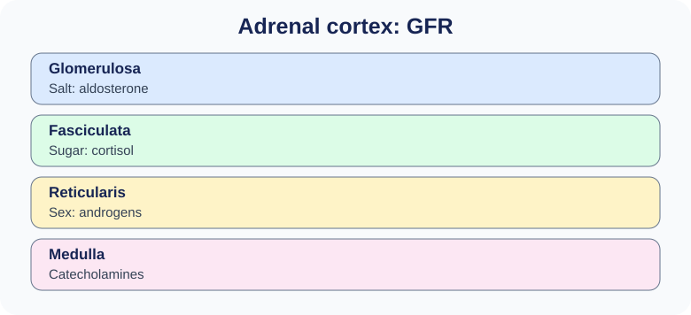
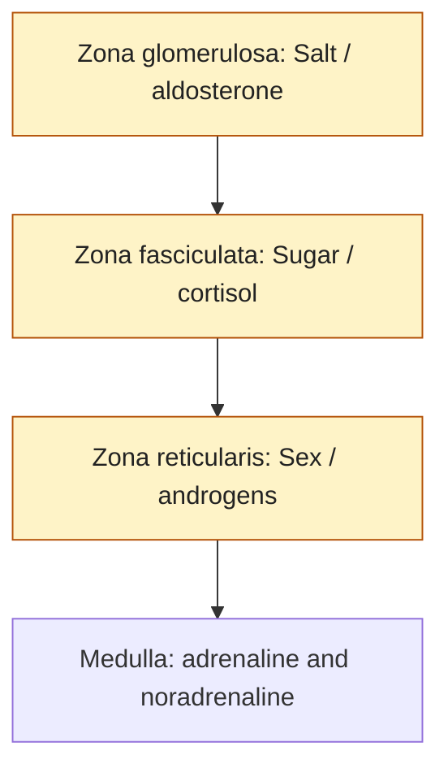

# Part 5 — Adrenal physiology, Addison, Cushing and adrenal tumors

[🏠 Chapter](../README.md) · [📚 All concept files](Endocrine-System-Master-Guide.md) · [📝 MCQs](../MCQs/Endocrine-Topic-Wise.md) · [🎯 Mocks](../MCQs/Endocrine-Mixed-Mocks.md) · [🏥 Previous Year Questions](../Previous-Year-Questions/Endocrine-Previous-Year-Questions-Index.md) · [⚡ Revision](../Revision/Endocrine-Quick-Revision.md) · [Sources](../References.md)

**Study-ready | NORCET / PGIMER / Staff Nurse / CHO.** Not marked studied. 🔴 Very High · 🟠 High · 🟡 Important · 🟢 Foundation = preparation priority, not verified exam frequency.

**Topics:** 1. Adrenal hormones · 2. Addison and crisis · 3. Cushing · 4. Conn, pheochromocytoma and CAH

### Pehle bilkul basic se samjho

- Dono kidneys ke upar ek-ek adrenal gland hoti hai. Iski bahar wali layer cortex aur andar wali layer medulla hai. Cortex ko Salt, Sugar, Sex trick se yaad karo.
- Aldosterone kidney ko namak (sodium) bachane ka signal deta hai. Paani sodium ke saath body mein ruk sakta hai. Isse BP ko support milta hai. Potassium urine se bahar jaata hai.
- Cortisol stress ke time glucose aur BP ko support karta hai. Bahut kam cortisol ho toh body illness ka saamna nahi kar paati. Addison disease mein adrenal gland kam kaam karti hai. Crisis mein BP bahut gir sakta hai.
- Cushing syndrome mein cortisol ka effect zyada hota hai. Skin patli, pet par fat, muscles weak, glucose aur BP high ho sakte hain. Cushing disease specifically pituitary ke ACTH tumor ko kehte hain.
- Conn syndrome mein aldosterone zyada hai. Pheochromocytoma mein adrenaline jaise hormones zyada nikal sakte hain. Isliye BP bahut badh sakta hai, paseena aur tez dhadkan ho sakti hai.
- Steroid dawai ko lambe samay tak lene ke baad apne aap ekdum band nahi karte. Body ne apna cortisol banana kam kar diya ho sakta hai.

## Contents
- [7. 🟠 Adrenal glands](#7--adrenal-glands)
- [🟠 Adrenal and other hormone crossovers](#-adrenal-and-other-hormone-crossovers)
- [🟠 HIGH | Cortex and medulla mechanism](#-high--cortex-and-medulla-mechanism)
- [🔴 VERY HIGH | Addison disease and adrenal crisis](#-very-high--addison-disease-and-adrenal-crisis)
- [🔴 VERY HIGH | Cushing syndrome](#-very-high--cushing-syndrome)
- [🟠 HIGH | Conn, pheochromocytoma and CAH](#-high--conn-pheochromocytoma-and-cah)

## 7. 🟠 Adrenal glands

🔴 **MOST IMPORTANT:** Addison vs Cushing, adrenal crisis, aldosterone and potassium, pheochromocytoma (HP 2020 reported source).

- Dono kidneys ke upar glands hoti hain. Bahar cortex, andar medulla.
- Cortex: glomerulosa = aldosterone (salt), fasciculata = cortisol (sugar/stress), reticularis = androgens (sex). Trick: Salt, Sugar, Sex.
- Aldosterone sodium aur water retain karne mein help karta hai aur potassium excretion badhata hai.
- Cortisol stress response, glucose regulation aur inflammation control mein role play karta hai.

| Feature | Addison (primary adrenal insufficiency) | Cushing syndrome |
|---|---|---|
| Cortisol | Low | High |
| BP | Low | Often high |
| Glucose | Low ho sakta hai | High ho sakta hai |
| Skin | Hyperpigmentation possible | Thin skin, purple striae |
| Weight | Loss | Central weight gain |
| Sodium/potassium | Low Na, high K possible | Variable. low K possible |

- Addison mein ACTH high hota hai. secondary adrenal insufficiency mein skin ka rang gehra hona (hyperpigmentation) aur high potassium (hyperkalemia) usually nahi.
- Adrenal crisis: severe hypotension, vomiting, weakness, confusion. Urgent ABC, IV hydrocortisone aur isotonic fluids per emergency protocol. glucose/electrolytes monitor.
- Long-term steroids ko suddenly stop nahi karna. Dose doctor ke bataye plan se dheere-dheere kam karni hoti hai. Sick-day rules aur steroid emergency card important.
- Cushing syndrome cortisol excess hai. Cushing disease specifically pituitary ACTH-secreting tumor. Steroid use common cause of Cushing syndrome.
- Cushing nursing: infection, glucose, BP, fragile skin aur falls/fractures monitor.
- Conn syndrome: primary aldosteronism. hypertension, low potassium ho sakta hai. Aldosterone-renin ratio screening.
- Pheochromocytoma: catecholamine-producing tumor. episodic headache, sweating, palpitations, hypertension. Plasma free or urinary fractionated metanephrines. preoperative alpha blockade before beta blockade.
- Congenital adrenal hyperplasia: commonly 21-hydroxylase deficiency. salt-wasting, androgen excess. Infant dehydration/shock emergency.

### Diagram — adrenal cortex outside to inside

### 🟠 Investigation and treatment — one-look table

| Condition | Key test and interpretation | Treatment/nursing link |
|---|---|---|
| Adrenal insufficiency | Morning cortisol and ACTH. ACTH stimulation test | Crisis: do not delay emergency treatment for testing. maintenance steroid replacement. primary disease may also need fludrocortisone |
| Cushing syndrome | Late-night salivary cortisol, 24-hour urinary free cortisol or overnight low-dose dexamethasone suppression, selected by clinician | Establish cortisol excess before localizing cause. surgery or cause-directed care. monitor infection and wound healing |

### 🔴 Addison disease and adrenal crisis
- Check BP including orthostatic changes, pulse, weight, I/O, sodium, potassium, glucose, nausea/vomiting, weakness and infection. Support safe mobility, doctor ke order ki nutrition and hormone replacement. monitor fludrocortisone response if doctor ke order ki.
- Teach never abruptly discontinue chronic glucocorticoids. patient ki zaroorat ke hisaab se sick-day dosing plan, medical alert/steroid card, emergency injection teaching for patient/family if doctor ke order ki. Vomiting preventing tablets or severe illness requires urgent care.
- **Adrenal crisis:** hypotension/shock, vomiting, weakness or altered consciousness. ABC, activate emergency response, IV access, ordered immediate hydrocortisone and isotonic fluid resuscitation. glucose/dextrose and electrolytes as needed per protocol. Do not delay treatment while awaiting cortisol results.
- **Goal:** restored BP/organs tak blood pahunchna (perfusion), safe glucose and electrolytes.

### 🟠 Cushing syndrome, Conn syndrome and pheochromocytoma
- **Cushing:** monitor BP, glucose, weight, edema, infection signs (may be subtle), skin bruising and wounds. Gentle handling/skin protection, fall and fracture prevention, appropriate nutrition, psychosocial support. Do not stop chronic steroids suddenly. After surgery monitor possible adrenal insufficiency.
- **Conn:** monitor BP, K, renal function, ECG if indicated, weakness/cramps and response to doctor ke order ki mineralocorticoid antagonist or surgery. teach medicine and follow-up safety.
- **Pheochromocytoma:** monitor BP/HR and headache/sweating/palpitations. minimize distress, avoid unnecessary abdominal tumor manipulation. Confirm doctor ke order ki alpha blockade before beta blockade. perioperative BP aur blood circulation se juda baar-baar check karna, post-op hypotension and hypoglycemia surveillance.
- **CAH:** in infants monitor feeding, weight, vomiting, dehydration, glucose and electrolytes. suspected salt-wasting crisis requires emergency care. Teach caregiver medication/stress plan and follow-up.

## 🟠 Adrenal and other hormone crossovers
- Cortisol supports vascular response and glucose during stress. aldosterone saves sodium and excretes K. Primary adrenal failure loses both, ACTH rises, skin darkening possible. Central failure usually preserves aldosterone. high potassium (hyperkalemia) less typical.
- Chronic exogenous steroids suppress HPA axis: sudden stopping unsafe. Screening for Cushing: late-night salivary cortisol, urine free cortisol or low-dose dexamethasone suppression kuch patients mein, not random cortisol alone.
- Pheochromocytoma: plasma free or urinary fractionated metanephrines. doctor ke order ki alpha blockade before beta blockade, post-op monitor glucose/BP. Primary aldosteronism hypertension with or without low K. aldosterone-renin ratio screening.

## 🟠 HIGH | Cortex and medulla mechanism
- Cortex cholesterol se steroid hormones synthesize karta hai. Glomerulosa aldosterone mainly RAAS and K controlled. fasciculata cortisol ACTH controlled. reticularis adrenal androgens. Medulla sympathetic chromaffin cells adrenaline/noradrenaline.
- Low renal organs tak blood pahunchna (perfusion) → renin → angiotensin II → aldosterone → distal nephron sodium reabsorption, potassium secretion. Water sodium follow karta hai. BP support. Cortisol glucose production and vascular catecholamine response support karta hai, immune inflammation suppress karta hai.
## 🔴 VERY HIGH | Addison disease and adrenal crisis
- Primary adrenal cortex failure (autoimmune, TB and other causes) → cortisol and often aldosterone low → fatigue, weight loss, khade hone par BP girna (orthostatic hypotension), salt craving, low Na, high K, possible hypoglycemia. ACTH rises → skin/mucosal skin ka rang gehra hona (hyperpigmentation). Secondary/tertiary ACTH suppression generally preserves aldosterone → pigmentation/high potassium (hyperkalemia) less typical.
- Investigations morning cortisol and ACTH. ACTH stimulation adrenal reserve assess. electrolytes and glucose. Suspected crisis treatment labs ke wait mein delay nahi.
- Chronic treatment glucocorticoid replacement. primary mineralocorticoid deficiency may need fludrocortisone. Monitor BP, orthostasis, K, Na, weight and symptoms. teach stress-dose plan, steroid card, emergency injection training if doctor ke order ki.
- **Crisis:** vomiting, severe weakness, low BP/shock, confusion, possible low glucose. Emergency ABC, IV access, ordered immediate hydrocortisone and isotonic fluid, glucose/electrolytes monitor. Adult guideline often 100 mg hydrocortisone IV/IM initial then 200 mg/24 h. actual care protocol/medical team, pediatric doses separate.
- **Case:** Patient on chronic steroids stops abruptly and develops vomiting, hypotension. Suspect adrenal insufficiency/crisis, not routine dehydration alone. Steroid withdrawal suppression important.
## 🔴 VERY HIGH | Cushing syndrome
- Cortisol excess exogenous steroid (common), pituitary ACTH tumor (Cushing disease), ectopic ACTH or adrenal cortisol tumor. Excess cortisol protein breakdown → thin skin, proximal muscle weakness, purple striae. fat redistribution → central obesity, moon face, dorsocervical fat. insulin resistance → glucose high. bone loss, infection, hypertension.
- Screening tests selected: late-night salivary cortisol, 24h urinary free cortisol or overnight 1-mg dexamethasone suppression. random serum cortisol not screening. After biochemical diagnosis ACTH helps localize cause. imaging next zaroorat aur doctor ke order ke hisaab se.
- Treatment cause-specific (taper exogenous only supervised, pituitary/adrenal surgery or specialist medication). Nursing skin protection, infection baar-baar check karna, glucose/BP, fall precautions, psychological support. after surgery risk adrenal insufficiency, doctor ke order ki steroid cover.
## 🟠 HIGH | Conn, pheochromocytoma and CAH
- Conn/primary aldosteronism excess aldosterone → hypertension, renin suppressed, K loss sometimes, metabolic alkalosis possible. Normal K does not rule out. ARR screen. confirm/localize per specialist (adrenal venous sampling selected). Unilateral adenoma surgery or mineralocorticoid antagonist e.g. spironolactone/eplerenone with K/renal baar-baar check karna.
- Pheochromocytoma adrenal medulla. paraganglioma outside adrenal. Catecholamine excess episodes headache, sweating, palpitations ± severe BP. Metanephrines before imaging workup patient ki condition ke hisaab se. Alpha blockade before beta to avoid unopposed vasoconstriction. pre-op volume plan, post-op BP and glucose checks. Avoid provoking/manipulating suspected tumor.
- CAH 21-hydroxylase deficiency common → cortisol low, androgen excess, sometimes aldosterone low. Salt-wasting neonate vomiting/dehydration/high potassium (hyperkalemia)/shock urgent. Newborn 17-OHP screening where available. endocrine follow-up, steroid/stress education, growth baar-baar check karna.
- Adrenal incidentaloma = imaging-detected mass, evaluate hormone activity and malignancy risk. not all functional. Adrenalectomy monitor bleeding, BP, electrolytes, glucose and doctor ke order ki steroid replacement.
- **Exam traps:** Addison vs Cushing opposite cortisol. Cushing disease pituitary. GFR Salt/Sugar/Sex. alpha before beta. steroids not abruptly stopped.

## 🎬 Study resources

[Addison disease lecture](https://www.youtube.com/watch?v=jxUXq7WoXhw) · [Mixed endocrine practice](https://www.youtube.com/watch?v=xcwJd5RbBb4)

[All topic-wise teaching and MCQ videos](../Endocrine-YouTube-Teaching-and-MCQ-Practice.md). Video ka title aur description check kiya hai. Poora video nahi dekha gaya.

[Chapter video table](Endocrine-System-Master-Guide.md) · [Topic-wise English MCQs](../MCQs/Endocrine-Topic-Wise.md). Video ka title aur description check kiya hai. Poora video nahi dekha gaya.

## Clinical references
[Endocrine Society adrenal insufficiency](https://academic.oup.com/jcem/article/101/2/364/2810222) · [NIDDK Cushing](https://www.niddk.nih.gov/health-information/endocrine-diseases/cushings-syndrome)

[All references](../References.md). Ye adult nursing exam ki padhai ke liye hai. Patient ki treatment doctor ke order aur hospital protocol se hoti hai.

[🏠 Chapter](../README.md) · [📚 All concept files](Endocrine-System-Master-Guide.md) · [📝 MCQs](../MCQs/Endocrine-Topic-Wise.md) · [🎯 Mocks](../MCQs/Endocrine-Mixed-Mocks.md) · [🏥 Previous Year Questions](../Previous-Year-Questions/Endocrine-Previous-Year-Questions-Index.md) · [⚡ Revision](../Revision/Endocrine-Quick-Revision.md) · [Sources](../References.md)
