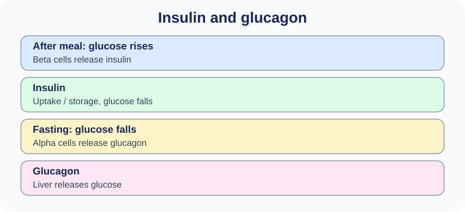
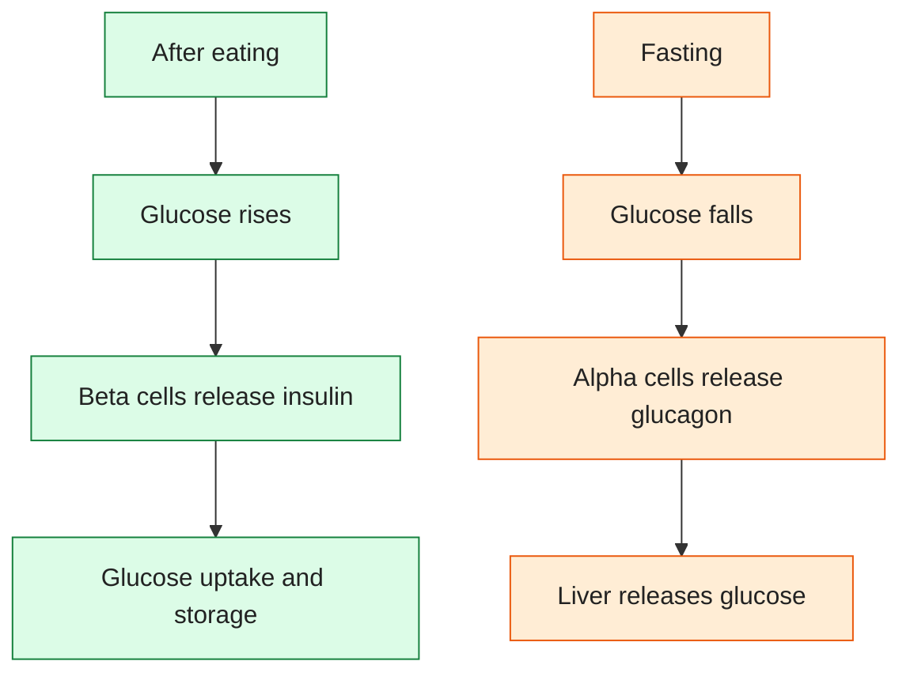

# Part 6 — Pancreas, diabetes diagnosis, insulin and antidiabetic medicines

[🏠 Chapter](../README.md) · [📚 All concept files](Endocrine-System-Master-Guide.md) · [📝 MCQs](../MCQs/Endocrine-Topic-Wise.md) · [🎯 Mocks](../MCQs/Endocrine-Mixed-Mocks.md) · [🏥 Previous Year Questions](../Previous-Year-Questions/Endocrine-Previous-Year-Questions-Index.md) · [⚡ Revision](../Revision/Endocrine-Quick-Revision.md) · [Sources](../References.md)

**Study-ready | NORCET / PGIMER / Staff Nurse / CHO.** Not marked studied. 🔴 Very High · 🟠 High · 🟡 Important · 🟢 Foundation = preparation priority, not verified exam frequency.

**Topics:** 1. Pancreas and glucose · 2. Diabetes types/diagnosis · 3. Insulin administration · 4. Non-insulin drugs and diet

## Contents
- [8. 🔴 Pancreas aur Diabetes mellitus](#8--pancreas-aur-diabetes-mellitus)
- [🟠 HIGH | Pancreas and glucose homeostasis](#-high--pancreas-and-glucose-homeostasis)
- [🔴 VERY HIGH | Diabetes types and diagnosis](#-very-high--diabetes-types-and-diagnosis)
- [🔴 VERY HIGH | Insulin — practical examples](#-very-high--insulin--practical-examples)
- [🟠 HIGH | Non-insulin drugs — nursing action](#-high--non-insulin-drugs--nursing-action)

## 8. 🔴 Pancreas aur Diabetes mellitus

🔴 **MOST IMPORTANT:** Insulin types and safety, glucose diagnostic criteria, diabetic foot, Type 1 vs Type 2. PGIMER 2025 reported clinical diabetes evaluation.

- Pancreatic islets: beta cells insulin, alpha cells glucagon, delta cells somatostatin.
- Khana khane ke baad glucose badhta hai. Insulin glucose ko muscle/fat cells mein lene aur liver mein store karne mein help karta hai. Fasting mein glucagon glucose badhata hai.
- Type 1: autoimmune beta-cell destruction, insulin required. Type 2: insulin resistance aur progressive insulin deficiency. Gestational diabetes: pregnancy mein diagnosed glucose intolerance (overt pre-existing diabetes se alag).
- Classic symptoms: polyuria (urine zyada), polydipsia (pyaas), polyphagia (bhookh), weight loss possible.

| Nonpregnant adult diagnosis | Diabetes threshold |
|---|---|
| Fasting plasma glucose | ≥126 mg/dL |
| 2-hour 75 g OGTT | ≥200 mg/dL |
| HbA1c | ≥6.5% |
| Random plasma glucose | ≥200 mg/dL with classic symptoms or crisis |

- Unequivocal hyperglycemia absent ho toh diagnosis confirm karne ke liye repeat/second abnormal test chahiye. HbA1c roughly past 2–3 months ka glucose estimate hai; anemia aur hemoglobin variants interpretation affect kar sakte hain.
- Prediabetes (ADA): fasting 100–125, 2-hour 140–199 mg/dL, HbA1c 5.7–6.4%.
- Long-term complications: retinopathy, nephropathy, neuropathy (microvascular), MI/stroke/PAD (macrovascular).
- Nursing: glucose monitoring, foot inspection daily, footwear, medication adherence, nutrition/activity education, hypoglycemia action plan; eye and kidney screening.

### Insulin aur medicines
- Rapid acting: lispro/aspart; short: regular; intermediate: NPH; long: glargine/detemir/degludec (duration product-specific).
- Regular insulin commonly IV infusion protocols mein use hota hai. NPH cloudy; regular clear. Compatible regular + NPH mix prescribed ho toh clear before cloudy. Glargine ko mix mat karo.
- Subcutaneous site rotation within region se lipohypertrophy kam hoti hai. Insulin product, dose, timing, glucose, meal availability check karo. Unopened insulin usually 2–8°C; freeze na karo; in-use storage product label se.
- Metformin: hepatic glucose production kam; GI effects, B12 deficiency possible; renal function check.
- Sulfonylureas: insulin release badhate hain, hypoglycemia risk.
- SGLT2 inhibitors: urine mein glucose excretion; genital infection aur euglycemic DKA risk.
- GLP-1 receptor agonists: glucose-dependent insulin secretion, satiety; nausea common.
- Type 1 mein basal insulin illness mein bhi generally continue under sick-day guidance; dose individualized.

### Diagram — glucose after a meal versus fasting

### 🔴 Insulin timing, administration, and glucose monitoring
Approximate textbook ranges only; specific formulation, dose and manufacturer instructions govern care.
| Type | Example | Onset | Peak | Duration |
|---|---|---|---|---|
| Rapid | Lispro/aspart | 10–30 min | ~1–3 h | ~3–5 h |
| Short | Regular SC | 30–60 min | ~2–4 h | ~5–8 h |
| Intermediate | NPH | 1–2 h | ~4–12 h | ~12–18 h, sometimes longer |
| Long | Glargine U100 | ~1–2 h | No pronounced peak | ~24 h |
| Ultra-long | Degludec | ~1 h | No pronounced peak | >42 h |

- Basal insulin background needs cover karta hai; bolus mealtime/correction needs. Type 1 mein basal insulin omission can precipitate DKA.
- Check order, patient, glucose, formulation, concentration (U-40 vs U-100), device, units, timing, meal and hypoglycemia risk. Independent double-check per local policy. Never interchange syringe concentrations; never share pens, even with new needles.
- SC abdomen, thigh, upper arm, buttock; rotate spots within chosen region; avoid lipohypertrophy, scar or inflamed site. Short 4-mm pen needle is generally inserted at 90°; individual technique depends on needle/body habitus. Gently roll NPH as directed; don't vigorously shake. Dispose of sharps safely.
- Regular + NPH if specifically compatible and prescribed: air into cloudy then clear vial; draw clear insulin before cloudy. Do not mix glargine/degludec with other insulin.
- Dose calculation exam example: U-100 = 100 units/mL; 8 units corresponds to 0.08 mL. In actual practice use the matching calibrated insulin device; do not use this arithmetic to improvise a syringe.
- Fingerstick: wash and dry hands, use single-use lancet, document result and symptoms, confirm unexpected CGM readings by meter as indicated. CGM measures interstitial glucose and can lag during rapid change.
- Dawn phenomenon: morning rise due to circadian counter-regulatory effects, without preceding nocturnal hypoglycemia. Somogyi effect: historical hypothesis of rebound hyperglycemia after night-time hypoglycemia; not well supported as a common explanation. Overnight CGM/SMBG differentiates patterns; don't automatically increase or reduce insulin without clinical review.
- Hypoglycemia levels: level 1 = 54–69 mg/dL, level 2 = below 54 mg/dL, level 3 = severe event requiring assistance regardless of measured glucose.
- Many nonpregnant adults have individualized targets around HbA1c <7%, premeal 80–130 mg/dL and peak postmeal <180 mg/dL; these are treatment targets, not diagnostic thresholds.

### 🔴 Diabetic diet and comprehensive nursing care
- Plate method: half non-starchy vegetables, quarter protein (dal/paneer/egg etc. according to plan), quarter carbohydrate foods (roti/rice etc.); water or unsweetened drinks. Pulses contain carbohydrate too. Teach portion size and consistency, not a blanket ban on carbohydrates.
- Pair carbohydrate with fiber/protein; avoid sugary drinks except treating hypoglycemia; choose whole grains when feasible. Individualize for CKD, pregnancy, frailty, affordability and activity. Dietitian referral as needed.
- Exercise improves insulin sensitivity. Insulin-treated patients may need glucose checks, planned carbohydrate and clinician-directed dose adjustments; carry fast glucose. Avoid vigorous exercise during significant ketosis.
- Foot: inspect soles/toes daily, dry between toes, protective footwear, no barefoot walking or self-cutting corns, promptly report infection/ulcer; assess pulses and 10-g monofilament with other sensory tests.
- Kidney screening: urine albumin-to-creatinine ratio and eGFR; type 2 at diagnosis, type 1 generally after 5 years, annually thereafter as indicated. Eye screening at type 2 diagnosis and within 5 years after type 1 onset; follow eye clinician schedule.
- Drugs: DPP-4 inhibitors increase incretin activity; generally low hypoglycemia risk alone. Pioglitazone improves sensitivity but can cause edema/worsen heart failure. Acarbose slows carbohydrate digestion, GI effects. Meglitinides are short-acting insulin secretagogues; hypoglycemia possible.
- In hospital: coordinate meal and prandial insulin, monitor glucose per order, assess infection/steroid effects, avoid unplanned insulin omission, and educate on discharge.
- Example nursing plan: unstable glucose risk → monitor glucose and coordinate medicines/meals; impaired skin integrity risk → foot inspection and pressure protection; knowledge gap → teach-back of insulin administration, hypoglycemia actions and sick-day plan. Evaluation: correct teach-back, glucose trends toward prescribed range, timely recognition/reporting of danger signs.

### 🔴 Diabetes mellitus and insulin administration
- Assess glucose patterns, food intake, insulin/medicine timing, infection, hydration, renal status, feet and knowledge. In hospitalized adults, glucose usually before meals if eating, every 4–6 hours if not eating, and more frequently with IV insulin per protocol.
- Verify patient/order, insulin type, concentration, units, device, glucose and meal availability; follow independent check policy. Rotate SC injection sites, avoid lipohypertrophy, use safe sharps disposal, never share pens. Match prescribed meal insulin timing; type 1 basal insulin must not be omitted without an appropriate alternative plan.
- Monitor hypoglycemia and hyperglycemia; document readings, doses, food, symptoms, corrective actions and response. Report recurrent lows and seek regimen review. Do not adjust independently unless authorized protocol.
- Foot care: daily inspection, protect feet, appropriate footwear, no barefoot walking, no self-cutting corns, prompt ulcer/infection review. Assess sensation and pulses. Teach individualized meal plan, activity, glucose monitoring, medication storage, sick-day plan and follow-up eye/kidney checks.
- **Goal:** glucose within individualized target without hypoglycemia, intact skin, patient demonstrates safe self-care.

## 🟠 HIGH | Pancreas and glucose homeostasis
- Islets of Langerhans: beta insulin, alpha glucagon, delta somatostatin, PP pancreatic polypeptide. Acinar cells digestive enzymes. Insulin receptor signal skeletal muscle/adipose GLUT4 uptake promotes, liver glycogen storage increases, hepatic glucose output and lipolysis decrease.
- Glucagon fasting state liver glycogen breakdown/gluconeogenesis increases. Somatostatin inhibits selected hormone release. Insulin and glucagon balance fed vs fasting.
## 🔴 VERY HIGH | Diabetes types and diagnosis
- Type 1 autoimmune beta-cell destruction → absolute insulin deficiency, ketosis risk. Type 2 insulin resistance + progressive beta-cell dysfunction, can also need insulin. LADA adult autoimmune; MODY monogenic; pancreatic disease, steroids can cause secondary diabetes.
- Symptoms polyuria (osmotic diuresis), polydipsia (water loss), polyphagia (impaired fuel handling), weight loss (catabolism). Type 2 may be asymptomatic for years.
- **Diagnosis vs management:** fasting plasma glucose ≥126 after ≥8h fast; HbA1c ≥6.5%; 2h 75g OGTT ≥200; random plasma glucose ≥200 with classic symptoms/crisis. Confirm if not unequivocal. Many adult treatment targets fasting/premeal 80–130 and postmeal <180, individualized; do not use targets as diagnosis cutoffs.
- HbA1c measures glycation of RBCs, affected by anemia, transfusion, altered RBC turnover, hemoglobin variants. C-peptide reflects endogenous insulin, injected insulin lacks C-peptide; autoantibodies help classification.
## 🔴 VERY HIGH | Insulin — practical examples
- Basal insulin covers background liver glucose production; bolus covers food and corrections. Type 1 fasting still needs basal plan. IV regular insulin common DKA protocol; not all insulin products IV.
- Mixing regular + NPH only if compatible/prescribed: air cloudy → air clear → draw clear → draw cloudy. Clear glargine also exists but never mix with NPH; clear appearance does not imply compatibility.
- U-40 40 units/mL and U-100 100 units/mL. Example 12 U in U-40 = 0.3 mL, U-100 = 0.12 mL; actual matching device essential. Dose written in units, not ambiguous U abbreviation if local safety policy.
- Before administration: glucose, meal availability, order, insulin name/concentration, correct device, dose, expiration, site. SC injection rotation within region; abdomen often faster absorption, avoid lipohypertrophy. Cold chain unopened 2–8°C, do not freeze; in-use duration product-specific. Never share pens even if needle changed.
- Monitor glucose when meals delayed, vomiting, steroid changes, exercise and illness; coordinate prescribed dose. Hypoglycemia response Part 7.
## 🟠 HIGH | Non-insulin drugs — nursing action
| Class | How it works | Important nurse check |
|---|---|---|
| Metformin | Reduces hepatic glucose output | GI, kidney function, B12 with long use; contrast/acute illness policy |
| Sulfonylurea | Stimulates insulin release | Hypoglycemia, meal intake, weight |
| Meglitinide | Short meal-linked secretion | Hypoglycemia, meal timing |
| DPP-4 inhibitor | Prolongs incretin action | Renal dose for some, agent-specific risk |
| GLP-1 RA | Glucose-dependent insulin, slows gastric emptying/satiety | GI effects, hydration, product-specific contraindications |
| SGLT2 inhibitor | Urinary glucose loss | Genital infection, dehydration, euglycemic DKA and perioperative hold policy |
| TZD (pioglitazone) | Improves insulin sensitivity | Edema, HF, fracture risk |
| Alpha-glucosidase inhibitor | Slows carbohydrate digestion | GI effects; if combination therapy hypo, treat with glucose |
- Medication choice individualized by renal/cardiac status, hypoglycemia risk, access and clinical plan. Do not independently change dose.
- **Nutrition case:** patient skips lunch after rapid insulin. Coordinate meal/dose, check glucose and hypoglycemia risk; not routine instruction to avoid all carbohydrates.
- **Exam traps:** alpha vs beta, basal vs bolus, clear before cloudy (only compatible), A1c diagnosis vs goal, SGLT2 euglycemic DKA, sulfonylurea hypoglycemia.

## 🎬 Study resources

[Diabetes mellitus and insulin lecture](https://www.youtube.com/watch?v=JQ5FiVbojC8) · [Mixed endocrine practice](https://www.youtube.com/watch?v=xcwJd5RbBb4)

[All topic-wise teaching and MCQ videos](../Endocrine-YouTube-Teaching-and-MCQ-Practice.md). Public title/description check; full playback not reviewed.

[Chapter video table](Endocrine-System-Master-Guide.md) · [Topic-wise English MCQs](../MCQs/Endocrine-Topic-Wise.md). Video title/description only checked previously; full playback not reviewed.

## Clinical references
[ADA 2026 pharmacology](https://doi.org/10.2337/dc26-S009) · [NIDDK diabetes testing](https://www.niddk.nih.gov/health-information/diabetes/overview/tests-diagnosis)

[All references](../References.md). Adult exam education; bedside treatment follows clinician orders/current local protocol.

[🏠 Chapter](../README.md) · [📚 All concept files](Endocrine-System-Master-Guide.md) · [📝 MCQs](../MCQs/Endocrine-Topic-Wise.md) · [🎯 Mocks](../MCQs/Endocrine-Mixed-Mocks.md) · [🏥 Previous Year Questions](../Previous-Year-Questions/Endocrine-Previous-Year-Questions-Index.md) · [⚡ Revision](../Revision/Endocrine-Quick-Revision.md) · [Sources](../References.md)
