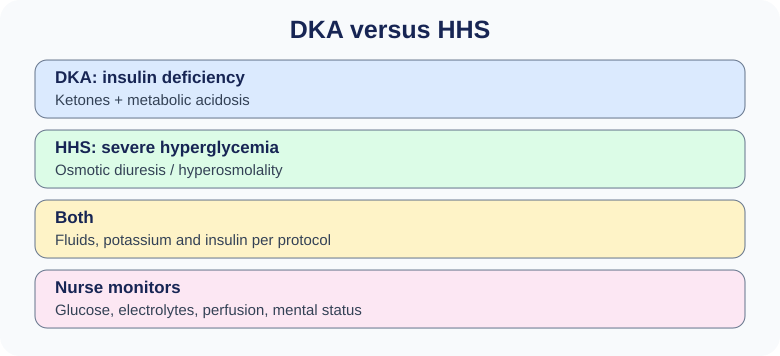
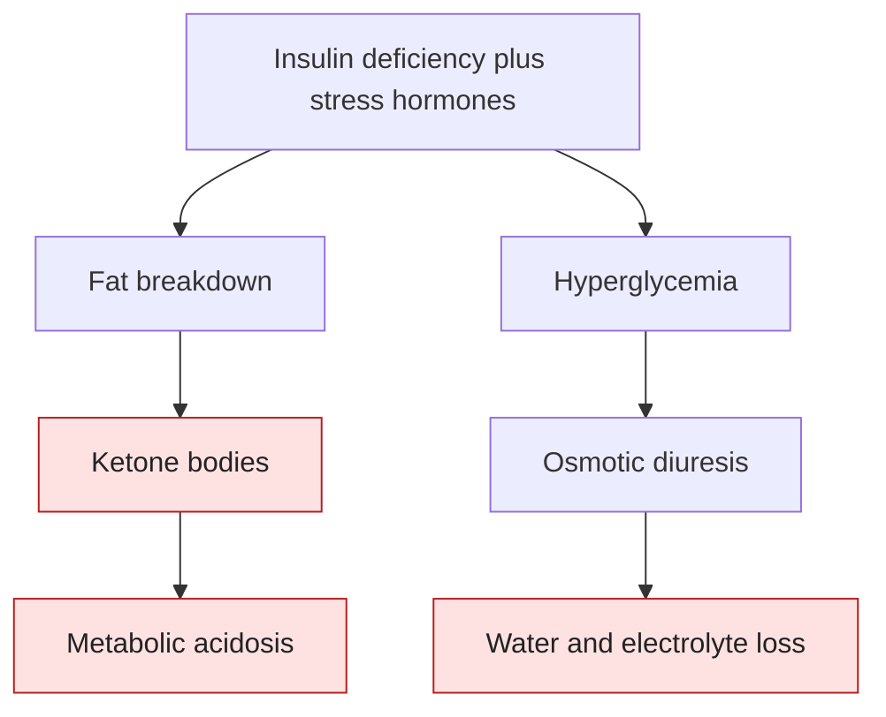

# Part 7 — Hypoglycemia, DKA and HHS

[🏠 Chapter](../README.md) · [📚 All concept files](Endocrine-System-Master-Guide.md) · [📝 MCQs](../MCQs/Endocrine-Topic-Wise.md) · [🎯 Mocks](../MCQs/Endocrine-Mixed-Mocks.md) · [🏥 Previous Year Questions](../Previous-Year-Questions/Endocrine-Previous-Year-Questions-Index.md) · [⚡ Revision](../Revision/Endocrine-Quick-Revision.md) · [Sources](../References.md)

**Study-ready | NORCET / PGIMER / Staff Nurse / CHO.** Not marked studied. 🔴 Very High · 🟠 High · 🟡 Important · 🟢 Foundation = preparation priority, not verified exam frequency.

**Topics:** 1. Hypoglycemia · 2. Diabetic ketoacidosis · 3. Hyperosmolar hyperglycemic state · 4. Emergency treatment monitoring and numericals

## Contents
- [9. 🔴 Hypoglycemia, DKA aur HHS](#9--hypoglycemia-dka-aur-hhs)
- [🔴 VERY HIGH | Hypoglycemia — first recognize then act](#-very-high--hypoglycemia--first-recognize-then-act)
- [🔴 VERY HIGH | DKA — why acidosis?](#-very-high--dka--why-acidosis)
- [🔴 VERY HIGH | HHS — why neurological signs?](#-very-high--hhs--why-neurological-signs)
- [🔴 VERY HIGH | Adult crisis nursing sequence](#-very-high--adult-crisis-nursing-sequence)

## 9. 🔴 Hypoglycemia, DKA aur HHS

🔴 **MOST IMPORTANT:** Hypoglycemia first aid, DKA vs HHS, potassium before insulin. PGIMER 2020 reported early hypoglycemia question.

- Hypoglycemia alert threshold below 70 mg/dL. Sweating, tremor, hunger, confusion; severe cases seizure/unconsciousness.
- Awake aur safely swallow kar sakta hai: 15 g fast carbohydrate, 15 minutes baad glucose recheck; repeat if still low. Unable to swallow: oral kuch mat do; emergency assistance, glucagon or IV dextrose per protocol.

| Feature | DKA | HHS |
|---|---|---|
| Main problem | Ketones + acidosis | Severe hyperosmolality/dehydration |
| Breathing | Kussmaul possible | Usually absent unless another cause |
| Glucose | Often high, can be near normal | Usually very high |
| Typical association | Type 1, but any type | Type 2, but overlap possible |

- DKA: insulin deficiency → fat breakdown → ketones → metabolic acidosis. Nausea, abdominal pain, deep breathing, fruity breath.
- HHS: severe hyperglycemia → urine water loss → dehydration → altered mental status.
- Treatment principles: IV fluids, potassium assessment/replacement, insulin as indicated, frequent glucose/electrolytes, treat precipitating cause. If potassium severely low, insulin delayed until corrected per protocol.
- DKA glucose normalize hone se pehle ketones clear nahi bhi hue ho sakte; prescribed dextrose may be added so insulin can continue safely.
- Sick day: hydration, glucose/ketone monitoring, urgent help for vomiting, breathing difficulty, confusion or persistent ketones.

### 🔴 DKA/HHS numerical revision — adult criteria and exam trap
2024 international consensus, also reflected in ADA 2026 inpatient standards:
| Criterion | DKA (all three) | HHS (all four) |
|---|---|---|
| Glucose | ≥200 mg/dL OR known diabetes | ≥600 mg/dL |
| Ketones | beta-hydroxybutyrate ≥3 mmol/L OR urine ≥2+ | beta-hydroxybutyrate <3 mmol/L OR urine <2+ |
| Acid-base | pH <7.3 and/or bicarbonate <18 mmol/L | pH ≥7.3 AND bicarbonate ≥15 mmol/L |
| Osmolality | Not mandatory | Effective >300 OR total >320 mOsm/kg |

- Effective osmolality (glucose mg/dL): 2 × sodium + glucose/18. Example: Na 150, glucose 720 → 340 mOsm/kg. Total osmolality additionally includes BUN/2.8 (mg/dL).
- Anion gap = Na − (Cl + HCO3). Example 140 − (104 + 12) = 24 mmol/L; supports high-gap acidosis but ketone measurement preferred for DKA monitoring.
- If K <3.5 mmol/L in adult crisis, replace potassium and defer insulin until >3.5 per 2024 consensus. Older textbooks often use 3.3; read exam's specified guideline. Follow local emergency protocol and monitor ECG/electrolytes.
- DKA resolution: plasma ketone <0.6 mmol/L AND pH ≥7.3 OR bicarbonate ≥18 mmol/L (acid-base condition in addition to ketone criterion); ideally glucose <200. Glucose alone does not prove resolution. Pediatric/pregnancy protocols differ.

### 🔴 Hypoglycemia, DKA and HHS — emergency nursing priorities
| Situation | First priorities and monitoring | Reassessment |
|---|---|---|
| Hypoglycemia, awake and safely swallowing | Check glucose when possible without delaying care; fast carbohydrate per protocol (usually 15 g adult), recheck after 15 min; repeat if still low | Symptoms, glucose, meal/snack as appropriate, cause and medication review |
| Hypoglycemia, unable to swallow | No oral food/drink; protect airway, emergency help, glucagon or IV dextrose per protocol | Consciousness and repeated glucose; prevent recurrence |
| DKA | ABC, IV access, ordered isotonic/balanced fluids, glucose/ketones, blood gas, K and renal tests; potassium safety before insulin, pump/infusion checks | Glucose and vital signs frequently; electrolytes/ketones/pH per protocol; dextrose when indicated so insulin can continue until ketoacidosis resolves |
| HHS | ABC, perfusion and dehydration assessment, ordered IV fluids, glucose, electrolytes, osmolality and neurologic monitoring; insulin per protocol | Gradual correction of osmolality/glucose, fluid balance, mental status and renal function |

- Identify precipitating illness (infection, omitted insulin, medicines etc.); monitor for overload in older patients or cardiac/renal impairment. Adult DKA/HHS protocols differ from pediatric/pregnancy protocols.
- In IV insulin transition, ensure prescribed overlap with SC basal insulin to avoid rebound hyperglycemia/DKA. Confirm patient/caregiver has supplies and follow-up before discharge.

## 🔴 VERY HIGH | Hypoglycemia — first recognize then act
- Causes insulin/sulfonylurea excess relative to food, skipped meals, exercise, renal impairment (drug clearance), alcohol/illness. Autonomic warning sweating, tremor, hunger, palpitations; neuroglycopenic confusion, behavior change, seizure, unconsciousness. Repeated lows may impair awareness.
- Level 1 54–69 mg/dL; level 2 <54; level 3 severe requiring assistance regardless of glucose. If safely swallowing, rapid carbohydrate usually 15 g, recheck 15 min, repeat if still low; follow meal/snack plan. If unable to swallow no oral food/drink; emergency assistance, glucose/glucagon according to protocol.
- **Case:** Glucose 48 and drowsy unable to swallow. No juice. ABC, emergency response, parenteral treatment as ordered, repeated glucose and evaluate cause. Long-acting insulin or sulfonylurea may cause recurrent low.
## 🔴 VERY HIGH | DKA — why acidosis?

- Insulin low → lipolysis → liver ketones (beta-hydroxybutyrate, acetoacetate); acid accumulates. Deep Kussmaul breathing compensates by blowing off CO2; fruity breath from acetone. Vomiting, pain, dehydration, tachycardia. Glucose may be modest with SGLT2/pregnancy/fasting.
- Triggers infection, omitted insulin, new diabetes, MI, stress, medication. Treat cause as well as metabolic crisis. Blood ketones preferred when available.
- Initial K can be normal/high despite total body depletion. Insulin pushes K intracellularly; low K before insulin dangerous arrhythmia. Adult 2024 consensus delay insulin if K <3.5 until corrected >3.5; older exam source 3.3 may differ.
## 🔴 VERY HIGH | HHS — why neurological signs?
- Relative insulin sufficient to limit major ketosis but not severe hyperglycemia → prolonged osmotic diuresis → water loss > sodium loss → high osmolality → confusion/seizures/coma possible. Common older type 2 with illness and limited water access. DKA/HHS overlap possible.
- **Numerical example:** Na 148, glucose 900 mg/dL → effective osmolality = 296 + 50 = 346 mOsm/kg. Very high, but HHS requires all criteria including absence of significant ketosis/acidosis.
- HHS correction must be gradual; monitor osmolality and neurologic status, fluid overload especially heart/kidney disease.
## 🔴 VERY HIGH | Adult crisis nursing sequence
1. ABC, vital signs, mental status, ECG, IV access, glucose/ketones/electrolytes/venous pH/renal function and precipitant assessment.
2. Prescribed isotonic or balanced crystalloid, adjust with perfusion and comorbidities; assess urine and fluid balance.
3. Check potassium; replace as indicated before/with insulin. IV insulin via protocol and infusion pump, double-check.
4. Glucose often every 1–2h; electrolytes/pH/ketones and HHS osmolality per protocol (often 4h); monitor ECG/perfusion. Add dextrose when indicated to allow continued insulin until ketoacidosis resolves.
5. DKA resolution ketones <0.6 mmol/L AND (pH ≥7.3 OR bicarbonate ≥18). HHS resolution depends osmolality, hydration, cognition and glucose; not glucose alone. Transition with prescribed basal overlap before IV insulin stop.
- Bicarbonate not routine DKA, severe acidosis specific indications; phosphate not routine unless clinically indicated. Pediatric DKA cerebral injury risk and fluid/insulin protocols distinct.
- **Sick-day education:** do not omit prescribed basal insulin, monitor glucose and ketones, maintain tolerated fluids, know urgent symptoms (vomiting, abdominal pain, fast breathing, confusion, persistent ketones). Individual written plan.
- **Exam trap:** Kussmaul = compensatory respiratory response to metabolic acidosis. No routine oral treatment when unconscious. Normal glucose alone does not equal DKA resolved.

## 🎬 Study resources

[DKA/HHS lab values and quiz](https://www.youtube.com/watch?v=E1VncG3dFdY) · [DKA/HHS case practice](https://www.youtube.com/watch?v=PyKl44OV51M) (English supplemental)

[All topic-wise teaching and MCQ videos](../Endocrine-YouTube-Teaching-and-MCQ-Practice.md). Public title/description check; full playback not reviewed.

[Chapter video table](Endocrine-System-Master-Guide.md) · [Topic-wise English MCQs](../MCQs/Endocrine-Topic-Wise.md). Video title/description only checked previously; full playback not reviewed.

## Clinical references
[ADA 2026 hospital care](https://doi.org/10.2337/dc26-s016) · [ADA glycemic emergencies](https://doi.org/10.2337/dc26-s006) · [2024 adult crisis consensus](https://pmc.ncbi.nlm.nih.gov/articles/PMC11272983/)

[All references](../References.md). Adult exam education; bedside treatment follows clinician orders/current local protocol.

[🏠 Chapter](../README.md) · [📚 All concept files](Endocrine-System-Master-Guide.md) · [📝 MCQs](../MCQs/Endocrine-Topic-Wise.md) · [🎯 Mocks](../MCQs/Endocrine-Mixed-Mocks.md) · [🏥 Previous Year Questions](../Previous-Year-Questions/Endocrine-Previous-Year-Questions-Index.md) · [⚡ Revision](../Revision/Endocrine-Quick-Revision.md) · [Sources](../References.md)
