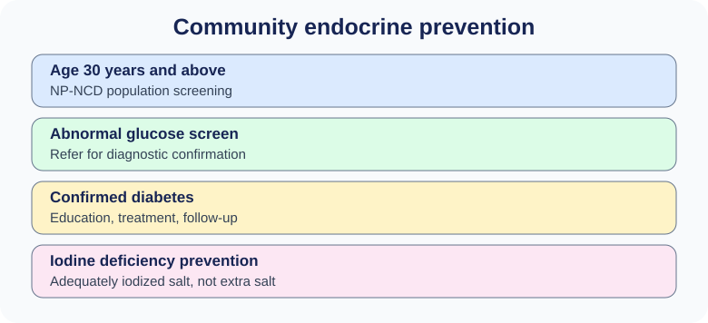

# Part 8 — Diabetes complications, community nursing and other hormones

[🏠 Chapter](../README.md) · [📚 All concept files](Endocrine-System-Master-Guide.md) · [📝 MCQs](../MCQs/Endocrine-Topic-Wise.md) · [🎯 Mocks](../MCQs/Endocrine-Mixed-Mocks.md) · [🏥 Previous Year Questions](../Previous-Year-Questions/README.md) · [⚡ Revision](../Revision/Endocrine-Quick-Revision.md) · [Sources](../References.md)

**Study-ready | NORCET / PGIMER / Staff Nurse / CHO.** Not marked studied. 🔴 Very High · 🟠 High · 🟡 Important · 🟢 Foundation = preparation priority, not verified exam frequency.

**Topics:** 1. Long-term diabetes complications · 2. Community screening and prevention · 3. Pregnancy and reproductive crossover · 4. Other endocrine glands and tumors

## Contents
- [10. 🟡 Other endocrine topics — clubbed](#10--other-endocrine-topics--clubbed)
- [🔴 Diabetes and community nursing (India)](#-diabetes-and-community-nursing-india)
- [🔴 VERY HIGH | Diabetes complications — understand vessel and nerve damage](#-very-high--diabetes-complications--understand-vessel-and-nerve-damage)
- [🟠 HIGH | Community nursing in India](#-high--community-nursing-in-india)
- [🟠 HIGH | Pregnancy, neonate and reproductive endocrine](#-high--pregnancy-neonate-and-reproductive-endocrine)
- [🟡 IMPORTANT | Other glands, endocrine tumors](#-important--other-glands-endocrine-tumors)

## 10. 🟡 Other endocrine topics — clubbed

🟡 **SECONDARY PRIORITY:** Pineal, thymus, MEN and other endocrine organs; pehle high-priority glands padho, fir ye revise karo.

- Pineal melatonin: sleep-wake cycle, darkness mein secretion increases.
- Thymus: T-cell maturation, childhood mein relatively prominent.
- Ovaries: estrogen, progesterone; testes: testosterone. FSH/LH gonadal function regulate karte hain.
- PCOS: ovulatory dysfunction, androgen excess, possible polycystic ovarian morphology; metabolic risk bhi assess hota hai.
- Kidney: erythropoietin RBC production, renin BP regulation, calcitriol calcium absorption. Heart: ANP sodium excretion mein help. GI: gastrin, secretin, CCK digestion regulate karte hain.
- MEN1: parathyroid, pituitary, pancreatic/duodenal neuroendocrine tumors. MEN2: medullary thyroid carcinoma, pheochromocytoma; MEN2A mein parathyroid disease possible.

### 🟡 Additional metabolic/reproductive crossover
- Metabolic syndrome: clustered central obesity, elevated glucose, triglycerides, BP and low HDL; criteria depend on definition/ethnicity. Lifestyle and risk-factor management.
- PCOS: ovulatory dysfunction and hyperandrogenism; ultrasound/AMH criteria in adults when indicated after excluding mimics; not diagnosed by ultrasound alone. Assess glucose risk and fertility concerns.
- Osteomalacia/rickets: impaired bone mineralization, often vitamin D deficiency. Osteoporosis: low bone strength, fracture risk. PTH and vitamin D physiology connect endocrine to musculoskeletal nursing; comprehensive osteoporosis in MSK chapter.
- Gestational diabetes: use pregnancy-specific protocol; postpartum 75-g OGTT typically 4–12 weeks and ongoing screening per ADA. Neonatal hypoglycemia is a risk.
- Rare tumors (MEN, insulinoma, glucagonoma) covered in the endocrine tumor section; detailed reproductive disorders and pediatric endocrinology belong additionally to their respective subjects.

### 🟡 Other endocrine disorders and crossovers
- Thyroid cancer/MEN: assess surgical/medication effects, voice/airway, calcium and emotional needs; reinforce specialist follow-up and genetic counseling referral when appropriate.
- PCOS/metabolic syndrome: respectful education, assess BP, metabolic risks, menstrual concerns, promote sustainable lifestyle changes and follow-up; avoid weight stigma.
- Gestational diabetes: reinforce prescribed glucose targets, diet/medicine safety and antenatal follow-up; coordinate maternal/newborn monitoring and postpartum glucose testing.
- Pineal/sleep disturbances: sleep history, sleep hygiene education, medication review and referral if persistent. Thymus-related problems: assess infection risk where immune dysfunction exists; specialist-directed care.

## 🔴 Diabetes and community nursing (India)

- Insulin high-alert drug: U-100 means 100 units/mL. Match syringe/pen concentration, check units, type, meal timing and glucose. Pen kabhi share mat karo. NPO type 1 still needs basal insulin plan.
- 10-g monofilament protective sensation assess karta hai; foot skin, footwear, pulses and infection signs check karo. Painless ulcer bhi dangerous. Retinal exam, urine albumin-to-creatinine ratio and eGFR screening as advised. Many nonpregnant adults A1c <7% target, but individualized.
- Dawn phenomenon early morning glucose rise; overnight readings/CGM se cause assess karo; nocturnal hypoglycemia exclude kiye bina bedtime insulin automatically increase mat karo. Exercise insulin users mein delayed hypoglycemia cause kar sakta hai.
- DKA requires diabetes/hyperglycemia + significant ketosis + metabolic acidosis. HHS severe glucose elevation, hyperosmolality without significant ketoacidosis. Overlap possible. Insulin K cells mein shift karta hai; initial serum K high hone par bhi total body K depleted ho sakta hai.
- **NP-NCD (formerly NPCDCS):** population screening age 30 years and above for diabetes, hypertension and oral, breast, cervical cancers. ASHA mobilizes and assesses risk; ANM/CHO screen and refer per programme; facility confirms diagnosis and plans treatment; community nurse follow-up, education, adherence and complication surveillance karti hai. Abnormal capillary screen alone definitive laboratory diagnosis nahi.
- Primary prevention = physical activity, tobacco cessation, balanced meals. Secondary = screening and early diagnosis. Tertiary = foot/eye/kidney care, complication prevention and rehabilitation. Teach-back, accessible diet and respectful communication.
- **NIDDCP:** National Goitre Control Programme renamed August 1992. Adequately iodized salt, iodine monitoring and education prevent iodine deficiency disorders. Iodized salt ko ordinary salt ki jagah use karo, extra salt nahi; dry covered storage. Pregnancy/childhood deficiency neurodevelopment affect kar sakti hai.
- Newborn congenital hypothyroidism screening and early treatment important; local screening availability varies. GDM testing/targets pregnancy-specific; postpartum 75-g OGTT 4–12 weeks as advised.
- Source: [MoHFW NP-NCD](https://www.mohfw.gov.in/sites/default/files/NP-NCD%20Operational%20Guidelines.pdf), [DGHS NIDDCP](https://dghs.mohfw.gov.in/niddcp.php), [ADA diagnosis 2026](https://doi.org/10.2337/dc26-s002).

- ADH V2 receptor inserts aquaporin-2 channels in collecting duct. Dopamine inhibits prolactin; antipsychotics can raise it. Pituitary apoplexy sudden severe headache/vision changes and possible adrenal crisis is emergency.
- Menopause lower estrogen removes negative feedback, FSH rises. PCOS diagnosis after excluding mimics; metabolic screening and respectful care. MEN1/MEN2 and pancreatic NETs require specialist assessment; rare subtypes overview only.

## 🔴 VERY HIGH | Diabetes complications — understand vessel and nerve damage
- Chronic hyperglycemia damages small vessels and nerves; duration, BP, lipids, smoking and kidney status influence risk. Microvascular = retina, kidney, neuropathy; macrovascular = MI, stroke, PAD.
- Retinopathy: early no symptoms; dilated eye assessment according to diabetes type/duration and clinician schedule. Sudden visual change urgent.
- Nephropathy: urine albumin-to-creatinine ratio and eGFR monitor; BP/glucose management, renal-dose review, prescribed ACEI/ARB/SGLT2 when eligible. Albuminuria can appear before creatinine rise.
- Peripheral neuropathy: numbness, burning, loss of protective sensation; monofilament plus other sensation testing, inspect pulses/skin. Autonomic neuropathy may cause orthostatic dizziness, gastroparesis, bladder dysfunction, hypoglycemia unawareness.
- Foot ulcer: neuropathy + pressure ± poor arterial supply/infection. Daily inspect sole/toe gaps, wash and dry especially between toes, protective shoes, no barefoot, no hot water/heating pad, no self-cutting corns. Ulcer needs offloading, vascular/infection assessment; no pain does not mean safe.
- **Case:** patient has painless plantar ulcer with red spreading skin and fever. Urgent diabetic foot assessment; evaluate systemic infection, perfusion, glucose; do not simply dress and discharge.
## 🟠 HIGH | Community nursing in India
- NP-NCD population screening age 30 years and above. ASHA mobilizes, family risk assessment and health education; ANM/CHO screening at appropriate facility/community setting, referral and follow-up. Facility confirms diagnosis per protocol. Symptoms warrant assessment regardless of age.
- Primary prevention healthy food, activity, tobacco cessation. Secondary early screening/diagnosis. Tertiary established disease care, disability/complication prevention and rehabilitation. Track referral completion, adherence, missed follow-up and medicine supply.
- **NIDDCP:** iodine deficiency causes goiter and may affect pregnancy/child neurodevelopment. Use adequately iodized salt instead of plain salt; not more salt. India programme monitors iodine status and salt quality, education and surveys. Adequately iodized salt at consumer level typically ≥15 ppm (Indian standard; product/programme context). Iodine supplementation pregnancy per clinical guidance, not unsupervised high-dose.
- Teach-back: ask patient to demonstrate glucose check, injection, foot inspection and what to do for hypoglycemia. Respect literacy, diet affordability and language. Maintain privacy in community records.
## 🟠 HIGH | Pregnancy, neonate and reproductive endocrine
- GDM placental hormone-related insulin resistance; pregnancy-specific screening and diagnostic criteria (India and ADA protocols differ). Maternal risks preeclampsia and later T2DM; neonatal macrosomia, hypoglycemia, birth complications. Coordinate antenatal glucose care, prescribed diet/medicine, newborn monitoring; postpartum 75g OGTT around 4–12 weeks per ADA and ongoing screening.
- PCOS ovulatory dysfunction, hyperandrogenism ± polycystic ovarian morphology, exclude mimics; metabolic risks, irregular periods and fertility needs. Respectful counseling, individualized treatment. Menopause estrogen falls, FSH rises; primary vs central hypogonadism based on gonadotropins.
- Congenital hypothyroidism screen and early treatment; neonatal CAH salt wasting emergency. Detailed maternity/pediatric protocols belong also to those subjects.
## 🟡 IMPORTANT | Other glands, endocrine tumors
- Pineal melatonin darkness-related circadian signal; thymus T-cell maturation; renal renin, erythropoietin and calcitriol; cardiac ANP/BNP natriuresis; GI gastrin/secretin/CCK. Placental hCG supports corpus luteum early, hPL contributes insulin resistance.
- MEN1 = parathyroid, pituitary, pancreatic/duodenal NET. MEN2 = medullary thyroid carcinoma, pheochromocytoma, sometimes parathyroid (2A). Specialist genetic counseling; pheochromocytoma evaluation before thyroid surgery in MEN2.
- Insulinoma recurrent hypoglycemia (Whipple triad: symptoms, documented low glucose, relief after correction). Glucagonoma hyperglycemia, weight loss, necrolytic migratory erythema; somatostatinoma rare. Tumor specialist evaluation not self-diagnosis.
- **Exam trick:** insulinoma causes low glucose; glucagonoma high glucose; medullary thyroid C cells calcitonin; MEN1 3 Ps; MEN2 medullary + pheochromocytoma.

## 🎬 Study resources
[Chapter video table](Endocrine-System-Master-Guide.md) · [Topic-wise English MCQs](../MCQs/Endocrine-Topic-Wise.md). Video title/description only checked previously; full playback not reviewed.

## Clinical references
[MoHFW NP-NCD](https://www.mohfw.gov.in/sites/default/files/NP-NCD%20Operational%20Guidelines.pdf) · [DGHS NIDDCP](https://dghs.mohfw.gov.in/niddcp.php) · [ADA Standards](https://professional.diabetes.org/standards-of-care)

[All references](../References.md). Adult exam education; bedside treatment follows clinician orders/current local protocol.

[🏠 Chapter](../README.md) · [📚 All concept files](Endocrine-System-Master-Guide.md) · [📝 MCQs](../MCQs/Endocrine-Topic-Wise.md) · [🎯 Mocks](../MCQs/Endocrine-Mixed-Mocks.md) · [🏥 Previous Year Questions](../Previous-Year-Questions/README.md) · [⚡ Revision](../Revision/Endocrine-Quick-Revision.md) · [Sources](../References.md)
