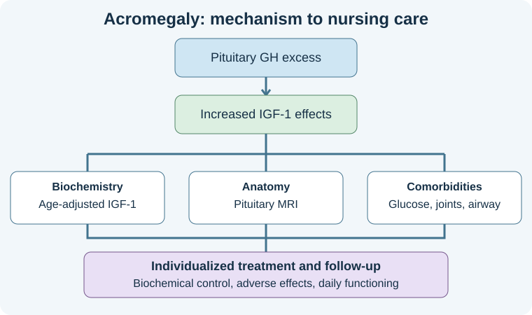

# Acromegaly — diagnosis, treatment and nursing care

**Study-ready candidate, not yet studied.** [Practice 20 MCQs](../MCQs/09A-Acromegaly-Clinical-Care-20-MCQs.md) · [Evidence register](../Previous-Year-Questions/09A-Acromegaly-Evidence-Gaps.md)

## GH aur IGF-1 ka connection

Pituitary brain ke base par ek chhoti endocrine gland hai. Growth hormone, jise GH kehte hain, liver aur doosre tissues ko insulin-like growth factor 1 (IGF-1) banane ka signal deta hai. Jab adult mein GH zaroorat se zyada release hota hai, toh growth plates band hone ke bawajood bones aur soft tissues ki thickness badh sakti hai. Haath, pair, jaw aur tongue bade ho sakte hain. Is condition ko acromegaly kehte hain. Aksar iska cause GH banane wala pituitary adenoma hota hai.

## Diagnosis aur assessment

Nurse patient ki purani photographs, hand aur shoe size changes, sweating, blood pressure, glucose history, joint pain aur daily functioning ke baare mein pooch sakti hai. GH pulses mein release hota hai, isliye ek random GH report par final decision nahi lena chahiye. IGF-1 ko age aur laboratory ki reference range ke saath interpret kiya jaata hai. Agar result aur clinical findings match nahi karte, toh medicines aur medical conditions ka effect specialist ko batana chahiye. Oral estrogen liver ke GH response ko badal sakta hai. Specialist selected equivocal cases mein supervised oral glucose suppression testing choose kar sakta hai. MRI lesion ki location aur nearby structures ka relation dikhata hai.

## Treatment aur nursing monitoring

Suitable resectable pituitary adenoma mein surgery aksar initial treatment option hoti hai. Tongue aur jaw changes airway management difficult bana sakte hain, isliye nurse anesthesia team ko relevant findings batati hai. Surgery ke baad early hormone value ko permanent cure ka proof mat samjho. Team generally lagbhag teen mahine par biochemical response assess karti hai aur baad mein individualized follow-up rakhti hai.

Somatostatin receptor ligands GH secretion ko reduce kar sakte hain. Pegvisomant GH receptor ko block karta hai, isliye treatment response assess karne mein IGF-1 important hai. Is medicine ke saath liver function monitoring bhi zaroori hai. Pasireotide blood glucose badha sakta hai. Agar patient ko gallbladder-related pain, fever aur jaundice ho, toh urgent evaluation chahiye. Medicine ki formulation, route aur schedule confirm karna administration se pehle important hai.

## Long-term care

Acromegaly ke saath glucose control, hypertension, cardiac issues, joint disease, median nerve compression aur bone health ki problems ho sakti hain. Patient ki diabetes medicine ki requirement successful treatment ke baad change ho sakti hai. Naye back pain aur height loss ko assess karo, kyunki normal bone density report bhi vertebral fracture ko completely exclude nahi karti. Colorectal screening ka plan specialist se discuss karo. Pituitary radiotherapy ke baad delayed hormone deficiencies ke liye long-term follow-up hota hai. Normal IGF-1 ke baad bhi joint pain ya functional problems reh sakti hain. Patient ki quality of life ko ignore nahi karna chahiye. Pregnancy plan karne wali patient ko medicine changes se pehle endocrine aur obstetric review ke liye guide karo.

## Teaching and practice evidence

- [Nursing Wallah by PW — pituitary lecture, published GH disorder chapter at 43:32](https://www.youtube.com/watch?v=VejlTNZXPfk&t=2612s). Description and published chapters retrieved. Playback and exact question coverage pending.
- Dedicated question-solving video verification remains pending. A teaching lecture is not counted as MCQ practice.
- [2024 diagnosis and remission consensus](https://doi.org/10.1007/s11102-023-01360-1).
- [Endocrine Society clinical practice guideline](https://academic.oup.com/jcem/article/99/11/3933/2836347).
- [2025 therapeutic outcomes consensus update](https://www.nature.com/articles/s41574-025-01148-2).
