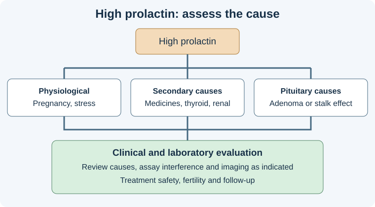

# Prolactinoma and hyperprolactinemia

**Study-ready candidate, not yet studied.** [20 original MCQs](../MCQs/09B-Prolactinoma-and-Hyperprolactinemia-20-MCQs.md) · [Evidence register](../Previous-Year-Questions/09B-Prolactinoma-Evidence-Gaps.md)

## Prolactin aur dopamine

Pituitary gland ke anterior part mein lactotroph cells prolactin banati hain. Prolactin breast mein doodh banne mein help karta hai. Normally hypothalamus se dopamine ka signal in cells tak pahunchta hai aur prolactin secretion ko control karta hai. Jab prolactin banane wala pituitary adenoma develop hota hai, toh prolactin high ho sakta hai. Is tumor ko prolactinoma kehte hain. Lekin har high prolactin report prolactinoma nahi hoti.

## Cause identify karna

Pregnancy, stressful sample collection, kuch medicines, primary hypothyroidism aur renal dysfunction prolactin ko affect kar sakte hain. Pituitary stalk par pressure se dopamine signal kam ho sakta hai. Nurse menstrual history, medicine history, libido, breast discharge, pregnancy possibility aur relevant clinical conditions poochti hai.

Kabhi laboratory test mein macroprolactin detect hota hai, jiska biological effect comparatively kam ho sakta hai. Agar bahut bada tumor ho aur prolactin unexpectedly mild elevated aaye, toh laboratory dilution se hook effect assess kar sakti hai. Yeh assay ki rare problem hai jisme actual bahut high level falsely low dikh sakta hai. Specialist result ko clinical findings aur MRI ke saath interpret karta hai.

## Treatment aur safety

Dopamine agonists jaise cabergoline prolactin kam karne aur tumor shrink karne mein help kar sakti hain. Nurse nausea, adherence, mood aur naye compulsive behaviors ko assess karti hai. Agar patient antipsychotic le raha hai toh endocrine aur psychiatric teams milkar treatment plan banati hain. Invasive lesion shrink hone ke baad rare cases mein clear watery nasal drainage CSF leak ka sign ho sakti hai. Isse urgent assessment chahiye. Intolerance ya inadequate response mein specialist other treatments, including selected surgery, discuss kar sakta hai.

## Follow-up aur reproductive care

High prolactin GnRH signaling suppress kar sakta hai. Isse LH, FSH aur sex hormones kam ho sakte hain. Lambe samay tak hypogonadism bone health ko affect kar sakta hai. Treatment ke baad fertility wapas aa sakti hai, isliye pregnancy intention aur contraception discuss karna important hai. Selected patients sustained control ke baad specialist-supervised medication withdrawal ke candidate ho sakte hain. Withdrawal ke baad bhi planned prolactin follow-up hota hai. Other pituitary hormone axes ko separately assess kiya jaata hai.

## References and videos

- [Pituitary Society consensus 2023](https://www.nature.com/articles/s41574-023-00886-5).
- [MSD Manual professional — prolactinoma](https://www.msdmanuals.com/professional/endocrine-and-metabolic-disorders/pituitary-disorders/prolactinoma).
- [Nursing Wallah by PW — NORCET 11 Prolactin Hormone Disorder](https://www.youtube.com/watch?v=Qft6PUihH-g). Indexed description identifies nursing and exam discussion. Specific question coverage and playback remain pending.
