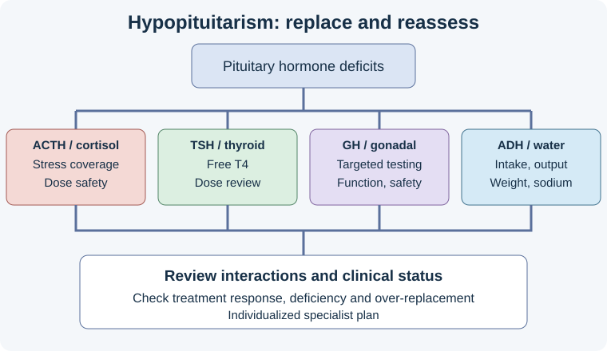

# Hypopituitarism — hormone replacement and safe nursing care

**Study-ready candidate, not yet studied.** [Practice 20 MCQs](../MCQs/09C-Hypopituitarism-Hormone-Replacement-20-MCQs.md) · [Evidence register](../Previous-Year-Questions/09C-Hypopituitarism-Evidence-Gaps.md)

## Pituitary hormone ki kami kya hoti hai?

Pituitary gland body ki multiple endocrine glands ko signals bhejti hai. Agar surgery, tumor, injury ya kisi doosre cause ki wajah se pituitary ka hormone output kam ho jaaye, toh ek ya multiple hormone axes affect ho sakti hain. Isko hypopituitarism kehte hain. Har patient mein same hormones deficient nahi hote, isliye nurse symptoms aur replacement medicines ko individually assess karti hai.

## Cortisol aur thyroid axis

ACTH adrenal cortex ko cortisol banane ka signal deta hai. Central adrenal insufficiency mein ACTH kam ya insufficient ho sakta hai. Cortisol ki kami life-threatening ho sakti hai, especially illness ya surgery ke time. Nurse prescribed hydrocortisone schedule, stress coverage aur emergency plan confirm karti hai. Aldosterone ka main regulation pituitary se alag hota hai, isliye central deficiency mein routine fludrocortisone generally needed nahi hoti. Morning cortisol ki timing aur recent steroid exposure record karna useful hai.

TSH thyroid gland ko stimulate karta hai. Central hypothyroidism mein TSH reliable dose marker nahi ho sakta. Isliye free T4 aur symptoms ko saath dekhkar replacement review hoti hai. Suspected cortisol deficiency ko thyroid hormone treatment se pehle specialist address karta hai. Oral estrogen binding proteins ko affect kar sakta hai aur hormone replacement need change ho sakti hai.

## GH aur gonadal axis

GH ka release pulses mein hota hai. Adult GH deficiency ke liye specialist indicated dynamic stimulation test choose kar sakta hai. Test-specific cutoffs aur BMI interpretation mein important ho sakte hain. Treatment ke baad IGF-1, symptoms, adrenal aur thyroid function monitor hote hain. Edema aur joint symptoms excessive GH replacement ka clue ho sakte hain.

Central hypogonadism mein pituitary ke LH aur FSH signals insufficient ho sakte hain. Morning testosterone aur gonadotropins ki testing male patient mein useful hai. Menopause ke baad expected gonadotropin rise absent ho toh pituitary dysfunction consider hoti hai. Gonadal hormone replacement ke liye contraindications aur intact uterus mein endometrial protection consider karna important hai.

## Water balance aur hormone interactions

Cortisol deficiency partial DI ko mask kar sakti hai. Glucocorticoid treatment shuru hone ke baad agar urine output bahut badhe toh nurse fluid balance, sodium aur clinical status assess karti hai. Pituitary surgery ke baad DI temporary bhi ho sakti hai, isliye specialist desmopressin ki ongoing need reassess kar sakta hai. Agar patient ko thirst sensation impaired hai, toh sirf pyaas par depend karna safe nahi hai. Prescribed fluid schedule, weight aur sodium monitoring se balance maintain kiya jaata hai.

## Sources and video

- [Endocrine Society clinical guideline summary — hormone replacement in hypopituitarism](https://www.endocrine.org/clinical-practice-guidelines/hormone-replacement-in-hypopituitarism).
- [Level Up RN — hypopituitarism, hyperpituitarism and hypophysectomy](https://www.youtube.com/watch?v=rlnGbbwFCfg). Teaching description indexed. Exact question-solving coverage pending.
