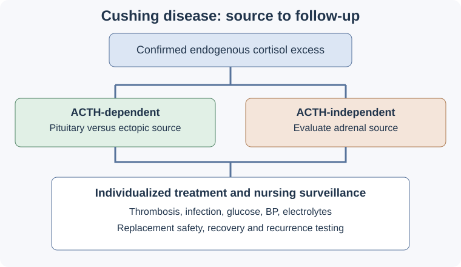

# Pituitary Cushing disease — clinical reasoning and nursing care

**Study-ready candidate, not yet studied.** [Practice 20 MCQs](../MCQs/09D-Pituitary-Cushing-Disease-20-MCQs.md) · [Evidence register](../Previous-Year-Questions/09D-Cushing-Disease-Evidence-Gaps.md)

## Source of cortisol excess

Cushing syndrome ka matlab glucocorticoid excess ka clinical state hai. Pituitary Cushing disease specifically ACTH-secreting pituitary lesion ki wajah se hoti hai. Endogenous hypercortisolism establish karne ke baad ACTH se dependent aur independent pathways differentiate karte hain. ACTH-dependent disease mein pituitary aur ectopic source consider hote hain. MRI small lesion miss kar sakta hai. Selected patients mein specialist inferior petrosal sinus sampling se ACTH source assess karta hai. Yeh screening test nahi hai.

## Reliable biochemical sampling

Late-night salivary cortisol, urinary free cortisol aur dexamethasone suppression tests patient context ke according use ho sakte hain. Shift-work sleep pattern late-night result affect kar sakta hai. Timed urine ka missed void report karo. Dexamethasone metabolism affect karne wali medicines document karo aur independently stop mat karo. Suspected cyclic disease mein active phase ke around specialist-guided repeated testing needed ho sakti hai.

## Complication surveillance and treatment

Active disease thrombosis, infection, hypertension, impaired glucose control, weakness aur bone problems ka risk badhati hai. New unilateral calf swelling ya respiratory deterioration ko promptly assess aur escalate karo. Treatment improve hone par glucose medicines ki requirement change ho sakti hai. Metyrapone jaise steroidogenesis inhibitors ke saath BP, potassium aur adrenal insufficiency signs monitor karo. Ketoconazole ke liye hepatic safety aur drug interactions assess hote hain. Pasireotide hyperglycemia cause kar sakti hai. Mifepristone receptor action block karti hai, isliye circulating cortisol se response directly measure nahi hota. Pregnancy safety important hai. Medicine selection aur dose adjustment specialist-directed hote hain.

## Post-treatment recovery

Successful pituitary surgery ke baad normal HPA function suppressed reh sakta hai. Prescribed glucocorticoid replacement aur emergency education recovery tak important hain. Fatigue aur muscle aches withdrawal syndrome ya inadequate replacement se related ho sakte hain. Adrenal crisis signs immediate escalation demand karte hain. Remission ke baad long-term recurrence testing aur cardiovascular, bone aur metabolic follow-up continue hota hai. Bilateral adrenalectomy selected refractory cases ka treatment ho sakti hai, lekin pituitary tumor progression surveillance aur lifelong adrenal hormone replacement zaroori rehte hain.

## Clinical references and video

- [Endocrine Society Cushing syndrome treatment guideline](https://www.endocrine.org/clinical-practice-guidelines/treatment-of-cushing-syndrome) · [2021 Pituitary Society consensus](https://pubmed.ncbi.nlm.nih.gov/34687601/).
- [Nursing Wallah by PW — NORCET 10 endocrine lecture](https://www.youtube.com/watch?v=VejlTNZXPfk), indexed chapter markers 48:31 Cushing disease and 1:01:02 cortisol testing. Teaching resource, not verified coverage of the 20 original questions.
