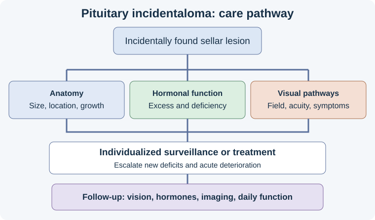

# Nonfunctioning pituitary adenomas and incidentalomas

**Study-ready candidate, not yet studied.** [Practice 20 MCQs](../MCQs/09E-Nonfunctioning-Pituitary-Adenomas-20-MCQs.md) · [Evidence register](../Previous-Year-Questions/09E-Nonfunctioning-Adenoma-Evidence-Gaps.md)

## Clinical significance

Pituitary incidentaloma imaging par unexpectedly discovered sellar lesion ko describe karta hai. Har incidental lesion adenoma nahi hoti aur har adenoma nonfunctioning nahi hoti. Clinically nonfunctioning adenoma mein overt hormone excess syndrome absent hota hai, lekin normal pituitary tissue ya nearby structures compress ho sakte hain. Adenoma ka maximum diameter 10 mm se kam ho toh microadenoma aur 10 mm ya zyada ho toh macroadenoma category hoti hai. Size ke saath location aur growth trend important hain.

## Assessment and escalation

Pituitary MRI anatomy characterize karne mein help karta hai. Device-specific MRI safety clearance needed hoti hai. Hormonal assessment clinically silent deficiencies aur excess evaluate karti hai. Chiasm ke paas lesion mein formal perimetry peripheral field defects identify kar sakti hai, even if patient normal reading acuity report karta hai. Parasellar spread ocular motor nerves affect kar sakta hai. Preoperative dilute polyuria ke context mein alternative sellar lesions consider karne chahiye.

Sudden severe headache, vomiting, visual change, altered consciousness ya hypotension pituitary apoplexy aur acute adrenal insufficiency ka concern raise kar sakte hain. ABCs aur urgent emergency escalation prioritize karo. Stable low-risk incidental lesions mein individualized surveillance possible hai. Objective growth, new visual impairment, hormonal change aur critical anatomy involvement specialist reassessment trigger karte hain.

## Treatment and follow-up

Transsphenoidal surgery symptomatic compressive adenomas ke liye commonly considered hoti hai. Pathology tissue hormone expression aur lineage clarify kar sakti hai. Silent corticotroph subtype ka tissue staining active clinical Cushing disease ke equivalent nahi hai. Stable postoperative residual lesion ke liye selected patients mein monitoring appropriate ho sakti hai. Radiotherapy decision individualized hai aur optic pathway proximity treatment planning mein relevant hai. Delayed hormone deficiencies radiotherapy ke years baad bhi develop ho sakti hain.

Pituitary surgery ke baad delayed sodium complications discharge ke baad possible hain. New nausea, headache ya confusion promptly report karo. Hormone recovery axis-specific hoti hai, isliye ek normal cortisol result se sab axes recovered assume mat karo. Follow-up mein vision, endocrine function, serial imaging, mobility, sleep, mood aur daily function assess hote hain. Travel aur cost barriers ko coordinated care plan mein address karo.

## Sources and video

- [Endotext — Non-Functioning Pituitary Adenomas](https://www.ncbi.nlm.nih.gov/books/NBK534880/) · [2025 Pituitary Society incidentaloma consensus](https://www.nature.com/articles/s41574-025-01134-8).
- [Nursing Wallah by PW — NORCET 10 pituitary lecture](https://www.youtube.com/watch?v=VejlTNZXPfk). Indexed chapters 12:16 optic relations, 14:51 cavernous sinus, 18:28 cranial nerves, 54:45 mass effect and 1:06:51 surgery. Teaching only. Dedicated practice coverage pending.
