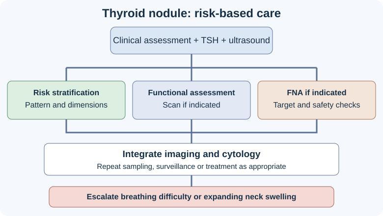

# Thyroid nodules and FNA — practical nursing assessment

**Study-ready candidate, not yet studied.** [20 original MCQs](../MCQs/10A-Thyroid-Nodules-and-FNA-20-MCQs.md) · [Evidence register](../Previous-Year-Questions/10A-Thyroid-Nodules-Evidence-Gaps.md)

## Nodule ka meaning aur assessment

Thyroid neck ke front mein butterfly-shaped gland hai. Iske kisi part mein discrete lump develop ho toh usse thyroid nodule kehte hain. Nodule solid, fluid-filled ya mixed ho sakta hai. Most nodules benign hote hain, lekin hormonal function aur malignancy risk alag questions hain. Nurse patient se growth, pain, swallowing, voice changes, breathing difficulty, radiation exposure aur family history ke baare mein poochti hai.

## Ultrasound, functional assessment aur biopsy

Ultrasound nodule ki dimensions, composition, margins, shape aur cervical nodes assess karta hai. Multiple nodules hon toh har lesion ka risk pattern aur applicable size criteria dekhte hain. Suspicious features ka matlab confirmed cancer nahi hai. Agar TSH suppressed ho toh suitable patient mein clinician scintigraphy se functional activity assess kar sakta hai. Fine-needle aspiration, ya FNA, se targeted lesion ki cells obtain hoti hain. Nurse patient aur nodule identification, medicine history, anticoagulant plan aur procedure-specific instructions confirm karti hai. Routine FNA bina sedation mein usually fasting required nahi hoti. Needle sampling ke waqt patient ko still rehna aur cough urge communicate karna chahiye.

## Sample aur result

Multiple nodules ke specimens ki separate location labeling important hai. Bethesda I nondiagnostic category hai aur further assessment needed ho sakti hai. Bethesda II benign hai lekin high-risk imaging mismatch ho toh reassessment important hai. Bethesda III atypia aur IV follicular neoplasm indeterminate categories hain. Follicular carcinoma ke diagnosis mein capsule ya blood vessel invasion assess karna important hota hai, jo aspirated cells alone se usually establish nahi hota. Molecular testing selected indeterminate nodules ka estimated risk refine kar sakti hai. Yeh absolute guarantee nahi deti.

## Recovery aur follow-up

Mild puncture discomfort expected ho sakta hai. Rapidly expanding neck swelling ya breathlessness rare but urgent complication ka sign ho sakti hai. ABCs aur emergency response priority hain. Benign nodule bhi pressure symptoms cause kar sakti hai. Monitoring mein comparable ultrasound dimensions aur risk pattern important hain. ETA 2023 mein significant growth ka ek criterion kam se kam do diameters mein 20% rise with minimum 2 mm increase hai. Growth alone cancer prove nahi karti. Selected recurrent benign cysts mein ethanol ablation aur symptomatic benign solid nodules mein thermal ablation specialist options ho sakte hain. Patient ko realistic outcomes aur follow-up explain karo.

## References and videos

- [American Thyroid Association — FNA patient guide](https://www.thyroid.org/fna-thyroid-nodules/) and [thyroid nodules](https://www.thyroid.org/thyroid-nodules/).
- [Endotext — thyroid fine-needle aspiration](https://www.ncbi.nlm.nih.gov/sites/books/NBK285544/).
- [2023 ETA thyroid nodule guideline](https://pmc.ncbi.nlm.nih.gov/articles/PMC10448590/). Indexed recommendations retrieved, full PMC open blocked.
- [Thyroid Nodule Biopsy — teaching demonstration](https://www.youtube.com/watch?v=7bYTit2AVTc). Indexed description confirms ultrasound-guided FNA. Channel, playback and exact practice mapping pending.
