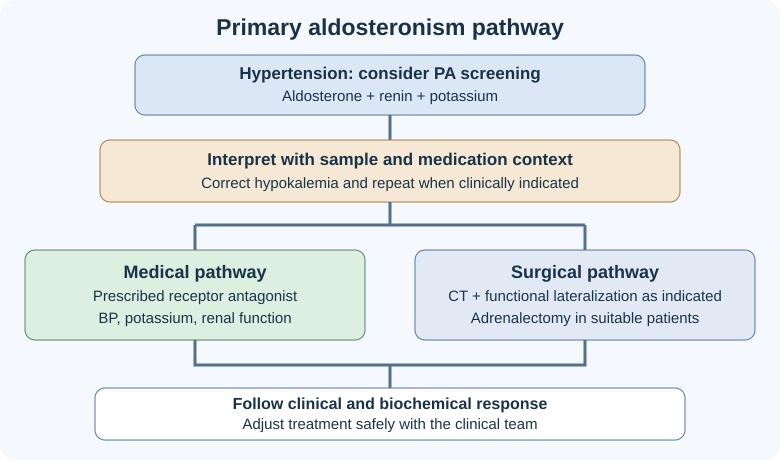

# Primary aldosteronism — recognition, screening and nursing management

**Study-ready candidate, not yet studied.** [20 original MCQs](../MCQs/10B-Primary-Aldosteronism-20-MCQs.md) · [Evidence register](../Previous-Year-Questions/10B-Primary-Aldosteronism-Evidence-Gaps.md)

## Aldosterone excess ko samjho

Adrenal cortex ki zona glomerulosa aldosterone banati hai. Normally renin-angiotensin system aur potassium iski secretion influence karte hain. Primary aldosteronism mein adrenal tissue renin ke normal control se relatively independent aldosterone excess produce karta hai. Kidney sodium retain karti hai aur potassium plus hydrogen ion excretion increase ho sakti hai. Is wajah se hypertension, kabhi hypokalemia aur metabolic alkalosis develop hote hain. Normal potassium disease ko exclude nahi karta. Compensatory natriuresis ki wajah se obvious edema har patient mein nahi hota.

## Screening aur interpretation

2025 Endocrine Society guideline hypertension wale individuals mein broader aldosterone-renin screening suggest karti hai. Resource constraints mein resistant hypertension aur strong clinical clues wale patients ko priority mil sakti hai. Aldosterone concentration, renin aur potassium saath interpret hote hain. ARR ek ratio hai. Example mein aldosterone 18 ng/dL aur renin activity 0.3 ng/mL/h ho toh ratio 60 hota hai. Is result ko assay-specific threshold aur clinical context ke saath dekhna chahiye.

Hypokalemia aldosterone suppress kar sakti hai. Beta blockers renin suppress karke ratio misleadingly high bana sakte hain aur ACE inhibitors renin badhakar negative result contribute kar sakte hain. Recent sodium restriction bhi results influence kar sakti hai. Nurse medicine list, sampling conditions aur electrolyte status document karti hai. Prescriber ki guidance ke bina blood pressure medicines stop nahi karni chahiye.

## Source localization aur treatment

Positive biochemical screening se source ka side establish nahi hota. CT anatomical lesion identify karta hai. AVS ka role suitable surgical candidates mein unilateral aur bilateral secretion differentiate karna hai. Procedure team potassium aur interfering medicines review karti hai. Selected non-surgical patients mein suppression testing har baar required nahi hoti. Adrenal adenoma ke saath autonomous cortisol secretion bhi assess ho sakti hai.

Bilateral disease ya non-surgical management mein mineralocorticoid receptor antagonists use ho sakte hain. Spironolactone se gynecomastia jaise adverse effects ho sakte hain. Clinician selected patients mein more selective alternative consider kar sakta hai. Nurse blood pressure, potassium, kidney function, medicine interactions aur potassium-containing salt substitute assess karti hai. Uncontrolled BP plus persistently suppressed renin mein 2025 guideline clinician-guided MRA titration consider karti hai. Effective treatment ke baad GFR modestly fall kar sakta hai due to correction of hyperfiltration, lekin clinical review zaroori hai.

## Postoperative care

Lateralizing disease mein selected patients adrenalectomy choose kar sakte hain. Biochemical improvement aur complete blood pressure cure alag outcomes hain. Antihypertensive therapy clinician BP trends ke hisaab se adjust karta hai. Postoperative potassium monitoring important hai kyunki remaining adrenal gland suppressed ho sakti hai. Hyperkalemia ya new renal dysfunction promptly report karo. Treatment ka goal BP control ke saath cardiovascular aur renal risks reduce karna bhi hai.

## References

- [2025 Endocrine Society primary aldosteronism guideline](https://www.endocrine.org/clinical-practice-guidelines/primary-aldosteronism-2).
- [Endotext — hyperaldosteronism](https://www.ncbi.nlm.nih.gov/sites/books/NBK279065/).
- [Full guideline, JCEM 2025](https://doi.org/10.1210/clinem/dgaf284).
- [The Playbook for Primary Aldosteronism — 2025 guidelines](https://www.youtube.com/watch?v=eVdk_b3N0Y8), indexed teaching description. Playback, channel details and exact MCQ-practice mapping pending.
