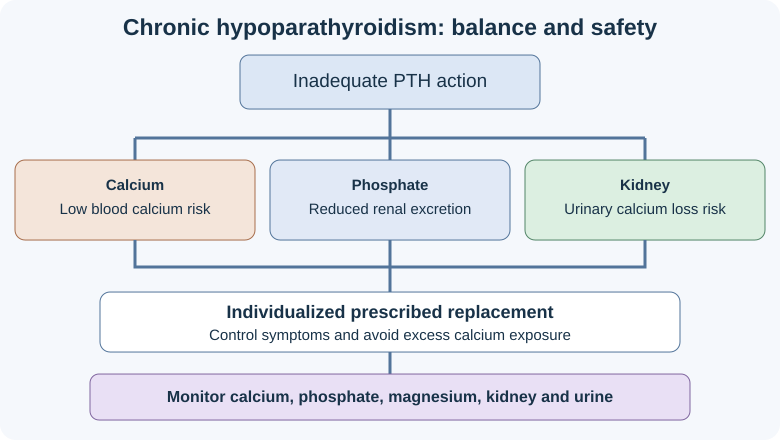

# Chronic hypoparathyroidism — calcium replacement and renal safety

**Study-ready candidate, not yet studied.** [20 original MCQs](../MCQs/10C-Chronic-Hypoparathyroidism-20-MCQs.md) · [Evidence register](../Previous-Year-Questions/10C-Hypoparathyroidism-Evidence-Gaps.md)

## PTH deficiency mein calcium balance

Parathyroid glands usually thyroid ke posterior region mein hoti hain. Jab blood ka ionized calcium kam hota hai, toh PTH normally increase hokar kidneys mein calcium reabsorption aur phosphate excretion support karta hai. PTH active vitamin D formation ko bhi stimulate karta hai. Gland injury, surgery ya selected genetic causes se PTH inadequate ho sakta hai. Isse calcium low aur phosphate high ho sakta hai. Low calcium ke saath reference-range PTH bhi inappropriate ho sakta hai.

## Treatment targets aur formulation

Revised ESE 2025 guidance postsurgical disease mein recovery possibility ke chalte 12-month chronic cutoff use karti hai. Iska matlab calcium treatment delay nahi karna hai. Conventional therapy mein prescribed activated vitamin D aur adequate calcium se symptoms control kiye jaate hain. Calcium target generally lower normal range ya slightly below normal hota hai, depending on symptoms aur safety. PTH deficiency renal calcium reabsorption reduce kar sakti hai, isliye serum calcium theek hone par bhi urinary calcium elevated ho sakta hai.

Calcium carbonate ka 40% mass elemental calcium hota hai. 1,250 mg carbonate se 500 mg elemental calcium milta hai. Supplemental elemental calcium 500 mg per day se zyada ho toh ESE smaller divided doses suggest karti hai. Carbonate ko food ke saath lena absorption support karta hai. Acid suppression ya achlorhydria mein clinician calcium citrate consider kar sakta hai. Active vitamin D phosphate absorption bhi increase kar sakta hai, isliye phosphate trends monitor karna zaroori hai.

## Renal safety aur treatment escalation

Stable conventional treatment mein periodic 24-hour urinary calcium useful hai. Creatinine aur sodium collection adequacy aur sodium intake ka context dete hain. ESE suggested targets adult women mein 250 mg/day se kam aur men mein 300 mg/day se kam hain. Hypercalciuria mein calcium aur activated vitamin D dose review, dietary sodium reduction aur selected thiazide therapy consider ho sakti hai. Thiazide ke saath BP, potassium, magnesium aur renal function monitor karo. Loop diuretic urinary calcium loss increase kar sakti hai, lekin necessary medical treatment ko independently stop nahi karna chahiye.

Optimized conventional therapy ke bawajood symptoms, calcium fluctuations, hyperphosphatemia, hypercalciuria ya reduced renal function ho toh specialist PTH replacement consider kar sakta hai. Treatment aim stable calcium aur conventional supplement need reduce karna hai. Calcium monitoring continue hoti hai.

## Follow-up aur escalation

ESE stable patients mein calcium, phosphate, magnesium aur renal function jaise tests example ke taur par every 3–6 months recommend karti hai. Therapy changes ke baad biochemical monitoring generally every 1–2 weeks hoti hai, aur severe symptoms mein immediate assessment chahiye. Conventional therapy mein timed urinary calcium periodically, example every 1–2 years, monitor hota hai. New flank pain, renal decline ya suspected calcification mein indicated renal imaging consider hoti hai. Endogenous recovery ke liye periodic PTH assessment useful ho sakti hai. Patient ko tingling, cramps, severe weakness, palpitations, confusion ya other new symptoms report karne ke liye educate karo.

## Sources and video

- [2025 revised ESE chronic hypoparathyroidism guideline](https://doi.org/10.1093/ejendo/lvaf222).
- [2022 International Task Force update](https://pmc.ncbi.nlm.nih.gov/articles/PMC10118814/), historical comparator, use revised ESE recommendations where stated.
- [Nursing Odyssey — Saunders NCLEX Endocrine Made Easy, published parathyroid section at 35:00](https://www.youtube.com/watch?v=xcwJd5RbBb4&t=2100s). Description and published marker retrieved, individual chronic-management question coverage and playback pending.
