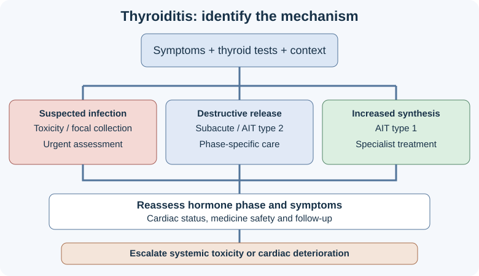

# Thyroiditis and amiodarone-associated thyroid dysfunction

**Study-ready candidate, not yet studied.** [20 original MCQs](../MCQs/10D-Thyroiditis-and-Amiodarone-20-MCQs.md) · [Evidence register](../Previous-Year-Questions/10D-Thyroiditis-Evidence-Gaps.md)

## Thyroid inflammation aur hormone release

Thyroiditis thyroid gland ki inflammation hai, aur etiology ke hisaab se course different ho sakta hai. Painful subacute thyroiditis often preceding respiratory illness aur thyroid pain ke saath present hoti hai. Inflamed follicles stored thyroid hormone release kar sakte hain. Isse temporary thyrotoxicosis hoti hai, even when gland actively zyada hormone synthesize nahi kar rahi hoti. Stored hormone depleted hone par hypothyroid phase aa sakti hai. Har patient sab phases experience nahi karta. Painless thyroiditis similar biochemical course follow kar sakti hai bina painful gland ke. Hashimoto thyroiditis commonly chronic autoimmune hypothyroidism cause karti hai. Antibody positivity alone replacement indication establish nahi karti.

## Painful gland mein safety assessment

Painful thyroid plus focal collection, high fever ya marked systemic toxicity acute suppurative infection ka concern raise karte hain. Is situation mein routine noninfectious thyroiditis treatment assume nahi karna chahiye. Clinician antimicrobial therapy aur source control assess karta hai. Aspirated specimen ko requested microbiology tests ke liye suitable container aur instructions ke saath handle karo. Normal thyroid tests infection exclude nahi karte.

Confirmed noninfectious subacute thyroiditis mein pain severity aur contraindications ke hisaab se anti-inflammatory treatment select hota hai. NSAID ke saath gastrointestinal aur renal risks review hote hain. Severe cases mein prescribed glucocorticoids use ho sakte hain. Taper ke dauran recurrence possible hai. Destructive thyrotoxic phase mein beta blockers adrenergic symptoms reduce kar sakte hain, lekin thionamides new hormone synthesis block karte hain aur pure destructive release ko target nahi karte.

## Phase-based follow-up

Initial palpitations resolve hone ke baad bhi thyroid function change ho sakti hai. New cold intolerance, constipation aur fatigue possible hypothyroid phase ka clue hai. Thyroid tests repeat karke current phase clarify hoti hai. Selected symptomatic patients temporary levothyroxine le sakte hain. Recovery possible ho toh specialist supervised replacement reassessment karta hai. Hard fixed infiltrative thyroid enlargement mein Riedel thyroiditis aur malignancy jaise differential diagnoses ko appropriate imaging aur tissue assessment se clarify karna important hai.

## Amiodarone-associated thyroid changes

Amiodarone iodine-rich antiarrhythmic medicine hai. Treatment ke dauran hypothyroidism ya thyrotoxicosis dono possible hain, isliye periodic thyroid assessment important hai. Type 1 AIT mein iodine-induced increased synthesis susceptible gland mein ho sakti hai. Type 2 AIT destructive inflammation se related hai. Doppler vascularity aur gland history useful clues hain, lekin mixed forms possible hain. Type 1 mein thionamide aur moderate-to-severe type 2 mein glucocorticoid clinician-directed treatment options hain. Cardiac indication important hone ki wajah se amiodarone stop ya continue karna specialist teams ka joint decision hai. Cardiac deterioration urgent multidisciplinary intervention demand kar sakti hai. Overt amiodarone-induced hypothyroidism mein prescribed levothyroxine diya ja sakta hai without necessarily withdrawing the antiarrhythmic.

## References and videos

- [Endotext — Acute, Subacute and Riedel thyroiditis](https://www.ncbi.nlm.nih.gov/sites/books/NBK285553/).
- [American Thyroid Association — thyroiditis](https://www.thyroid.org/thyroiditis/).
- [2018 ETA amiodarone-associated thyroid dysfunction guideline](https://pubmed.ncbi.nlm.nih.gov/29594056/). Full guideline indexed at [PMC](https://pmc.ncbi.nlm.nih.gov/articles/PMC5869486/), direct open blocked in this run.
- [What is Subacute Thyreoiditis (De Quervain's)?](https://www.youtube.com/watch?v=7obiTrfAU04), indexed teaching metadata. Exact coverage and channel/playback pending.
- [Thyroid Disorders NCLEX Questions & Answers](https://www.youtube.com/watch?v=t9j-7I4jDj8), indexed broad question-practice metadata. Specific item coverage pending.
