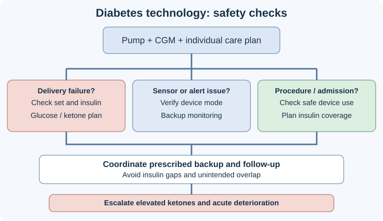

# Diabetes technology and insulin-device safety

**Study-ready candidate, not yet studied.** [20 original MCQs](../MCQs/10E-Diabetes-Technology-and-Pump-Safety-20-MCQs.md) · [Evidence register](../Previous-Year-Questions/10E-Diabetes-Technology-Evidence-Gaps.md)

## Pump mein insulin delivery

Insulin pump programmed background basal rate aur separate meal/correction boluses deliver karti hai. Typical rapid-acting-insulin pump user ke paas sustained long-acting depot nahi hota. Delivery interrupt hone par insulin deficiency aur ketosis jaldi develop ho sakti hai. Kinked tubing, displaced cannula, insulin heat exposure aur pump malfunction possible causes hain. Alarm absent hone se delivery success guarantee nahi hoti. Tubing priming aur cannula fill ke device-specific instructions carefully follow karo.

## Pump failure aur backup

Unexplained persistent hyperglycemia mein patient-specific glucose aur ketone monitoring plan follow karo. Confirmed infusion failure ke saath elevated ketones mein prescribed backup injected insulin route aur urgent clinical assessment needed ho sakte hain. DKA symptoms medical emergency hain. Written backup plan mein individualized alternative basal aur meal insulin instructions, supplies aur emergency contact details honi chahiye. Backup long-acting insulin ka residual effect pump restart ke time consider karo, warna basal overlap hypoglycemia cause kar sakta hai. Insulin on board recent doses ka remaining action estimate karta hai. Repeated early corrections insulin stacking risk badha sakti hain.

## CGM aur automated systems

CGM interstitial glucose estimate karta hai. Hybrid AID system sensor input se insulin delivery adjust kar sakta hai, lekin meal-related user action many systems mein needed hoti hai. Sensor communication loss mein displayed fallback mode verify karo. Time zone changes clock-dependent profiles ko affect kar sakte hain. Manufacturer instructions aur clinical training specific device ke liye important hain.

Time in range percentage se target range mein spent duration calculate hota hai. Example mein 24 hours ka 75% equals 18 hours. HbA1c average glycemia estimate karta hai, lekin recurrent clinically significant lows average mein hide ho sakte hain. CGM report interpret karte waqt time below range aur sufficient data capture consider karo. Usual 14-day report ke liye 70% active data desirable hai, although individual clinical context matters.

## Inpatient and procedural safety

Hospital mein pump continuation patient ki current self-management capacity aur institutional protocol par depend karti hai. Acute confusion mein qualified team ko alternate insulin regimen arrange karna chahiye so that necessary insulin coverage continues. Personal CGM use ke saath hospital protocol ke according confirmatory POC testing ho sakti hai. MRI compatibility manufacturer aur radiology instructions se verify karo, aur incompatible device removal se pehle insulin continuity plan banao. Infusion site infection ke signs promptly assess karo, aur essential alerts preserve karte hue alarm fatigue address karo. Insulin doses ya device programming independently change na karo.

## Clinical references and video leads

- [FDA insulin pump home safety](https://www.fda.gov/medical-devices/infusion-pumps/insulin-pumps-tips-using-your-insulin-pump-home).
- [UCSF Diabetes Teaching Center — Ketones and Insulin Pumps](https://diabetesteachingcenter.ucsf.edu/content/ketones-and-insulin-pumps).
- [ADCES pump backup plans](https://www.adces.org/education/danatech/insulin-pumps/troubleshooting-pumps/pump-back-up-plans).
- [ADCES CGM and pump integration](https://www.adces.org/education/danatech/insulin-pumps/training-clients-patients/cgm-pump-integration) and [AID consensus](https://academic.oup.com/edrv/article/44/2/254/6692818).
- [ADA Standards 2026 — diabetes technology](https://doi.org/10.2337/dc26-s007).
- [ADA Standards 2026 — glycemic goals](https://doi.org/10.2337/dc26-s006).
- [ADA Standards 2026 — hospital care](https://doi.org/10.2337/dc26-s016).
- [ADCES infusion site troubleshooting](https://www.adces.org/education/danatech/insulin-pumps/troubleshooting-pumps/troubleshooting-acute-infusion-set-site-issues).
- [Insulin pump teaching video lead](https://www.youtube.com/watch?v=PZrkaIJ23-E). Specific device model, coverage and playback remain unverified.
