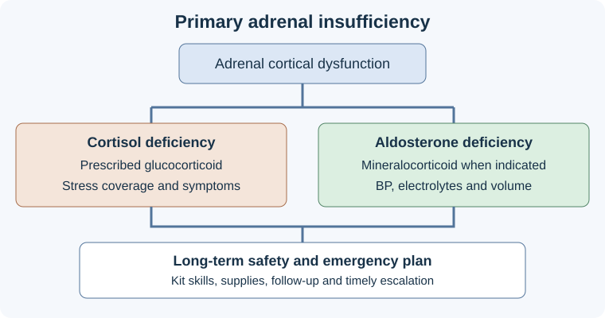

# Primary adrenal insufficiency — replacement and longitudinal nursing care

**Study-ready candidate, not yet studied.** [Practice 20 MCQs](../MCQs/11A-Primary-Adrenal-Insufficiency-20-MCQs.md) · [Evidence register](../Previous-Year-Questions/11A-Primary-Adrenal-Insufficiency-Evidence-Gaps.md)

## Adrenal cortex ki kami ko samjho

Adrenal glands kidney ke upar hoti hain. Cortex cortisol aur aldosterone banata hai. Primary adrenal insufficiency mein adrenal cortex ki function inadequate ho sakti hai. Cortisol body ko stress aur glucose regulation mein help karta hai. Aldosterone kidney mein sodium retain aur potassium excrete karne mein help karta hai. Dono ki deficiency ke effects alag ho sakte hain. Isliye confirmed cortisol deficiency ke saath paired renin aur aldosterone assessment useful hai.

## Diagnosis aur cause

Stable patient mein clinician ACTH aur cortisol evaluation plus suitable corticotropin test select kar sakta hai. Test ka exact sample timing aur cortisol assay ka validated cutoff important hai. Agar patient severe unstable hai aur adrenal crisis suspected hai toh emergency steroid aur fluid treatment ko tests ke liye delay nahi karna chahiye. 21-hydroxylase antibody autoimmune etiology support kar sakti hai. Negative result ke baad specialist TB ya other adrenal pathology jaise alternate causes evaluate kar sakta hai. Autoimmune disease ke saath thyroid, diabetes aur B12 deficiency jaise associated disorders bhi consider karo.

## Replacement safety

Hydrocortisone cortisol replacement hai. Fludrocortisone confirmed mineralocorticoid deficiency mein sodium aur water balance support karti hai. Persistent salt craving aur orthostatic symptoms under-replacement ka clue ho sakte hain. Edema, high BP aur suppressed renin excess ka concern raise karte hain. Heat aur sweating mein sodium loss badh sakta hai. Nurse clinical findings aur medicines document karke specialist review coordinate karti hai. ACTH normalization routine dose escalation ka sole target nahi hai, kyunki excess glucocorticoid exposure harmful ho sakta hai.

## Crisis aur continuity

Adrenal crisis mein parenteral hydrocortisone, fluids aur clinical monitoring needed hain. Infusion interruption promptly address karo. Oral transition ke liye patient stable hona aur oral medicine absorb kar pana important hai. Stress-dose hydrocortisone ka mineralocorticoid effect usual fludrocortisone need temporarily change kar sakta hai. Emergency kit training mein return demonstration, written sick-day instructions, sufficient supplies aur contacts important hain. DHEA selected patients mein optional adjunct ho sakta hai, essential hormone replacement nahi.

## Sources and video

- [Endocrine Society primary adrenal insufficiency guideline](https://www.endocrine.org/clinical-practice-guidelines/primary-adrenal-insufficiency).
- [NICE NG243 recommendations](https://www.nice.org.uk/guidance/ng243/chapter/Recommendations), indexed recommendations. Direct access was blocked.
- [ADAPT NCLEX REVIEW teaching section 28:40](https://www.youtube.com/watch?v=2GWI6B8VsP4&t=1720s) and [published practice section 46:25](https://www.youtube.com/watch?v=2GWI6B8VsP4&t=2785s). Description and markers retrieved. Individual item coverage remains unverified.
