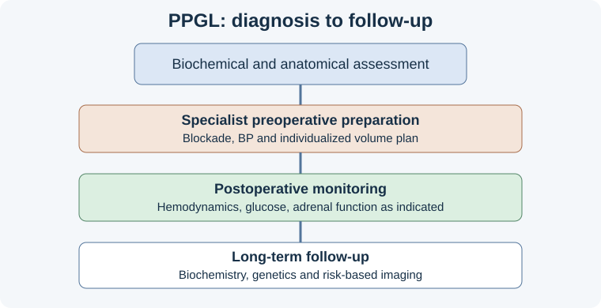

# Pheochromocytoma and paraganglioma — diagnostic and perioperative care

**Study-ready candidate, not yet studied.** [Practice 20 MCQs](../MCQs/11B-Pheochromocytoma-and-Paraganglioma-20-MCQs.md) · [Evidence register](../Previous-Year-Questions/11B-PPGL-Evidence-Gaps.md)

## Catecholamine-producing tumor

Adrenal medulla catecholamines banati hai, jaise adrenaline aur noradrenaline. Is tissue se tumor arise ho toh pheochromocytoma kehte hain. Extra-adrenal related tumor paraganglioma kehlata hai. Dono ko collectively PPGL kehte hain. Catecholamine excess BP, pulse aur metabolism affect kar sakta hai. Kuch paragangliomas biochemically silent bhi hote hain. Metanephrines continuous tumor metabolism se form ho sakti hain, isliye testing sirf symptomatic attacks par depend nahi karti.

## Reliable testing aur safety

Plasma metanephrine collection mein posture aur laboratory reference interval match karna important hai. Supine protocol mein at least 30 minutes recumbent rest recommended hai. Stress, medicines aur sampling conditions borderline result influence kar sakte hain. Nurse complete medicine history document karti hai aur repeat testing ka specialist plan follow karti hai. Adrenal mass ki biopsy se pehle functional PPGL risk address hona chahiye kyunki manipulation dangerous catecholamine release provoke kar sakti hai. Confirmed PPGL mein genetic counseling family history absent hone par bhi relevant hai.

## Surgical preparation

Functional PPGL mein specialist alpha blockade establish karta hai. Nurse orthostatic BP aur symptoms monitor karti hai. Volume contraction reverse karne ke liye suitable patients mein prescribed salt-fluid preparation useful ho sakti hai. Heart failure aur renal disease mein plan carefully individualize hota hai. Metyrosine selected severe cases mein catecholamine synthesis reduce kar sakti hai. Drowsiness aur movement changes report karo. Tumor removal ke baad abrupt catecholamine reduction, residual blockade, volume depletion aur blood loss hypotension contribute kar sakte hain. Glucose monitoring bhi important hai kyunki insulin release rebound ho sakta hai.

## Long-term follow-up

Recovery ke baad biochemical response assess kiya jaata hai. Normal postoperative markers ke bawajood risk-based long-term surveillance important hai. Histology alone metastatic potential completely exclude nahi karti. Selected bilateral hereditary cases mein cortical-sparing surgery adrenal cortical hormone production preserve karne ka aim rakhti hai, lekin hormone status aur recurrence follow-up needed hai. Metastatic disease mein tracer-specific functional imaging selected targeted radionuclide treatment suitability assess kar sakti hai.

## Sources and videos

- [Endocrine Society PPGL guideline](https://academic.oup.com/jcem/article/99/6/1915/2537399).
- [Japan Endocrine Society 2025 guideline](https://www.jstage.jst.go.jp/article/endocrj/73/1/73_EJ25-0165/_html/-char/en).
- [ADAPT NCLEX REVIEW, published pheochromocytoma care section 43:35](https://www.youtube.com/watch?v=2GWI6B8VsP4&t=2615s), [question practice 46:25](https://www.youtube.com/watch?v=2GWI6B8VsP4&t=2785s). Published description inspected, exact individual item coverage not confirmed.
