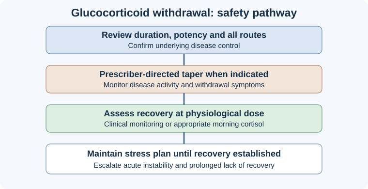

# Glucocorticoid-induced adrenal insufficiency and withdrawal

**Study-ready candidate, not yet studied.** [20 original MCQs](../MCQs/11C-Glucocorticoid-Induced-Adrenal-Insufficiency-20-MCQs.md) · [Evidence register](../Previous-Year-Questions/11C-Glucocorticoid-Withdrawal-Evidence-Gaps.md)

## HPA axis suppression ka meaning

Hypothalamus aur pituitary adrenal cortex ko cortisol banane ka signal dete hain. Jab bahar se glucocorticoid medicine long duration tak milti hai, toh feedback ke through natural ACTH aur cortisol secretion suppress ho sakti hai. Dose, duration, potency, multiple routes aur drug interactions se risk vary karta hai. 2024 joint guideline oral exposure ke approximate risk thresholds 3–4 weeks ya longer aur daily physiological equivalent se higher dose batati hai. Isolated shorter courses mein routine taper usually needed nahi hota, lekin underlying illness aur previous exposure consider karo.

## Taper aur recovery assessment

Long-term treatment taper tab consider hota hai jab underlying condition controlled ho aur glucocorticoid ab required na ho. Long-acting steroid ko selected cases mein shorter-acting medicine mein supervised convert kar sakte hain. Physiological dose tak pahunchne par gradual monitored taper ya morning cortisol assessment possible hai. Guideline guide values mein morning cortisol above 10 micrograms/dL recovery support karta hai, 5–10 mein physiological coverage aur repeat test, aur below 5 mein continued coverage aur later reassessment consider hoti hai. Yeh values assay aur clinical context ke saath interpret hoti hain. Har patient ke liye routine dynamic test necessary nahi hai. Severe withdrawal syndrome mein clinician last tolerated dose aur slower taper consider kar sakta hai.

## Exposure history aur safety

High-dose inhaled, potent topical, recent intra-articular injections aur simultaneous multiple formulations systemic effects create kar sakte hain. Strong CYP3A4 inhibitors kuch steroid medicines ka exposure badha sakte hain. Exogenous Cushingoid appearance HPA suppression ke saath coexist kar sakti hai. Recovery uncertain ho toh patient ko prescribed stress coverage instructions milni chahiye. Minor stable illness mein oral route appropriate ho sakta hai, jabki major stress, prolonged oral restriction ya instability mein parenteral coverage needed ho sakti hai. Steroid-induced deficiency alone mein fludrocortisone routinely indicated nahi hai. One year tak physiological dose par recovery absent ho toh endocrinology evaluation recommended hai.

## References

- [2024 ESE/Endocrine Society guideline](https://www.endocrine.org/clinical-practice-guidelines/glucocorticoid-induced-adrenal-insufficiency), directly retrieved recommendations R2.1–2.12 and R3.1–3.2.
- [ADAPT NCLEX REVIEW, steroid exposure section 33:08](https://www.youtube.com/watch?v=2GWI6B8VsP4&t=1988s). Published teaching marker, predates 2024 guideline. Dedicated current question-solving coverage pending.
