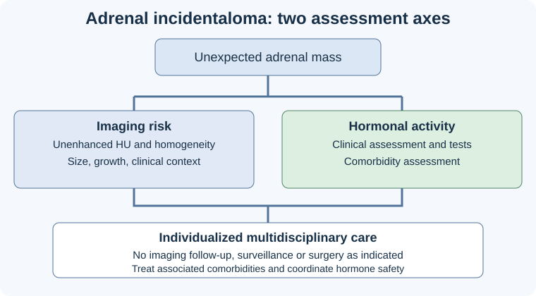

# Adrenal incidentaloma and mild autonomous cortisol secretion

**Study-ready candidate, not yet studied.** [20 original MCQs](../MCQs/11D-Adrenal-Incidentaloma-20-MCQs.md) · [Evidence register](../Previous-Year-Questions/11D-Adrenal-Incidentaloma-Evidence-Gaps.md)

## Adrenal mass ka assessment

Kabhi abdomen imaging kisi unrelated reason ke liye hoti hai aur adrenal gland ka mass unexpectedly dikhta hai. Isko adrenal incidentaloma kehte hain. Nurse patient ko explain karti hai ki lesion ka malignancy risk aur hormone secretion alag questions hain. 2023 ESE guideline mein homogeneous unenhanced CT attenuation 10 HU ya kam clear benign imaging pattern hai, jisme routine further imaging needed nahi hoti. Homogeneous 11–20 HU lesion under 4 cm with no significant hormone excess mein additional characterization ya appropriate interval imaging consider hoti hai. Large heterogeneous ya high-attenuation mass multidisciplinary review demand karti hai. HU value ki imaging phase verify karna zaroori hai. Indeterminate lesion surveillance mein more than 20% plus at least 5 mm maximum diameter growth significant reassessment trigger ho sakti hai.

## Hormone activity aur MACS

Mild autonomous cortisol secretion, ya MACS, mein cortisol regulation abnormal ho sakti hai even without specific signs of overt Cushing syndrome. 1-mg overnight dexamethasone test mein post-test cortisol above 1.8 micrograms/dL is context mein MACS suggest karta hai. Clinician ACTH independence, test confounders aur persistence assess karta hai. Frail patients with limited life expectancy mein testing ka clinical benefit individualized hota hai. BP, diabetes aur skeletal fragility jaise associated problems ka assessment aur treatment important hai.

## Management aur longitudinal care

Selected unilateral MACS patients with meaningful comorbidities surgery discuss kar sakte hain, considering health, age, preferences aur biochemical findings. Adrenalectomy se pehle stress-dose glucocorticoid plan verify karo when indicated, because postoperative adrenal function impaired ho sakti hai. Clearly benign lesion with previously normal hormonal evaluation mein routine repeated biochemical testing usually needed nahi hoti unless new symptoms ya comorbidities worsen. Nonoperative MACS mein annual clinical comorbidity review useful hai. Bilateral masses ko separately characterize karo. Extensive bilateral metastases mein adrenal deficiency consider karo. Younger patient ya suspected cortical carcinoma mein timely specialist assessment important hai. Bilateral adrenalectomy routine MACS management nahi hai when overt Cushing syndrome absent ho.

## References and video

- [2023 ESE adrenal incidentaloma guideline](https://academic.oup.com/ejendo/article/189/1/G1/7198474).
- [The Surgical Scholar — Adrenal Incidentaloma: What It Is and When to Act](https://www.youtube.com/watch?v=k8V1eQQBLbo), 2026 teaching video. Published imaging section 03:40, MACS section 05:05 and follow-up 06:40. Exact question-solving content and playback unverified.
