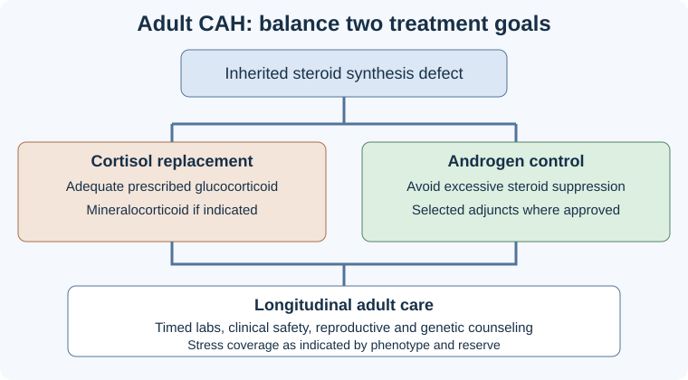

# Adult congenital adrenal hyperplasia — clinical assessment and follow-up

**Study-ready candidate, not yet studied.** [20 original MCQs](../MCQs/11E-Adult-Congenital-Adrenal-Hyperplasia-20-MCQs.md) · [Evidence register](../Previous-Year-Questions/11E-Adult-CAH-Evidence-Gaps.md)

## Mechanism aur adult diagnosis

Congenital adrenal hyperplasia (CAH) inherited steroid synthesis disorders ka group hai. Common 21-hydroxylase deficiency mein cortisol synthesis impaired hoti hai aur ACTH drive increase ho sakti hai. Precursors adrenal androgen production ki taraf shift ho sakte hain. Classic aur nonclassic phenotypes ki severity aur replacement need alag ho sakti hai. Symptomatic adults mein early morning 17-hydroxyprogesterone assessment useful hai. Borderline findings mein specialist cosyntropin-stimulated complete steroid profile select kar sakta hai. Equivocal testing ya counseling mein targeted genetics relevant ho sakti hai.

## Monitoring aur treatment goals

Classic CAH mein prescribed glucocorticoid essential cortisol replacement provide karta hai aur androgen excess control karne mein help karta hai. Mineralocorticoid clinically indicated hone par diya jaata hai. Treatment monitoring mein consistently timed hormone sampling, BP, BMI aur Cushingoid signs assess karo. Complete steroid precursor suppression ke liye excessive glucocorticoid dena routine goal nahi hai. Routine adrenal imaging stable disease mein indicated nahi hai unless relevant clinical concerns arise. Men with classic CAH mein periodic testicular ultrasound testicular adrenal rest tumors assess karne ke liye recommended hai. Fertility concerns specialist referral deserve karte hain.

## Nonclassic disease aur genetic counseling

Asymptomatic nonpregnant adults with nonclassic CAH mein routine glucocorticoid treatment recommended nahi hai. Meaningful androgen symptoms mein individualized treatment discussion ho sakti hai. Prior symptoms resolve ho jaayein toh supervised treatment reassessment possible hai. Major stress coverage ka decision documented adrenal reserve aur iatrogenic suppression se related hai. Routine daily exercise alone automatic dose increase ka reason nahi hai. Autosomal recessive inheritance ko simple example se samjho: dono parents heterozygous carriers hon toh standard model mein affected child ka risk 25% per pregnancy hota hai.

## Newer adjunctive treatment

US FDA ne December 2024 mein crinecerfont ko classic CAH mein glucocorticoid replacement ke adjunct ke roop mein approve kiya. Yeh CRF type 1 receptor antagonist hai aur ACTH-driven androgen excess reduce karne mein help kar sakti hai. Yeh cortisol replacement nahi hai. Glucocorticoid adequate physiological replacement se neeche nahi reduce karna chahiye. Strong CYP3A4 inducer exposure reduce kar sakte hain aur prescriber ko label-specific adjustment assess karna chahiye. Serious hypersensitivity signs urgent care demand karte hain. Indian approval, availability aur local prescribing rules independently verify karne honge before claiming local use.

## References

- [Endocrine Society 2018 CAH guideline](https://www.endocrine.org/clinical-practice-guidelines/congenital-adrenal-hyperplasia-guideline-resources), directly retrieved recommendations 3.2–3.4, 4.4–4.17, 5.2–5.6 and 6.3–6.13.
- [US FDA approval announcement](https://www.fda.gov/news-events/press-announcements/fda-approves-new-treatment-congenital-adrenal-hyperplasia).
- [US prescribing information, DailyMed](https://dailymed.nlm.nih.gov/dailymed/lookup.cfm?setid=fd3a6fbd-9137-428a-ba46-df6606f07d28&version=5), directly retrieved.
- [CAH teaching review](https://www.youtube.com/watch?v=MrXIHQ11gD4), indexed description. Dedicated adult nursing question-solving coverage and playback unverified.
