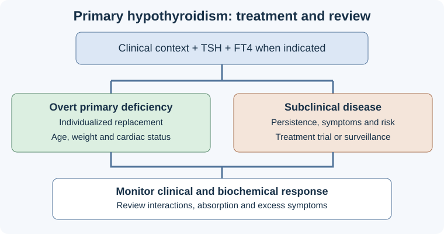

# Adult primary hypothyroidism — treatment and monitoring

**Study-ready candidate, not yet studied.** [20 original MCQs](../MCQs/12A-Primary-Hypothyroidism-Management-20-MCQs.md) · [Evidence register](../Previous-Year-Questions/12A-Hypothyroidism-Evidence-Gaps.md)

## Hormone replacement ka basic principle

Thyroid gland T4 aur T3 hormones banati hai. Primary hypothyroidism mein thyroid ki hormone production inadequate ho jaati hai. Levothyroxine synthetic T4 hai, jisko body ke tissues active T3 mein convert kar sakte hain. Dose selection age, weight, cardiovascular history aur clinical status ke basis par hoti hai. NICE mein selected adults under 65 without cardiovascular disease ke liye 1.6 micrograms/kg/day starting estimate hai. Older adults aur cardiac disease mein cautious titration consider hoti hai. Dose independently change mat karo.

## Test result aur longitudinal assessment

Acute illness thyroid function results temporarily alter kar sakti hai. TPO antibodies etiology clarify karti hain, lekin serial titres routine replacement monitoring ke liye recommended nahi hain. Primary hypothyroidism mein TSH main follow-up marker hai. Severe longstanding untreated disease mein TSH normalize hone mein up to six months lag sakte hain. Stable control ke baad annual monitoring consider hoti hai. Persistent symptoms mein FT4 aur other causes assess karna useful hai. Excess replacement se suppressed TSH aur cardiac complications ho sakti hain.

## Subclinical hypothyroidism

Subclinical disease mein TSH raised hai aur FT4 normal hai. NICE repeated TSH at least 10 on two occasions three months apart mein treatment consider karti hai. Under 65 symptomatic adults with repeated TSH above reference but below 10 mein monitored six-month trial possible hai. Normal TSH ke bawajood no symptom benefit ho toh selected mild subclinical trial supervised stop karne ka discussion ho sakta hai. Yeh overt deficiency replacement ko stop karne ka general rule nahi hai. Underlying autoimmune features ke saath untreated disease mein annual thyroid tests consider hote hain.

## Medication safety

Consistent dosing schedule important hai. Selected patients bedtime dosing use kar sakte hain with adequate food separation. Formulation change, GI malabsorption aur binding medications dose response alter kar sakti hain. Diabetes ke saath thyroid therapy change par glucose trends monitor karo. Desiccated animal thyroid routine treatment recommended nahi hai. Euthyroid weight loss ke liye levothyroxine use nahi karna chahiye.

## Sources

- [NICE NG145 hosted by NCBI](https://www.ncbi.nlm.nih.gov/books/NBK550859/).
- [ATA thyroid hormone treatment](https://www.thyroid.org/thyroid-hormone-treatment/).
- [US prescribing label](https://dailymed.nlm.nih.gov/dailymed/drugInfo.cfm?setid=bc9385d0-5c67-4bde-94da-e621347e2cba), indexed text available, direct access failed. Local product instructions verify karo.
