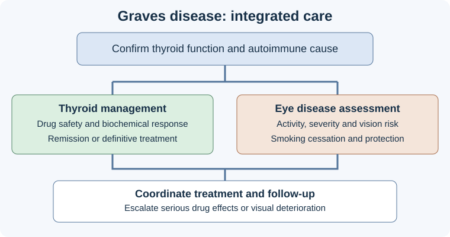

# Adult Graves disease and orbitopathy — clinical nursing care

**Study-ready candidate, not yet studied.** [20 original MCQs](../MCQs/12B-Graves-Disease-and-Orbitopathy-20-MCQs.md) · [Evidence register](../Previous-Year-Questions/12B-Graves-Evidence-Gaps.md)

## Graves ka mechanism aur diagnosis

Graves ek autoimmune disease hai. TSH receptor stimulate karne wali antibodies thyroid gland mein hormone synthesis increase kar sakti hain. TRAb test se autoimmune etiology support hoti hai. Negative TRAb aur unclear cause mein clinician functional thyroid scan consider kar sakta hai. Palpable nodule absent ho toh ultrasound har thyrotoxic adult ka mandatory first test nahi hai. Destructive thyroiditis mein stored hormone release aur Graves mein increased synthesis alag processes hain.

## Drug safety aur remission

Thionamides new hormone synthesis reduce karte hain. Baseline full blood count aur liver function assess karo. Early response mein FT4 aur FT3 useful hain because TSH recovery lag kar sakti hai. Fever aur sore throat par urgent blood count aur drug hold guidance important hai. Confirmed agranulocytosis ke baad antithyroid drugs restart nahi karne chahiye. Routine repeat FBC aur LFT without clinical suspicion NICE recommend nahi karti. Remission decision mein TRAb aur clinical context helpful hain. Persistent antibody elevation mein specialist extended treatment ya definitive options discuss kar sakta hai. Drug withdrawal ke baad biochemical follow-up arrange karo.

## Definitive treatment aur eye disease

Treatment options mein antithyroid drugs, radioiodine aur surgery aate hain. Compression, eye activity, patient preference aur radiation precautions ki feasibility choice affect karte hain. Radioiodine response gradual hota hai aur persistent hyperthyroidism ya hypothyroidism detect karne ke liye monitoring chahiye.

Orbitopathy mein activity ongoing inflammation describe karti hai aur severity functional impact aur vision threat assess karti hai. Smoking cessation aur stable euthyroidism important hain. Lubricants ocular surface protect karne mein help karte hain. New color vision ya acuity reduction urgent ophthalmic assessment demand karti hai. Active significant eye disease mein antithyroid drugs generally preferred hain over radioiodine. Selenium-deficient settings mein selected mild active recent-onset disease ke liye supervised limited selenium course consider ho sakta hai. Inactive residual diplopia ya other structural effects mein rehabilitative surgical assessment useful ho sakti hai.

## References

- [NICE NG145](https://www.ncbi.nlm.nih.gov/books/NBK550859/).
- [2018 ETA Graves guideline](https://pmc.ncbi.nlm.nih.gov/articles/PMC6140607/).
- [2021 EUGOGO guideline](https://academic.oup.com/ejendo/article/185/4/G43/6654384).
