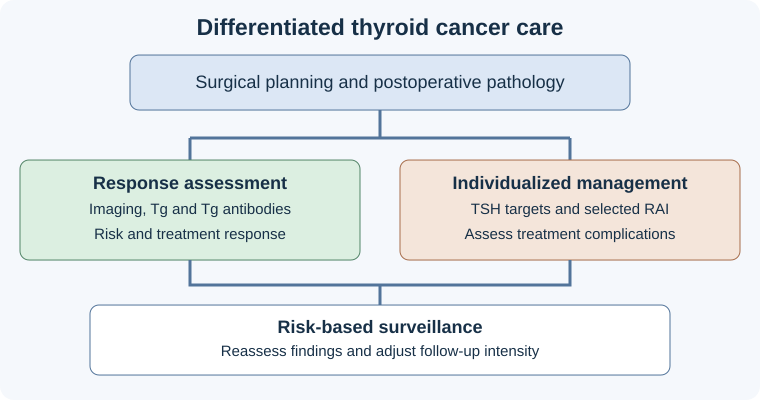

# Differentiated thyroid carcinoma — postoperative endocrine care

**Study-ready candidate, not yet studied.** [20 original MCQs](../MCQs/12C-Differentiated-Thyroid-Cancer-Care-20-MCQs.md) · [Evidence register](../Previous-Year-Questions/12C-Differentiated-Thyroid-Cancer-Evidence-Gaps.md)

## Treatment planning

Differentiated thyroid carcinoma thyroid follicular cells se originate karta hai, including papillary aur follicular types. Preoperative neck ultrasound local tumor extent aur nodal findings clarify karne mein useful hai. Surgical extent individualized hota hai. Selected small clinically node-negative disease mein routine prophylactic central dissection avoid karna complication risk reduce kar sakta hai. Completion surgery se pehle existing recurrent laryngeal nerve function important hai. Routine drain placement postoperative clinical observation replace nahi karti.

## Response assessment

Postoperative risk assessment initial stage se aage jaati hai. Pathology, imaging, serum thyroglobulin (Tg) aur Tg antibodies se risk revise ho sakta hai. 2025 ATA initial postoperative Tg assessment 6–12 weeks mein recommend karti hai. Tg antibodies assay interfere kar sakti hain. Lobectomy ke baad normal remaining lobe Tg produce karti hai, isliye serial Tg interpretation limited hai. Structural disease imaging par confirmed ho toh low Tg alone excellent response establish nahi karta. TSH targets response aur risks ke according individualize hote hain. Sustained excellent low-risk response mein surveillance burden gradually reduce ho sakta hai.

## Radioiodine aur nursing follow-up

RAI selected iodine-avid disease mein use hoti hai. Recombinant TSH selected preparation mein hormone withdrawal avoid kar sakta hai. Low-iodine diet sodium-free diet nahi hai. Appropriate diet aur fluid instructions follow karo. Salivary pain, swelling aur long-term dry mouth radiation-related complications ho sakte hain. Persistent xerostomia mein oral-health assessment useful hai. SPECT-CT uncertain uptake ko anatomy ke saath correlate kar sakta hai. Recurrent nodal disease ka treatment size alone par decide nahi hota. Location, progression, previous treatment aur patient factors assess hote hain.

## References

- [2025 ATA executive summary](https://journals.sagepub.com/doi/full/10.1177/10507256251390877), direct retrieved.
- [2025 full guideline](https://doi.org/10.1177/10507256251363120), indexed recommendations, PMC direct retrieval blocked.
- [NICE NG230](https://www.ncbi.nlm.nih.gov/books/NBK589159/).
- [ATA radioactive iodine guidance](https://www.thyroid.org/radioactive-iodine/).
- [NIH iodine guidance](https://ods.od.nih.gov/factsheets/iodine-HealthProfessional/), indexed low-iodine versus sodium guidance.
