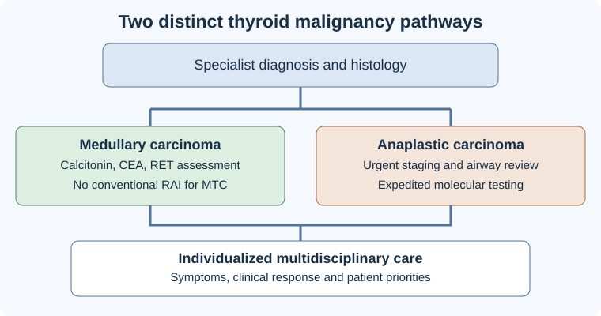

# Medullary and anaplastic thyroid cancer — distinct endocrine care

**Study-ready candidate, not yet studied.** [20 original MCQs](../MCQs/12D-Medullary-and-Anaplastic-Thyroid-Cancer-20-MCQs.md) · [Evidence register](../Previous-Year-Questions/12D-Medullary-Anaplastic-Evidence-Gaps.md)

## Medullary carcinoma

MTC thyroid ke parafollicular C cells se arise karta hai. Calcitonin aur CEA useful tumor markers hain. Tumor-only RET mutation aur inherited germline RET mutation different findings hain. Apparent sporadic disease mein bhi germline testing aur counseling important hai. MEN2A context mein associated parathyroid disease aur adrenal tumors assess hote hain. MTC typical follicular-cell iodine uptake nahi karta, isliye conventional radioactive iodine indicated nahi hai. Total thyroidectomy ke baad levothyroxine se normal thyroid function maintain karte hain, routine cancer-related TSH suppression nahi. Secretory diarrhea mein fluid balance, electrolytes aur symptom control monitor karo. Serial calcitonin aur CEA ko comparable assay aur imaging context mein interpret karo. Detectable marker alone systemic treatment ka automatic indication nahi hai. Relevant RET alteration aur clinical indication ho toh selected targeted medicines consider hoti hain.

## Anaplastic carcinoma

ATC rapid progressive thyroid malignancy ho sakta hai. Suspicion par specialist diagnosis, tissue evaluation, airway assessment aur staging expeditiously coordinate karo. BRAF V600E result actionable therapy influence kar sakta hai. Selected mutation-positive patients mein BRAF aur MEK pathway inhibition consider hoti hai. Significant treatment response ke baad resectability reassess ho sakti hai. Airway intervention actual obstruction, tumor anatomy aur patient goals ke basis par individualized hoti hai. Routine prophylactic tracheostomy every stable patient ke liye appropriate nahi hai. Palliative care pain, symptom burden, communication aur quality of life address karti hai, even while active treatment continues.

## Sources

- [2015 ATA medullary carcinoma guideline](https://journals.sagepub.com/doi/full/10.1089/thy.2014.0335).
- [ATA medullary carcinoma overview](https://www.thyroid.org/thyroid-health-medullary/).
- [NCI thyroid cancer PDQ](https://www.cancer.gov/types/thyroid/hp/thyroid-treatment-pdq).
- [2021 ATA anaplastic carcinoma guideline](https://journals.sagepub.com/doi/full/10.1089/thy.2020.0944).
- [2026 ASCO systemic thyroid cancer guideline](https://ascopubs.org/doi/10.1200/JCO-26-00235).
