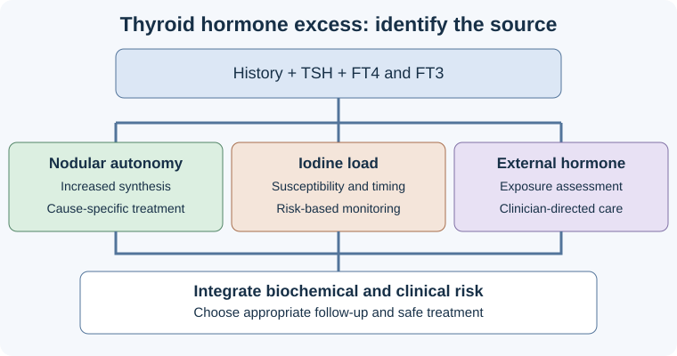

# Toxic nodular and other non-Graves thyrotoxicosis

**Study-ready candidate, not yet studied.** [20 original MCQs](../MCQs/12E-Toxic-Nodular-and-Other-Thyrotoxicosis-20-MCQs.md) · [Evidence register](../Previous-Year-Questions/12E-Non-Graves-Thyrotoxicosis-Evidence-Gaps.md)

## Autonomous thyroid tissue

Toxic adenoma ek autonomously functioning thyroid nodule hai. Toxic multinodular goiter mein multiple functioning areas ho sakte hain. Yeh tissue suppressed TSH ke bawajood hormone synthesize kar sakta hai. FT3 elevated aur FT4 normal ho toh overt T3-predominant thyrotoxicosis possible hai. Functional imaging distribution se cause clarify ho sakta hai. Antithyroid drugs hormone synthesis control karti hain but underlying autonomy necessarily eliminate nahi karti. Selected solitary toxic nodule mein hemithyroidectomy ya RAI definitive options hain. Multiple nodules mein unsuitable definitive therapy ke context mein long-term titrated medication possible hai.

## Subclinical hyperthyroidism

Subclinical disease mein TSH low aur FT4 plus FT3 normal hote hain. Persistent TSH below 0.1 mIU/L ETA grade 2 category hai. Older patients mein cardiac aur fracture risks relevant hain. Younger asymptomatic low-risk grade 1 patients mein observation possible hai. NICE untreated adult surveillance mein six-monthly TSH consider karti hai with FT4 and FT3 if TSH abnormal.

## Iodine exposure aur exogenous hormones

Iodinated contrast susceptible autonomous thyroid tissue mein increased synthesis trigger kar sakta hai. Elective overt hyperthyroidism mein alternative imaging ya timing review karo. Essential emergency imaging ke liye urgent multidisciplinary decision needed hai. Low-risk patients mein universal prophylaxis indicated nahi hai. High-risk patients mein targeted thyroid testing approximately 3–4 weeks after contrast consider hoti hai. Recent iodine exposure isotope uptake interfere kar sakta hai, so nuclear medicine ko exact date batao. 2021 ETA general one-to-two-month interval advice deti hai. Nonprescription thyroid-containing products exogenous excess cause kar sakte hain. Low uptake plus low Tg with no antibody interference external hormone source support kar sakta hai. Treatment actual cause, clinical severity aur exposure assessment se guided hota hai.

## References

- [Endotext thyrotoxicosis of other etiologies](https://www.ncbi.nlm.nih.gov/books/NBK285562/).
- [NICE NG145](https://www.ncbi.nlm.nih.gov/books/NBK550859/).
- [2015 ETA subclinical hyperthyroidism guideline](https://pubmed.ncbi.nlm.nih.gov/26558232/).
- [2021 ETA iodine contrast guideline](https://pmc.ncbi.nlm.nih.gov/articles/PMC8314764/).
- [2016 ATA hyperthyroidism guideline](https://journals.sagepub.com/doi/10.1089/thy.2016.0229).
