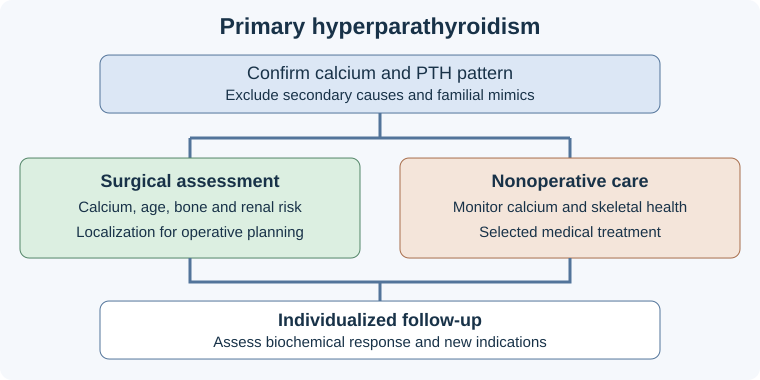

# Primary hyperparathyroidism — diagnosis, treatment and follow-up

**Study-ready candidate, not studied.** [20 MCQs](../MCQs/13A-Primary-Hyperparathyroidism-20-MCQs.md) · [Evidence](../Previous-Year-Questions/13A-Primary-Hyperparathyroidism-Evidence-Gaps.md)

PTH parathyroid glands se release hoti hai. Primary hyperparathyroidism mein gland ki secretion calcium feedback ke according adequately suppress nahi hoti. Repeated paired calcium aur PTH results se biochemical diagnosis establish karo. Normocalcemic disease mein secondary causes exclude karna important hai. Familial hypocalciuric hypercalcemia ka suspicion family history aur low urinary clearance ratio se ho sakta hai, lekin thiazide, renal function aur vitamin D status interpretation affect karte hain. Confirmed FHH mein routine surgery generally useful nahi hoti.

## Surgery ka decision

Confirmed PHPT mein imaging localization ke liye hai, diagnosis ke liye nahi. Calcium upper limit se more than 1 mg/dL higher, age below 50, selected skeletal findings including vertebral fracture or T-score at or below −2.5, aur renal involvement surgery assessment ke reasons hain. Exact 2022 workshop criteria aur individualized operative risk specialist verify karta hai. Young age aur multigland involvement inherited syndrome evaluation justify kar sakte hain.

## Nonoperative and postoperative care

Surveillance mein annual calcium aur appropriate renal monitoring, plus indicated three-site DXA important hai. Cinacalcet calcium-sensing receptor sensitivity increase karti hai. Antiresorptive drugs skeletal protection mein help kar sakti hain; dono goals separate hain. Surgery ke baad immediate calcium safety aur later biochemical cure assessment different tasks hain. NICE three to six months par adjusted calcium measurement suggest karti hai. Nonspecific symptoms improve hone ki guarantee nahi deni chahiye.

## References

- [2022 Fifth International Workshop](https://onlinelibrary.wiley.com/doi/full/10.1002/jbmr.4677), indexed recommendations.
- [NICE NG132](https://www.nice.org.uk/guidance/ng132/chapter/Recommendations), indexed recommendations.
- [Endotext: Approach to Hypercalcemia](https://www.ncbi.nlm.nih.gov/sites/books/NBK279129/), directly retrieved.
