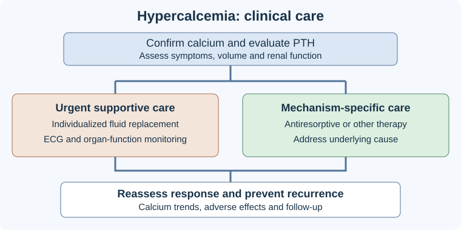

# Hypercalcemia — non-PTH causes and acute endocrine nursing care

**Study-ready candidate, not studied.** [20 MCQs](../MCQs/13B-Non-PTH-Hypercalcemia-and-Clinical-Care-20-MCQs.md) · [Evidence](../Previous-Year-Questions/13B-Hypercalcemia-Evidence-Gaps.md)

## Mechanism identify karo

High calcium mein intact PTH suppressed ho toh PTH-independent causes consider karo. PTHrP-producing tumors bone aur kidney pathways activate kar sakte hain. Lymphoma aur granulomatous disease mein extrarenal calcitriol synthesis intestinal calcium absorption increase kar sakti hai. Excess calcium carbonate and alkali exposure se hypercalcemia, renal impairment aur metabolic alkalosis ka combination develop ho sakta hai. Immobilization bone resorption increase kar sakti hai.

## Urgent assessment

Acute symptomatic severe disease mein mental status, ECG, hemodynamics, intake-output aur renal function assess karo. Hypercalcemia renal concentrating ability impair karke dehydration cause kar sakti hai. Isotonic saline volume deficit correct karne mein help karti hai, but heart failure aur kidney impairment mein fluid plan carefully individualize hota hai. Loop diuretics routine first-line treatment nahi hain; selected volume-overload context mein clinician consider kar sakta hai.

## Medication aur follow-up

Malignancy-associated severe calcium elevation mein rapid temporary calcitonin plus more sustained antiresorptive therapy consider hoti hai. Calcitonin ka effect tachyphylaxis se kam ho sakta hai. IV bisphosphonate se pehle renal function review karo. Denosumab renal clearance par dependent nahi hai, lekin CKD and vitamin D deficiency mein hypocalcemia risk important hai. Refractory HCM after IV bisphosphonate mein denosumab consider ho sakti hai. Calcitriol-driven disease mein glucocorticoids selected cases mein useful hain; persistent severe HCM mein antiresorptive addition consider hoti hai. Dialysis selected refractory or renal-failure situations mein specialist option hai. Cause-specific treatment, exposure reconciliation and follow-up are essential.

## References
- [Endotext: Approach to Hypercalcemia](https://www.ncbi.nlm.nih.gov/sites/books/NBK279129/)
- [Endocrine Society HCM guideline recommendations](https://www.endocrine.org/clinical-practice-guidelines/hypercalcemia)
