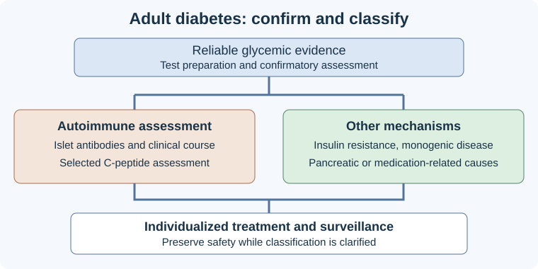

# Adult diabetes classification and testing

**Study-ready candidate, not studied.** [20 MCQs](../MCQs/13C-Adult-Diabetes-Classification-and-Diagnostic-Testing-20-MCQs.md) · [Evidence register](../Previous-Year-Questions/13C-Diabetes-Classification-Evidence-Gaps.md)

## Reliable diagnosis

Fasting plasma glucose aur timed OGTT standardized tests hain. Fasting ke liye at least eight hours caloric intake absent hona chahiye. OGTT se pehle usual mixed diet with adequate carbohydrate intake maintain karne ki prescribed instructions follow karo. Specimen processing delayed ho toh cells glucose consume kar sakte hain. HbA1c assay interference aur altered red-cell biology results affect kar sakti hain. Discordant findings mein reliable confirmatory testing aur clinical context important hain. Impaired glucose tolerance aur overt diabetes thresholds different hain.

## Diabetes type ka assessment

Type 1 diabetes any adult age ya BMI mein ho sakti hai. Islet autoantibodies autoimmune etiology support karti hain but negative result alone excludes nahi karta. C-peptide endogenous insulin secretion assess karne mein useful hai, but recent hyperglycemic crisis ke immediately baad interpretation problematic ho sakti hai. Stage 1 autoimmune type 1 mein multiple antibodies with normal glycemia hoti hain; stage 2 mein dysglycemia bhi present hoti hai. Risk-based monitoring se progression early identify ho sakti hai.

## Other specific types

Atypical young-onset multigenerational diabetes mein monogenic cause consider karo. GCK-MODY aur HNF1A-MODY treatment implications different hain; genetic diagnosis aur specialist supervision essential hain. Chronic pancreatitis endocrine aur exocrine function affect kar sakti hai. Immune checkpoint therapy abrupt insulin deficiency precipitate kar sakti hai. Clinical deterioration urgent escalation demand karti hai. Diabetes classification ko patient appearance ya insulin prescription alone se decide mat karo.

## References
- [ADA 2026 section 2](https://doi.org/10.2337/dc26-s002)
- [Laboratory analysis guideline 2023](https://diabetesjournals.org/care/article/46/10/e151/153425/Guidelines-and-Recommendations-for-Laboratory)
- [ADA/EASD 2026 adult type 1 consensus](https://link.springer.com/article/10.1007/s00125-026-06833-z)
- [ADA 2025 section 2 monogenic table](https://diabetesjournals.org/care/article/48/Supplement_1/S27/157566)
