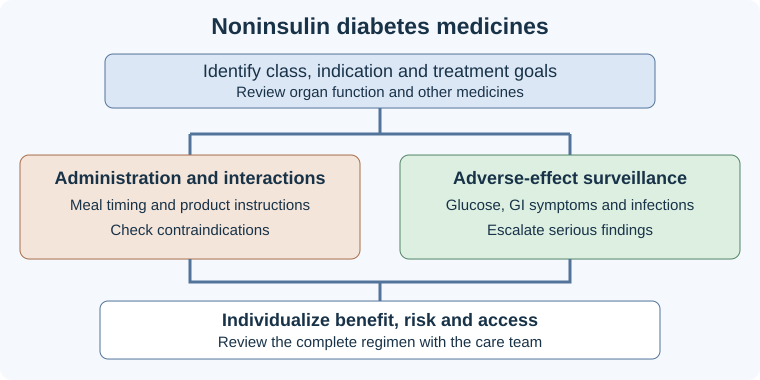

# Noninsulin diabetes medication — nursing safety

**Study-ready candidate, not studied.** [20 MCQs](../MCQs/13D-Noninsulin-Diabetes-Medication-Safety-20-MCQs.md) · [Evidence register](../Previous-Year-Questions/13D-Noninsulin-Medication-Evidence-Gaps.md)

## Drug mechanisms

DPP-4 inhibitors endogenous incretin breakdown reduce karte hain. GLP-1-based medicines glucose-dependent signaling affect karti hain; tirzepatide GIP aur GLP-1 dono receptors target karti hai. Alpha-glucosidase inhibitors intestinal carbohydrate digestion delay karti hain. SGLT2 inhibitors proximal tubular glucose reabsorption reduce karke glucosuria promote karte hain. Treatment selection individualized clinical goals aur comorbidities par depend karta hai.

## Medication review

Metformin tolerability meal timing aur gradual titration se improve ho sakti hai. Hypoxic acute illness aur renal deterioration mein urgent safety review karo. US label renal thresholds aur specific contrast-hold guidance specify karti hai; local institutional protocols may differ. Repaglinide meal-associated dosing follow karti hai; skipped meal ke dose ko skip karna label instruction hai. Gemfibrozil interaction exposure markedly increase kar sakti hai.

Oral semaglutide ke special administration instructions verify karo. US semaglutide label MTC/MEN2 contraindication specify karti hai. Severe gastroparesis mein GLP-1-based therapy suitability review karo. Routine DPP-4 plus GLP-1 combination recommended nahi hai. DPP-4 inhibitor ke baad severe disabling joint pain aaye toh possible drug-related arthralgia promptly report karo. Existing insulin or secretagogue therapy ke saath new agent add ho toh hypoglycemia risk review karo. Tirzepatide oral contraception exposure affect kar sakti hai; product-label counseling important hai. Empagliflozin genital fungal infections ka risk increase karti hai. Severe perineal symptoms with fever urgent assessment demand karte hain. Cardiovascular indications and medication access patient-centered decisions mein include karo.

## References
- [ADA 2026 pharmacologic approaches](https://doi.org/10.2337/dc26-s009)
- [US metformin label](https://dailymed.nlm.nih.gov/dailymed/drugInfo.cfm?setid=0ff1ba75-3c86-4baf-a6b1-1bb883839866)
- [US empagliflozin label](https://dailymed.nlm.nih.gov/dailymed/drugInfo.cfm?setid=5777b8a8-ada6-4950-8548-43a1de11f075)
- [US oral semaglutide label](https://dailymed.nlm.nih.gov/dailymed/drugInfo.cfm?setid=27f15fac-7d98-4114-a2ec-92494a91da98)
- [US repaglinide label](https://dailymed.nlm.nih.gov/dailymed/drugInfo.cfm?setid=cb995e92-295e-4638-a064-978211f5afe1)
- [US tirzepatide label](https://dailymed.nlm.nih.gov/dailymed/drugInfo.cfm?setid=d2d7da5d-ad07-4228-955f-cf7e355c8cc0)

- [US sitagliptin label](https://dailymed.nlm.nih.gov/dailymed/drugInfo.cfm?setid=1b03c82f-b52e-4092-b9dc-f2c9b0d6ab40)
