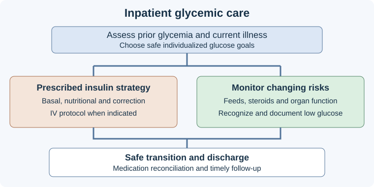

# Inpatient diabetes — glycemic nursing care

**Study-ready candidate, not studied.** [20 MCQs](../MCQs/13E-Inpatient-Diabetes-Glycemic-Care-20-MCQs.md) · [Evidence register](../Previous-Year-Questions/13E-Inpatient-Diabetes-Evidence-Gaps.md)

## Admission aur goals

Admission par previous three months ka HbA1c unavailable ho toh indicated A1C testing prior glycemic exposure samajhne mein useful hai. ADA 2026 most hospitalized adults mein persistent glucose at least 180 mg/dL on two occasions within 24 hours par therapy initiation or intensification recommend karti hai. ICU mein usual treatment goal 140–180 mg/dL hai; noncritical adult mein 100–180 mg/dL if safely achievable. Risk-based exceptions clinical team decide karti hai.

## Insulin planning

Basal insulin background requirement cover karti hai. Nutritional insulin actual carbohydrate supply se match hoti hai, aur correction elevated glucose address karti hai. Adequate intake mein basal-prandial-correction approach generally preferred hai. Poor intake mein basal plus correction as indicated. Critical illness mein validated IV insulin protocol frequent monitoring demand karta hai. SC transition mein basal injection ka action establish hone tak appropriate overlap maintain karo. Stable recent infusion rates, home regimen, organ function and nutrition transition dose inform karte hain.

## Changing clinical needs

Poor capillary perfusion glucose meter reliability affect kar sakti hai; uncertain result reliable laboratory measurement aur urgent clinical assessment se clarify karo. Morning prednisone later daytime glucose elevation cause kar sakti hai, jise selected NPH timing address kar sakti hai. Steroid dose reduce ho toh intensified insulin plan promptly review karo. Continuous enteral feed interrupt hone par active insulin hypoglycemia risk create karta hai; glucose check, feed-interruption protocol aur indicated dextrose plan follow karo. Near-low fasting trends review karo. Hypoglycemia events document and track karo. Discharge medication changes timely outpatient follow-up demand karte hain. Selected HF indication ke liye SGLT2 treatment ka decision routine inpatient glycemic control se separate hai.

## Sources
- [ADA 2026 hospital diabetes standards](https://doi.org/10.2337/dc26-s016)
- [ADA 2026 pharmacologic approaches](https://doi.org/10.2337/dc26-s009)
- [Endotext inpatient diabetes management](https://www.ncbi.nlm.nih.gov/books/NBK278972/)
- [ADA 2026 diabetes technology](https://diabetesjournals.org/care/article/49/Supplement_1/S150/163922)
