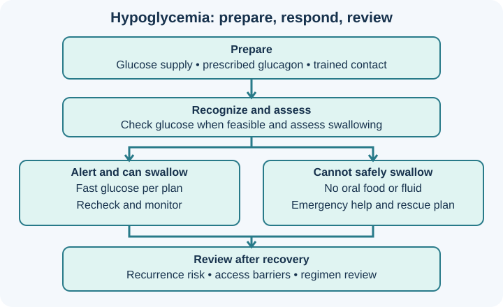

# Outpatient hypoglycemia prevention and rescue readiness

**Study-ready candidate.** Abhi yeh practice learner ne attempt nahi ki hai.

[Chapter](../README.md) · [MCQs](../MCQs/14A-Outpatient-Hypoglycemia-Prevention-20-MCQs.md) · [Evidence](../Previous-Year-Questions/14A-Hypoglycemia-Prevention-Evidence-Gaps.md)

## Low glucose ka risk kyun important hai?

Hypoglycemia ka matlab hai blood glucose ka normal safe range se neeche girna. Jab insulin ya insulin release badhane wali medicine ka effect glucose ki supply se zyada ho jata hai, toh brain aur muscles ko glucose kam mil sakta hai. Har patient ki symptoms same nahi hoti hain. Kuch patients ko warning symptoms kam feel hote hain. Severe episode mein patient ko dusre person ki help chahiye hoti hai. Isliye HbA1c target par hona bhi safety ka complete proof nahi hai.

## Prevention aur rescue readiness

Nurse patient se poochti hai ki medicine kab li, meal aur activity kab hui aur low reading kis time aayi. In details ko glucose record ke saath dekhne se repeated pattern samajh aata hai. Agar patient ke paas monitoring supplies ya fast carbohydrate afford karne ka problem hai, toh nurse diabetes team ke saath accessible plan arrange karti hai. Sirf testing zyada karne ko kehna practical problem solve nahi karega.

Jab patient ghar se bahar jata hai, toh woh prescribed plan ke hisaab se measured fast carbohydrate carry kare. Medical identification emergency responder ko diabetes aur insulin ke baare mein bata sakti hai. Work ya travel mein patient ki consent se selected trusted person ko response plan samjhana useful hai. Driving ke waqt low glucose ho toh vehicle ko safe jagah rokna zaruri hai. Treatment ke baad bhi attention aur reaction recover hone tak driving nahi karni chahiye.

## Rescue medicine aur family training

Glucagon ek hormone hai jo liver se stored glucose release karne mein madad karta hai. Severe hypoglycemia mein prescribed rescue glucagon trained caregiver de sakta hai. Kuch products mein mixing karni padti hai aur kuch ready-to-use hote hain. Nurse actual prescribed device par training deti hai aur caregiver se steps repeat karwati hai. Expiry aur storage instructions check karna bhi important hai. Behosh patient ko mouth se food ya fluid nahi dena chahiye. Emergency assistance turant activate karein. Glucagon ka response aane tak wait na karein. Agar behosh patient normally breathe kar raha hai aur trauma ka suspicion nahi hai, toh recovery position mein side par turn karein aur breathing monitor karein. Agar normal breathing nahi hai, toh trained emergency resuscitation steps follow karein. Recovery ke baad bhi low glucose phir aa sakta hai, isliye agreed emergency plan aur monitoring follow karein.

## Example

Maan lo insulin lene wale adult ka glucose gardening ke baad baar-baar low aa raha hai. Nurse activity ka duration, medication timing, meals aur glucose readings note karti hai. Phir diabetes team individualized changes assess karti hai. Agar severe event hua ho, toh goals aur medicines ka review zaruri hai. Patient ko daantne ke bajay fear aur access barriers samajhna better hai.

## Exam recap

Severe episode mein assistance ki need important hai. Rescue medicine available hona enough nahi hai. Caregiver ko uska use aana chahiye. First-aid kit mein oral glucose alert aur safely swallow karne wale person ke liye useful hai. Recovery ke baad recurrence risk aur emergency plan yaad rakho.

## References and videos

- [ADA 2026 Section 6](https://doi.org/10.2337/dc26-s006)
- [Endocrine Society high-risk hypoglycemia recommendations](https://www.endocrine.org/clinical-practice-guidelines/high-risk-for-hypoglycemia)
- [CDC treatment guidance](https://www.cdc.gov/diabetes/treatment/treatment-low-blood-sugar-hypoglycemia.html)
- [NIDDK hypoglycemia](https://www.niddk.nih.gov/health-information/diabetes/overview/preventing-problems/low-blood-glucose-hypoglycemia)

Specific teaching and MCQ video mapping remains pending. No verified historical question attribution.
