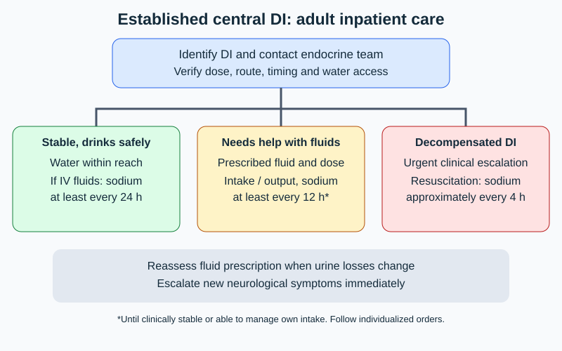

# Established adult central DI — inpatient nursing care

**Study-ready candidate, not studied.**

## 🟠 Diagnosis aur admission safety

Central diabetes insipidus ko ab arginine vasopressin deficiency bhi kehte hain. Vasopressin ek hormone hai jo kidney ko paani bachane mein madad karta hai. Jab hormone kam hota hai toh urine mein bahut paani nikal sakta hai. Desmopressin iska synthetic replacement hai. Is disease ka insulin ki kami se direct relation nahi hai.

Admission par nurse diagnosis ko clearly identify karti hai aur endocrine team ko inform karti hai. Patient ki usual formulation, dose, route aur timing ko verify karna bahut zaruri hai. Tablet aur spray ka same microgram dose injection ke barabar nahi hota. Agar stock nahi hai ya route change ho raha hai toh pharmacy aur prescriber se urgent clarification lo. Patient ki last dose aur next dose ka time transfer handover mein bhi do.

## 🔴 Paani ki access aur monitoring

Agar patient alert hai, pyaas feel karta hai aur safely pee sakta hai, toh usko paani tak access do. Agar maintenance IV fluids chal rahe hain toh stable patient ka sodium kam se kam har 24 ghante check kiya jaata hai. Agar patient khud fluid manage nahi kar sakta toh fluid intake aur urine output record karo aur sodium kam se kam har 12 ghante check karo jab tak patient stable na ho ya khud manage na kar sake. Safe enteral access ho toh prescribed water us route se diya ja sakta hai. Vomiting, fasting aur blocked nose ke time team ko treatment plan review karna pad sakta hai.

## 🔴 Decompensation aur emergency care

Decompensation ka matlab hai ki body ka water balance control se bahar ho gaya hai. Severe dehydration mein blood circulation kam ho sakti hai. Is halat mein urine output kam bhi dikh sakta hai. Isliye sirf urine kam dekhkar yeh mat samjho ki DI theek ho gaya. Urgent medical assessment aur high-dependency care ki zarurat ho sakti hai. Agar circulating volume kam hai toh team pehle isotonic saline se circulation restore karti hai aur phir free-water deficit ko safely manage karti hai. Resuscitation ke time sodium lagbhag har 4 ghante monitor karo. Jab desmopressin urine water loss kam kar deti hai toh fluid rate aur sodium correction ko reassess karna zaruri hai. Naye neurological symptoms ko turant escalate karo. Har dose aur fluid change treating team ke individualized orders ke mutabik hona chahiye.

## Practice and references

- [20 original MCQs](../MCQs/14B-Central-DI-Inpatient-Care-20-MCQs.md)
- [Society for Endocrinology inpatient guidance summary](https://www.endocrinology.org/clinical-practice/clinical-guidance/arginine-vasopressin-deficiency-diabetes-insipidus/diabetes-insipidus-arginine-vasopressin-deficiency-information/)
- [Tomkins et al., adult central DI review, JCEM 2022](https://academic.oup.com/jcem/article/107/10/2701/6623615)
- [Evidence register](../Previous-Year-Questions/14B-Central-DI-Inpatient-Evidence-Gaps.md)

Specific teaching video and MCQ-solving video verification remains pending.
