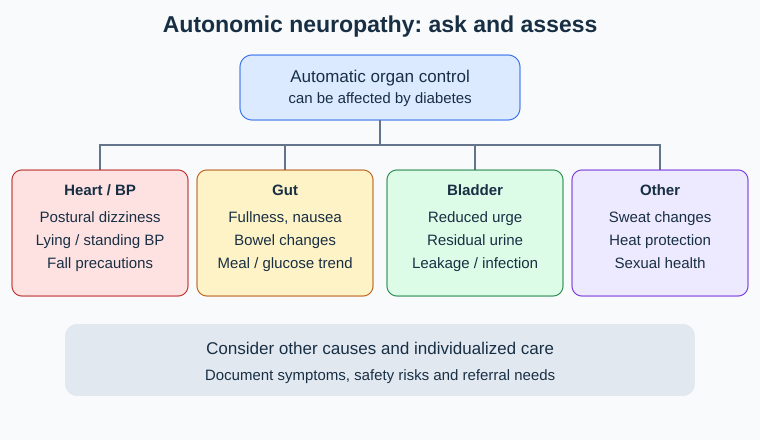

# Diabetic autonomic neuropathy

**Study-ready candidate, not studied.**

## 🟠 Mechanism aur symptom screening

Autonomic nerves body ke automatic kaam sambhalti hain. Heart rate, BP, stomach ki movement, bladder aur sweating ko hum har waqt conscious effort se control nahi karte. Diabetes mein lambe samay tak glucose aur metabolic risk factors nerves aur unko blood dene wali chhoti vessels ko damage kar sakte hain. Isse ek se zyada organs mein symptoms aa sakte hain. Nurse patient ko privacy dekar dizziness, bowel pattern, bladder emptying, sweating aur sexual symptoms ke baare mein poochhti hai. Har symptom ka cause diabetes hi hai, aisa assume nahi karna chahiye.

## 🔴 Heart aur blood pressure

Khade hote waqt normally blood vessels aur heart rate adjust hote hain. Agar autonomic control weak hai toh BP gir sakta hai aur patient ko chakkar aa sakta hai. Nurse safe support ke saath lying aur standing BP aur pulse record karti hai. Dehydration aur medicines jaise causes bhi consider karne hote hain. Dheere uthna aur fall precautions useful hain. Salt ya water badhane ki advice heart failure aur kidney disease mein individualized honi chahiye. Exercise plan mein abnormal heart rate response ko bhi dhyan mein rakho.

## 🔴 Digestion aur bladder

Gastroparesis ka matlab hai ki mechanical blockage ke bina stomach food ko dheere empty karta hai. Patient jaldi full feel kar sakta hai aur vomiting ya nausea ho sakti hai. Food absorption aur insulin action ka timing alag ho jaaye toh glucose fluctuate kar sakta hai. Team pehle obstruction aur motility-affecting medicines ko assess karti hai. Gastric emptying test diagnosis mein useful ho sakta hai. Nurse food, symptoms aur glucose trends record karti hai. Nighttime diarrhea ya constipation bhi possible hain, lekin doosre causes rule out karna zaruri hai.

Bladder ki nerves damaged hon toh patient ko filling ka signal kam mil sakta hai. Urine pass karne ke baad bhi bladder mein urine bacha ho sakta hai. Isse repeated infection ya leakage ho sakti hai. Bladder scan aur individualized timed voiding plan assessment aur care mein madad karte hain. Sweating kam ho toh heat precautions lo. Sexual symptoms ke liye private discussion aur appropriate referral do.

[20 original questions](../MCQs/14C-Diabetic-Autonomic-Neuropathy-20-MCQs.md) · [Evidence register](../Previous-Year-Questions/14C-Diabetic-Autonomic-Neuropathy-Evidence-Gaps.md)

Clinical references: [NIDDK autonomic neuropathy](https://www.niddk.nih.gov/health-information/diabetes/overview/preventing-problems/nerve-damage-diabetic-neuropathies/autonomic-neuropathy) and [ADA 2026 section 12](https://doi.org/10.2337/dc26-s012). Specific teaching and practice videos remain unverified.
