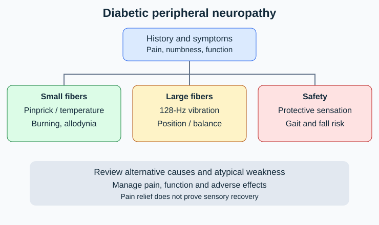

# Diabetic peripheral neuropathy: assessment and pain management

**Study-ready candidate, not studied.**

## 🟠 Sensory fibers aur screening

Peripheral nerves spinal cord se body ke parts tak messages le jaati hain. Diabetes mein metabolic aur vascular changes ke kaaran ye nerves damage ho sakti hain. Distal symmetric pattern mein aksar symptoms toes aur feet se shuru hote hain. Small fibers pain aur temperature ka signal carry karti hain. Large fibers vibration aur position ka signal carry karti hain. Patient ko burning, tingling ya numbness ho sakti hai. Kabhi bedsheet ka halka touch bhi painful lagta hai, jise allodynia kehte hain.

Type 2 diabetes mein diagnosis ke time aur type 1 diabetes mein paanch saal baad routine neuropathy assessment shuru karo. Iske baad kam se kam har saal assessment chahiye. History ke saath pinprick ya temperature aur 128-Hz tuning fork se vibration assess ki ja sakti hai. Monofilament protective sensation assess karta hai. Normal monofilament se early painful small-fiber neuropathy rule out nahi hoti. Gait aur balance bhi assess karo.

## 🔴 Alternate causes aur escalation

Diabetes hone par har nerve symptom ko diabetic neuropathy assume mat karo. B12 deficiency, thyroid problems aur kidney disease jaise causes consider karo. Agar weakness rapid, asymmetric ya motor-predominant hai toh neurological assessment ke liye escalate karo. Typical distal sensory symptoms mein har patient ko nerve biopsy ki zarurat nahi hoti. Specialist unclear ya atypical cases mein further testing decide kar sakta hai.

## 🔴 Pain care aur functional safety

Nerve pain ke liye prescribed gabapentinoids, selected antidepressants ya other guideline-supported options useful ho sakte hain. Dawa pain signaling reduce kar sakti hai, lekin damaged sensation turant restore nahi hoti. Nurse pain ke saath sleep, daily function, gait aur adverse effects document karti hai. Agar drowsiness ya dizziness ho toh fall precautions lo aur medicine review karao. Routine opioid use recommended nahi hai. Individualized glucose, BP aur lipid management, rehabilitation aur protective care long-term plan ka part hain.

[20 original MCQs](../MCQs/14D-Diabetic-Peripheral-Neuropathy-Assessment-and-Pain-20-MCQs.md) · [Evidence register](../Previous-Year-Questions/14D-Diabetic-Peripheral-Neuropathy-Assessment-and-Pain-Evidence-Gaps.md)

References: [NIDDK peripheral neuropathy](https://www.niddk.nih.gov/health-information/diabetes/overview/preventing-problems/nerve-damage-diabetic-neuropathies/peripheral-neuropathy) and [ADA 2026 section 12](https://doi.org/10.2337/dc26-s012). Specific teaching and MCQ video verification pending.
