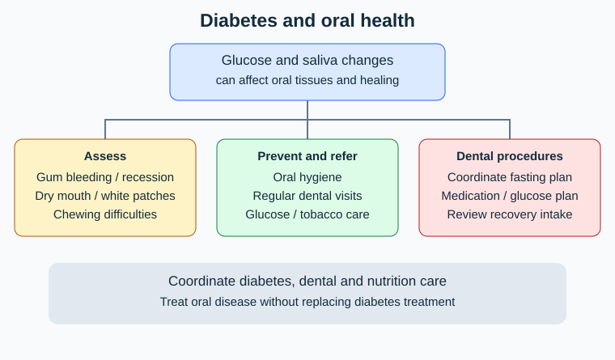

# Diabetes-related oral health and dental care coordination

**Study-ready candidate, not studied.**

## 🟠 Glucose, saliva aur gum health

Saliva mouth ko moist rakhti hai aur food particles aur acids ko clear karne mein help karti hai. Diabetes ya kuch medicines ke kaaran saliva kam ho sakti hai. Blood glucose high rahe toh saliva mein glucose bhi badh sakta hai. Plaque bacteria sugar use karke acids banate hain. Isse dental caries aur gum disease ka risk badh sakta hai. Dry mouth ki complaint ko xerostomia kehte hain. Nurse dryness, bleeding gums, bad breath, loose teeth aur painful white patches jaise symptoms assess karti hai. White patches fungal infection ka clue ho sakte hain, lekin proper examination zaruri hai.

Gingivitis mein gums inflamed hote hain. Periodontitis mein tooth ke supporting tissues aur bone bhi damage ho sakte hain. Gum disease aur glucose management ka relationship complex hai. Periodontal treatment oral health ke liye important hai aur kuch patients mein glucose control improve karne mein help kar sakta hai. Yeh diabetes medicines ka replacement nahi hai. Regular dental assessment, safe home oral cleaning, glucose management aur tobacco cessation support useful hain.

## 🔴 Dental procedures aur diabetes medication safety

Routine dental examination mein patient usually normal food aur agreed treatment plan follow karta hai. Agar fasting, sedation ya surgery planned hai toh dental aur diabetes team ko pehle individualized medication aur glucose monitoring plan banana chahiye. Insulin ko automatically stop ya double mat karo. Fasting ke time basal aur meal-related insulin ki needs alag ho sakti hain. Procedure ke baad chewing aur oral intake kam ho toh glucose trends aur treatment plan reassess karo. High glucose healing aur infection risk ko affect kar sakta hai, isliye follow-up zaruri hai.

Dental chair mein sudden sweating aur confusion ho toh procedure roko aur glucose emergency ke liye prompt assessment aur local protocol follow karo. Oral pain ya loose teeth ke kaaran meals difficult hon toh dental team aur dietitian ko involve karo. Access barriers jaise cost aur transport ko identify karke realistic follow-up arrange karo.

[20 original MCQs](../MCQs/14E-Diabetes-Oral-Health-and-Dental-Care-20-MCQs.md) · [Evidence register](../Previous-Year-Questions/14E-Diabetes-Oral-Health-and-Dental-Care-Evidence-Gaps.md)

References: [NIDDK oral health](https://www.niddk.nih.gov/health-information/diabetes/overview/preventing-problems/gum-disease-dental-problems), [American Dental Association diabetes](https://www.ada.org/resources/ada-library/oral-health-topics/diabetes), [ADA Standards 2026 section 4](https://doi.org/10.2337/dc26-s004). Specific teaching and MCQ video verification pending.
