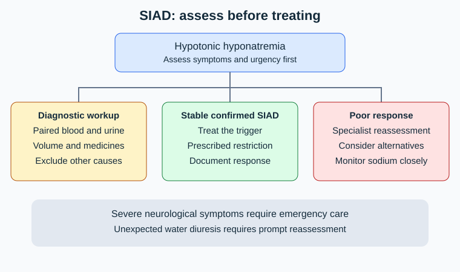

# SIAD diagnostic assessment and non-emergency nursing care

**Study-ready candidate, not studied.**

## 🟠 Water balance aur diagnostic clues

Vasopressin kidney ko paani bachane ka signal deta hai. Jab blood dilute ho toh normally yeh signal kam ho jaata hai aur kidney dilute urine nikalti hai. SIAD mein water excretion ka yeh response inappropriate ho sakta hai. Body mein excess water ke kaaran serum sodium dilute ho jaata hai. Diagnosis ke liye low serum osmolality, urine osmolality aur urine sodium ko volume status aur medicine history ke saath interpret karna zaruri hai. Bahut dilute urine classic SIAD ke against clue ho sakti hai. Cortisol deficiency aur doosre relevant causes exclude karo. Thiazide use urine sodium ki interpretation ko confuse kar sakta hai. Pneumonia, selected medicines aur small-cell lung carcinoma possible triggers hain.

## 🔴 Stable patient ki nursing care

Severe neurological symptoms emergency hain aur stable SIAD ke routine plan se manage nahi kiye jaate. Stable patient mein underlying cause treat karna aur prescribed fluid restriction first-line approach ho sakta hai. Drinks, soup aur medicine ke saath liya water prescribed allowance ke hisaab se count karo. Mouth care aur planned fluid distribution se thirst manage karne mein help mil sakti hai. Actual intake aur output, sodium trend aur practical barriers document karo. High urine osmolality ki wajah se fluid restriction kabhi sufficient nahi hoti.

## 🔴 Specialist therapies aur monitoring

Oral urea osmotic solute excretion badhakar water excretion mein help kar sakti hai. Tolvaptan vasopressin V2 receptor block karti hai. Isse urine water loss badhta hai. Tolvaptan har patient ke liye appropriate nahi hai aur specialist ki supervision chahiye. Initial dosing ke time purani restriction order ko review karo aur safe water access aur sodium monitoring ensure karo. Agar trigger resolve hone ke baad achanak dilute urine zyada aane lage toh sodium tezi se rise kar sakta hai. Is change ko turant team ko report karo. Discharge par individualized fluid instructions, medicine review aur repeat sodium testing ka plan hona chahiye.

[20 original questions](../MCQs/15A-SIAD-Diagnostic-Assessment-and-Nonemergency-Care-20-MCQs.md) · [Evidence register](../Previous-Year-Questions/15A-SIAD-Diagnostic-Assessment-and-Nonemergency-Care-Evidence-Gaps.md)

[Endocrine Reviews 2023](https://academic.oup.com/edrv/article/44/5/819/7090475) · [European hyponatraemia guideline](https://academic.oup.com/ejendo/article/170/3/G1/6668028) · [JCEM clinical review 2022](https://academic.oup.com/jcem/article/107/8/2362/6578514)

Specific teaching and MCQ video verification remains pending.
