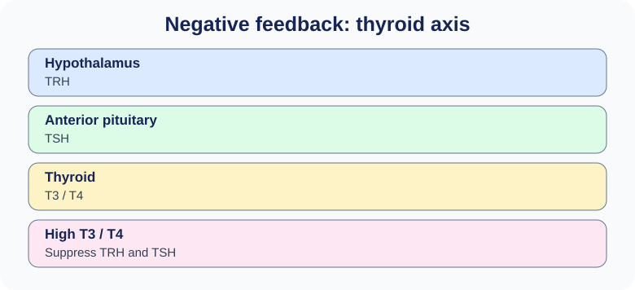
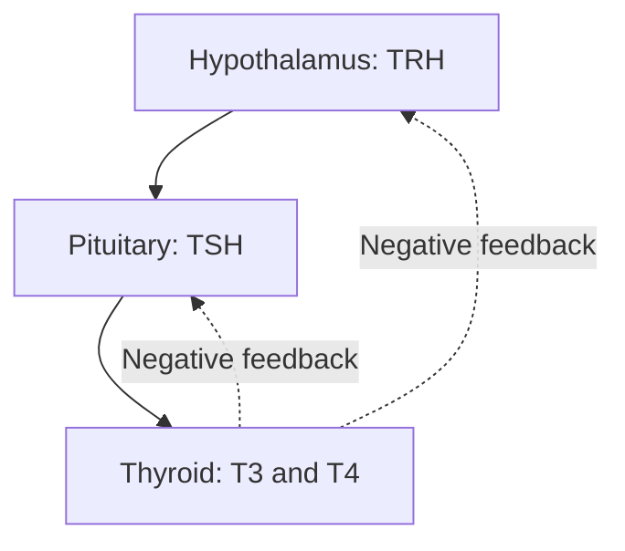
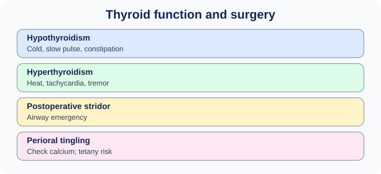
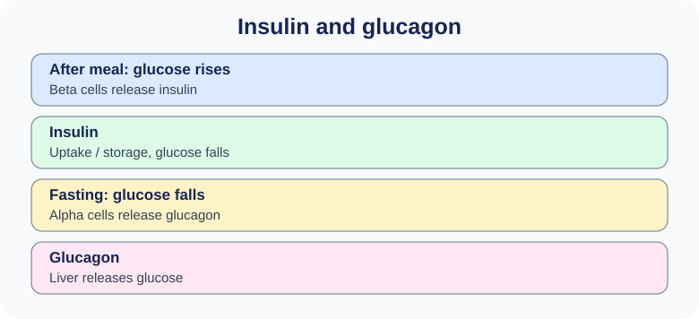
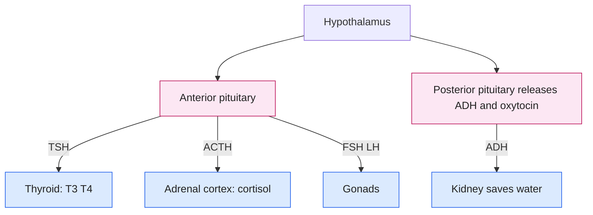
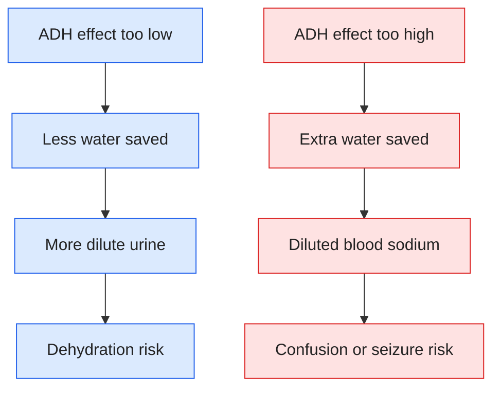
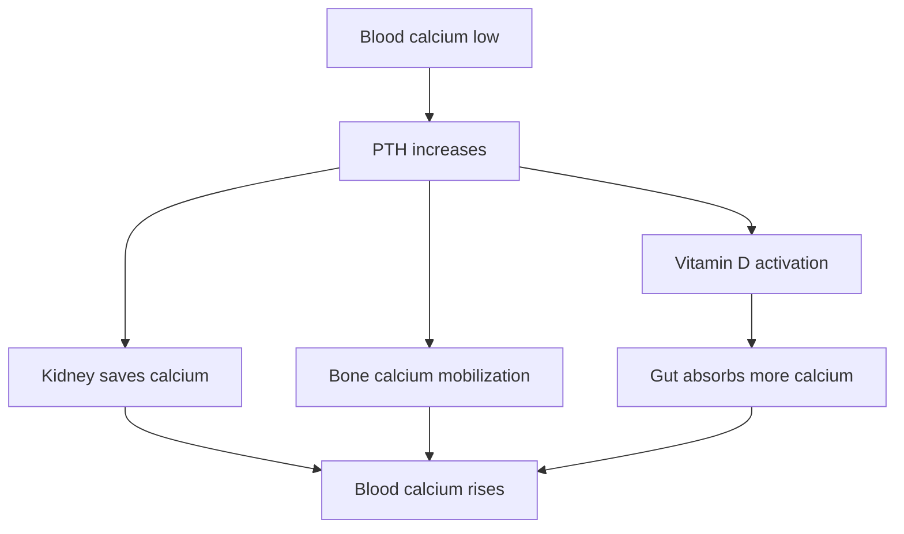
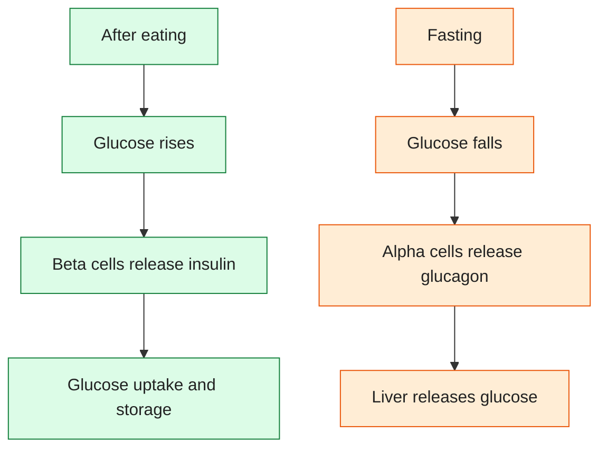
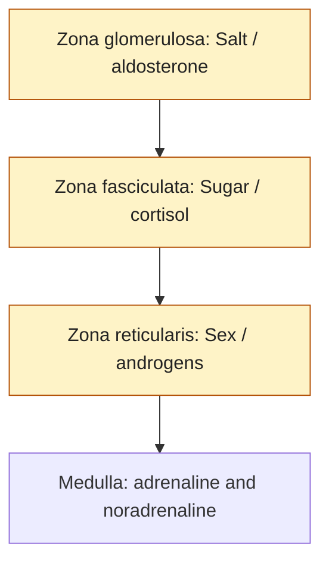

# 🧠 Endocrine System — Illustrated Master Study Guide

[🏠 Chapter](../README.md) · [📖 Concepts](../Concepts/Endocrine-System-Master-Guide.md) · [📝 MCQs](../MCQs/Endocrine-Topic-Wise.md) · [🏥 Previous Year Questions](../Previous-Year-Questions/README.md) · [⚡ Revision](../Revision/Endocrine-Quick-Revision.md) · [References](../References.md)

**Study-ready, not yet studied.** Roman Hinglish. 🔴 Very High · 🟠 High · 🟡 Important · 🟢 Foundation (study priority, not official frequency).

## Contents
- [1. 🟢 Endocrine system kya hai?](#1--endocrine-system-kya-hai)
- [2. 🟠 Feedback mechanism](#2--feedback-mechanism)
- [3. 🟠 Pituitary gland](#3--pituitary-gland)
- [4. 🔴 ADH, Diabetes insipidus aur SIADH](#4--adh-diabetes-insipidus-aur-siadh)
- [5. 🟠 Thyroid gland](#5--thyroid-gland)
- [6. 🔴 Parathyroid aur calcium](#6--parathyroid-aur-calcium)
- [7. 🟠 Adrenal glands](#7--adrenal-glands)
- [8. 🔴 Pancreas aur Diabetes mellitus](#8--pancreas-aur-diabetes-mellitus)
- [9. 🔴 Hypoglycemia, DKA aur HHS](#9--hypoglycemia-dka-aur-hhs)
- [10. 🟡 Other endocrine topics — clubbed](#10--other-endocrine-topics--clubbed)
- [14. 🎨 Gland-wise visual revision and priority](#14--gland-wise-visual-revision-and-priority)
- [15. 🟡 Extra topics — missed points and revision](#15--extra-topics--missed-points-and-revision)
- [19. 🔴 Final coverage audit — missing and underdeveloped concepts (26 November 2026)](#19--final-coverage-audit--missing-and-underdeveloped-concepts-26-november-2026)
- [22. 🔴 Disease-wise nursing responsibilities — bedside care and NORCET priorities](#22--disease-wise-nursing-responsibilities--bedside-care-and-norcet-priorities)

## 1. 🟢 Endocrine system kya hai?

- Hamari body mein kuch glands hormones banati hain. Hormones blood ke through doosre organs tak pahunchte hain aur unka kaam control karte hain.
- Endocrine glands ki ducts nahi hoti. Exocrine glands apna secretion duct ke through bhejti hain, jaise salivary glands.
- Pancreas dono tarah ka gland hai: insulin blood mein aur digestive enzymes duct mein jaate hain.

| Gland | Hormone | Kaam |
|---|---|---|
| Anterior pituitary | GH, TSH, ACTH, FSH, LH, prolactin | Growth, thyroid, adrenal aur reproduction control |
| Posterior pituitary | ADH, oxytocin release | Paani bachana, uterine contraction aur milk ejection |
| Thyroid | T3, T4, calcitonin | Metabolism aur calcium regulation |
| Parathyroid | PTH | Blood calcium badhana |
| Adrenal cortex | Aldosterone, cortisol, androgens | Salt-water balance, stress response |
| Adrenal medulla | Adrenaline, noradrenaline | Fight-or-flight response |
| Pancreas | Insulin, glucagon, somatostatin | Blood glucose control |
| Pineal | Melatonin | Sleep-wake timing |
| Ovaries/testes | Estrogen, progesterone/testosterone | Reproduction |
| Thymus | Thymic factors | T-cell development |

## 2. 🟠 Feedback mechanism

- Jab thyroid hormones kam hote hain, hypothalamus TRH aur pituitary TSH badha sakte hain. TSH thyroid ko hormone banane ka signal deta hai.
- Jab T3/T4 ka level badhta hai, TRH aur TSH kam ho jaate hain. Ise negative feedback kehte hain.

- Primary hypothyroidism: thyroid mein problem, TSH usually high aur free T4 low.
- Central hypothyroidism: pituitary/hypothalamus mein problem, free T4 low aur TSH low ya inappropriate normal.

## 3. 🟠 Pituitary gland

🔴 **MOST IMPORTANT:** ADH kahan banta hai aur kahan se release hota hai; anterior vs posterior pituitary; Sheehan syndrome; post-surgery urine output. 🟠 HP 2026 source reports posterior pituitary question (section 18).

- Brain ke base par sella turcica mein hoti hai. Hypothalamus isko control karta hai.
- Anterior pituitary apne hormones banati hai. ADH aur oxytocin hypothalamus mein bante hain aur posterior pituitary se release hote hain.
- GH growth mein help karta hai. Bachpan mein excess GH se gigantism, adults mein acromegaly. Acromegaly mein haath, pair aur jaw bade ho sakte hain. IGF-1 screening aur specialist testing useful hain.
- GH ki childhood deficiency se short stature ho sakta hai.
- Prolactinoma: prolactin badhta hai; galactorrhea, irregular periods, infertility ho sakti hai. Cabergoline commonly used hoti hai.
- Pituitary tumor optic chiasm par pressure daale toh bitemporal hemianopia ho sakti hai.
- Hypopituitarism mein multiple hormones kam ho sakte hain. Cortisol deficiency exclude/treat karna thyroid replacement se pehle important hai.
- Sheehan syndrome: severe postpartum bleeding ke baad pituitary damage; milk na banna aur periods na aana clues hain.
- Transsphenoidal surgery ke baad urine output, sodium, neurological status aur clear nasal drainage monitor karo; CSF leak suspect ho toh report karo. Nose blowing/straining se bachne ki advice surgeon ke protocol ke hisaab se.

## 4. 🔴 ADH, Diabetes insipidus aur SIADH

🔴 **HIGH PRIORITY — EXAM LEAD:** DI mein dilute urine, SIADH mein low sodium. NORCET 2023 DI presentation source, HP 2026 related pituitary hormone source (section 18).

- ADH kidney ko paani bachane mein help karta hai.
- ADH kam ho ya kidney respond na kare toh bahut dilute urine aata hai. Pyaas badhti hai. Ise diabetes insipidus (DI) kehte hain; glucose wali diabetes se alag hai.
- Central DI mein ADH ki kami; nephrogenic DI mein kidney ka response kam. Central DI mein desmopressin useful ho sakta hai.
- SIADH mein body extra paani rok leti hai; blood sodium dilute hokar kam ho jaata hai. Headache, confusion, seizures ho sakte hain.

| Finding | DI | SIADH |
|---|---|---|
| Urine | Zyada, dilute | Relatively concentrated |
| Serum sodium | High ho sakta hai | Low |
| Serum osmolality | High ho sakti hai | Low |
| Nursing | I/O, weight, hydration, sodium | I/O, weight, sodium, neurological signs |

- SIADH mein fluid restriction selected stable cases mein; severe symptomatic hyponatremia emergency hai, protocol-based hypertonic saline aur close sodium monitoring chahiye. Sodium ko bahut jaldi correct karna harmful hai.
- Water deprivation test supervised setting mein hota hai, ghar par nahi.

## 5. 🟠 Thyroid gland

🔴 **MOST IMPORTANT:** Thyroidectomy ke baad airway aur calcium; thyroid storm vs myxedema coma; TSH/T4 pattern. 🔁 Postoperative hypocalcemia reported in 2022 and 2024 NORCET collections.

- Neck mein trachea ke saamne butterfly-shaped gland. Follicular cells T3/T4 banati hain; C cells calcitonin.
- T3/T4 body ki energy use aur heat production ko regulate karte hain. Iodine hormone synthesis ke liye chahiye.
- Goiter ka matlab gland ka size badhna hai; thyroid function normal, low ya high ho sakta hai.

| Sign | Hypothyroidism | Hyperthyroidism |
|---|---|---|
| Weight | Badhta hai | Kam ho sakta hai |
| Temperature | Thand lagna | Garmi lagna |
| Pulse | Slow | Fast |
| Bowel | Constipation | Frequent stools |
| Skin | Dry | Warm, moist |
| Common cause | Hashimoto thyroiditis | Graves disease |

- Graves autoimmune disease hai; eye signs ho sakte hain. Hyperthyroidism mein tremor, palpitations aur anxiety bhi hoti hai.
- Tests: TSH, free T4, kabhi T3, antibodies. Ultrasound nodule ki structure dikhata hai; suspicious nodules mein FNAC specialist decide karta hai.
- Hypothyroidism: levothyroxine prescribed dose mein, consistently empty stomach; iron/calcium se usually 4 hours ka gap.
- Hyperthyroidism: antithyroid medicines, beta blockers for symptoms, selected patients mein radioiodine ya surgery. Fever/sore throat on antithyroid drug ko urgently report karo (agranulocytosis risk).
- Radioiodine pregnancy mein contraindicated hai; breastfeeding aur radiation precautions specialist instructions ke according.
- Congenital hypothyroidism: early newborn screening aur treatment brain development ke liye important.

### 🔴 Thyroid emergencies aur surgery
- Thyroid storm: high fever, severe tachycardia, agitation/confusion, possible heart failure. ABC, emergency escalation, ECG, cooling, fluids as appropriate aur prescribed treatment. Iodine antithyroid medicine ke baad protocol ke according.
- Myxedema coma: severe hypothyroidism, hypothermia, bradycardia, hypoventilation aur altered consciousness. ABC, ventilatory support as needed, urgent escalation; IV thyroid hormone aur glucocorticoid medical team ke protocol se.
- Thyroidectomy ke baad neck swelling, bleeding, stridor ya respiratory distress ko emergency samjho. Airway first. Semi-Fowler position if appropriate, neck supported, voice, wound aur calcium monitor karo.
- Lips ke aas-paas tingling ya muscle spasm calcium kam hone ka sign ho sakta hai.

## 6. 🔴 Parathyroid aur calcium

🔴 **MOST IMPORTANT / REPORTED REPEAT:** Hypocalcemia after thyroidectomy, Trousseau and Chvostek signs, tetany. Source details section 18.

- Usually 4 glands thyroid ke peeche hoti hain. PTH blood calcium badhata hai: bone, kidney aur vitamin D activation ke through.
- Hypoparathyroidism: calcium kam, phosphate high ho sakta hai; tingling, tetany, cramps, seizures, prolonged QT.
- Chvostek sign: facial nerve tap karne par facial twitch. Trousseau sign: BP cuff se carpal spasm.
- Severe symptomatic hypocalcemia mein prescribed IV calcium gluconate, ECG aur IV site monitor.
- Primary hyperparathyroidism: calcium high, PTH high/inappropriately normal; kidney stones, bone pain, constipation, weakness. Phosphate low ho sakta hai.
- Hypercalcemia mein dehydration aur confusion ho sakte hain; hydration aur prescribed treatment; ECG/renal function monitor.

## 7. 🟠 Adrenal glands

🔴 **MOST IMPORTANT:** Addison vs Cushing, adrenal crisis, aldosterone and potassium, pheochromocytoma (HP 2020 reported source).

- Dono kidneys ke upar glands hoti hain. Bahar cortex, andar medulla.
- Cortex: glomerulosa = aldosterone (salt), fasciculata = cortisol (sugar/stress), reticularis = androgens (sex). Trick: Salt, Sugar, Sex.
- Aldosterone sodium aur water retain karne mein help karta hai aur potassium excretion badhata hai.
- Cortisol stress response, glucose regulation aur inflammation control mein role play karta hai.

| Feature | Addison (primary adrenal insufficiency) | Cushing syndrome |
|---|---|---|
| Cortisol | Low | High |
| BP | Low | Often high |
| Glucose | Low ho sakta hai | High ho sakta hai |
| Skin | Hyperpigmentation possible | Thin skin, purple striae |
| Weight | Loss | Central weight gain |
| Sodium/potassium | Low Na, high K possible | Variable; low K possible |

- Addison mein ACTH high hota hai; secondary adrenal insufficiency mein hyperpigmentation aur hyperkalemia usually nahi.
- Adrenal crisis: severe hypotension, vomiting, weakness, confusion. Urgent ABC, IV hydrocortisone aur isotonic fluids per emergency protocol; glucose/electrolytes monitor.
- Long-term steroids ko suddenly stop nahi karna; taper prescribed plan se. Sick-day rules aur steroid emergency card important.
- Cushing syndrome cortisol excess hai; Cushing disease specifically pituitary ACTH-secreting tumor. Steroid use common cause of Cushing syndrome.
- Cushing nursing: infection, glucose, BP, fragile skin aur falls/fractures monitor.
- Conn syndrome: primary aldosteronism; hypertension, low potassium ho sakta hai. Aldosterone-renin ratio screening.
- Pheochromocytoma: catecholamine-producing tumor; episodic headache, sweating, palpitations, hypertension. Plasma free or urinary fractionated metanephrines; preoperative alpha blockade before beta blockade.
- Congenital adrenal hyperplasia: commonly 21-hydroxylase deficiency; salt-wasting, androgen excess. Infant dehydration/shock emergency.

## 8. 🔴 Pancreas aur Diabetes mellitus

🔴 **MOST IMPORTANT:** Insulin types and safety, glucose diagnostic criteria, diabetic foot, Type 1 vs Type 2. PGIMER 2025 reported clinical diabetes evaluation.

- Pancreatic islets: beta cells insulin, alpha cells glucagon, delta cells somatostatin.
- Khana khane ke baad glucose badhta hai. Insulin glucose ko muscle/fat cells mein lene aur liver mein store karne mein help karta hai. Fasting mein glucagon glucose badhata hai.
- Type 1: autoimmune beta-cell destruction, insulin required. Type 2: insulin resistance aur progressive insulin deficiency. Gestational diabetes: pregnancy mein diagnosed glucose intolerance (overt pre-existing diabetes se alag).
- Classic symptoms: polyuria (urine zyada), polydipsia (pyaas), polyphagia (bhookh), weight loss possible.

| Nonpregnant adult diagnosis | Diabetes threshold |
|---|---|
| Fasting plasma glucose | ≥126 mg/dL |
| 2-hour 75 g OGTT | ≥200 mg/dL |
| HbA1c | ≥6.5% |
| Random plasma glucose | ≥200 mg/dL with classic symptoms or crisis |

- Unequivocal hyperglycemia absent ho toh diagnosis confirm karne ke liye repeat/second abnormal test chahiye. HbA1c roughly past 2–3 months ka glucose estimate hai; anemia aur hemoglobin variants interpretation affect kar sakte hain.
- Prediabetes (ADA): fasting 100–125, 2-hour 140–199 mg/dL, HbA1c 5.7–6.4%.
- Long-term complications: retinopathy, nephropathy, neuropathy (microvascular), MI/stroke/PAD (macrovascular).
- Nursing: glucose monitoring, foot inspection daily, footwear, medication adherence, nutrition/activity education, hypoglycemia action plan; eye and kidney screening.

### Insulin aur medicines
- Rapid acting: lispro/aspart; short: regular; intermediate: NPH; long: glargine/detemir/degludec (duration product-specific).
- Regular insulin commonly IV infusion protocols mein use hota hai. NPH cloudy; regular clear. Compatible regular + NPH mix prescribed ho toh clear before cloudy. Glargine ko mix mat karo.
- Subcutaneous site rotation within region se lipohypertrophy kam hoti hai. Insulin product, dose, timing, glucose, meal availability check karo. Unopened insulin usually 2–8°C; freeze na karo; in-use storage product label se.
- Metformin: hepatic glucose production kam; GI effects, B12 deficiency possible; renal function check.
- Sulfonylureas: insulin release badhate hain, hypoglycemia risk.
- SGLT2 inhibitors: urine mein glucose excretion; genital infection aur euglycemic DKA risk.
- GLP-1 receptor agonists: glucose-dependent insulin secretion, satiety; nausea common.
- Type 1 mein basal insulin illness mein bhi generally continue under sick-day guidance; dose individualized.

## 9. 🔴 Hypoglycemia, DKA aur HHS

🔴 **MOST IMPORTANT:** Hypoglycemia first aid, DKA vs HHS, potassium before insulin. PGIMER 2020 reported early hypoglycemia question.

- Hypoglycemia alert threshold below 70 mg/dL. Sweating, tremor, hunger, confusion; severe cases seizure/unconsciousness.
- Awake aur safely swallow kar sakta hai: 15 g fast carbohydrate, 15 minutes baad glucose recheck; repeat if still low. Unable to swallow: oral kuch mat do; emergency assistance, glucagon or IV dextrose per protocol.

| Feature | DKA | HHS |
|---|---|---|
| Main problem | Ketones + acidosis | Severe hyperosmolality/dehydration |
| Breathing | Kussmaul possible | Usually absent unless another cause |
| Glucose | Often high, can be near normal | Usually very high |
| Typical association | Type 1, but any type | Type 2, but overlap possible |

- DKA: insulin deficiency → fat breakdown → ketones → metabolic acidosis. Nausea, abdominal pain, deep breathing, fruity breath.
- HHS: severe hyperglycemia → urine water loss → dehydration → altered mental status.
- Treatment principles: IV fluids, potassium assessment/replacement, insulin as indicated, frequent glucose/electrolytes, treat precipitating cause. If potassium severely low, insulin delayed until corrected per protocol.
- DKA glucose normalize hone se pehle ketones clear nahi bhi hue ho sakte; prescribed dextrose may be added so insulin can continue safely.
- Sick day: hydration, glucose/ketone monitoring, urgent help for vomiting, breathing difficulty, confusion or persistent ketones.

## 10. 🟡 Other endocrine topics — clubbed

🟡 **SECONDARY PRIORITY:** Pineal, thymus, MEN and other endocrine organs; pehle high-priority glands padho, fir ye revise karo.

- Pineal melatonin: sleep-wake cycle, darkness mein secretion increases.
- Thymus: T-cell maturation, childhood mein relatively prominent.
- Ovaries: estrogen, progesterone; testes: testosterone. FSH/LH gonadal function regulate karte hain.
- PCOS: ovulatory dysfunction, androgen excess, possible polycystic ovarian morphology; metabolic risk bhi assess hota hai.
- Kidney: erythropoietin RBC production, renin BP regulation, calcitriol calcium absorption. Heart: ANP sodium excretion mein help. GI: gastrin, secretin, CCK digestion regulate karte hain.
- MEN1: parathyroid, pituitary, pancreatic/duodenal neuroendocrine tumors. MEN2: medullary thyroid carcinoma, pheochromocytoma; MEN2A mein parathyroid disease possible.

## 14. 🎨 Gland-wise visual revision and priority

**Weightage note:** 🔴 Highest revision priority, 🟠 High priority, 🟡 Secondary revision, 🟢 Basic. Actual exam-wise percentage available nahi hai. Repeated question lead alag source table mein diya hai.

| Gland | 🔴 Pehle ye karo | 🟡 Baad mein revise |
|---|---|---|
| Pituitary | ADH origin/release, DI vs SIADH, post-operative monitoring | Prolactin, GH and other anterior hormones |
| Thyroid | Hypo vs hyper, thyroidectomy airway and calcium, thyroid emergencies | Nodules, thyroiditis, cancers |
| Parathyroid | PTH action, Chvostek/Trousseau, hypocalcemia | Other causes of calcium disorders |
| Adrenal | Addison vs Cushing, crisis, cortex layers, pheochromocytoma | CAH, Conn syndrome |
| Pancreas | Insulin, hypoglycemia, DKA/HHS, diagnostic values, foot care | Rare islet tumors |
| Other glands | Pineal, thymus, gonadal hormones | MEN and diffuse endocrine organs |

### Diagram — hormone map

### Diagram — DI versus SIADH

### Diagram — calcium control

### Diagram — glucose after a meal versus fasting

### Diagram — adrenal cortex outside to inside

## 15. 🟡 Extra topics — missed points and revision

- **Thyroiditis:** Hashimoto autoimmune hypothyroidism ka common cause hai. Subacute thyroiditis mein neck pain ho sakta hai aur hormone leak hone se temporary thyrotoxicosis. Postpartum thyroiditis painless ho sakti hai. Har thyrotoxicosis mein antithyroid drugs helpful nahi hoti.
- **Thyroid cancers:** Papillary common differentiated type; follicular blood-borne spread kar sakta hai; medullary C-cell origin aur calcitonin marker; anaplastic aggressive. Treatment subtype-specific hota hai.
- **Insulinoma:** Pancreatic beta-cell neuroendocrine tumor se recurrent hypoglycemia ho sakti hai. Whipple triad: symptoms, documented low plasma glucose, glucose correction se symptoms improve.
- **Glucagonoma:** Glucagon-producing tumor; diabetes, weight loss aur characteristic rash possible.
- **Pituitary apoplexy:** sudden severe headache, visual change, possible acute adrenal insufficiency; emergency escalation.
- **Endocrine assessment:** weight trends, BP/pulse, hydration, menstrual history, growth, skin, neurological status, medication history. Lab values ko local reference range ke saath interpret karo.
- **Nursing lab clues:** Sodium commonly 135–145 mmol/L, potassium 3.5–5.0 mmol/L, total calcium about 8.5–10.5 mg/dL; lab-specific ranges vary; albumin/ionized calcium context matters.
- **Diabetes prevention and education:** balanced meals, activity as tolerated, tobacco cessation, BP/lipid management, vaccination as recommended, regular follow-up.
- **Gestational diabetes:** pregnancy-specific testing and thresholds differ from nonpregnant criteria. Maternal glucose monitoring and postpartum follow-up important.
- **Diabetic neuropathy:** sensory loss, autonomic symptoms; monofilament testing, foot care and ulcer/infection referral.

## 19. 🔴 Final coverage audit — missing and underdeveloped concepts (26 November 2026)

Checked against the [INC B.Sc. Nursing Adult Health Nursing I endocrine unit](https://www.legitquest.com/act/indian-nursing-council-revised-regulations-and-curriculum-for-bsc-nursing-program-regulations-2020/CBD2): anatomy/physiology, history and examination, thyroid/parathyroid/adrenal/pituitary hypo-/hyperfunction and tumors, diabetes, medical/surgical/nutritional nursing management, diabetic diet education and insulin administration. The major headings are present; the following fills specific gaps. Priority markers are educational estimates, not official exam frequencies.

### 🟠 Hormone physiology and assessment
- Hypothalamus ke TRH, CRH, GnRH, GHRH pituitary ko stimulate karte hain; dopamine prolactin ko inhibit karta hai, somatostatin GH aur TSH ko inhibit kar sakta hai. Pulsatile GnRH FSH/LH release support karta hai.
- Peptide hormones (insulin, ADH) generally cell surface receptors par act karte hain; steroid (cortisol) aur thyroid hormones intracellular/nuclear receptors se gene expression change karte hain. Thyroid hormones amino-acid derived hote hue bhi nuclear action karte hain.
- Positive feedback example: labor mein cervical stretch → oxytocin → stronger uterine contraction → more stretch, until birth.
- Endocrine history: thirst, urine frequency/nocturia, appetite, weight change, heat/cold tolerance, sleep, menstrual/sexual symptoms, growth, steroid/thyroid/diabetes drug history. Examine pulse/BP including orthostatic BP if indicated, BMI, skin/hair, tremor, thyroid size, eye findings, hydration and feet. Document trends rather than a single observation.

### 🟠 Gland-specific diagnostic tests, treatment and nursing
| Condition | Key test and interpretation | Treatment/nursing link |
|---|---|---|
| Acromegaly | Age-adjusted IGF-1; specialist GH suppression after oral glucose if needed; pituitary MRI | Surgery often first-line for resectable tumor; somatostatin analogues/pegvisomant as indicated; assess airway, sleep apnea, glucose, vision |
| Prolactinoma | Prolactin; exclude pregnancy, medicines, hypothyroidism; MRI as indicated | Dopamine agonist; monitor orthostatic symptoms and vision |
| DI | Serum/urine osmolality and sodium, supervised water deprivation/desmopressin or specialist copeptin testing | Central DI generally responds to desmopressin; excess dosing/water can cause hyponatremia; lithium-associated nephrogenic DI requires cause-directed care |
| SIADH | Hypotonic hyponatremia with inappropriately concentrated urine; exclude adrenal/thyroid causes and other mimics | Monitor neurological state, fluid balance and sodium correction |
| Primary hypothyroid | TSH ↑, free T4 ↓ | Levothyroxine; assess adherence, pulse, symptom trends |
| Primary hyperthyroid | TSH ↓, free T4 and/or T3 ↑; TRAb supports Graves | Monitor treatment adverse effects, eye symptoms, cardiovascular status |
| Primary hyperparathyroidism | Calcium ↑, PTH not appropriately suppressed | Assess kidney stones/bone health; selected patients need parathyroidectomy |
| Adrenal insufficiency | Morning cortisol and ACTH; ACTH stimulation test | Crisis: do not delay emergency treatment for testing; maintenance steroid replacement; primary disease may also need fludrocortisone |
| Cushing syndrome | Late-night salivary cortisol, 24-hour urinary free cortisol or overnight low-dose dexamethasone suppression, selected by clinician | Establish cortisol excess before localizing cause; surgery or cause-directed care; monitor infection and wound healing |
| Pheochromocytoma | Plasma free or urinary fractionated metanephrines | Alpha blockade first; beta blockade only afterward if needed; perioperative BP monitoring |

**Analogy:** Stimulation test = gland ko signal dekar dekhna ki hormone badhta hai ya nahi. Suppression test = brake lagakar dekhna ki hormone kam hota hai ya nahi.
- Graves orbitopathy: gritty eyes, lid retraction, proptosis, diplopia. Lubrication and smoking cessation counseling; impaired vision or color vision warrants urgent assessment. 
- Goiter types: diffuse or nodular; simple/nontoxic or toxic. Iodine deficiency can cause goiter; iodized salt helps prevent deficiency, but indiscriminate iodine supplements are not treatment for every thyroid disorder.
- Thyroid nodule: ultrasound risk stratification guides FNAC; thyroid cancer can occur with normal thyroid function. 
- After parathyroid surgery: monitor calcium and magnesium, paresthesia, tetany; hungry bone syndrome is prolonged hypocalcemia from rapid mineral uptake by bone.
- Adrenalectomy: monitor BP, glucose, electrolytes and prescribed steroid coverage; after pheochromocytoma removal hypotension/hypoglycemia may occur.
- Pituitary postoperative care: early DI and delayed hyponatremia can both occur; follow fluid/sodium surveillance and discharge instructions.
- Hypogonadism: primary gonadal failure generally low sex hormones with elevated FSH/LH; central failure low sex hormones with low/inappropriately normal FSH/LH. Kallmann syndrome is congenital GnRH deficiency with impaired smell (lower priority).

### 🔴 Insulin timing, administration, and glucose monitoring
Approximate textbook ranges only; specific formulation, dose and manufacturer instructions govern care.
| Type | Example | Onset | Peak | Duration |
|---|---|---|---|---|
| Rapid | Lispro/aspart | 10–30 min | ~1–3 h | ~3–5 h |
| Short | Regular SC | 30–60 min | ~2–4 h | ~5–8 h |
| Intermediate | NPH | 1–2 h | ~4–12 h | ~12–18 h, sometimes longer |
| Long | Glargine U100 | ~1–2 h | No pronounced peak | ~24 h |
| Ultra-long | Degludec | ~1 h | No pronounced peak | >42 h |

- Basal insulin background needs cover karta hai; bolus mealtime/correction needs. Type 1 mein basal insulin omission can precipitate DKA.
- Check order, patient, glucose, formulation, concentration (U-40 vs U-100), device, units, timing, meal and hypoglycemia risk. Independent double-check per local policy. Never interchange syringe concentrations; never share pens, even with new needles.
- SC abdomen, thigh, upper arm, buttock; rotate spots within chosen region; avoid lipohypertrophy, scar or inflamed site. Short 4-mm pen needle is generally inserted at 90°; individual technique depends on needle/body habitus. Gently roll NPH as directed; don't vigorously shake. Dispose of sharps safely.
- Regular + NPH if specifically compatible and prescribed: air into cloudy then clear vial; draw clear insulin before cloudy. Do not mix glargine/degludec with other insulin.
- Dose calculation exam example: U-100 = 100 units/mL; 8 units corresponds to 0.08 mL. In actual practice use the matching calibrated insulin device; do not use this arithmetic to improvise a syringe.
- Fingerstick: wash and dry hands, use single-use lancet, document result and symptoms, confirm unexpected CGM readings by meter as indicated. CGM measures interstitial glucose and can lag during rapid change.
- Dawn phenomenon: morning rise due to circadian counter-regulatory effects, without preceding nocturnal hypoglycemia. Somogyi effect: historical hypothesis of rebound hyperglycemia after night-time hypoglycemia; not well supported as a common explanation. Overnight CGM/SMBG differentiates patterns; don't automatically increase or reduce insulin without clinical review.
- Hypoglycemia levels: level 1 = 54–69 mg/dL, level 2 = below 54 mg/dL, level 3 = severe event requiring assistance regardless of measured glucose.
- Many nonpregnant adults have individualized targets around HbA1c <7%, premeal 80–130 mg/dL and peak postmeal <180 mg/dL; these are treatment targets, not diagnostic thresholds.

### 🔴 Diabetic diet and comprehensive nursing care
- Plate method: half non-starchy vegetables, quarter protein (dal/paneer/egg etc. according to plan), quarter carbohydrate foods (roti/rice etc.); water or unsweetened drinks. Pulses contain carbohydrate too. Teach portion size and consistency, not a blanket ban on carbohydrates.
- Pair carbohydrate with fiber/protein; avoid sugary drinks except treating hypoglycemia; choose whole grains when feasible. Individualize for CKD, pregnancy, frailty, affordability and activity. Dietitian referral as needed.
- Exercise improves insulin sensitivity. Insulin-treated patients may need glucose checks, planned carbohydrate and clinician-directed dose adjustments; carry fast glucose. Avoid vigorous exercise during significant ketosis.
- Foot: inspect soles/toes daily, dry between toes, protective footwear, no barefoot walking or self-cutting corns, promptly report infection/ulcer; assess pulses and 10-g monofilament with other sensory tests.
- Kidney screening: urine albumin-to-creatinine ratio and eGFR; type 2 at diagnosis, type 1 generally after 5 years, annually thereafter as indicated. Eye screening at type 2 diagnosis and within 5 years after type 1 onset; follow eye clinician schedule.
- Drugs: DPP-4 inhibitors increase incretin activity; generally low hypoglycemia risk alone. Pioglitazone improves sensitivity but can cause edema/worsen heart failure. Acarbose slows carbohydrate digestion, GI effects. Meglitinides are short-acting insulin secretagogues; hypoglycemia possible.
- In hospital: coordinate meal and prandial insulin, monitor glucose per order, assess infection/steroid effects, avoid unplanned insulin omission, and educate on discharge.
- Example nursing plan: unstable glucose risk → monitor glucose and coordinate medicines/meals; impaired skin integrity risk → foot inspection and pressure protection; knowledge gap → teach-back of insulin administration, hypoglycemia actions and sick-day plan. Evaluation: correct teach-back, glucose trends toward prescribed range, timely recognition/reporting of danger signs.

### 🔴 DKA/HHS numerical revision — adult criteria and exam trap
2024 international consensus, also reflected in ADA 2026 inpatient standards:
| Criterion | DKA (all three) | HHS (all four) |
|---|---|---|
| Glucose | ≥200 mg/dL OR known diabetes | ≥600 mg/dL |
| Ketones | beta-hydroxybutyrate ≥3 mmol/L OR urine ≥2+ | beta-hydroxybutyrate <3 mmol/L OR urine <2+ |
| Acid-base | pH <7.3 and/or bicarbonate <18 mmol/L | pH ≥7.3 AND bicarbonate ≥15 mmol/L |
| Osmolality | Not mandatory | Effective >300 OR total >320 mOsm/kg |

- Effective osmolality (glucose mg/dL): 2 × sodium + glucose/18. Example: Na 150, glucose 720 → 340 mOsm/kg. Total osmolality additionally includes BUN/2.8 (mg/dL).
- Anion gap = Na − (Cl + HCO3). Example 140 − (104 + 12) = 24 mmol/L; supports high-gap acidosis but ketone measurement preferred for DKA monitoring.
- If K <3.5 mmol/L in adult crisis, replace potassium and defer insulin until >3.5 per 2024 consensus. Older textbooks often use 3.3; read exam's specified guideline. Follow local emergency protocol and monitor ECG/electrolytes.
- DKA resolution: plasma ketone <0.6 mmol/L AND pH ≥7.3 OR bicarbonate ≥18 mmol/L (acid-base condition in addition to ketone criterion); ideally glucose <200. Glucose alone does not prove resolution. Pediatric/pregnancy protocols differ.

### 🟡 Additional metabolic/reproductive crossover
- Metabolic syndrome: clustered central obesity, elevated glucose, triglycerides, BP and low HDL; criteria depend on definition/ethnicity. Lifestyle and risk-factor management.
- PCOS: ovulatory dysfunction and hyperandrogenism; ultrasound/AMH criteria in adults when indicated after excluding mimics; not diagnosed by ultrasound alone. Assess glucose risk and fertility concerns.
- Osteomalacia/rickets: impaired bone mineralization, often vitamin D deficiency. Osteoporosis: low bone strength, fracture risk. PTH and vitamin D physiology connect endocrine to musculoskeletal nursing; comprehensive osteoporosis in MSK chapter.
- Gestational diabetes: use pregnancy-specific protocol; postpartum 75-g OGTT typically 4–12 weeks and ongoing screening per ADA. Neonatal hypoglycemia is a risk.
- Rare tumors (MEN, insulinoma, glucagonoma) already in section 15; detailed reproductive disorders and pediatric endocrinology belong additionally to their respective subjects.

### Sources for this audit
- [INC curriculum reproduction](https://www.legitquest.com/act/indian-nursing-council-revised-regulations-and-curriculum-for-bsc-nursing-program-regulations-2020/CBD2)
- [ADA 2026 glycemic goals and emergencies](https://doi.org/10.2337/dc26-S006); [hospital care](https://doi.org/10.2337/dc26-s016); [pharmacology](https://doi.org/10.2337/dc26-S009)
- [2024 international hyperglycemic crisis consensus](https://pmc.ncbi.nlm.nih.gov/articles/PMC11272983/)
- NIDDK: [acromegaly](https://www.niddk.nih.gov/health-information/endocrine-diseases/acromegaly), [Cushing syndrome](https://www.niddk.nih.gov/health-information/endocrine-diseases/cushings-syndrome), [adrenal insufficiency diagnosis](https://www.niddk.nih.gov/health-information/endocrine-diseases/adrenal-insufficiency-addisons-disease/diagnosis), [diabetes testing](https://www.niddk.nih.gov/health-information/diabetes/overview/tests-diagnosis)
- [ADA 2026 diabetes technology](https://doi.org/10.2337/dc26-S007)

## 22. 🔴 Disease-wise nursing responsibilities — bedside care and NORCET priorities

**Nursing framework:** Assessment → identify priority problem → plan measurable outcome → intervene → reassess and document. ABC (airway, breathing, circulation) comes first in emergencies. Medicines, fluid restriction, IV electrolytes and infusion rates follow prescribed orders/approved protocols. Priority labels are study priorities, not verified PYQ frequency.

### 🟠 Universal endocrine nursing care
- Assess baseline and trends: BP, pulse, RR, temperature, SpO2, consciousness, pain, hydration, weight, intake/output, glucose and relevant laboratory tests. Review medicine history, allergies, pregnancy possibility where relevant and comorbidities.
- Observe changes in skin, hair, appetite, bowel habits, vision, mobility and sleep. Record orthostatic symptoms; use fall precautions if indicated.
- Explain tests, fasting/medicine instructions as ordered, obtain baseline samples correctly, label and report critical results promptly; do not independently withhold essential hormones.
- Use medication rights, patient identification and infection prevention. Communicate deterioration with SBAR (situation, background, assessment, recommendation). Document intervention, response and handover.
- Discharge: written action plan, warning signs, medicine schedule, follow-up and teach-back (patient apne shabdon mein samjhaye).

### 🔴 Pituitary disorders and postoperative care
- **Acromegaly/gigantism:** monitor BP, glucose, headache, visual field symptoms, sleep apnea and airway risk; protect painful joints, assist mobility, monitor treatment effects and body-image concerns. New severe headache or vision loss requires urgent escalation.
- **Hypopituitarism/Sheehan syndrome:** assess fatigue, hypotension, hypoglycemia, menstrual history and lactation; monitor prescribed hormone replacement. Suspected cortisol deficiency must be addressed before thyroid hormone initiation by the medical team. Teach steroid emergency plan when prescribed.
- **Prolactinoma:** monitor headache, visual symptoms, menstrual/lactation changes; check dizziness and orthostatic BP with dopamine agonists; reinforce follow-up.
- **Transsphenoidal surgery:** baseline/post-op neuro and visual checks, strict I/O and sodium trend; report new polyuria, thirst, confusion, clear nasal drainage or sudden visual changes. Keep head elevated as ordered, avoid nose blowing/straining and nasal instrumentation unless authorized by surgical team; provide oral care, stool-softener teaching if ordered. Delayed hyponatremia may develop after discharge; reinforce symptoms and follow-up sodium testing.

### 🔴 Diabetes insipidus (DI)
- **Assessment:** measure urine volume, concentration/specific gravity, fluid intake, daily weight, pulse, BP, serum sodium and osmolality. Look for dry mucosa, tachycardia, orthostatic hypotension and altered consciousness.
- **Action:** provide access to water if alert and permitted; support ordered fluid replacement, monitor response and administer prescribed desmopressin in central DI. Inability to drink or missed desmopressin in hospital can lead to severe dehydration; escalate early.
- **Safety:** excessive desmopressin/water can cause hyponatremia. Monitor urine and sodium after treatment; supervised diagnostic water deprivation only.
- **Goal:** stable circulation, hydration, sodium and urine trends. **Exam priority:** prevent dehydration and hypernatremia.

### 🔴 SIADH
- Measure strict I/O and daily weight on same scale, track sodium and neurologic status. Check for headache, nausea, confusion, decreased consciousness or seizure; assess cause/medicines.
- Implement ordered fluid restriction including oral/IV sources; explain rationale, provide mouth care. Severe symptomatic hyponatremia is an emergency: protect airway, seizure safety, rapid escalation, ordered hypertonic saline with close sodium checks. Avoid overly rapid correction.
- Monitor improvement in consciousness and sodium; report rapid changes. **Exam priority:** neurologic safety and controlled sodium correction.

### 🔴 Hypothyroidism and myxedema coma
- Routine care: monitor HR/BP, temperature, weight, fatigue, constipation and skin; provide comfortable warmth, skin care, gradual activity and bowel support appropriate to condition.
- Give prescribed levothyroxine consistently, usually on empty stomach; separate iron/calcium by about 4 hours; explain long-term follow-up and symptoms of excess replacement (palpitations, tremor).
- **Myxedema coma:** altered mental status + hypothermia + slow breathing/bradycardia. Activate emergency team, assess airway/ventilation, monitor ECG, glucose and electrolytes, maintain gentle/passive warmth, administer ordered IV thyroid hormone/glucocorticoid and supportive care. Avoid unprescribed sedatives or aggressive external warming.
- **Goal:** adequate ventilation, stable circulation, improving mental status.

### 🔴 Hyperthyroidism, Graves disease and thyroid storm
- Monitor HR/rhythm, BP, temperature, weight, hydration, tremor, diarrhea and rest/sleep; quiet environment, comfortable cooling, nutrition support and activity paced to symptoms.
- Administer prescribed antithyroid drugs and beta blockers; report fever/sore throat promptly (agranulocytosis concern) and jaundice/dark urine (liver injury concern). Teach medication adherence and labs.
- Graves eye care: lubricants as ordered, head elevation, protect eyes and report new diplopia or loss of vision/color vision.
- **Thyroid storm:** high fever, severe tachycardia, agitation/confusion. ABC, urgent escalation, ECG, oxygen if indicated, cooling, fluid support as ordered; give prescribed drugs in correct sequence (iodine after thionamide when applicable). Avoid aspirin for fever in thyroid storm unless specifically directed for another indication.
- **Goal:** falling temperature/HR and improved mental status; prevent cardiac failure.

### 🔴 Thyroidectomy — preoperative, postoperative, discharge
- Pre-op: review thyroid status, vital signs, voice/swallow baseline, allergies, consent process and preparation orders. Teach supported neck movement, breathing exercises and warning signs.
- Post-op: airway first; assess breathing, stridor, swallowing, voice, neck swelling/tightness and bleeding. Maintain semi-Fowler if appropriate with neck supported. Ensure oxygen/suction and emergency airway equipment accessible per policy; sudden neck swelling or respiratory distress → emergency surgical/airway escalation immediately.
- Monitor calcium/PTH as ordered and tingling around mouth/fingers, cramps, carpal spasm, tetany; report promptly, administer ordered calcium and monitor ECG as indicated. Voice change may indicate laryngeal nerve dysfunction; persistent change needs evaluation.
- Wound/pain care, safe oral intake after swallowing assessment as appropriate, medication teaching (thyroid hormone or calcium if prescribed). Return urgently for breathing difficulty, progressive swelling or severe spasms.
- **Exam trap:** stridor/neck swelling overrides routine pain assessment; symptomatic hypocalcemia also requires prompt action.

### 🔴 Hypoparathyroidism and hyperparathyroidism
- **Hypoparathyroid:** monitor Ca, phosphate, magnesium, ECG/QT and neuromuscular symptoms. Seizure/fall precautions when indicated. Severe tetany/laryngospasm → airway assessment and urgent escalation; administer ordered IV calcium gluconate with ECG and IV site checks. Teach prescribed calcium/active vitamin D and lab follow-up.
- **Hyperparathyroid:** monitor hydration, Ca, renal function, stones, bowel function and bone pain. Encourage fluids/mobility only if appropriate; use fall/fracture precautions. Report confusion, severe weakness, dysrhythmia or dehydration.
- **After parathyroidectomy:** assess airway/neck as with thyroid surgery; monitor calcium and magnesium for postoperative hypocalcemia/hungry bone syndrome.

### 🔴 Addison disease and adrenal crisis
- Check BP including orthostatic changes, pulse, weight, I/O, sodium, potassium, glucose, nausea/vomiting, weakness and infection. Support safe mobility, prescribed nutrition and hormone replacement; monitor fludrocortisone response if prescribed.
- Teach never abruptly discontinue chronic glucocorticoids; individualized sick-day dosing plan, medical alert/steroid card, emergency injection teaching for patient/family if prescribed. Vomiting preventing tablets or severe illness requires urgent care.
- **Adrenal crisis:** hypotension/shock, vomiting, weakness or altered consciousness. ABC, activate emergency response, IV access, ordered immediate hydrocortisone and isotonic fluid resuscitation; glucose/dextrose and electrolytes as needed per protocol. Do not delay treatment while awaiting cortisol results.
- **Goal:** restored BP/perfusion, safe glucose and electrolytes.

### 🟠 Cushing syndrome, Conn syndrome and pheochromocytoma
- **Cushing:** monitor BP, glucose, weight, edema, infection signs (may be subtle), skin bruising and wounds. Gentle handling/skin protection, fall and fracture prevention, appropriate nutrition, psychosocial support. Do not stop chronic steroids suddenly. After surgery monitor possible adrenal insufficiency.
- **Conn:** monitor BP, K, renal function, ECG if indicated, weakness/cramps and response to prescribed mineralocorticoid antagonist or surgery; teach medicine and follow-up safety.
- **Pheochromocytoma:** monitor BP/HR and headache/sweating/palpitations; minimize distress, avoid unnecessary abdominal tumor manipulation. Confirm prescribed alpha blockade before beta blockade; perioperative hemodynamic monitoring, post-op hypotension and hypoglycemia surveillance.
- **CAH:** in infants monitor feeding, weight, vomiting, dehydration, glucose and electrolytes; suspected salt-wasting crisis requires emergency care. Teach caregiver medication/stress plan and follow-up.

### 🔴 Diabetes mellitus and insulin administration
- Assess glucose patterns, food intake, insulin/medicine timing, infection, hydration, renal status, feet and knowledge. In hospitalized adults, glucose usually before meals if eating, every 4–6 hours if not eating, and more frequently with IV insulin per protocol.
- Verify patient/order, insulin type, concentration, units, device, glucose and meal availability; follow independent check policy. Rotate SC injection sites, avoid lipohypertrophy, use safe sharps disposal, never share pens. Match prescribed meal insulin timing; type 1 basal insulin must not be omitted without an appropriate alternative plan.
- Monitor hypoglycemia and hyperglycemia; document readings, doses, food, symptoms, corrective actions and response. Report recurrent lows and seek regimen review. Do not adjust independently unless authorized protocol.
- Foot care: daily inspection, protect feet, appropriate footwear, no barefoot walking, no self-cutting corns, prompt ulcer/infection review. Assess sensation and pulses. Teach individualized meal plan, activity, glucose monitoring, medication storage, sick-day plan and follow-up eye/kidney checks.
- **Goal:** glucose within individualized target without hypoglycemia, intact skin, patient demonstrates safe self-care.

### 🔴 Hypoglycemia, DKA and HHS — emergency nursing priorities
| Situation | First priorities and monitoring | Reassessment |
|---|---|---|
| Hypoglycemia, awake and safely swallowing | Check glucose when possible without delaying care; fast carbohydrate per protocol (usually 15 g adult), recheck after 15 min; repeat if still low | Symptoms, glucose, meal/snack as appropriate, cause and medication review |
| Hypoglycemia, unable to swallow | No oral food/drink; protect airway, emergency help, glucagon or IV dextrose per protocol | Consciousness and repeated glucose; prevent recurrence |
| DKA | ABC, IV access, ordered isotonic/balanced fluids, glucose/ketones, blood gas, K and renal tests; potassium safety before insulin, pump/infusion checks | Glucose and vital signs frequently; electrolytes/ketones/pH per protocol; dextrose when indicated so insulin can continue until ketoacidosis resolves |
| HHS | ABC, perfusion and dehydration assessment, ordered IV fluids, glucose, electrolytes, osmolality and neurologic monitoring; insulin per protocol | Gradual correction of osmolality/glucose, fluid balance, mental status and renal function |

- Identify precipitating illness (infection, omitted insulin, medicines etc.); monitor for overload in older patients or cardiac/renal impairment. Adult DKA/HHS protocols differ from pediatric/pregnancy protocols.
- In IV insulin transition, ensure prescribed overlap with SC basal insulin to avoid rebound hyperglycemia/DKA. Confirm patient/caregiver has supplies and follow-up before discharge.

### 🟡 Other endocrine disorders and crossovers
- Thyroid cancer/MEN: assess surgical/medication effects, voice/airway, calcium and emotional needs; reinforce specialist follow-up and genetic counseling referral when appropriate.
- PCOS/metabolic syndrome: respectful education, assess BP, metabolic risks, menstrual concerns, promote sustainable lifestyle changes and follow-up; avoid weight stigma.
- Gestational diabetes: reinforce prescribed glucose targets, diet/medicine safety and antenatal follow-up; coordinate maternal/newborn monitoring and postpartum glucose testing.
- Pineal/sleep disturbances: sleep history, sleep hygiene education, medication review and referral if persistent. Thymus-related problems: assess infection risk where immune dysfunction exists; specialist-directed care.

### Nursing care plan mini-example
**DI:** Deficient fluid volume risk related to excessive urinary water loss → aim for stable BP, hydration, sodium and documented I/O → monitor urine, weight, sodium, prescribed fluid/desmopressin response → reassess thirst, circulation and labs.
**Post-thyroidectomy:** Risk of airway compromise → maintain adequate ventilation and no progressive neck swelling → airway checks, supported position, emergency readiness, rapid escalation for stridor → document respiratory status and response.

### References
- [OpenStax Medical-Surgical Nursing, endocrine chapter](https://openstax.org/books/medical-surgical-nursing/pages/21-summary)
- [OpenStax pituitary disorders](https://openstax.org/books/medical-surgical-nursing/pages/21-4-pituitary-disorders)
- [American Thyroid Association multidisciplinary thyroid surgery consensus](https://journals.sagepub.com/doi/10.1177/10507256261442596)
- [Endocrine Society primary adrenal insufficiency guideline](https://academic.oup.com/jcem/article/101/2/364/2810222)
- [ADA 2026 hospital diabetes care](https://doi.org/10.2337/dc26-s016), [ADA 2026 glycemic emergencies](https://doi.org/10.2337/dc26-S006), [2024 adult hyperglycemic crisis consensus](https://doi.org/10.2337/dci24-0032)

## 🟠 Hormone action and diagnostic reasoning
- Hormone ko message samjho, receptor ko lock. Peptide hormone (insulin) cell surface receptor se signal bhejta hai; steroid (cortisol) cell ke andar receptor se gene expression change karta hai. Thyroid hormones nuclear receptors se act karte hain.
- Hypothalamus anterior pituitary ko portal blood se control karta hai; posterior pituitary axons se ADH/oxytocin release karta hai. Primary gland failure mein final hormone low aur upstream stimulating hormone usually high; central failure mein signal inadequate.
- Cortisol normally morning higher; random cortisol se Cushing diagnose nahi. Steroid medicines, biotin, pregnancy aur acute illness test interpretation change kar sakte hain. Sample time aur medicine history document karo.
- **Exam trick:** Normal TSH central hypothyroidism exclude nahi karta; low FT4 ignore mat karo.

## 🔴 Water balance — numerical and clinical reasoning
- Total serum osmolality approximate = 2 × Na + glucose/18 + BUN/2.8 (glucose and BUN mg/dL). Effective osmolality excludes BUN. Example Na 140, glucose 90, BUN 14: total ~290 mOsm/kg, effective ~285.
- DI mein urine dilute hota hai despite water loss. Patient freely drink kare toh sodium normal bhi ho sakta hai. SIADH usually hypotonic euvolemic hyponatremia with inappropriately concentrated urine; adrenal/thyroid failure and other causes exclude karte hain. Water deprivation supervised specialist test hai.
- Severe symptomatic hyponatremia mein airway/seizure safety first, prescribed hypertonic saline and close sodium monitoring. Overly rapid correction se osmotic demyelination ho sakti hai; correction limits clinical context par depend karti hain.

## 🔴 Thyroid and calcium — clinical why
- T3/T4 metabolism accelerate karte hain. Low hormone means slow gut, cold intolerance, bradycardia; high means heat, fast HR, frequent stool. Graves antibodies TSH receptor stimulate karte hain; Hashimoto autoimmune destruction. Graves eye disease har thyrotoxicosis mein nahi hoti.
- Goiter size hormone level nahi batata; euthyroid goiter possible. Ultrasound structural nodule ko assess karta hai; uptake testing selected cases, radioactive iodine pregnancy mein avoid. FNA nodule risk/size ke hisaab se.
- Thyroid storm severe systemic decompensation hai; myxedema coma mein coma mandatory nahi. Postoperative expanding hematoma airway compress kar sakta hai.
- Low magnesium PTH release/action impair kar sakta hai. Low albumin total calcium ko kam dikha sakta hai even with normal ionized Ca. Symptoms and ionized Ca matter.
- Hypercalcemia: dehydration, constipation, confusion, short QT. Hypocalcemia: tingling, tetany, long QT. Trousseau cuff-induced carpal spasm, Chvostek facial twitch.

## 🟠 Bone and mineral disorders
- Vitamin D deficiency reduces intestinal calcium absorption. Rickets children mein growth plate mineralization ki problem; osteomalacia adult bone mineralization ki problem; osteoporosis low bone strength with fracture risk.
- DEXA bone density assess karta hai; postmenopausal women and men ≥50 mein T-score ≤−2.5 osteoporosis criterion, clinical exceptions possible.
- Nursing: fall prevention, weight-bearing activity if safe, calcium/vitamin D and prescribed therapy, fragility fracture assessment. Oral bisphosphonates follow product-specific fasting/upright instructions; swallowing problems report karo.
- Paget disease abnormal remodeling, bone pain/deformity and raised ALP possible. CKD mineral-bone disorder mein phosphate retention, low calcitriol, secondary PTH elevation ho sakta hai.

## 🔴 Diabetes and community nursing (India)

- Insulin high-alert drug: U-100 means 100 units/mL. Match syringe/pen concentration, check units, type, meal timing and glucose. Pen kabhi share mat karo. NPO type 1 still needs basal insulin plan.
- 10-g monofilament protective sensation assess karta hai; foot skin, footwear, pulses and infection signs check karo. Painless ulcer bhi dangerous. Retinal exam, urine albumin-to-creatinine ratio and eGFR screening as advised. Many nonpregnant adults A1c <7% target, but individualized.
- Dawn phenomenon early morning glucose rise; overnight readings/CGM se cause assess karo; nocturnal hypoglycemia exclude kiye bina bedtime insulin automatically increase mat karo. Exercise insulin users mein delayed hypoglycemia cause kar sakta hai.
- DKA requires diabetes/hyperglycemia + significant ketosis + metabolic acidosis. HHS severe glucose elevation, hyperosmolality without significant ketoacidosis. Overlap possible. Insulin K cells mein shift karta hai; initial serum K high hone par bhi total body K depleted ho sakta hai.
- **NP-NCD (formerly NPCDCS):** population screening age 30 years and above for diabetes, hypertension and oral, breast, cervical cancers. ASHA mobilizes and assesses risk; ANM/CHO screen and refer per programme; facility confirms diagnosis and plans treatment; community nurse follow-up, education, adherence and complication surveillance karti hai. Abnormal capillary screen alone definitive laboratory diagnosis nahi.
- Primary prevention = physical activity, tobacco cessation, balanced meals. Secondary = screening and early diagnosis. Tertiary = foot/eye/kidney care, complication prevention and rehabilitation. Teach-back, accessible diet and respectful communication.
- **NIDDCP:** National Goitre Control Programme renamed August 1992. Adequately iodized salt, iodine monitoring and education prevent iodine deficiency disorders. Iodized salt ko ordinary salt ki jagah use karo, extra salt nahi; dry covered storage. Pregnancy/childhood deficiency neurodevelopment affect kar sakti hai.
- Newborn congenital hypothyroidism screening and early treatment important; local screening availability varies. GDM testing/targets pregnancy-specific; postpartum 75-g OGTT 4–12 weeks as advised.
- Source: [MoHFW NP-NCD](https://www.mohfw.gov.in/sites/default/files/NP-NCD%20Operational%20Guidelines.pdf), [DGHS NIDDCP](https://dghs.mohfw.gov.in/niddcp.php), [ADA diagnosis 2026](https://doi.org/10.2337/dc26-s002).

## 🟠 Adrenal and other hormone crossovers
- Cortisol supports vascular response and glucose during stress; aldosterone saves sodium and excretes K. Primary adrenal failure loses both, ACTH rises, skin darkening possible. Central failure usually preserves aldosterone; hyperkalemia less typical.
- Chronic exogenous steroids suppress HPA axis: sudden stopping unsafe. Screening for Cushing: late-night salivary cortisol, urine free cortisol or low-dose dexamethasone suppression in selected patients, not random cortisol alone.
- Pheochromocytoma: plasma free or urinary fractionated metanephrines; prescribed alpha blockade before beta blockade, post-op monitor glucose/BP. Primary aldosteronism hypertension with or without low K; aldosterone-renin ratio screening.
- ADH V2 receptor inserts aquaporin-2 channels in collecting duct. Dopamine inhibits prolactin; antipsychotics can raise it. Pituitary apoplexy sudden severe headache/vision changes and possible adrenal crisis is emergency.
- Menopause lower estrogen removes negative feedback, FSH rises. PCOS diagnosis after excluding mimics; metabolic screening and respectful care. MEN1/MEN2 and pancreatic NETs require specialist assessment; rare subtypes overview only.

## 🎬 YouTube — teaching and practice
| Topic | Concept | Practice |
|---|---|---|
| Glands / physiology | [PW Nursing Wallah Aarogyam A&P](https://www.youtube.com/watch?v=_bPmrRWgrTQ) | [Endocrine mixed MCQs 2026](https://www.youtube.com/watch?v=W00an2mL_5w) |
| Pituitary / thyroid | [NORCET 10 introduction and thyroid](https://www.youtube.com/watch?v=BalA29k0tuM) | [Mixed MCQs](https://www.youtube.com/watch?v=W00an2mL_5w) |
| Thyroid emergencies | [NORCET 10 endocrine countdown](https://www.youtube.com/watch?v=GnwsrLcZzEs) | [Topic-wise practice](../MCQs/Endocrine-Topic-Wise.md) |
| Adrenal, diabetes, community | [Mixed endocrine lecture — relevant sections](https://www.youtube.com/watch?v=GnwsrLcZzEs) | [Topic-wise practice](../MCQs/Endocrine-Topic-Wise.md) |

**Dhyan de:** Video titles/descriptions check hue; full playback/transcript review nahi hua. Dedicated teaching + MCQ videos for every subtopic still pending. No official repetition claim from video titles.

## 📋 Coverage check
Foundation, assessment and diagnostics, pituitary/water balance, thyroid/parathyroid, adrenal, diabetes/emergencies, drugs/surgery, bone disorders, pediatric/obstetric crossovers, nutrition, community and nursing care included. Rare specialist protocols and pediatric dosing not exhaustive; official exam syllabus and paper authentication pending. Study-ready, not marked studied.

[🏠 Chapter](../README.md) · [📖 Concepts](../Concepts/Endocrine-System-Master-Guide.md) · [📝 MCQs](../MCQs/Endocrine-Topic-Wise.md) · [🏥 Previous Year Questions](../Previous-Year-Questions/README.md) · [⚡ Revision](../Revision/Endocrine-Quick-Revision.md) · [References](../References.md)

