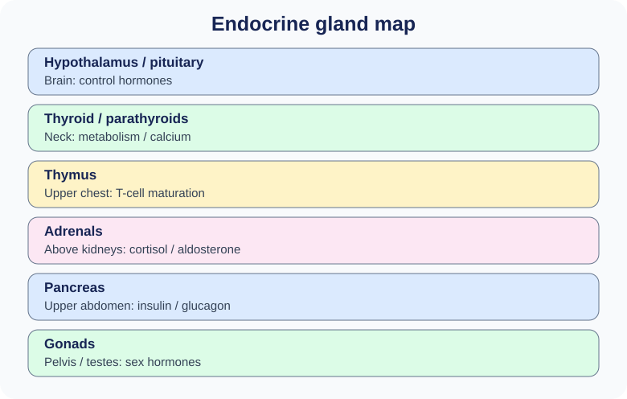

# 🧠 Endocrine System — Complete Concepts Index

[🏠 Chapter](../README.md) · [📝 MCQs](../MCQs/Endocrine-Topic-Wise.md) · [🎯 Mocks](../MCQs/Endocrine-Mixed-Mocks.md) · [🏥 Previous Year Questions](../Previous-Year-Questions/Endocrine-Previous-Year-Questions-Index.md) · [⚡ Revision](../Revision/Endocrine-Quick-Revision.md)

**Study-ready, not marked studied.** Ab ek long notes file mein sab kuch nahi hai. Respiratory chapter ki tarah 3–4 related major topics club karke 8 detailed concept files banaye hain. Part numbers study sequence hain, completed days nahi.

| Part | Detailed notes | Priority | Main topics |
|---|---|---|---|
| 1 | [Anatomy, hormones, feedback and assessment](01-Endocrine-Anatomy-Hormones-Feedback-Assessment.md) | 🟠 High | Gland locations, hormone receptors, HPT/HPA/HPG axes, primary vs central failure, lab and physical assessment |
| 2 | [Pituitary disorders, DI and SIADH](02-Pituitary-Disorders-DI-SIADH.md) | 🔴 Very High | GH, prolactin, Sheehan syndrome, pituitary tumors, postoperative care and sodium/water balance |
| 3 | [Thyroid disorders, emergencies and surgery](03-Thyroid-Disorders-Emergencies-Surgery.md) | 🔴 Very High | Hormone synthesis, hypo/hyper, Graves, Hashimoto, goiter, thyroid cancers, storm, myxedema, thyroidectomy |
| 4 | [Parathyroid, calcium and bone disorders](04-Parathyroid-Calcium-Bone-Disorders.md) | 🔴 Very High | PTH, vitamin D, tetany, calcium emergencies, hungry bone syndrome, osteoporosis, CKD-MBD |
| 5 | [Adrenal disorders](05-Adrenal-Addison-Cushing-Conn-Pheochromocytoma.md) | 🔴 Very High | Cortex, medulla, Addison, crisis, Cushing, Conn, pheochromocytoma, CAH, surgery |
| 6 | [Pancreas, diabetes, insulin and drugs](06-Pancreas-Diabetes-Insulin-Drugs.md) | 🔴 Very High | Types, diagnosis, insulin onset/peak/duration, injections, mixing, numericals, drugs and diet |
| 7 | [Hypoglycemia, DKA and HHS](07-Hypoglycemia-DKA-HHS.md) | 🔴 Very High | Clinical signs, emergency sequence, criteria, osmolality, potassium safety, monitoring |
| 8 | [Diabetes complications, community and other hormones](08-Diabetes-Complications-Community-Other-Hormones.md) | 🟠 High | Foot/eye/kidney care, NP-NCD, NIDDCP, GDM, PCOS, MEN and other endocrine organs |

## 📋 Coverage and sources
- INC Adult Health Nursing I broad endocrine curriculum: anatomy/physiology, assessment, pituitary/thyroid/parathyroid/adrenal disorders including hypo/hyperfunction and tumors, diabetes, investigations, medical/surgical/nutrition/nursing care and insulin skills. [Indian Nursing Council regulations PDF](https://thc.nic.in/Central%20Governmental%20Regulations/Indian%20Nursing%20Council%20%28Revised%20Regulations%20and%20Curriculum%20For%20B.Sc.%28Nursing%29%20%28Program%29%20Regulations%2C2020..pdf) · [OpenStax endocrine nursing](https://openstax.org/books/medical-surgical-nursing/pages/21-introduction) · [ADA 2026 hospital care](https://doi.org/10.2337/dc26-s016).
- Community screening, complications, bone disorders and reproductive/pediatric crossover included. Specialist protocols and every possible exam item not exhaustive.
- Priority labels are preparation estimates, not authenticated exam weightage. Reported and official PYQs kept separate.
- Prior monolithic guide reorganized, original version retained in Git history. No MCQ stems/options changed in this restructuring.

## 🎬 YouTube — teaching and practice

[Open updated topic-wise teaching and MCQ video guide](../Endocrine-YouTube-Teaching-and-MCQ-Practice.md).

| Topic | Concept | Practice |
|---|---|---|
| Glands / physiology | [PW Nursing Wallah Aarogyam A&P](https://www.youtube.com/watch?v=_bPmrRWgrTQ) | [Endocrine mixed MCQs 2026](https://www.youtube.com/watch?v=W00an2mL_5w) |
| Pituitary / thyroid | [NORCET 10 introduction and thyroid](https://www.youtube.com/watch?v=BalA29k0tuM) | [Mixed MCQs](https://www.youtube.com/watch?v=W00an2mL_5w) |
| Thyroid emergencies | [NORCET 10 endocrine countdown](https://www.youtube.com/watch?v=GnwsrLcZzEs) | [Topic-wise practice](../MCQs/Endocrine-Topic-Wise.md) |
| Adrenal, diabetes, community | [Mixed endocrine lecture — relevant sections](https://www.youtube.com/watch?v=GnwsrLcZzEs) | [Topic-wise practice](../MCQs/Endocrine-Topic-Wise.md) |

**Dhyan de:** Video titles/descriptions check hue; full playback/transcript review nahi hua. Dedicated teaching + MCQ videos for every subtopic still pending. No official repetition claim from video titles.

### Extra topic-specific resources (second search)
- [Addison disease Hindi nursing lecture](https://www.youtube.com/watch?v=9MzgaysB_f4) — adrenal insufficiency teaching, title and description checked.
- [Unacademy NORCET adrenal gland class](https://unacademy.com/course/adrenal-gland-endocrine-system-part-ii/ZPZ2XIUL) — coaching course page.
- [Bhushan Science Nursing diabetes lecture lead](https://salda.ws/video.php?id=CDQiNZA9Y1o) — third-party video metadata, direct YouTube playback not checked.
- [Community national health programme practice](https://edurev.in/t/497449/nursing-exams-practice-questions-national-health-programs) — practice resource, not official paper.
- Separate complete teaching/MCQ video pairs for each small subtopic not established; use the topic-wise written bank rather than unsupported video links.

## References
- [INC curriculum reproduction](https://www.legitquest.com/act/indian-nursing-council-revised-regulations-and-curriculum-for-bsc-nursing-program-regulations-2020/CBD2)
- [ADA 2026 glycemic goals and emergencies](https://doi.org/10.2337/dc26-S006); [hospital care](https://doi.org/10.2337/dc26-s016); [pharmacology](https://doi.org/10.2337/dc26-S009)
- [2024 international hyperglycemic crisis consensus](https://pmc.ncbi.nlm.nih.gov/articles/PMC11272983/)
- NIDDK: [acromegaly](https://www.niddk.nih.gov/health-information/endocrine-diseases/acromegaly), [Cushing syndrome](https://www.niddk.nih.gov/health-information/endocrine-diseases/cushings-syndrome), [adrenal insufficiency diagnosis](https://www.niddk.nih.gov/health-information/endocrine-diseases/adrenal-insufficiency-addisons-disease/diagnosis), [diabetes testing](https://www.niddk.nih.gov/health-information/diabetes/overview/tests-diagnosis)
- [ADA 2026 diabetes technology](https://doi.org/10.2337/dc26-S007)

- [OpenStax Medical-Surgical Nursing, endocrine chapter](https://openstax.org/books/medical-surgical-nursing/pages/21-summary)
- [OpenStax pituitary disorders](https://openstax.org/books/medical-surgical-nursing/pages/21-4-pituitary-disorders)
- [American Thyroid Association multidisciplinary thyroid surgery consensus](https://journals.sagepub.com/doi/10.1177/10507256261442596)
- [Endocrine Society primary adrenal insufficiency guideline](https://academic.oup.com/jcem/article/101/2/364/2810222)
- [ADA 2026 hospital diabetes care](https://doi.org/10.2337/dc26-s016), [ADA 2026 glycemic emergencies](https://doi.org/10.2337/dc26-S006), [2024 adult hyperglycemic crisis consensus](https://doi.org/10.2337/dci24-0032)

[All references](../References.md)
