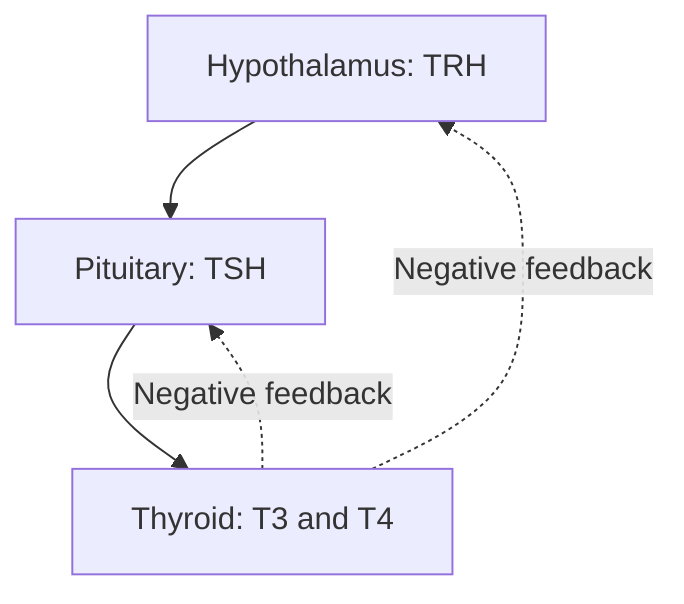
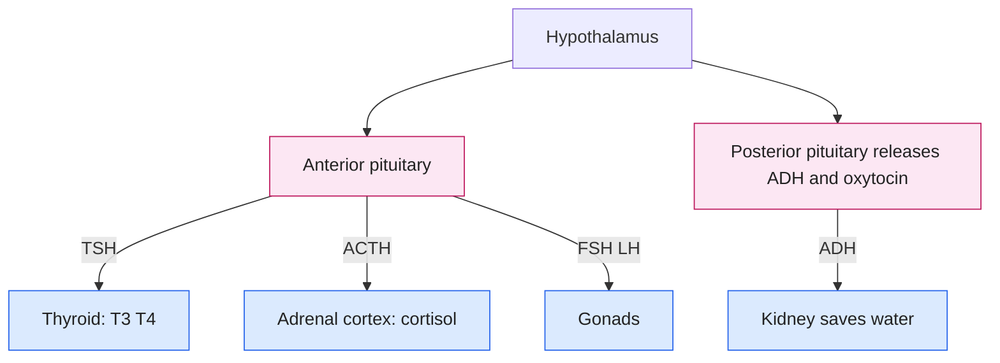
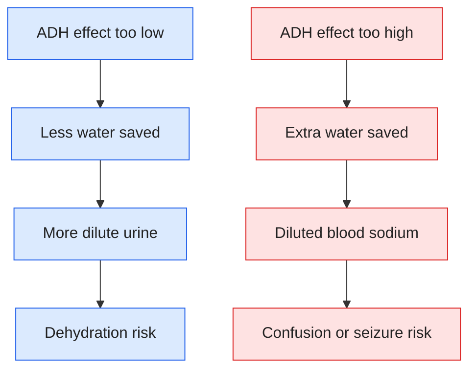
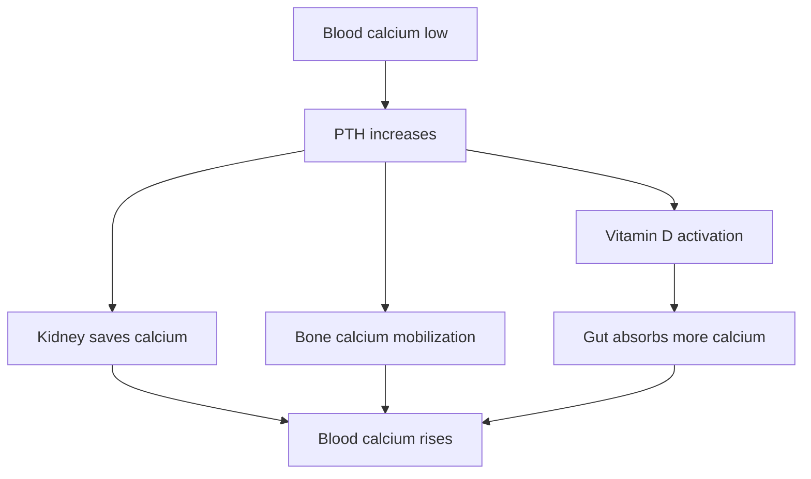
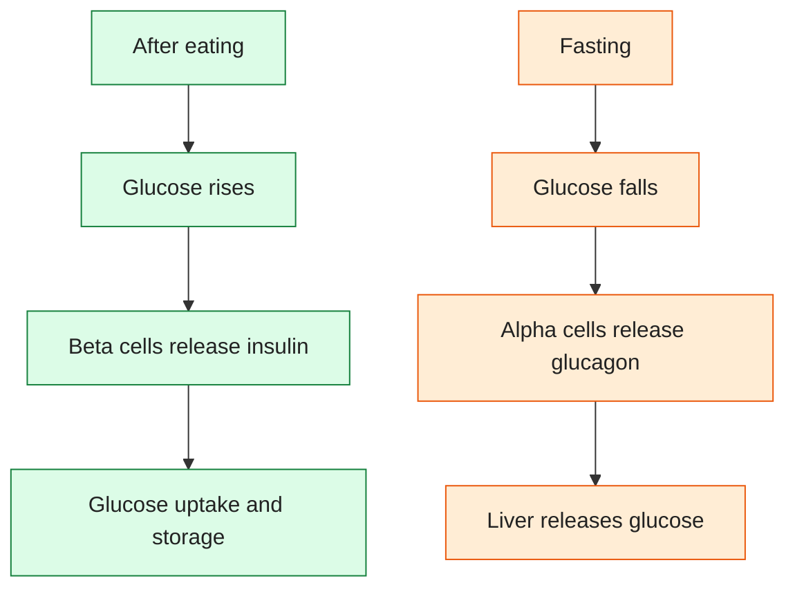
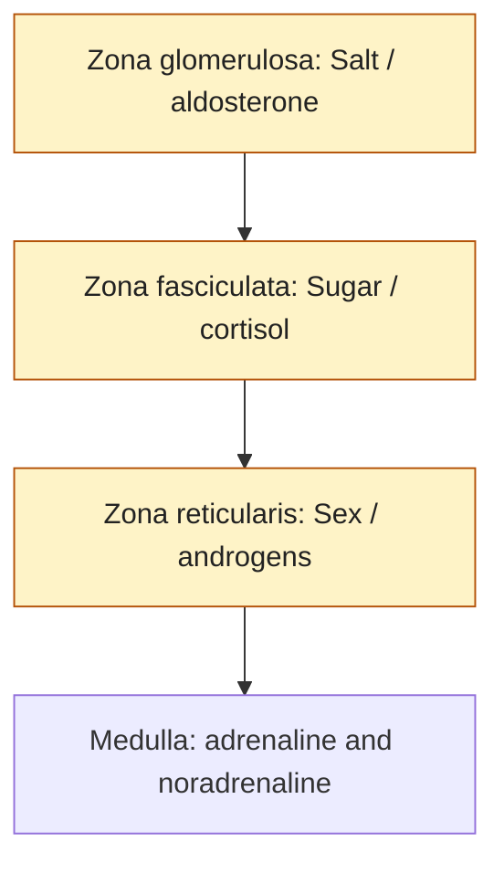

# 🧠 Endocrine System — NORCET + HP Staff Nurse + PGIMER

**Study-ready first edition | Simple Hinglish | Not marked as studied**

🔴 Most important clinical concepts · 🟠 High study priority · 🟡 Important · 🟢 Foundation. These are study priorities, not measured exam frequencies.

## 1. 🟢 Endocrine system kya hai?

- Hamari body mein kuch glands hormones banati hain. Hormones blood ke through doosre organs tak pahunchte hain aur unka kaam control karte hain.
- Endocrine glands ki ducts nahi hoti. Exocrine glands apna secretion duct ke through bhejti hain, jaise salivary glands.
- Pancreas dono tarah ka gland hai: insulin blood mein aur digestive enzymes duct mein jaate hain.

| Gland | Hormone | Kaam |
|---|---|---|
| Anterior pituitary | GH, TSH, ACTH, FSH, LH, prolactin | Growth, thyroid, adrenal aur reproduction control |
| Posterior pituitary | ADH, oxytocin release | Paani bachana, uterine contraction aur milk ejection |
| Thyroid | T3, T4, calcitonin | Metabolism aur calcium regulation |
| Parathyroid | PTH | Blood calcium badhana |
| Adrenal cortex | Aldosterone, cortisol, androgens | Salt-water balance, stress response |
| Adrenal medulla | Adrenaline, noradrenaline | Fight-or-flight response |
| Pancreas | Insulin, glucagon, somatostatin | Blood glucose control |
| Pineal | Melatonin | Sleep-wake timing |
| Ovaries/testes | Estrogen, progesterone/testosterone | Reproduction |
| Thymus | Thymic factors | T-cell development |

## 2. 🟠 Feedback mechanism

- Jab thyroid hormones kam hote hain, hypothalamus TRH aur pituitary TSH badha sakte hain. TSH thyroid ko hormone banane ka signal deta hai.
- Jab T3/T4 ka level badhta hai, TRH aur TSH kam ho jaate hain. Ise negative feedback kehte hain.

- Primary hypothyroidism: thyroid mein problem, TSH usually high aur free T4 low.
- Central hypothyroidism: pituitary/hypothalamus mein problem, free T4 low aur TSH low ya inappropriate normal.

## 3. 🟠 Pituitary gland

🔴 **MOST IMPORTANT:** ADH kahan banta hai aur kahan se release hota hai; anterior vs posterior pituitary; Sheehan syndrome; post-surgery urine output. 🟠 HP 2026 source reports posterior pituitary question (section 18).

- Brain ke base par sella turcica mein hoti hai. Hypothalamus isko control karta hai.
- Anterior pituitary apne hormones banati hai. ADH aur oxytocin hypothalamus mein bante hain aur posterior pituitary se release hote hain.
- GH growth mein help karta hai. Bachpan mein excess GH se gigantism, adults mein acromegaly. Acromegaly mein haath, pair aur jaw bade ho sakte hain. IGF-1 screening aur specialist testing useful hain.
- GH ki childhood deficiency se short stature ho sakta hai.
- Prolactinoma: prolactin badhta hai; galactorrhea, irregular periods, infertility ho sakti hai. Cabergoline commonly used hoti hai.
- Pituitary tumor optic chiasm par pressure daale toh bitemporal hemianopia ho sakti hai.
- Hypopituitarism mein multiple hormones kam ho sakte hain. Cortisol deficiency exclude/treat karna thyroid replacement se pehle important hai.
- Sheehan syndrome: severe postpartum bleeding ke baad pituitary damage; milk na banna aur periods na aana clues hain.
- Transsphenoidal surgery ke baad urine output, sodium, neurological status aur clear nasal drainage monitor karo; CSF leak suspect ho toh report karo. Nose blowing/straining se bachne ki advice surgeon ke protocol ke hisaab se.

## 4. 🔴 ADH, Diabetes insipidus aur SIADH

🔴 **HIGH PRIORITY — EXAM LEAD:** DI mein dilute urine, SIADH mein low sodium. NORCET 2023 DI presentation source, HP 2026 related pituitary hormone source (section 18).

- ADH kidney ko paani bachane mein help karta hai.
- ADH kam ho ya kidney respond na kare toh bahut dilute urine aata hai. Pyaas badhti hai. Ise diabetes insipidus (DI) kehte hain; glucose wali diabetes se alag hai.
- Central DI mein ADH ki kami; nephrogenic DI mein kidney ka response kam. Central DI mein desmopressin useful ho sakta hai.
- SIADH mein body extra paani rok leti hai; blood sodium dilute hokar kam ho jaata hai. Headache, confusion, seizures ho sakte hain.

| Finding | DI | SIADH |
|---|---|---|
| Urine | Zyada, dilute | Relatively concentrated |
| Serum sodium | High ho sakta hai | Low |
| Serum osmolality | High ho sakti hai | Low |
| Nursing | I/O, weight, hydration, sodium | I/O, weight, sodium, neurological signs |

- SIADH mein fluid restriction selected stable cases mein; severe symptomatic hyponatremia emergency hai, protocol-based hypertonic saline aur close sodium monitoring chahiye. Sodium ko bahut jaldi correct karna harmful hai.
- Water deprivation test supervised setting mein hota hai, ghar par nahi.

## 5. 🟠 Thyroid gland

🔴 **MOST IMPORTANT:** Thyroidectomy ke baad airway aur calcium; thyroid storm vs myxedema coma; TSH/T4 pattern. 🔁 Postoperative hypocalcemia reported in 2022 and 2024 NORCET collections.

- Neck mein trachea ke saamne butterfly-shaped gland. Follicular cells T3/T4 banati hain; C cells calcitonin.
- T3/T4 body ki energy use aur heat production ko regulate karte hain. Iodine hormone synthesis ke liye chahiye.
- Goiter ka matlab gland ka size badhna hai; thyroid function normal, low ya high ho sakta hai.

| Sign | Hypothyroidism | Hyperthyroidism |
|---|---|---|
| Weight | Badhta hai | Kam ho sakta hai |
| Temperature | Thand lagna | Garmi lagna |
| Pulse | Slow | Fast |
| Bowel | Constipation | Frequent stools |
| Skin | Dry | Warm, moist |
| Common cause | Hashimoto thyroiditis | Graves disease |

- Graves autoimmune disease hai; eye signs ho sakte hain. Hyperthyroidism mein tremor, palpitations aur anxiety bhi hoti hai.
- Tests: TSH, free T4, kabhi T3, antibodies. Ultrasound nodule ki structure dikhata hai; suspicious nodules mein FNAC specialist decide karta hai.
- Hypothyroidism: levothyroxine prescribed dose mein, consistently empty stomach; iron/calcium se usually 4 hours ka gap.
- Hyperthyroidism: antithyroid medicines, beta blockers for symptoms, selected patients mein radioiodine ya surgery. Fever/sore throat on antithyroid drug ko urgently report karo (agranulocytosis risk).
- Radioiodine pregnancy mein contraindicated hai; breastfeeding aur radiation precautions specialist instructions ke according.
- Congenital hypothyroidism: early newborn screening aur treatment brain development ke liye important.

### 🔴 Thyroid emergencies aur surgery
- Thyroid storm: high fever, severe tachycardia, agitation/confusion, possible heart failure. ABC, emergency escalation, ECG, cooling, fluids as appropriate aur prescribed treatment. Iodine antithyroid medicine ke baad protocol ke according.
- Myxedema coma: severe hypothyroidism, hypothermia, bradycardia, hypoventilation aur altered consciousness. ABC, ventilatory support as needed, urgent escalation; IV thyroid hormone aur glucocorticoid medical team ke protocol se.
- Thyroidectomy ke baad neck swelling, bleeding, stridor ya respiratory distress ko emergency samjho. Airway first. Semi-Fowler position if appropriate, neck supported, voice, wound aur calcium monitor karo.
- Lips ke aas-paas tingling ya muscle spasm calcium kam hone ka sign ho sakta hai.

## 6. 🔴 Parathyroid aur calcium

🔴 **MOST IMPORTANT / REPORTED REPEAT:** Hypocalcemia after thyroidectomy, Trousseau and Chvostek signs, tetany. Source details section 18.

- Usually 4 glands thyroid ke peeche hoti hain. PTH blood calcium badhata hai: bone, kidney aur vitamin D activation ke through.
- Hypoparathyroidism: calcium kam, phosphate high ho sakta hai; tingling, tetany, cramps, seizures, prolonged QT.
- Chvostek sign: facial nerve tap karne par facial twitch. Trousseau sign: BP cuff se carpal spasm.
- Severe symptomatic hypocalcemia mein prescribed IV calcium gluconate, ECG aur IV site monitor.
- Primary hyperparathyroidism: calcium high, PTH high/inappropriately normal; kidney stones, bone pain, constipation, weakness. Phosphate low ho sakta hai.
- Hypercalcemia mein dehydration aur confusion ho sakte hain; hydration aur prescribed treatment; ECG/renal function monitor.

## 7. 🟠 Adrenal glands

🔴 **MOST IMPORTANT:** Addison vs Cushing, adrenal crisis, aldosterone and potassium, pheochromocytoma (HP 2020 reported source).

- Dono kidneys ke upar glands hoti hain. Bahar cortex, andar medulla.
- Cortex: glomerulosa = aldosterone (salt), fasciculata = cortisol (sugar/stress), reticularis = androgens (sex). Trick: Salt, Sugar, Sex.
- Aldosterone sodium aur water retain karne mein help karta hai aur potassium excretion badhata hai.
- Cortisol stress response, glucose regulation aur inflammation control mein role play karta hai.

| Feature | Addison (primary adrenal insufficiency) | Cushing syndrome |
|---|---|---|
| Cortisol | Low | High |
| BP | Low | Often high |
| Glucose | Low ho sakta hai | High ho sakta hai |
| Skin | Hyperpigmentation possible | Thin skin, purple striae |
| Weight | Loss | Central weight gain |
| Sodium/potassium | Low Na, high K possible | Variable; low K possible |

- Addison mein ACTH high hota hai; secondary adrenal insufficiency mein hyperpigmentation aur hyperkalemia usually nahi.
- Adrenal crisis: severe hypotension, vomiting, weakness, confusion. Urgent ABC, IV hydrocortisone aur isotonic fluids per emergency protocol; glucose/electrolytes monitor.
- Long-term steroids ko suddenly stop nahi karna; taper prescribed plan se. Sick-day rules aur steroid emergency card important.
- Cushing syndrome cortisol excess hai; Cushing disease specifically pituitary ACTH-secreting tumor. Steroid use common cause of Cushing syndrome.
- Cushing nursing: infection, glucose, BP, fragile skin aur falls/fractures monitor.
- Conn syndrome: primary aldosteronism; hypertension, low potassium ho sakta hai. Aldosterone-renin ratio screening.
- Pheochromocytoma: catecholamine-producing tumor; episodic headache, sweating, palpitations, hypertension. Plasma free or urinary fractionated metanephrines; preoperative alpha blockade before beta blockade.
- Congenital adrenal hyperplasia: commonly 21-hydroxylase deficiency; salt-wasting, androgen excess. Infant dehydration/shock emergency.

## 8. 🔴 Pancreas aur Diabetes mellitus

🔴 **MOST IMPORTANT:** Insulin types and safety, glucose diagnostic criteria, diabetic foot, Type 1 vs Type 2. PGIMER 2025 reported clinical diabetes evaluation.

- Pancreatic islets: beta cells insulin, alpha cells glucagon, delta cells somatostatin.
- Khana khane ke baad glucose badhta hai. Insulin glucose ko muscle/fat cells mein lene aur liver mein store karne mein help karta hai. Fasting mein glucagon glucose badhata hai.
- Type 1: autoimmune beta-cell destruction, insulin required. Type 2: insulin resistance aur progressive insulin deficiency. Gestational diabetes: pregnancy mein diagnosed glucose intolerance (overt pre-existing diabetes se alag).
- Classic symptoms: polyuria (urine zyada), polydipsia (pyaas), polyphagia (bhookh), weight loss possible.

| Nonpregnant adult diagnosis | Diabetes threshold |
|---|---|
| Fasting plasma glucose | ≥126 mg/dL |
| 2-hour 75 g OGTT | ≥200 mg/dL |
| HbA1c | ≥6.5% |
| Random plasma glucose | ≥200 mg/dL with classic symptoms or crisis |

- Unequivocal hyperglycemia absent ho toh diagnosis confirm karne ke liye repeat/second abnormal test chahiye. HbA1c roughly past 2–3 months ka glucose estimate hai; anemia aur hemoglobin variants interpretation affect kar sakte hain.
- Prediabetes (ADA): fasting 100–125, 2-hour 140–199 mg/dL, HbA1c 5.7–6.4%.
- Long-term complications: retinopathy, nephropathy, neuropathy (microvascular), MI/stroke/PAD (macrovascular).
- Nursing: glucose monitoring, foot inspection daily, footwear, medication adherence, nutrition/activity education, hypoglycemia action plan; eye and kidney screening.

### Insulin aur medicines
- Rapid acting: lispro/aspart; short: regular; intermediate: NPH; long: glargine/detemir/degludec (duration product-specific).
- Regular insulin commonly IV infusion protocols mein use hota hai. NPH cloudy; regular clear. Compatible regular + NPH mix prescribed ho toh clear before cloudy. Glargine ko mix mat karo.
- Subcutaneous site rotation within region se lipohypertrophy kam hoti hai. Insulin product, dose, timing, glucose, meal availability check karo. Unopened insulin usually 2–8°C; freeze na karo; in-use storage product label se.
- Metformin: hepatic glucose production kam; GI effects, B12 deficiency possible; renal function check.
- Sulfonylureas: insulin release badhate hain, hypoglycemia risk.
- SGLT2 inhibitors: urine mein glucose excretion; genital infection aur euglycemic DKA risk.
- GLP-1 receptor agonists: glucose-dependent insulin secretion, satiety; nausea common.
- Type 1 mein basal insulin illness mein bhi generally continue under sick-day guidance; dose individualized.

## 9. 🔴 Hypoglycemia, DKA aur HHS

🔴 **MOST IMPORTANT:** Hypoglycemia first aid, DKA vs HHS, potassium before insulin. PGIMER 2020 reported early hypoglycemia question.

- Hypoglycemia alert threshold below 70 mg/dL. Sweating, tremor, hunger, confusion; severe cases seizure/unconsciousness.
- Awake aur safely swallow kar sakta hai: 15 g fast carbohydrate, 15 minutes baad glucose recheck; repeat if still low. Unable to swallow: oral kuch mat do; emergency assistance, glucagon or IV dextrose per protocol.

| Feature | DKA | HHS |
|---|---|---|
| Main problem | Ketones + acidosis | Severe hyperosmolality/dehydration |
| Breathing | Kussmaul possible | Usually absent unless another cause |
| Glucose | Often high, can be near normal | Usually very high |
| Typical association | Type 1, but any type | Type 2, but overlap possible |

- DKA: insulin deficiency → fat breakdown → ketones → metabolic acidosis. Nausea, abdominal pain, deep breathing, fruity breath.
- HHS: severe hyperglycemia → urine water loss → dehydration → altered mental status.
- Treatment principles: IV fluids, potassium assessment/replacement, insulin as indicated, frequent glucose/electrolytes, treat precipitating cause. If potassium severely low, insulin delayed until corrected per protocol.
- DKA glucose normalize hone se pehle ketones clear nahi bhi hue ho sakte; prescribed dextrose may be added so insulin can continue safely.
- Sick day: hydration, glucose/ketone monitoring, urgent help for vomiting, breathing difficulty, confusion or persistent ketones.

## 10. 🟡 Other endocrine topics — clubbed

🟡 **SECONDARY PRIORITY:** Pineal, thymus, MEN and other endocrine organs; pehle high-priority glands padho, fir ye revise karo.

- Pineal melatonin: sleep-wake cycle, darkness mein secretion increases.
- Thymus: T-cell maturation, childhood mein relatively prominent.
- Ovaries: estrogen, progesterone; testes: testosterone. FSH/LH gonadal function regulate karte hain.
- PCOS: ovulatory dysfunction, androgen excess, possible polycystic ovarian morphology; metabolic risk bhi assess hota hai.
- Kidney: erythropoietin RBC production, renin BP regulation, calcitriol calcium absorption. Heart: ANP sodium excretion mein help. GI: gastrin, secretin, CCK digestion regulate karte hain.
- MEN1: parathyroid, pituitary, pancreatic/duodenal neuroendocrine tumors. MEN2: medullary thyroid carcinoma, pheochromocytoma; MEN2A mein parathyroid disease possible.

## 11. 📝 Topic-wise practice MCQs (original, not PYQs)

1. Which gland releases ADH? A. Anterior pituitary B. Posterior pituitary C. Thyroid D. Adrenal cortex

Answer
B. ADH hypothalamus mein banta hai aur posterior pituitary se release hota hai.

2. A patient with central DI is likely to have: A. Dilute polyuria B. Concentrated oliguria C. Hypoglycemia D. Tetany

Answer
A. ADH kam hone se kidney paani retain nahi kar paati.

3. Primary hypothyroidism typically shows: A. Low TSH and high T4 B. High TSH and low free T4 C. High TSH and high T4 D. Low TSH and high cortisol

Answer
B. Thyroid se hormone kam aata hai, pituitary TSH badhati hai.

4. Tingling around lips after thyroidectomy suggests: A. Hyperglycemia B. Hypocalcemia C. Hypernatremia D. Hyperkalemia

Answer
B. Parathyroid function affected ho sakta hai. Calcium aur airway assess karo.

5. Which adrenal layer makes aldosterone? A. Reticularis B. Medulla C. Glomerulosa D. Fasciculata

Answer
C. Salt, Sugar, Sex trick yaad rakho.

6. Which pancreatic cell produces insulin? A. Alpha B. Beta C. Delta D. Acinar

Answer
B. Alpha glucagon, delta somatostatin, acinar digestive enzymes banati hain.

7. A conscious patient with glucose 58 mg/dL can swallow safely. Initial treatment? A. Fast carbohydrate B. Extra insulin C. Fluid restriction D. Exercise

Answer
A. 15 g fast carbohydrate aur 15 minutes mein recheck.

8. Which is characteristic of DKA? A. Respiratory alkalosis as primary disturbance B. Ketosis with metabolic acidosis C. Hypocalcemic tetany D. Low cortisol

Answer
B. Fat breakdown se ketones aur acidosis hoti hai.

## 12. 🏁 Mixed mock — first set

1. After thyroid surgery, a patient develops stridor. Priority? A. Offer food B. Assess/support airway and call emergency help C. Walk patient D. Check weight
2. Which finding is typical in SIADH? A. Hypernatremia with dilute urine B. Hyponatremia with concentrated urine C. Hypercalcemia D. High HbA1c
3. Severe hypotension and vomiting in known Addison disease suggest: A. Thyroid storm B. Adrenal crisis C. Acromegaly D. Graves disease
4. An unconscious hypoglycemic patient should receive: A. Oral juice B. Oral candy C. Emergency glucagon or IV dextrose per protocol D. Exercise
5. Bitemporal hemianopia in pituitary tumor results from pressure on: A. Optic chiasm B. Cerebellum C. Medulla D. Thyroid

Mock answers and rationale

1 B — airway sabse pehle. 2 B — excess water blood sodium ko dilute karta hai. 3 B — cortisol deficiency emergency ho sakti hai. 4 C — unconscious patient ko oral food se aspiration ho sakta hai. 5 A — optic chiasm compression se side vision affected hoti hai.

## 13. PYQ evidence status and further reading

Official NORCET/HPRCA/PGIMER question papers and year-wise frequency have not been independently verified in this edition. Above questions are original practice, not attributed PYQs. Priority labels reflect clinical relevance, not proven repetition.

Clinical reading: [NIDDK endocrine diseases](https://www.niddk.nih.gov/health-information/endocrine-diseases), [ADA standards](https://professional.diabetes.org/standards-of-care), [Endocrine Society guidelines](https://www.endocrine.org/clinical-practice-guidelines), [American Thyroid Association](https://www.thyroid.org/).

**Edition status:** Expanded practice and diagrams are available in sections 14–18 below. Official PYQ verification remains pending; broad INC coverage audit and gap-filling are in sections 19–21.

## 14. 🎨 Gland-wise visual revision and priority

**Weightage note:** 🔴 Highest revision priority, 🟠 High priority, 🟡 Secondary revision, 🟢 Basic. Actual exam-wise percentage available nahi hai. Repeated question lead alag source table mein diya hai.

| Gland | 🔴 Pehle ye karo | 🟡 Baad mein revise |
|---|---|---|
| Pituitary | ADH origin/release, DI vs SIADH, post-operative monitoring | Prolactin, GH and other anterior hormones |
| Thyroid | Hypo vs hyper, thyroidectomy airway and calcium, thyroid emergencies | Nodules, thyroiditis, cancers |
| Parathyroid | PTH action, Chvostek/Trousseau, hypocalcemia | Other causes of calcium disorders |
| Adrenal | Addison vs Cushing, crisis, cortex layers, pheochromocytoma | CAH, Conn syndrome |
| Pancreas | Insulin, hypoglycemia, DKA/HHS, diagnostic values, foot care | Rare islet tumors |
| Other glands | Pineal, thymus, gonadal hormones | MEN and diffuse endocrine organs |

### Diagram — hormone map

### Diagram — DI versus SIADH

### Diagram — calcium control

### Diagram — glucose after a meal versus fasting

### Diagram — adrenal cortex outside to inside

## 15. 🟡 Extra topics — missed points and revision

- **Thyroiditis:** Hashimoto autoimmune hypothyroidism ka common cause hai. Subacute thyroiditis mein neck pain ho sakta hai aur hormone leak hone se temporary thyrotoxicosis. Postpartum thyroiditis painless ho sakti hai. Har thyrotoxicosis mein antithyroid drugs helpful nahi hoti.
- **Thyroid cancers:** Papillary common differentiated type; follicular blood-borne spread kar sakta hai; medullary C-cell origin aur calcitonin marker; anaplastic aggressive. Treatment subtype-specific hota hai.
- **Insulinoma:** Pancreatic beta-cell neuroendocrine tumor se recurrent hypoglycemia ho sakti hai. Whipple triad: symptoms, documented low plasma glucose, glucose correction se symptoms improve.
- **Glucagonoma:** Glucagon-producing tumor; diabetes, weight loss aur characteristic rash possible.
- **Pituitary apoplexy:** sudden severe headache, visual change, possible acute adrenal insufficiency; emergency escalation.
- **Endocrine assessment:** weight trends, BP/pulse, hydration, menstrual history, growth, skin, neurological status, medication history. Lab values ko local reference range ke saath interpret karo.
- **Nursing lab clues:** Sodium commonly 135–145 mmol/L, potassium 3.5–5.0 mmol/L, total calcium about 8.5–10.5 mg/dL; lab-specific ranges vary; albumin/ionized calcium context matters.
- **Diabetes prevention and education:** balanced meals, activity as tolerated, tobacco cessation, BP/lipid management, vaccination as recommended, regular follow-up.
- **Gestational diabetes:** pregnancy-specific testing and thresholds differ from nonpregnant criteria. Maternal glucose monitoring and postpartum follow-up important.
- **Diabetic neuropathy:** sensory loss, autonomic symptoms; monofilament testing, foot care and ulcer/infection referral.

## 16. 📝 Expanded topic-wise original MCQ bank

### Hormones and feedback

**Q1.1 [Easy] Which endocrine gland has both endocrine and exocrine functions?**

A. Thyroid  
B. Pancreas  
C. Pineal  
D. Parathyroid

Show answer & explanation

**Correct: B. Pancreas** — Pancreas insulin blood mein aur digestive enzymes duct mein bhejta hai.

- Thyroid: Is question mein correct finding/action nahi hai.
- Pineal: Is question mein correct finding/action nahi hai.
- Parathyroid: Is question mein correct finding/action nahi hai.

**Q1.2 [Medium] A steroid hormone primarily binds to which receptor location?**

A. Intracellular receptor  
B. Ribosome  
C. Lysosome  
D. Extracellular matrix

Show answer & explanation

**Correct: A. Intracellular receptor** — Steroid lipid-soluble hai, cell ke andar receptor se bind karta hai.

- Ribosome: Is question mein correct finding/action nahi hai.
- Lysosome: Is question mein correct finding/action nahi hai.
- Extracellular matrix: Is question mein correct finding/action nahi hai.

**Q1.3 [Medium] In a normal thyroid axis, a rise in circulating free T4 causes:**

A. Reduced TSH secretion  
B. Increased PTH  
C. Increased TSH  
D. Increased TRH

Show answer & explanation

**Correct: A. Reduced TSH secretion** — T4 badhne par negative feedback TSH ko kam karta hai.

- Increased PTH: Is question mein correct finding/action nahi hai.
- Increased TSH: Is question mein correct finding/action nahi hai.
- Increased TRH: Is question mein correct finding/action nahi hai.

**Q1.4 [Easy] Which hormone is a hypothalamic releasing hormone?**

A. Insulin  
B. TRH  
C. TSH  
D. PTH

Show answer & explanation

**Correct: B. TRH** — TRH hypothalamus se aata hai aur anterior pituitary ko TSH banane ka signal deta hai.

- Insulin: Is question mein correct finding/action nahi hai.
- TSH: Is question mein correct finding/action nahi hai.
- PTH: Is question mein correct finding/action nahi hai.

**Q1.5 [Medium] Which hormone promotes milk synthesis rather than milk ejection?**

A. ADH  
B. Oxytocin  
C. Prolactin  
D. LH

Show answer & explanation

**Correct: C. Prolactin** — Prolactin milk banata hai; oxytocin milk bahar nikalne mein help karta hai.

- ADH: Is question mein correct finding/action nahi hai.
- Oxytocin: Is question mein correct finding/action nahi hai.
- LH: Is question mein correct finding/action nahi hai.

### Pituitary and water balance

**Q2.1 [Easy] Excess growth hormone before closure of epiphyseal plates causes:**

A. Gigantism  
B. Myxedema  
C. Cretinism  
D. Acromegaly

Show answer & explanation

**Correct: A. Gigantism** — Growth plates open hone par height zyada badhti hai.

- Myxedema: Is question mein correct finding/action nahi hai.
- Cretinism: Is question mein correct finding/action nahi hai.
- Acromegaly: Is question mein correct finding/action nahi hai.

**Q2.2 [Medium] Which test is commonly used to screen for acromegaly?**

A. Serum sodium only  
B. Urine ketones  
C. HbA1c  
D. Serum IGF-1

Show answer & explanation

**Correct: D. Serum IGF-1** — GH ka effect IGF-1 ke through hota hai; IGF-1 useful screening marker hai.

- Serum sodium only: Is question mein correct finding/action nahi hai.
- Urine ketones: Is question mein correct finding/action nahi hai.
- HbA1c: Is question mein correct finding/action nahi hai.

**Q2.3 [Medium] Failure of lactation after massive postpartum hemorrhage suggests:**

A. SIADH  
B. Graves disease  
C. Conn syndrome  
D. Sheehan syndrome

Show answer & explanation

**Correct: D. Sheehan syndrome** — Bleeding se pituitary ki blood supply kam ho sakti hai.

- SIADH: Is question mein correct finding/action nahi hai.
- Graves disease: Is question mein correct finding/action nahi hai.
- Conn syndrome: Is question mein correct finding/action nahi hai.

**Q2.4 [Easy] Which drug is used for central diabetes insipidus?**

A. Desmopressin  
B. Methimazole  
C. Spironolactone  
D. Glucagon

Show answer & explanation

**Correct: A. Desmopressin** — Desmopressin ADH jaisa effect dekar kidney ko paani bachane mein help karta hai.

- Methimazole: Is question mein correct finding/action nahi hai.
- Spironolactone: Is question mein correct finding/action nahi hai.
- Glucagon: Is question mein correct finding/action nahi hai.

**Q2.5 [Medium] Which finding requires urgent action after transsphenoidal surgery?**

A. New clear nasal drainage  
B. Normal urine output  
C. Stable pulse  
D. Mild fatigue

Show answer & explanation

**Correct: A. New clear nasal drainage** — Clear nasal drainage CSF leak ho sakta hai; medical team ko report karo.

- Normal urine output: Is question mein correct finding/action nahi hai.
- Stable pulse: Is question mein correct finding/action nahi hai.
- Mild fatigue: Is question mein correct finding/action nahi hai.

**Q2.6 [Medium] In nephrogenic DI, the main defect is:**

A. Excess aldosterone  
B. Lack of PTH  
C. Excess insulin  
D. Kidney resistance to ADH

Show answer & explanation

**Correct: D. Kidney resistance to ADH** — ADH present ho sakta hai par kidney uska response nahi deti.

- Excess aldosterone: Is question mein correct finding/action nahi hai.
- Lack of PTH: Is question mein correct finding/action nahi hai.
- Excess insulin: Is question mein correct finding/action nahi hai.

**Q2.7 [Easy] A patient with SIADH develops a seizure. Which complication is most likely?**

A. Hyperglycemia  
B. Hypercalcemia  
C. Severe hyponatremia  
D. Hypernatremia

Show answer & explanation

**Correct: C. Severe hyponatremia** — Extra paani sodium dilute karta hai; severe low sodium brain ko affect karta hai.

- Hyperglycemia: Is question mein correct finding/action nahi hai.
- Hypercalcemia: Is question mein correct finding/action nahi hai.
- Hypernatremia: Is question mein correct finding/action nahi hai.

### Thyroid and parathyroid

**Q3.1 [Easy] Which thyroid cells secrete calcitonin?**

A. Beta cells  
B. Chief cells  
C. Follicular cells  
D. Parafollicular cells

Show answer & explanation

**Correct: D. Parafollicular cells** — C cells ko parafollicular cells bhi kehte hain.

- Beta cells: Is question mein correct finding/action nahi hai.
- Chief cells: Is question mein correct finding/action nahi hai.
- Follicular cells: Is question mein correct finding/action nahi hai.

**Q3.2 [Medium] Exophthalmos is classically associated with:**

A. Conn syndrome  
B. Graves disease  
C. Addison disease  
D. Hashimoto disease

Show answer & explanation

**Correct: B. Graves disease** — Graves mein autoimmune inflammation eyes ke tissues ko affect kar sakti hai.

- Conn syndrome: Is question mein correct finding/action nahi hai.
- Addison disease: Is question mein correct finding/action nahi hai.
- Hashimoto disease: Is question mein correct finding/action nahi hai.

**Q3.3 [Medium] A patient on methimazole reports fever and sore throat. Priority action?**

A. Reassure and ignore  
B. Urgent medical assessment and CBC  
C. Give extra methimazole  
D. Start exercise

Show answer & explanation

**Correct: B. Urgent medical assessment and CBC** — Agranulocytosis ka risk hai; urgent review zaroori hai.

- Reassure and ignore: Is question mein correct finding/action nahi hai.
- Give extra methimazole: Is question mein correct finding/action nahi hai.
- Start exercise: Is question mein correct finding/action nahi hai.

**Q3.4 [Easy] Levothyroxine should generally be separated from oral calcium supplements by:**

A. 30 minutes  
B. 4 hours  
C. No interval  
D. 10 minutes

Show answer & explanation

**Correct: B. 4 hours** — Calcium absorption kam kar sakta hai, isliye usually four hours gap.

- 30 minutes: Is question mein correct finding/action nahi hai.
- No interval: Is question mein correct finding/action nahi hai.
- 10 minutes: Is question mein correct finding/action nahi hai.

**Q3.5 [Medium] Which vital sign pattern suggests myxedema coma?**

A. Hypertension and tremor  
B. Tachypnea with normal cognition  
C. High fever and tachycardia  
D. Hypothermia and bradycardia

Show answer & explanation

**Correct: D. Hypothermia and bradycardia** — Severe hypothyroidism mein body processes slow ho jaate hain.

- Hypertension and tremor: Is question mein correct finding/action nahi hai.
- Tachypnea with normal cognition: Is question mein correct finding/action nahi hai.
- High fever and tachycardia: Is question mein correct finding/action nahi hai.

**Q3.6 [Medium] Which clinical feature most strongly suggests thyroid storm?**

A. Isolated ankle pain  
B. Mild constipation  
C. High fever and marked tachycardia  
D. Chronic dry skin

Show answer & explanation

**Correct: C. High fever and marked tachycardia** — Thyroid hormone excess emergency mein temperature aur pulse bahut badh sakte hain.

- Isolated ankle pain: Is question mein correct finding/action nahi hai.
- Mild constipation: Is question mein correct finding/action nahi hai.
- Chronic dry skin: Is question mein correct finding/action nahi hai.

**Q3.7 [Easy] Which bedside sign is elicited by inflating a blood pressure cuff to provoke carpal spasm?**

A. Babinski  
B. Trousseau  
C. Romberg  
D. Kernig

Show answer & explanation

**Correct: B. Trousseau** — Low calcium mein muscles easily contract karti hain; BP cuff se carpal spasm Trousseau hai.

- Babinski: Is question mein correct finding/action nahi hai.
- Romberg: Is question mein correct finding/action nahi hai.
- Kernig: Is question mein correct finding/action nahi hai.

**Q3.8 [Medium] Which ECG change is associated with hypocalcemia?**

A. Prolonged QT  
B. Always ST elevation  
C. Absent P wave  
D. Shortened QT

Show answer & explanation

**Correct: A. Prolonged QT** — Low calcium ventricular repolarization ko prolong kar sakta hai.

- Always ST elevation: Is question mein correct finding/action nahi hai.
- Absent P wave: Is question mein correct finding/action nahi hai.
- Shortened QT: Is question mein correct finding/action nahi hai.

**Q3.9 [Medium] Which biochemical pattern fits primary hyperparathyroidism?**

A. High calcium and suppressed PTH always  
B. Low sodium and high cortisol  
C. Low calcium and low PTH  
D. High calcium and inappropriately high PTH

Show answer & explanation

**Correct: D. High calcium and inappropriately high PTH** — PTH calcium badhata hai; primary disease mein PTH inappropriate high ya normal rehta hai.

- High calcium and suppressed PTH always: Is question mein correct finding/action nahi hai.
- Low sodium and high cortisol: Is question mein correct finding/action nahi hai.
- Low calcium and low PTH: Is question mein correct finding/action nahi hai.

**Q3.10 [Easy] Which symptom in a post-thyroidectomy patient can indicate recurrent laryngeal nerve dysfunction?**

A. Diarrhea  
B. New hoarseness  
C. Polyphagia  
D. Hematuria

Show answer & explanation

**Correct: B. New hoarseness** — Recurrent laryngeal nerve vocal cords ko control karti hai; voice change assess karo.

- Diarrhea: Is question mein correct finding/action nahi hai.
- Polyphagia: Is question mein correct finding/action nahi hai.
- Hematuria: Is question mein correct finding/action nahi hai.

### Adrenal disorders

**Q4.1 [Easy] Which adrenal cortex zone primarily produces cortisol?**

A. Medulla  
B. Glomerulosa  
C. Fasciculata  
D. Reticularis

Show answer & explanation

**Correct: C. Fasciculata** — Glomerulosa salt, fasciculata sugar/stress, reticularis sex hormones.

- Medulla: Is question mein correct finding/action nahi hai.
- Glomerulosa: Is question mein correct finding/action nahi hai.
- Reticularis: Is question mein correct finding/action nahi hai.

**Q4.2 [Medium] Which laboratory pattern is typical of primary adrenal insufficiency?**

A. High Na and low K  
B. Low Na and high K  
C. High calcium only  
D. High glucose always

Show answer & explanation

**Correct: B. Low Na and high K** — Aldosterone kam hone se sodium loss aur potassium retention ho sakta hai.

- High Na and low K: Is question mein correct finding/action nahi hai.
- High calcium only: Is question mein correct finding/action nahi hai.
- High glucose always: Is question mein correct finding/action nahi hai.

**Q4.3 [Medium] Why can primary Addison disease cause skin hyperpigmentation?**

A. High ACTH and related peptides  
B. High insulin  
C. Low melatonin  
D. Low ACTH

Show answer & explanation

**Correct: A. High ACTH and related peptides** — Cortisol kam hone par ACTH badhta hai aur pigmentation badh sakti hai.

- High insulin: Is question mein correct finding/action nahi hai.
- Low melatonin: Is question mein correct finding/action nahi hai.
- Low ACTH: Is question mein correct finding/action nahi hai.

**Q4.4 [Easy] Cushing disease specifically refers to:**

A. Adrenal medullary tumor  
B. Low cortisol  
C. All glucocorticoid excess  
D. Pituitary ACTH-producing tumor

Show answer & explanation

**Correct: D. Pituitary ACTH-producing tumor** — Cushing syndrome broad term hai; disease pituitary origin ko kehte hain.

- Adrenal medullary tumor: Is question mein correct finding/action nahi hai.
- Low cortisol: Is question mein correct finding/action nahi hai.
- All glucocorticoid excess: Is question mein correct finding/action nahi hai.

**Q4.5 [Medium] Which feature is typical of Cushing syndrome?**

A. Cold intolerance only  
B. Purple striae  
C. Profound salt craving only  
D. Low glucose always

Show answer & explanation

**Correct: B. Purple striae** — Cortisol excess skin ko thin karta hai aur purple stretch marks ho sakte hain.

- Cold intolerance only: Is question mein correct finding/action nahi hai.
- Profound salt craving only: Is question mein correct finding/action nahi hai.
- Low glucose always: Is question mein correct finding/action nahi hai.

**Q4.6 [Medium] Which screening test is used for primary aldosteronism?**

A. Aldosterone-renin ratio  
B. HbA1c  
C. Serum prolactin  
D. Water deprivation test

Show answer & explanation

**Correct: A. Aldosterone-renin ratio** — Aldosterone excess aur renin suppression ke pattern ko assess karte hain.

- HbA1c: Is question mein correct finding/action nahi hai.
- Serum prolactin: Is question mein correct finding/action nahi hai.
- Water deprivation test: Is question mein correct finding/action nahi hai.

**Q4.7 [Easy] In pheochromocytoma preparation, which blockade is established before beta blockade?**

A. Calcium supplementation  
B. Insulin blockade  
C. ADH blockade  
D. Alpha blockade

Show answer & explanation

**Correct: D. Alpha blockade** — Pehle alpha blockade se vasoconstriction control hoti hai; beta pehle dena dangerous ho sakta hai.

- Calcium supplementation: Is question mein correct finding/action nahi hai.
- Insulin blockade: Is question mein correct finding/action nahi hai.
- ADH blockade: Is question mein correct finding/action nahi hai.

**Q4.8 [Medium] Which enzyme deficiency most commonly causes congenital adrenal hyperplasia?**

A. Amylase  
B. Thyroid peroxidase  
C. 21-hydroxylase  
D. Lactase

Show answer & explanation

**Correct: C. 21-hydroxylase** — 21-hydroxylase deficiency cortisol aur kabhi aldosterone synthesis ko reduce karti hai.

- Amylase: Is question mein correct finding/action nahi hai.
- Thyroid peroxidase: Is question mein correct finding/action nahi hai.
- Lactase: Is question mein correct finding/action nahi hai.

### Diabetes, drugs and complications

**Q5.1 [Easy] Which pancreatic cell secretes glucagon?**

A. Beta  
B. Alpha  
C. Delta  
D. Acinar

Show answer & explanation

**Correct: B. Alpha** — Alpha glucagon blood glucose badhata hai; beta insulin glucose kam karne mein help karta hai.

- Beta: Is question mein correct finding/action nahi hai.
- Delta: Is question mein correct finding/action nahi hai.
- Acinar: Is question mein correct finding/action nahi hai.

**Q5.2 [Medium] Which finding supports autoimmune type 1 diabetes?**

A. Elevated PTH  
B. High TSH alone  
C. Low sodium alone  
D. GAD autoantibodies

Show answer & explanation

**Correct: D. GAD autoantibodies** — Type 1 mein beta cells par immune attack ho sakta hai; GAD antibody ek marker hai.

- Elevated PTH: Is question mein correct finding/action nahi hai.
- High TSH alone: Is question mein correct finding/action nahi hai.
- Low sodium alone: Is question mein correct finding/action nahi hai.

**Q5.3 [Medium] Which fasting plasma glucose meets the diabetes diagnostic threshold?**

A. 126 mg/dL  
B. 70 mg/dL  
C. 99 mg/dL  
D. 110 mg/dL

Show answer & explanation

**Correct: A. 126 mg/dL** — Nonpregnant adults mein fasting 126 ya zyada threshold hai; confirmation may be needed.

- 70 mg/dL: Is question mein correct finding/action nahi hai.
- 99 mg/dL: Is question mein correct finding/action nahi hai.
- 110 mg/dL: Is question mein correct finding/action nahi hai.

**Q5.4 [Easy] HbA1c primarily reflects glycemia over approximately:**

A. One year  
B. One day  
C. One week  
D. 2–3 months

Show answer & explanation

**Correct: D. 2–3 months** — RBC mein glucose attachment recent months ka estimate deta hai.

- One year: Is question mein correct finding/action nahi hai.
- One day: Is question mein correct finding/action nahi hai.
- One week: Is question mein correct finding/action nahi hai.

**Q5.5 [Medium] Which insulin is traditionally cloudy?**

A. Regular  
B. NPH  
C. Glargine  
D. Lispro

Show answer & explanation

**Correct: B. NPH** — NPH suspension hai. Product label check karo.

- Regular: Is question mein correct finding/action nahi hai.
- Glargine: Is question mein correct finding/action nahi hai.
- Lispro: Is question mein correct finding/action nahi hai.

**Q5.6 [Medium] Repeated insulin injections into the same small area may cause:**

A. Goiter  
B. Tetany  
C. Exophthalmos  
D. Lipohypertrophy

Show answer & explanation

**Correct: D. Lipohypertrophy** — Same jagah injections se fatty lump ban sakta hai aur absorption unpredictable ho sakta hai.

- Goiter: Is question mein correct finding/action nahi hai.
- Tetany: Is question mein correct finding/action nahi hai.
- Exophthalmos: Is question mein correct finding/action nahi hai.

**Q5.7 [Easy] Which medication class has a notable hypoglycemia risk by increasing insulin secretion?**

A. Metformin alone  
B. Levothyroxine  
C. Sulfonylureas  
D. SGLT2 inhibitors alone

Show answer & explanation

**Correct: C. Sulfonylureas** — Sulfonylurea insulin release badhati hai; glucose low ho sakta hai.

- Metformin alone: Is question mein correct finding/action nahi hai.
- Levothyroxine: Is question mein correct finding/action nahi hai.
- SGLT2 inhibitors alone: Is question mein correct finding/action nahi hai.

**Q5.8 [Medium] A patient using an SGLT2 inhibitor develops nausea and ketones with modest glucose elevation. Consider:**

A. Hyperparathyroidism  
B. Euglycemic DKA  
C. Myxedema coma  
D. SIADH

Show answer & explanation

**Correct: B. Euglycemic DKA** — DKA mein glucose bahut high hona zaroori nahi, especially SGLT2 use mein.

- Hyperparathyroidism: Is question mein correct finding/action nahi hai.
- Myxedema coma: Is question mein correct finding/action nahi hai.
- SIADH: Is question mein correct finding/action nahi hai.

**Q5.9 [Medium] Which diabetes complication is microvascular?**

A. Retinopathy  
B. Myocardial infarction  
C. Peripheral arterial disease  
D. Ischemic stroke

Show answer & explanation

**Correct: A. Retinopathy** — Retina ki small blood vessels damage hoti hain.

- Myocardial infarction: Is question mein correct finding/action nahi hai.
- Peripheral arterial disease: Is question mein correct finding/action nahi hai.
- Ischemic stroke: Is question mein correct finding/action nahi hai.

**Q5.10 [Easy] Which foot-care instruction is appropriate for neuropathy?**

A. Inspect feet daily  
B. Use very hot water  
C. Cut deep into corns  
D. Walk barefoot

Show answer & explanation

**Correct: A. Inspect feet daily** — Sensation kam ho sakti hai; daily inspection se unnoticed injury identify hoti hai.

- Use very hot water: Is question mein correct finding/action nahi hai.
- Cut deep into corns: Is question mein correct finding/action nahi hai.
- Walk barefoot: Is question mein correct finding/action nahi hai.

**Q5.11 [Medium] Which drug reduces hepatic glucose production?**

A. Hydrocortisone  
B. Desmopressin  
C. Metformin  
D. Glucagon

Show answer & explanation

**Correct: C. Metformin** — Metformin liver se glucose output kam karne mein help karti hai.

- Hydrocortisone: Is question mein correct finding/action nahi hai.
- Desmopressin: Is question mein correct finding/action nahi hai.
- Glucagon: Is question mein correct finding/action nahi hai.

**Q5.12 [Medium] Which clinical finding suggests autonomic hypoglycemia?**

A. Exophthalmos  
B. Sweating and tremor  
C. Dry skin with bradycardia  
D. Purple striae

Show answer & explanation

**Correct: B. Sweating and tremor** — Low sugar par adrenaline response se sweating aur tremor ho sakte hain.

- Exophthalmos: Is question mein correct finding/action nahi hai.
- Dry skin with bradycardia: Is question mein correct finding/action nahi hai.
- Purple striae: Is question mein correct finding/action nahi hai.

### Emergencies and other glands

**Q6.1 [Easy] Which acid-base disorder is primary in DKA?**

A. Metabolic acidosis  
B. Metabolic alkalosis  
C. Respiratory alkalosis  
D. Respiratory acidosis

Show answer & explanation

**Correct: A. Metabolic acidosis** — Ketones acidic hote hain, bicarbonate kam ho sakta hai.

- Metabolic alkalosis: Is question mein correct finding/action nahi hai.
- Respiratory alkalosis: Is question mein correct finding/action nahi hai.
- Respiratory acidosis: Is question mein correct finding/action nahi hai.

**Q6.2 [Medium] Which finding best differentiates HHS from typical DKA?**

A. Tetany  
B. High PTH  
C. Marked hyperosmolality with little ketosis  
D. Always low blood sugar

Show answer & explanation

**Correct: C. Marked hyperosmolality with little ketosis** — HHS mein severe glucose-related dehydration aur hyperosmolality prominent hoti hai.

- Tetany: Is question mein correct finding/action nahi hai.
- High PTH: Is question mein correct finding/action nahi hai.
- Always low blood sugar: Is question mein correct finding/action nahi hai.

**Q6.3 [Medium] If potassium is severely low before starting IV insulin for DKA, what is appropriate?**

A. Restrict all fluids  
B. Start insulin without monitoring  
C. Replace potassium and delay insulin per protocol  
D. Give oral sugar only

Show answer & explanation

**Correct: C. Replace potassium and delay insulin per protocol** — Insulin potassium cells ke andar bhejta hai, already low potassium aur dangerous ho sakta hai.

- Restrict all fluids: Is question mein correct finding/action nahi hai.
- Start insulin without monitoring: Is question mein correct finding/action nahi hai.
- Give oral sugar only: Is question mein correct finding/action nahi hai.

**Q6.4 [Easy] Which endocrine organ produces melatonin?**

A. Pineal  
B. Thyroid  
C. Pancreas  
D. Adrenal cortex

Show answer & explanation

**Correct: A. Pineal** — Pineal sleep-wake timing regulate karne mein help karti hai.

- Thyroid: Is question mein correct finding/action nahi hai.
- Pancreas: Is question mein correct finding/action nahi hai.
- Adrenal cortex: Is question mein correct finding/action nahi hai.

**Q6.5 [Medium] Which organ is associated with T-cell maturation?**

A. Parathyroid  
B. Pineal  
C. Adrenal medulla  
D. Thymus

Show answer & explanation

**Correct: D. Thymus** — Thymus mein T lymphocytes mature hote hain.

- Parathyroid: Is question mein correct finding/action nahi hai.
- Pineal: Is question mein correct finding/action nahi hai.
- Adrenal medulla: Is question mein correct finding/action nahi hai.

**Q6.6 [Medium] Which hormone stimulates red blood cell production?**

A. Oxytocin  
B. Somatostatin  
C. Erythropoietin  
D. Calcitonin

Show answer & explanation

**Correct: C. Erythropoietin** — Kidney hypoxia ke response mein EPO banati hai, marrow RBC banata hai.

- Oxytocin: Is question mein correct finding/action nahi hai.
- Somatostatin: Is question mein correct finding/action nahi hai.
- Calcitonin: Is question mein correct finding/action nahi hai.

**Q6.7 [Easy] MEN2 is classically associated with which thyroid malignancy?**

A. Thyroid lymphoma  
B. Medullary carcinoma  
C. Papillary carcinoma exclusively  
D. Follicular adenoma

Show answer & explanation

**Correct: B. Medullary carcinoma** — MEN2 mein medullary thyroid carcinoma aur pheochromocytoma important hain.

- Thyroid lymphoma: Is question mein correct finding/action nahi hai.
- Papillary carcinoma exclusively: Is question mein correct finding/action nahi hai.
- Follicular adenoma: Is question mein correct finding/action nahi hai.

## 17. 🏁 Additional mixed mocks

Practice format: 10 questions each; suggested 10 minutes per set. Score +1 correct, −1/3 incorrect, 0 skipped for practice only. Not an official exam pattern claim. Attempt before opening answers.

### Mock 2 — Bedside priorities

**M1.1 [Easy] A patient with diabetes is alert and has glucose 61 mg/dL. After rapid carbohydrate, when should glucose generally be rechecked?**

A. 15 minutes  
B. 2 hours  
C. Next morning  
D. One week

Show answer & explanation

**Correct: A. 15 minutes** — 15 minute baad recheck karo; low rahe toh protocol repeat.

- 2 hours: Is question mein correct finding/action nahi hai.
- Next morning: Is question mein correct finding/action nahi hai.
- One week: Is question mein correct finding/action nahi hai.

**M1.2 [Medium] After total thyroidectomy, rapidly increasing neck swelling is observed. Which priority?**

A. Emergency airway assessment and escalation  
B. Offer oral fluid  
C. Check HbA1c  
D. Document at end of shift

Show answer & explanation

**Correct: A. Emergency airway assessment and escalation** — Neck hematoma airway compress kar sakta hai.

- Offer oral fluid: Is question mein correct finding/action nahi hai.
- Check HbA1c: Is question mein correct finding/action nahi hai.
- Document at end of shift: Is question mein correct finding/action nahi hai.

**M1.3 [Medium] A patient with adrenal insufficiency cannot keep prescribed steroid down due to vomiting. What is the concern?**

A. Gigantism  
B. Hyperparathyroidism  
C. Adrenal crisis  
D. Graves orbitopathy

Show answer & explanation

**Correct: C. Adrenal crisis** — Stress aur steroid dose miss hone se cortisol deficiency emergency ho sakti hai.

- Gigantism: Is question mein correct finding/action nahi hai.
- Hyperparathyroidism: Is question mein correct finding/action nahi hai.
- Graves orbitopathy: Is question mein correct finding/action nahi hai.

**M1.4 [Easy] A patient on insulin is unable to swallow and has severe hypoglycemia. What should the nurse avoid?**

A. Protocol-based parenteral treatment  
B. Calling for help  
C. Checking glucose  
D. Giving oral juice

Show answer & explanation

**Correct: D. Giving oral juice** — Oral juice aspiration kara sakta hai.

- Protocol-based parenteral treatment: Is question mein correct finding/action nahi hai.
- Calling for help: Is question mein correct finding/action nahi hai.
- Checking glucose: Is question mein correct finding/action nahi hai.

**M1.5 [Medium] A patient with DI has increasing sodium and tachycardia. Which assessment is most relevant?**

A. Fluid balance and hydration  
B. Visual acuity only  
C. Bowel sounds only  
D. Skin pigmentation only

Show answer & explanation

**Correct: A. Fluid balance and hydration** — Urine se paani loss hone par dehydration aur high sodium ho sakte hain.

- Visual acuity only: Is question mein correct finding/action nahi hai.
- Bowel sounds only: Is question mein correct finding/action nahi hai.
- Skin pigmentation only: Is question mein correct finding/action nahi hai.

**M1.6 [Medium] A patient with SIADH is on fluid restriction. Which trend best reflects net fluid balance?**

A. Pupil color  
B. Hair length  
C. Height  
D. Daily weight

Show answer & explanation

**Correct: D. Daily weight** — Same time daily weight fluid changes assess karne mein help karta hai.

- Pupil color: Is question mein correct finding/action nahi hai.
- Hair length: Is question mein correct finding/action nahi hai.
- Height: Is question mein correct finding/action nahi hai.

**M1.7 [Easy] Which symptom in a patient taking antithyroid drugs requires prompt review for liver injury?**

A. Dry hair only  
B. Hiccups  
C. Jaundice  
D. Mild hunger

Show answer & explanation

**Correct: C. Jaundice** — Jaundice liver injury ka sign ho sakta hai.

- Dry hair only: Is question mein correct finding/action nahi hai.
- Hiccups: Is question mein correct finding/action nahi hai.
- Mild hunger: Is question mein correct finding/action nahi hai.

**M1.8 [Medium] Which intervention helps prevent injury in a patient with cortisol excess and osteoporosis?**

A. Forceful massage  
B. Fall precautions  
C. Bed rest indefinitely  
D. Barefoot walking

Show answer & explanation

**Correct: B. Fall precautions** — Bone weak ho sakti hain; fall prevention important hai.

- Forceful massage: Is question mein correct finding/action nahi hai.
- Bed rest indefinitely: Is question mein correct finding/action nahi hai.
- Barefoot walking: Is question mein correct finding/action nahi hai.

**M1.9 [Medium] Which observation suggests DKA treatment must not stop simply because glucose has improved?**

A. Persistent ketonemia and acidosis  
B. Normal temperature  
C. Normal vision  
D. Improved thirst alone

Show answer & explanation

**Correct: A. Persistent ketonemia and acidosis** — Insulin ketosis clear karne ke liye continue ho sakta hai with protocol-directed dextrose.

- Normal temperature: Is question mein correct finding/action nahi hai.
- Normal vision: Is question mein correct finding/action nahi hai.
- Improved thirst alone: Is question mein correct finding/action nahi hai.

**M1.10 [Easy] Which finding is a red flag for severe hypothyroidism?**

A. Mild hair loss alone  
B. Occasional hunger  
C. Normal alertness  
D. Progressive drowsiness with hypoventilation

Show answer & explanation

**Correct: D. Progressive drowsiness with hypoventilation** — Severe hypothyroidism breathing aur consciousness reduce kar sakta hai.

- Mild hair loss alone: Is question mein correct finding/action nahi hai.
- Occasional hunger: Is question mein correct finding/action nahi hai.
- Normal alertness: Is question mein correct finding/action nahi hai.

### Mock 3 — Mixed reasoning

**M2.1 [Easy] Low free T4 with inappropriately normal TSH suggests:**

A. Primary hyperthyroidism  
B. Pheochromocytoma  
C. Primary hyperparathyroidism  
D. Central hypothyroidism

Show answer & explanation

**Correct: D. Central hypothyroidism** — Pituitary adequate TSH response nahi de rahi ho sakti.

- Primary hyperthyroidism: Is question mein correct finding/action nahi hai.
- Pheochromocytoma: Is question mein correct finding/action nahi hai.
- Primary hyperparathyroidism: Is question mein correct finding/action nahi hai.

**M2.2 [Medium] A patient has hypertension and unexplained hypokalemia. Which endocrine disorder should be considered?**

A. Hypoparathyroidism  
B. GH deficiency  
C. Primary aldosteronism  
D. Central DI

Show answer & explanation

**Correct: C. Primary aldosteronism** — Aldosterone sodium retain aur potassium excrete karta hai.

- Hypoparathyroidism: Is question mein correct finding/action nahi hai.
- GH deficiency: Is question mein correct finding/action nahi hai.
- Central DI: Is question mein correct finding/action nahi hai.

**M2.3 [Medium] What should be assessed in a patient with a pituitary macroadenoma and visual complaints?**

A. Dental caries  
B. Visual fields  
C. Hearing alone  
D. Ankle circumference

Show answer & explanation

**Correct: B. Visual fields** — Optic chiasm compression se temporal fields affect hote hain.

- Dental caries: Is question mein correct finding/action nahi hai.
- Hearing alone: Is question mein correct finding/action nahi hai.
- Ankle circumference: Is question mein correct finding/action nahi hai.

**M2.4 [Easy] Which lab test measures average glucose but may be misleading with altered red cell turnover?**

A. HbA1c  
B. TSH  
C. Cortisol  
D. PTH

Show answer & explanation

**Correct: A. HbA1c** — RBC lifespan change hone se HbA1c interpretation change ho sakti hai.

- TSH: Is question mein correct finding/action nahi hai.
- Cortisol: Is question mein correct finding/action nahi hai.
- PTH: Is question mein correct finding/action nahi hai.

**M2.5 [Medium] Which patient requires urgent evaluation for possible salt-wasting CAH?**

A. Adult with mild myopia  
B. Child with normal appetite  
C. Adult with isolated cough  
D. Infant with vomiting, dehydration and shock

Show answer & explanation

**Correct: D. Infant with vomiting, dehydration and shock** — Aldosterone deficiency salt loss aur circulatory collapse kar sakti hai.

- Adult with mild myopia: Is question mein correct finding/action nahi hai.
- Child with normal appetite: Is question mein correct finding/action nahi hai.
- Adult with isolated cough: Is question mein correct finding/action nahi hai.

**M2.6 [Medium] Which symptom cluster is characteristic of catecholamine excess?**

A. Tetany, tingling, seizures only  
B. Polyuria with dilute urine alone  
C. Episodic headache, sweating and palpitations  
D. Cold intolerance, dry skin, constipation

Show answer & explanation

**Correct: C. Episodic headache, sweating and palpitations** — Adrenal catecholamine excess sympathetic signs deta hai.

- Tetany, tingling, seizures only: Is question mein correct finding/action nahi hai.
- Polyuria with dilute urine alone: Is question mein correct finding/action nahi hai.
- Cold intolerance, dry skin, constipation: Is question mein correct finding/action nahi hai.

**M2.7 [Easy] A person with diabetes and loss of protective sensation should test bath water using:**

A. No check  
B. A thermometer or unaffected body area  
C. Insensate foot alone  
D. Boiling water

Show answer & explanation

**Correct: B. A thermometer or unaffected body area** — Neuropathy mein heat feel kam ho sakti hai, burn prevention important hai.

- No check: Is question mein correct finding/action nahi hai.
- Insensate foot alone: Is question mein correct finding/action nahi hai.
- Boiling water: Is question mein correct finding/action nahi hai.

**M2.8 [Medium] Which hormone mediates uterine contraction and milk ejection?**

A. Oxytocin  
B. Prolactin  
C. GH  
D. ACTH

Show answer & explanation

**Correct: A. Oxytocin** — Oxytocin contraction karata hai; prolactin milk synthesis.

- Prolactin: Is question mein correct finding/action nahi hai.
- GH: Is question mein correct finding/action nahi hai.
- ACTH: Is question mein correct finding/action nahi hai.

**M2.9 [Medium] Which finding may indicate severe hypercalcemia?**

A. Carpal spasm as typical finding  
B. Profuse sweating after insulin only  
C. Exophthalmos  
D. Confusion and dehydration

Show answer & explanation

**Correct: D. Confusion and dehydration** — High calcium kidney water handling aur mental status affect kar sakta hai.

- Carpal spasm as typical finding: Is question mein correct finding/action nahi hai.
- Profuse sweating after insulin only: Is question mein correct finding/action nahi hai.
- Exophthalmos: Is question mein correct finding/action nahi hai.

**M2.10 [Easy] Which teaching is appropriate for a patient with long-term glucocorticoid treatment?**

A. Double all doses permanently  
B. Avoid telling clinicians  
C. Do not stop abruptly without a medical plan  
D. Stop as soon as symptoms improve

Show answer & explanation

**Correct: C. Do not stop abruptly without a medical plan** — Long-term steroid se adrenal axis suppress ho sakta hai; supervised taper zaroori hai.

- Double all doses permanently: Is question mein correct finding/action nahi hai.
- Avoid telling clinicians: Is question mein correct finding/action nahi hai.
- Stop as soon as symptoms improve: Is question mein correct finding/action nahi hai.

## 18. 📚 Previous-year question evidence — source-linked concept practice

These are independently worded study prompts based on published third-party exam collections, not verbatim official papers. Exact official keys and population-wide exam frequency have not been verified.

| Exam / source | Reported question concept | Answer / revision |
|---|---|---|
| [NORCET 2022 memory-based](https://id.scribd.com/document/883792179/AIIMS-NORCET-2022-Memory-Based-Paper-11th-September-2022-English) | Carpopedal spasm after thyroid surgery | Hypocalcemia |
| [NORCET 6 Prelims 2024, NPrep](https://nprep.in/question-answer/a-45-year-old-patient-undergoes-a-total-thyroidectomy-and-is-admitted-DbUfjWcVOdZhStNCoQlQQ) | Early signs of postoperative hypocalcemia | Perioral tingling / neuromuscular irritability |
| [NORCET 5 Prelims 2023, Shift 2](https://nextnurse.in/pyq/norcet/norcet-norcet-5-prelims-shift-2) | Classic DI presentation | Polyuria, polydipsia |
| [HPSSC Staff Nurse October 2020](https://ramanacademy.in/previous-papers/staff-nurse-hpssc-october-2020/) | Gland associated with pheochromocytoma | Adrenal, typically medulla |
| [HP Staff Nurse May 2026, shift 2](https://rojgarbee.com/himachal-pradesh/staff-nurse/old-question-papers/25026-shift-2-05-may-2026) | Posterior pituitary hormone release | ADH and oxytocin |
| [PGIMER Nursing Officer 2020](https://nextnurse.in/pyq/pgimer-nursing-officer/pgimer-nursing-officer-pgimer-no-2020) | Early hypoglycemia recognition | Sweating, tremor, hunger, palpitations |
| [PGIMER Nursing Officer 2025](https://nextnurse.in/pyq/pgimer-nursing-officer/pgimer-nursing-officer-pgimer-nursing-officer-2025) | Clinical diabetes evaluation | Glucose-based diagnosis; revise criteria |

🔴 **Repeated concept documented in two NORCET-labelled collections (2022 and 2024): post-thyroidectomy hypocalcemia.** Third-party recall evidence, not an official frequency count.

🟠 **Cross-exam reported concept: posterior pituitary/ADH and DI.** NORCET 2023 and HP 2026 collections cover related concepts, not identical questions.

Further paper archives for research: [HP Staff Nurse papers](https://himexam.com/hp-staff-nurse-previous-question-papers-pdf-download/), [NORCET cycle archive](https://nprep.in/blogs/aiims-norcet-previous-year-question-papers-pdf), [PGIMER archive](https://nextnurse.in/pyq/pgimer-nursing-officer). Archive listing is not proof of any specific question until checked.

**Status:** Study-ready expanded edition. Official PYQ verification, more long mocks and some detailed rationales remain open; see sections 19–21 for broad coverage audit and added practice. No study completion recorded.

## 19. 🔴 Final coverage audit — missing and underdeveloped concepts (26 November 2026)

Checked against the [INC B.Sc. Nursing Adult Health Nursing I endocrine unit](https://www.legitquest.com/act/indian-nursing-council-revised-regulations-and-curriculum-for-bsc-nursing-program-regulations-2020/CBD2): anatomy/physiology, history and examination, thyroid/parathyroid/adrenal/pituitary hypo-/hyperfunction and tumors, diabetes, medical/surgical/nutritional nursing management, diabetic diet education and insulin administration. The major headings are present; the following fills specific gaps. Priority markers are educational estimates, not official exam frequencies.

### 🟠 Hormone physiology and assessment
- Hypothalamus ke TRH, CRH, GnRH, GHRH pituitary ko stimulate karte hain; dopamine prolactin ko inhibit karta hai, somatostatin GH aur TSH ko inhibit kar sakta hai. Pulsatile GnRH FSH/LH release support karta hai.
- Peptide hormones (insulin, ADH) generally cell surface receptors par act karte hain; steroid (cortisol) aur thyroid hormones intracellular/nuclear receptors se gene expression change karte hain. Thyroid hormones amino-acid derived hote hue bhi nuclear action karte hain.
- Positive feedback example: labor mein cervical stretch → oxytocin → stronger uterine contraction → more stretch, until birth.
- Endocrine history: thirst, urine frequency/nocturia, appetite, weight change, heat/cold tolerance, sleep, menstrual/sexual symptoms, growth, steroid/thyroid/diabetes drug history. Examine pulse/BP including orthostatic BP if indicated, BMI, skin/hair, tremor, thyroid size, eye findings, hydration and feet. Document trends rather than a single observation.

### 🟠 Gland-specific diagnostic tests, treatment and nursing
| Condition | Key test and interpretation | Treatment/nursing link |
|---|---|---|
| Acromegaly | Age-adjusted IGF-1; specialist GH suppression after oral glucose if needed; pituitary MRI | Surgery often first-line for resectable tumor; somatostatin analogues/pegvisomant as indicated; assess airway, sleep apnea, glucose, vision |
| Prolactinoma | Prolactin; exclude pregnancy, medicines, hypothyroidism; MRI as indicated | Dopamine agonist; monitor orthostatic symptoms and vision |
| DI | Serum/urine osmolality and sodium, supervised water deprivation/desmopressin or specialist copeptin testing | Central DI generally responds to desmopressin; excess dosing/water can cause hyponatremia; lithium-associated nephrogenic DI requires cause-directed care |
| SIADH | Hypotonic hyponatremia with inappropriately concentrated urine; exclude adrenal/thyroid causes and other mimics | Monitor neurological state, fluid balance and sodium correction |
| Primary hypothyroid | TSH ↑, free T4 ↓ | Levothyroxine; assess adherence, pulse, symptom trends |
| Primary hyperthyroid | TSH ↓, free T4 and/or T3 ↑; TRAb supports Graves | Monitor treatment adverse effects, eye symptoms, cardiovascular status |
| Primary hyperparathyroidism | Calcium ↑, PTH not appropriately suppressed | Assess kidney stones/bone health; selected patients need parathyroidectomy |
| Adrenal insufficiency | Morning cortisol and ACTH; ACTH stimulation test | Crisis: do not delay emergency treatment for testing; maintenance steroid replacement; primary disease may also need fludrocortisone |
| Cushing syndrome | Late-night salivary cortisol, 24-hour urinary free cortisol or overnight low-dose dexamethasone suppression, selected by clinician | Establish cortisol excess before localizing cause; surgery or cause-directed care; monitor infection and wound healing |
| Pheochromocytoma | Plasma free or urinary fractionated metanephrines | Alpha blockade first; beta blockade only afterward if needed; perioperative BP monitoring |

**Analogy:** Stimulation test = gland ko signal dekar dekhna ki hormone badhta hai ya nahi. Suppression test = brake lagakar dekhna ki hormone kam hota hai ya nahi.
- Graves orbitopathy: gritty eyes, lid retraction, proptosis, diplopia. Lubrication and smoking cessation counseling; impaired vision or color vision warrants urgent assessment. 
- Goiter types: diffuse or nodular; simple/nontoxic or toxic. Iodine deficiency can cause goiter; iodized salt helps prevent deficiency, but indiscriminate iodine supplements are not treatment for every thyroid disorder.
- Thyroid nodule: ultrasound risk stratification guides FNAC; thyroid cancer can occur with normal thyroid function. 
- After parathyroid surgery: monitor calcium and magnesium, paresthesia, tetany; hungry bone syndrome is prolonged hypocalcemia from rapid mineral uptake by bone.
- Adrenalectomy: monitor BP, glucose, electrolytes and prescribed steroid coverage; after pheochromocytoma removal hypotension/hypoglycemia may occur.
- Pituitary postoperative care: early DI and delayed hyponatremia can both occur; follow fluid/sodium surveillance and discharge instructions.
- Hypogonadism: primary gonadal failure generally low sex hormones with elevated FSH/LH; central failure low sex hormones with low/inappropriately normal FSH/LH. Kallmann syndrome is congenital GnRH deficiency with impaired smell (lower priority).

### 🔴 Insulin timing, administration, and glucose monitoring
Approximate textbook ranges only; specific formulation, dose and manufacturer instructions govern care.
| Type | Example | Onset | Peak | Duration |
|---|---|---|---|---|
| Rapid | Lispro/aspart | 10–30 min | ~1–3 h | ~3–5 h |
| Short | Regular SC | 30–60 min | ~2–4 h | ~5–8 h |
| Intermediate | NPH | 1–2 h | ~4–12 h | ~12–18 h, sometimes longer |
| Long | Glargine U100 | ~1–2 h | No pronounced peak | ~24 h |
| Ultra-long | Degludec | ~1 h | No pronounced peak | >42 h |

- Basal insulin background needs cover karta hai; bolus mealtime/correction needs. Type 1 mein basal insulin omission can precipitate DKA.
- Check order, patient, glucose, formulation, concentration (U-40 vs U-100), device, units, timing, meal and hypoglycemia risk. Independent double-check per local policy. Never interchange syringe concentrations; never share pens, even with new needles.
- SC abdomen, thigh, upper arm, buttock; rotate spots within chosen region; avoid lipohypertrophy, scar or inflamed site. Short 4-mm pen needle is generally inserted at 90°; individual technique depends on needle/body habitus. Gently roll NPH as directed; don't vigorously shake. Dispose of sharps safely.
- Regular + NPH if specifically compatible and prescribed: air into cloudy then clear vial; draw clear insulin before cloudy. Do not mix glargine/degludec with other insulin.
- Dose calculation exam example: U-100 = 100 units/mL; 8 units corresponds to 0.08 mL. In actual practice use the matching calibrated insulin device; do not use this arithmetic to improvise a syringe.
- Fingerstick: wash and dry hands, use single-use lancet, document result and symptoms, confirm unexpected CGM readings by meter as indicated. CGM measures interstitial glucose and can lag during rapid change.
- Dawn phenomenon: morning rise due to circadian counter-regulatory effects, without preceding nocturnal hypoglycemia. Somogyi effect: historical hypothesis of rebound hyperglycemia after night-time hypoglycemia; not well supported as a common explanation. Overnight CGM/SMBG differentiates patterns; don't automatically increase or reduce insulin without clinical review.
- Hypoglycemia levels: level 1 = 54–69 mg/dL, level 2 = below 54 mg/dL, level 3 = severe event requiring assistance regardless of measured glucose.
- Many nonpregnant adults have individualized targets around HbA1c <7%, premeal 80–130 mg/dL and peak postmeal <180 mg/dL; these are treatment targets, not diagnostic thresholds.

### 🔴 Diabetic diet and comprehensive nursing care
- Plate method: half non-starchy vegetables, quarter protein (dal/paneer/egg etc. according to plan), quarter carbohydrate foods (roti/rice etc.); water or unsweetened drinks. Pulses contain carbohydrate too. Teach portion size and consistency, not a blanket ban on carbohydrates.
- Pair carbohydrate with fiber/protein; avoid sugary drinks except treating hypoglycemia; choose whole grains when feasible. Individualize for CKD, pregnancy, frailty, affordability and activity. Dietitian referral as needed.
- Exercise improves insulin sensitivity. Insulin-treated patients may need glucose checks, planned carbohydrate and clinician-directed dose adjustments; carry fast glucose. Avoid vigorous exercise during significant ketosis.
- Foot: inspect soles/toes daily, dry between toes, protective footwear, no barefoot walking or self-cutting corns, promptly report infection/ulcer; assess pulses and 10-g monofilament with other sensory tests.
- Kidney screening: urine albumin-to-creatinine ratio and eGFR; type 2 at diagnosis, type 1 generally after 5 years, annually thereafter as indicated. Eye screening at type 2 diagnosis and within 5 years after type 1 onset; follow eye clinician schedule.
- Drugs: DPP-4 inhibitors increase incretin activity; generally low hypoglycemia risk alone. Pioglitazone improves sensitivity but can cause edema/worsen heart failure. Acarbose slows carbohydrate digestion, GI effects. Meglitinides are short-acting insulin secretagogues; hypoglycemia possible.
- In hospital: coordinate meal and prandial insulin, monitor glucose per order, assess infection/steroid effects, avoid unplanned insulin omission, and educate on discharge.
- Example nursing plan: unstable glucose risk → monitor glucose and coordinate medicines/meals; impaired skin integrity risk → foot inspection and pressure protection; knowledge gap → teach-back of insulin administration, hypoglycemia actions and sick-day plan. Evaluation: correct teach-back, glucose trends toward prescribed range, timely recognition/reporting of danger signs.

### 🔴 DKA/HHS numerical revision — adult criteria and exam trap
2024 international consensus, also reflected in ADA 2026 inpatient standards:
| Criterion | DKA (all three) | HHS (all four) |
|---|---|---|
| Glucose | ≥200 mg/dL OR known diabetes | ≥600 mg/dL |
| Ketones | beta-hydroxybutyrate ≥3 mmol/L OR urine ≥2+ | beta-hydroxybutyrate <3 mmol/L OR urine <2+ |
| Acid-base | pH <7.3 and/or bicarbonate <18 mmol/L | pH ≥7.3 AND bicarbonate ≥15 mmol/L |
| Osmolality | Not mandatory | Effective >300 OR total >320 mOsm/kg |

- Effective osmolality (glucose mg/dL): 2 × sodium + glucose/18. Example: Na 150, glucose 720 → 340 mOsm/kg. Total osmolality additionally includes BUN/2.8 (mg/dL).
- Anion gap = Na − (Cl + HCO3). Example 140 − (104 + 12) = 24 mmol/L; supports high-gap acidosis but ketone measurement preferred for DKA monitoring.
- If K <3.5 mmol/L in adult crisis, replace potassium and defer insulin until >3.5 per 2024 consensus. Older textbooks often use 3.3; read exam's specified guideline. Follow local emergency protocol and monitor ECG/electrolytes.
- DKA resolution: plasma ketone <0.6 mmol/L AND pH ≥7.3 OR bicarbonate ≥18 mmol/L (acid-base condition in addition to ketone criterion); ideally glucose <200. Glucose alone does not prove resolution. Pediatric/pregnancy protocols differ.

### 🟡 Additional metabolic/reproductive crossover
- Metabolic syndrome: clustered central obesity, elevated glucose, triglycerides, BP and low HDL; criteria depend on definition/ethnicity. Lifestyle and risk-factor management.
- PCOS: ovulatory dysfunction and hyperandrogenism; ultrasound/AMH criteria in adults when indicated after excluding mimics; not diagnosed by ultrasound alone. Assess glucose risk and fertility concerns.
- Osteomalacia/rickets: impaired bone mineralization, often vitamin D deficiency. Osteoporosis: low bone strength, fracture risk. PTH and vitamin D physiology connect endocrine to musculoskeletal nursing; comprehensive osteoporosis in MSK chapter.
- Gestational diabetes: use pregnancy-specific protocol; postpartum 75-g OGTT typically 4–12 weeks and ongoing screening per ADA. Neonatal hypoglycemia is a risk.
- Rare tumors (MEN, insulinoma, glucagonoma) already in section 15; detailed reproductive disorders and pediatric endocrinology belong additionally to their respective subjects.

### Sources for this audit
- [INC curriculum reproduction](https://www.legitquest.com/act/indian-nursing-council-revised-regulations-and-curriculum-for-bsc-nursing-program-regulations-2020/CBD2)
- [ADA 2026 glycemic goals and emergencies](https://doi.org/10.2337/dc26-S006); [hospital care](https://doi.org/10.2337/dc26-s016); [pharmacology](https://doi.org/10.2337/dc26-S009)
- [2024 international hyperglycemic crisis consensus](https://pmc.ncbi.nlm.nih.gov/articles/PMC11272983/)
- NIDDK: [acromegaly](https://www.niddk.nih.gov/health-information/endocrine-diseases/acromegaly), [Cushing syndrome](https://www.niddk.nih.gov/health-information/endocrine-diseases/cushings-syndrome), [adrenal insufficiency diagnosis](https://www.niddk.nih.gov/health-information/endocrine-diseases/adrenal-insufficiency-addisons-disease/diagnosis), [diabetes testing](https://www.niddk.nih.gov/health-information/diabetes/overview/tests-diagnosis)
- [ADA 2026 diabetes technology](https://doi.org/10.2337/dc26-S007)

## 20. 📝 Gap-filling original MCQs — 20 questions

**G1. [Hormone physiology] Which hypothalamic signal normally inhibits prolactin?**

A. Dopamine  
B. TRH  
C. CRH  
D. GnRH

Show answer & explanation

**Correct: A. Dopamine** — Dopamine tonically suppresses prolactin; TRH can stimulate it, CRH controls ACTH, GnRH controls gonadotropins.

**G2. [Hormone physiology] Which is a positive feedback example?**

A. Cortisol suppressing ACTH  
B. Oxytocin during labor  
C. T4 suppressing TSH  
D. Insulin lowering glucose

Show answer & explanation

**Correct: B. Oxytocin during labor** — Cervical stretch stimulates oxytocin and contraction reinforces stretch. Other examples are negative feedback.

**G3. [Pituitary] A patient with central hypogonadism has low testosterone. What is expected?**

A. Markedly elevated LH in all cases  
B. High calcitonin  
C. Low or inappropriately normal LH  
D. High PTH

Show answer & explanation

**Correct: C. Low or inappropriately normal LH** — Central failure means pituitary/hypothalamic signal is insufficient; high LH suggests primary gonadal failure. Calcium hormones are unrelated.

**G4. [Adrenal] Which dynamic test commonly assesses suspected adrenal insufficiency?**

A. Water deprivation  
B. OGTT for GH suppression  
C. Radioiodine uptake  
D. ACTH stimulation

Show answer & explanation

**Correct: D. ACTH stimulation** — ACTH tests adrenal cortisol reserve; water deprivation assesses DI; GH suppression assesses acromegaly; uptake assesses thyroid.

**G5. [Adrenal] Which is an accepted initial screening test for Cushing syndrome?**

A. Late-night salivary cortisol  
B. Random serum insulin  
C. Urine glucose alone  
D. Serum calcitonin

Show answer & explanation

**Correct: A. Late-night salivary cortisol** — Loss of cortisol's normal nighttime nadir supports cortisol excess. Other tests do not measure that process.

**G6. [Thyroid] A patient with Graves orbitopathy reports new impaired color vision. What is the priority?**

A. Routine review in six months  
B. Urgent assessment for optic nerve compromise  
C. Restrict fluids  
D. Give oral glucose

Show answer & explanation

**Correct: B. Urgent assessment for optic nerve compromise** — Color vision change can indicate sight-threatening optic neuropathy; delay is unsafe; fluid restriction/glucose are not corrective.

**G7. [Parathyroid] Persistent hypocalcemia after parathyroidectomy with rapid skeletal mineral uptake is called what?**

A. Dawn phenomenon  
B. Somogyi effect  
C. Hungry bone syndrome  
D. Conn syndrome

Show answer & explanation

**Correct: C. Hungry bone syndrome** — Bone remineralization removes circulating calcium. Dawn/Somogyi relate to glucose; Conn is aldosterone excess.

**G8. [Adrenal] After pheochromocytoma removal, which change needs monitoring?**

A. Isolated high TSH only  
B. Exclusively hypercalcemia  
C. Increased melatonin only  
D. Hypotension and hypoglycemia

Show answer & explanation

**Correct: D. Hypotension and hypoglycemia** — Catecholamine withdrawal can reduce BP and increase insulin effect. Other findings are not typical immediate risks.

**G9. [Diabetes] Which insulin generally has no pronounced peak and lasts around 24 hours?**

A. Glargine U100  
B. NPH  
C. Regular  
D. Lispro

Show answer & explanation

**Correct: A. Glargine U100** — Glargine is basal long-acting. NPH peaks hours later; regular and lispro cover meals.

**G10. [Diabetes] Morning high glucose without overnight hypoglycemia is consistent with what?**

A. Proven Somogyi rebound  
B. Dawn phenomenon  
C. Adrenal crisis  
D. Insulinoma

Show answer & explanation

**Correct: B. Dawn phenomenon** — Circadian counter-regulatory hormones may raise glucose; Somogyi is historical and would require preceding low glucose; other disorders tend toward low glucose.

**G11. [Diabetes] A patient requires 8 units using U-100 insulin. What is the equivalent volume for a calculation question?**

A. 0.8 mL  
B. 8 mL  
C. 0.08 mL  
D. 0.008 mL

Show answer & explanation

**Correct: C. 0.08 mL** — 8 ÷ 100 = 0.08 mL; other options are tenfold or greater errors. Use matching insulin device clinically.

**G12. [Diabetes] A CGM reading is inconsistent with symptoms. What is the appropriate step?**

A. Ignore symptoms  
B. Double basal insulin immediately  
C. Share another patient's lancet  
D. Check capillary glucose as indicated

Show answer & explanation

**Correct: D. Check capillary glucose as indicated** — CGM lag/error is possible. Confirm using an appropriate meter; do not ignore symptoms, improvise doses or share lancets.

**G13. [Diabetes] Which glucose value represents level 2 hypoglycemia?**

A. 49 mg/dL  
B. 62 mg/dL  
C. 95 mg/dL  
D. 135 mg/dL

Show answer & explanation

**Correct: A. 49 mg/dL** — Below 54 is level 2; 62 is level 1, the others are not hypoglycemic by these thresholds.

**G14. [Diabetes] In a diabetes plate-method teaching example, non-starchy vegetables occupy approximately how much?**

A. One eighth  
B. Half  
C. The whole plate  
D. None

Show answer & explanation

**Correct: B. Half** — Half vegetables, quarter protein, quarter carbohydrate foods is a practical starting visual; individualize nutrition.

**G15. [Diabetes] Which test screens for early diabetic kidney damage along with eGFR?**

A. Serum TSH  
B. Urine ketones alone  
C. Urine albumin-to-creatinine ratio  
D. Peak flow

Show answer & explanation

**Correct: C. Urine albumin-to-creatinine ratio** — Albuminuria can signal kidney damage; TSH thyroid, ketones acute metabolism, peak flow respiratory.

**G16. [Diabetes] Which diabetes medicine may worsen heart failure through fluid retention?**

A. Acarbose  
B. Sitagliptin  
C. Glucagon  
D. Pioglitazone

Show answer & explanation

**Correct: D. Pioglitazone** — Pioglitazone can cause edema; acarbose mainly GI effects; sitagliptin is a DPP-4 inhibitor; glucagon treats severe hypoglycemia.

**G17. [Emergency] Adult known diabetes, ketones 4 mmol/L, pH 7.2, glucose 175 mg/dL. Which is possible?**

A. Euglycemic DKA  
B. HHS by glucose alone  
C. Normal acid-base  
D. SIADH by definition

Show answer & explanation

**Correct: A. Euglycemic DKA** — Known diabetes plus ketones and acidosis meet DKA criteria despite modest glucose. HHS requires severe hyperglycemia/hyperosmolality.

**G18. [Emergency] Na 150 mmol/L, glucose 720 mg/dL. Effective osmolality?**

A. 300 mOsm/kg  
B. 340 mOsm/kg  
C. 190 mOsm/kg  
D. 720 mOsm/kg

Show answer & explanation

**Correct: B. 340 mOsm/kg** — 2 × 150 + 720/18 = 340. Other options omit or misuse terms.

**G19. [Emergency] Adult DKA with potassium 3.1 mmol/L. Under 2024 consensus, what is appropriate?**

A. Start insulin without potassium assessment  
B. Give oral glucose only  
C. Replace potassium and defer insulin until safe  
D. Restrict all fluids

Show answer & explanation

**Correct: C. Replace potassium and defer insulin until safe** — Insulin shifts potassium intracellularly and can precipitate dangerous hypokalemia. Follow emergency fluids and electrolyte protocol.

**G20. [Diabetes] Which feature is part of standard postpartum follow-up after gestational diabetes?**

A. No glucose testing ever again  
B. Radioiodine scan  
C. Water deprivation test  
D. 75-g OGTT around 4–12 weeks

Show answer & explanation

**Correct: D. 75-g OGTT around 4–12 weeks** — GDM raises later diabetes risk; OGTT assesses postpartum glucose tolerance. Other tests do not address this risk.

## 21. Additional reported PYQ leads (2026)
- [NORCET 10 Mains, question 60](https://nextnurse.in/pyq/norcet/norcet-norcet-10-mains): reported NPH insulin properties. Revise onset/peak, cloudy suspension, hypoglycemia risk, mixing.
- [NORCET 5 Prelims 2023, shift 2](https://nprep.in/question-answer/which-of-the-following-test-would-confirm-thyroid-disorder-TcEBiFkPh3vcSaCStwjj9): reported thyroid diagnostic testing. Revise TSH/free T4 patterns; test choice depends on context.
- [NORCET 3 Shift 1, 2022](https://nextnurse.in/pyq/norcet/norcet-norcet-3-shift-1): reported patient education in type 2 diabetes; oral treatment does not imply mild disease or eliminate complications.
- [NORCET 10 Prelims 2026](https://nextnurse.in/pyq/norcet/norcet-norcet-10-prelims): reported severe hyperglycemia case; revise ketones, hydration, electrolyte assessment and protocol-based insulin.

These are third-party reported exam topics, not independently authenticated official papers or verbatim questions. No frequency estimate asserted.

**Audit outcome:** All broad INC adult endocrine unit headings covered; additional detail and 20 original questions included. Full official NORCET/HPRCA/PGIMER paper authentication, exhaustive duplicate check across existing question sets, and more long mocks remain open. Rare specialist conditions are intentionally not exhaustive. Study status remains not studied.
