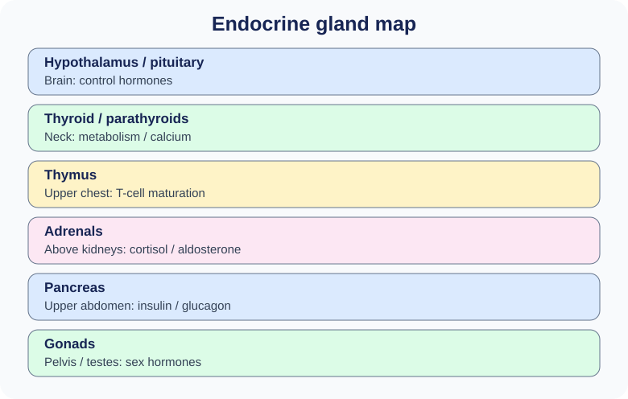

# 🧠 Endocrine System — Hamara Illustrated Complete Chapter

**AIIMS NORCET 12 · PGIMER · HP Staff Nurse / HPRCA · CHO / Community Nursing**  
**Study-ready, not yet marked studied or attempted.** Easy Roman Hinglish concepts, English MCQs, hidden answers.

🔴 **VERY HIGH** — diabetes, DKA/HHS, insulin, thyroid emergencies, DI/SIADH, calcium and adrenal crisis.  
🟠 **HIGH** — pituitary, thyroid, parathyroid, adrenal physiology, investigations and surgery.  
🟡 **IMPORTANT** — bone/mineral disorders, reproductive crossovers, other hormones, MEN and community programmes.  
🟢 **FOUNDATION** — gland location, hormones, feedback. Priority labels study estimates hain, official weightage nahi.

## 📖 Start here
| Study part | Open |
|---|---|
| 8 detailed concept files, disease-wise nursing care, diagnostics and diagrams | [📚 All 8 concept files](Concepts/Endocrine-System-Master-Guide.md) |
| Topic-wise questions — 113 | [📝 Topic-wise MCQs](MCQs/Endocrine-Topic-Wise.md) |
| Three mixed mocks — 25 | [🎯 Mixed mock practice](MCQs/Endocrine-Mixed-Mocks.md) |
| Exam-source evidence, NORCET / PGIMER / HP | [🏥 Previous Year Questions](Previous-Year-Questions/README.md) |
| Rapid review, emergency clues and values | [⚡ Quick revision](Revision/Endocrine-Quick-Revision.md) |
| Clinical and community sources | [🔎 References](References.md) |

**Practice total: 138 original entries** (113 topic-wise + 25 mock), including 24 new clinical/community applications. Existing stems/options retained; legacy revision questions sometimes test the same concept. Not claimed as 138 semantically unique questions or official PYQs. All entries unattempted.

## 📚 Detailed concept files — start here

| Part | Detailed notes | Priority | Main topics |
|---|---|---|---|
| 1 | [Anatomy, hormones, feedback and assessment](Concepts/01-Endocrine-Anatomy-Hormones-Feedback-Assessment.md) | 🟠 High | Gland locations, hormone receptors, HPT/HPA/HPG axes, primary vs central failure, lab and physical assessment |
| 2 | [Pituitary disorders, DI and SIADH](Concepts/02-Pituitary-Disorders-DI-SIADH.md) | 🔴 Very High | GH, prolactin, Sheehan syndrome, pituitary tumors, postoperative care and sodium/water balance |
| 3 | [Thyroid disorders, emergencies and surgery](Concepts/03-Thyroid-Disorders-Emergencies-Surgery.md) | 🔴 Very High | Hormone synthesis, hypo/hyper, Graves, Hashimoto, goiter, thyroid cancers, storm, myxedema, thyroidectomy |
| 4 | [Parathyroid, calcium and bone disorders](Concepts/04-Parathyroid-Calcium-Bone-Disorders.md) | 🔴 Very High | PTH, vitamin D, tetany, calcium emergencies, hungry bone syndrome, osteoporosis, CKD-MBD |
| 5 | [Adrenal disorders](Concepts/05-Adrenal-Addison-Cushing-Conn-Pheochromocytoma.md) | 🔴 Very High | Cortex, medulla, Addison, crisis, Cushing, Conn, pheochromocytoma, CAH, surgery |
| 6 | [Pancreas, diabetes, insulin and drugs](Concepts/06-Pancreas-Diabetes-Insulin-Drugs.md) | 🔴 Very High | Types, diagnosis, insulin onset/peak/duration, injections, mixing, numericals, drugs and diet |
| 7 | [Hypoglycemia, DKA and HHS](Concepts/07-Hypoglycemia-DKA-HHS.md) | 🔴 Very High | Clinical signs, emergency sequence, criteria, osmolality, potassium safety, monitoring |
| 8 | [Diabetes complications, community and other hormones](Concepts/08-Diabetes-Complications-Community-Other-Hormones.md) | 🟠 High | Foot/eye/kidney care, NP-NCD, NIDDCP, GDM, PCOS, MEN and other endocrine organs |

**Dhyan de:** 3–4 related topic groups per file; Part 1–8 are a recommended study order, not completed days. Original diagrams and clinical examples are embedded in relevant files.

## 🎯 Topic coverage and priority
| Topic | Study focus |
|---|---|
| Foundation and feedback | 🟢 Glands, receptors, negative/positive feedback |
| Pituitary | 🔴 GH, prolactin, Sheehan, postoperative care, DI and SIADH |
| Thyroid | 🔴 Hypo/hyper, Graves, Hashimoto, goiter, cancer, storm, myxedema, surgery |
| Parathyroid and bone | 🔴 PTH, calcium, tetany, postoperative care; 🟠 rickets, osteoporosis and mineral disorders |
| Adrenal | 🔴 Addison/crisis, Cushing, Conn, pheochromocytoma, CAH |
| Diabetes | 🔴 Diagnosis, types, complications, insulin, oral medicines, DKA/HHS, hypoglycemia, foot care |
| Other hormones | 🟡 Pineal, thymus, gonads, MEN, NETs, pediatric and obstetric crossover |
| Community nursing | 🟠 NP-NCD age 30+, screening/referral, prevention levels, NIDDCP, iodine education |

## 🎨 Visual gallery
| Diagram / chart | Topic |
|---|---|
| [Gland overview](Assets/gland-map.svg) | Gland locations and hormones |
| [Feedback](Assets/feedback.svg) | TRH → TSH → T3/T4 |
| [Water balance](Assets/water-balance.svg) | DI vs SIADH |
| [Thyroid](Assets/thyroid.svg) | Hypo vs hyper and postoperative clues |
| [Calcium](Assets/calcium.svg) | PTH regulation |
| [Adrenal](Assets/adrenal.svg) | GFR = Salt, Sugar, Sex |
| [Glucose](Assets/glucose.svg) | Insulin vs glucagon |
| [DKA/HHS](Assets/dka-hhs.svg) | Emergency mechanisms |
| [Community](Assets/community.svg) | Screening and iodine prevention |

Nine original SVG study charts plus Mermaid flowcharts in the master guide. These are educational schematics, not clinical diagnostic images.

## 🎬 YouTube resources
- [PW Nursing Wallah / Aarogyam A&P](https://www.youtube.com/watch?v=_bPmrRWgrTQ)
- [NORCET 10 introduction / thyroid](https://www.youtube.com/watch?v=BalA29k0tuM)
- [NORCET 10 endocrine countdown](https://www.youtube.com/watch?v=GnwsrLcZzEs)
- [Endocrine MCQ practice](https://www.youtube.com/watch?v=W00an2mL_5w)
- [Addison disease Hindi lecture](https://www.youtube.com/watch?v=9MzgaysB_f4)

More topic resources in [Master Guide](Concepts/Endocrine-System-Master-Guide.md). Titles and descriptions checked, full playback not reviewed. Dedicated video pairs for every subtopic pending.

## 📌 Study rule and evidence status
- Concepts → revision → topic-wise MCQs → mocks → revise mistakes. Answers hidden in dropdowns.
- Source-reported past exam topics and official verified papers are different. Official NORCET, PGIMER and HPRCA paper/key authentication remains incomplete.
- Broad adult nursing and community endocrine scope included; no claim of every possible exam question or exhaustive specialist syllabus.
- Previous README content reorganized into chapter folders; Git history retains earlier page.

[⬅ Nursing chapters home](../../README.md)
