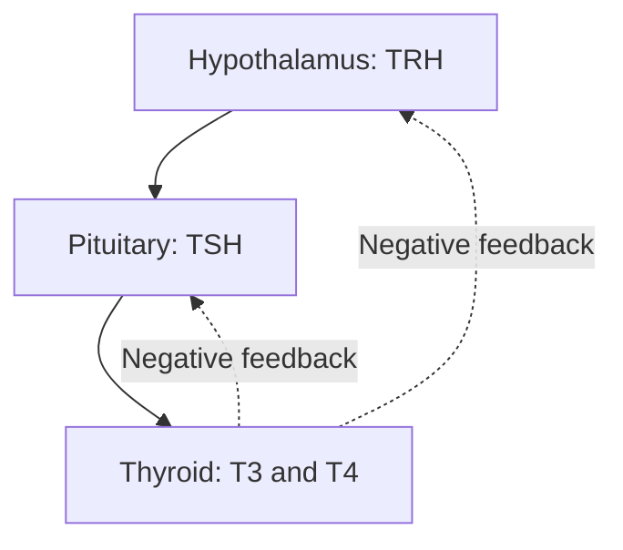

# 🧠 Endocrine System — NORCET + HP Staff Nurse + PGIMER

**Study-ready first edition | Simple Hinglish | Not marked as studied**

🔴 Most important clinical concepts · 🟠 High study priority · 🟡 Important · 🟢 Foundation. These are study priorities, not measured exam frequencies.

## 1. 🟢 Endocrine system kya hai?

- Hamari body mein kuch glands hormones banati hain. Hormones blood ke through doosre organs tak pahunchte hain aur unka kaam control karte hain.
- Endocrine glands ki ducts nahi hoti. Exocrine glands apna secretion duct ke through bhejti hain, jaise salivary glands.
- Pancreas dono tarah ka gland hai: insulin blood mein aur digestive enzymes duct mein jaate hain.

| Gland | Hormone | Kaam |
|---|---|---|
| Anterior pituitary | GH, TSH, ACTH, FSH, LH, prolactin | Growth, thyroid, adrenal aur reproduction control |
| Posterior pituitary | ADH, oxytocin release | Paani bachana, uterine contraction aur milk ejection |
| Thyroid | T3, T4, calcitonin | Metabolism aur calcium regulation |
| Parathyroid | PTH | Blood calcium badhana |
| Adrenal cortex | Aldosterone, cortisol, androgens | Salt-water balance, stress response |
| Adrenal medulla | Adrenaline, noradrenaline | Fight-or-flight response |
| Pancreas | Insulin, glucagon, somatostatin | Blood glucose control |
| Pineal | Melatonin | Sleep-wake timing |
| Ovaries/testes | Estrogen, progesterone/testosterone | Reproduction |
| Thymus | Thymic factors | T-cell development |

## 2. 🟠 Feedback mechanism

- Jab thyroid hormones kam hote hain, hypothalamus TRH aur pituitary TSH badha sakte hain. TSH thyroid ko hormone banane ka signal deta hai.
- Jab T3/T4 ka level badhta hai, TRH aur TSH kam ho jaate hain. Ise negative feedback kehte hain.

- Primary hypothyroidism: thyroid mein problem, TSH usually high aur free T4 low.
- Central hypothyroidism: pituitary/hypothalamus mein problem, free T4 low aur TSH low ya inappropriate normal.

## 3. 🟠 Pituitary gland

- Brain ke base par sella turcica mein hoti hai. Hypothalamus isko control karta hai.
- Anterior pituitary apne hormones banati hai. ADH aur oxytocin hypothalamus mein bante hain aur posterior pituitary se release hote hain.
- GH growth mein help karta hai. Bachpan mein excess GH se gigantism, adults mein acromegaly. Acromegaly mein haath, pair aur jaw bade ho sakte hain. IGF-1 screening aur specialist testing useful hain.
- GH ki childhood deficiency se short stature ho sakta hai.
- Prolactinoma: prolactin badhta hai; galactorrhea, irregular periods, infertility ho sakti hai. Cabergoline commonly used hoti hai.
- Pituitary tumor optic chiasm par pressure daale toh bitemporal hemianopia ho sakti hai.
- Hypopituitarism mein multiple hormones kam ho sakte hain. Cortisol deficiency exclude/treat karna thyroid replacement se pehle important hai.
- Sheehan syndrome: severe postpartum bleeding ke baad pituitary damage; milk na banna aur periods na aana clues hain.
- Transsphenoidal surgery ke baad urine output, sodium, neurological status aur clear nasal drainage monitor karo; CSF leak suspect ho toh report karo. Nose blowing/straining se bachne ki advice surgeon ke protocol ke hisaab se.

## 4. 🔴 ADH, Diabetes insipidus aur SIADH

- ADH kidney ko paani bachane mein help karta hai.
- ADH kam ho ya kidney respond na kare toh bahut dilute urine aata hai. Pyaas badhti hai. Ise diabetes insipidus (DI) kehte hain; glucose wali diabetes se alag hai.
- Central DI mein ADH ki kami; nephrogenic DI mein kidney ka response kam. Central DI mein desmopressin useful ho sakta hai.
- SIADH mein body extra paani rok leti hai; blood sodium dilute hokar kam ho jaata hai. Headache, confusion, seizures ho sakte hain.

| Finding | DI | SIADH |
|---|---|---|
| Urine | Zyada, dilute | Relatively concentrated |
| Serum sodium | High ho sakta hai | Low |
| Serum osmolality | High ho sakti hai | Low |
| Nursing | I/O, weight, hydration, sodium | I/O, weight, sodium, neurological signs |

- SIADH mein fluid restriction selected stable cases mein; severe symptomatic hyponatremia emergency hai, protocol-based hypertonic saline aur close sodium monitoring chahiye. Sodium ko bahut jaldi correct karna harmful hai.
- Water deprivation test supervised setting mein hota hai, ghar par nahi.

## 5. 🟠 Thyroid gland

- Neck mein trachea ke saamne butterfly-shaped gland. Follicular cells T3/T4 banati hain; C cells calcitonin.
- T3/T4 body ki energy use aur heat production ko regulate karte hain. Iodine hormone synthesis ke liye chahiye.
- Goiter ka matlab gland ka size badhna hai; thyroid function normal, low ya high ho sakta hai.

| Sign | Hypothyroidism | Hyperthyroidism |
|---|---|---|
| Weight | Badhta hai | Kam ho sakta hai |
| Temperature | Thand lagna | Garmi lagna |
| Pulse | Slow | Fast |
| Bowel | Constipation | Frequent stools |
| Skin | Dry | Warm, moist |
| Common cause | Hashimoto thyroiditis | Graves disease |

- Graves autoimmune disease hai; eye signs ho sakte hain. Hyperthyroidism mein tremor, palpitations aur anxiety bhi hoti hai.
- Tests: TSH, free T4, kabhi T3, antibodies. Ultrasound nodule ki structure dikhata hai; suspicious nodules mein FNAC specialist decide karta hai.
- Hypothyroidism: levothyroxine prescribed dose mein, consistently empty stomach; iron/calcium se usually 4 hours ka gap.
- Hyperthyroidism: antithyroid medicines, beta blockers for symptoms, selected patients mein radioiodine ya surgery. Fever/sore throat on antithyroid drug ko urgently report karo (agranulocytosis risk).
- Radioiodine pregnancy mein contraindicated hai; breastfeeding aur radiation precautions specialist instructions ke according.
- Congenital hypothyroidism: early newborn screening aur treatment brain development ke liye important.

### 🔴 Thyroid emergencies aur surgery
- Thyroid storm: high fever, severe tachycardia, agitation/confusion, possible heart failure. ABC, emergency escalation, ECG, cooling, fluids as appropriate aur prescribed treatment. Iodine antithyroid medicine ke baad protocol ke according.
- Myxedema coma: severe hypothyroidism, hypothermia, bradycardia, hypoventilation aur altered consciousness. ABC, ventilatory support as needed, urgent escalation; IV thyroid hormone aur glucocorticoid medical team ke protocol se.
- Thyroidectomy ke baad neck swelling, bleeding, stridor ya respiratory distress ko emergency samjho. Airway first. Semi-Fowler position if appropriate, neck supported, voice, wound aur calcium monitor karo.
- Lips ke aas-paas tingling ya muscle spasm calcium kam hone ka sign ho sakta hai.

## 6. 🔴 Parathyroid aur calcium

- Usually 4 glands thyroid ke peeche hoti hain. PTH blood calcium badhata hai: bone, kidney aur vitamin D activation ke through.
- Hypoparathyroidism: calcium kam, phosphate high ho sakta hai; tingling, tetany, cramps, seizures, prolonged QT.
- Chvostek sign: facial nerve tap karne par facial twitch. Trousseau sign: BP cuff se carpal spasm.
- Severe symptomatic hypocalcemia mein prescribed IV calcium gluconate, ECG aur IV site monitor.
- Primary hyperparathyroidism: calcium high, PTH high/inappropriately normal; kidney stones, bone pain, constipation, weakness. Phosphate low ho sakta hai.
- Hypercalcemia mein dehydration aur confusion ho sakte hain; hydration aur prescribed treatment; ECG/renal function monitor.

## 7. 🟠 Adrenal glands

- Dono kidneys ke upar glands hoti hain. Bahar cortex, andar medulla.
- Cortex: glomerulosa = aldosterone (salt), fasciculata = cortisol (sugar/stress), reticularis = androgens (sex). Trick: Salt, Sugar, Sex.
- Aldosterone sodium aur water retain karne mein help karta hai aur potassium excretion badhata hai.
- Cortisol stress response, glucose regulation aur inflammation control mein role play karta hai.

| Feature | Addison (primary adrenal insufficiency) | Cushing syndrome |
|---|---|---|
| Cortisol | Low | High |
| BP | Low | Often high |
| Glucose | Low ho sakta hai | High ho sakta hai |
| Skin | Hyperpigmentation possible | Thin skin, purple striae |
| Weight | Loss | Central weight gain |
| Sodium/potassium | Low Na, high K possible | Variable; low K possible |

- Addison mein ACTH high hota hai; secondary adrenal insufficiency mein hyperpigmentation aur hyperkalemia usually nahi.
- Adrenal crisis: severe hypotension, vomiting, weakness, confusion. Urgent ABC, IV hydrocortisone aur isotonic fluids per emergency protocol; glucose/electrolytes monitor.
- Long-term steroids ko suddenly stop nahi karna; taper prescribed plan se. Sick-day rules aur steroid emergency card important.
- Cushing syndrome cortisol excess hai; Cushing disease specifically pituitary ACTH-secreting tumor. Steroid use common cause of Cushing syndrome.
- Cushing nursing: infection, glucose, BP, fragile skin aur falls/fractures monitor.
- Conn syndrome: primary aldosteronism; hypertension, low potassium ho sakta hai. Aldosterone-renin ratio screening.
- Pheochromocytoma: catecholamine-producing tumor; episodic headache, sweating, palpitations, hypertension. Plasma free or urinary fractionated metanephrines; preoperative alpha blockade before beta blockade.
- Congenital adrenal hyperplasia: commonly 21-hydroxylase deficiency; salt-wasting, androgen excess. Infant dehydration/shock emergency.

## 8. 🔴 Pancreas aur Diabetes mellitus

- Pancreatic islets: beta cells insulin, alpha cells glucagon, delta cells somatostatin.
- Khana khane ke baad glucose badhta hai. Insulin glucose ko muscle/fat cells mein lene aur liver mein store karne mein help karta hai. Fasting mein glucagon glucose badhata hai.
- Type 1: autoimmune beta-cell destruction, insulin required. Type 2: insulin resistance aur progressive insulin deficiency. Gestational diabetes: pregnancy mein diagnosed glucose intolerance (overt pre-existing diabetes se alag).
- Classic symptoms: polyuria (urine zyada), polydipsia (pyaas), polyphagia (bhookh), weight loss possible.

| Nonpregnant adult diagnosis | Diabetes threshold |
|---|---|
| Fasting plasma glucose | ≥126 mg/dL |
| 2-hour 75 g OGTT | ≥200 mg/dL |
| HbA1c | ≥6.5% |
| Random plasma glucose | ≥200 mg/dL with classic symptoms or crisis |

- Unequivocal hyperglycemia absent ho toh diagnosis confirm karne ke liye repeat/second abnormal test chahiye. HbA1c roughly past 2–3 months ka glucose estimate hai; anemia aur hemoglobin variants interpretation affect kar sakte hain.
- Prediabetes (ADA): fasting 100–125, 2-hour 140–199 mg/dL, HbA1c 5.7–6.4%.
- Long-term complications: retinopathy, nephropathy, neuropathy (microvascular), MI/stroke/PAD (macrovascular).
- Nursing: glucose monitoring, foot inspection daily, footwear, medication adherence, nutrition/activity education, hypoglycemia action plan; eye and kidney screening.

### Insulin aur medicines
- Rapid acting: lispro/aspart; short: regular; intermediate: NPH; long: glargine/detemir/degludec (duration product-specific).
- Regular insulin commonly IV infusion protocols mein use hota hai. NPH cloudy; regular clear. Compatible regular + NPH mix prescribed ho toh clear before cloudy. Glargine ko mix mat karo.
- Subcutaneous site rotation within region se lipohypertrophy kam hoti hai. Insulin product, dose, timing, glucose, meal availability check karo. Unopened insulin usually 2–8°C; freeze na karo; in-use storage product label se.
- Metformin: hepatic glucose production kam; GI effects, B12 deficiency possible; renal function check.
- Sulfonylureas: insulin release badhate hain, hypoglycemia risk.
- SGLT2 inhibitors: urine mein glucose excretion; genital infection aur euglycemic DKA risk.
- GLP-1 receptor agonists: glucose-dependent insulin secretion, satiety; nausea common.
- Type 1 mein basal insulin illness mein bhi generally continue under sick-day guidance; dose individualized.

## 9. 🔴 Hypoglycemia, DKA aur HHS

- Hypoglycemia alert threshold below 70 mg/dL. Sweating, tremor, hunger, confusion; severe cases seizure/unconsciousness.
- Awake aur safely swallow kar sakta hai: 15 g fast carbohydrate, 15 minutes baad glucose recheck; repeat if still low. Unable to swallow: oral kuch mat do; emergency assistance, glucagon or IV dextrose per protocol.

| Feature | DKA | HHS |
|---|---|---|
| Main problem | Ketones + acidosis | Severe hyperosmolality/dehydration |
| Breathing | Kussmaul possible | Usually absent unless another cause |
| Glucose | Often high, can be near normal | Usually very high |
| Typical association | Type 1, but any type | Type 2, but overlap possible |

- DKA: insulin deficiency → fat breakdown → ketones → metabolic acidosis. Nausea, abdominal pain, deep breathing, fruity breath.
- HHS: severe hyperglycemia → urine water loss → dehydration → altered mental status.
- Treatment principles: IV fluids, potassium assessment/replacement, insulin as indicated, frequent glucose/electrolytes, treat precipitating cause. If potassium severely low, insulin delayed until corrected per protocol.
- DKA glucose normalize hone se pehle ketones clear nahi bhi hue ho sakte; prescribed dextrose may be added so insulin can continue safely.
- Sick day: hydration, glucose/ketone monitoring, urgent help for vomiting, breathing difficulty, confusion or persistent ketones.

## 10. 🟡 Other endocrine topics — clubbed

- Pineal melatonin: sleep-wake cycle, darkness mein secretion increases.
- Thymus: T-cell maturation, childhood mein relatively prominent.
- Ovaries: estrogen, progesterone; testes: testosterone. FSH/LH gonadal function regulate karte hain.
- PCOS: ovulatory dysfunction, androgen excess, possible polycystic ovarian morphology; metabolic risk bhi assess hota hai.
- Kidney: erythropoietin RBC production, renin BP regulation, calcitriol calcium absorption. Heart: ANP sodium excretion mein help. GI: gastrin, secretin, CCK digestion regulate karte hain.
- MEN1: parathyroid, pituitary, pancreatic/duodenal neuroendocrine tumors. MEN2: medullary thyroid carcinoma, pheochromocytoma; MEN2A mein parathyroid disease possible.

## 11. 📝 Topic-wise practice MCQs (original, not PYQs)

1. Which gland releases ADH? A. Anterior pituitary B. Posterior pituitary C. Thyroid D. Adrenal cortex

Answer
B. ADH hypothalamus mein banta hai aur posterior pituitary se release hota hai.

2. A patient with central DI is likely to have: A. Dilute polyuria B. Concentrated oliguria C. Hypoglycemia D. Tetany

Answer
A. ADH kam hone se kidney paani retain nahi kar paati.

3. Primary hypothyroidism typically shows: A. Low TSH and high T4 B. High TSH and low free T4 C. High TSH and high T4 D. Low TSH and high cortisol

Answer
B. Thyroid se hormone kam aata hai, pituitary TSH badhati hai.

4. Tingling around lips after thyroidectomy suggests: A. Hyperglycemia B. Hypocalcemia C. Hypernatremia D. Hyperkalemia

Answer
B. Parathyroid function affected ho sakta hai. Calcium aur airway assess karo.

5. Which adrenal layer makes aldosterone? A. Reticularis B. Medulla C. Glomerulosa D. Fasciculata

Answer
C. Salt, Sugar, Sex trick yaad rakho.

6. Which pancreatic cell produces insulin? A. Alpha B. Beta C. Delta D. Acinar

Answer
B. Alpha glucagon, delta somatostatin, acinar digestive enzymes banati hain.

7. A conscious patient with glucose 58 mg/dL can swallow safely. Initial treatment? A. Fast carbohydrate B. Extra insulin C. Fluid restriction D. Exercise

Answer
A. 15 g fast carbohydrate aur 15 minutes mein recheck.

8. Which is characteristic of DKA? A. Respiratory alkalosis as primary disturbance B. Ketosis with metabolic acidosis C. Hypocalcemic tetany D. Low cortisol

Answer
B. Fat breakdown se ketones aur acidosis hoti hai.

## 12. 🏁 Mixed mock — first set

1. After thyroid surgery, a patient develops stridor. Priority? A. Offer food B. Assess/support airway and call emergency help C. Walk patient D. Check weight
2. Which finding is typical in SIADH? A. Hypernatremia with dilute urine B. Hyponatremia with concentrated urine C. Hypercalcemia D. High HbA1c
3. Severe hypotension and vomiting in known Addison disease suggest: A. Thyroid storm B. Adrenal crisis C. Acromegaly D. Graves disease
4. An unconscious hypoglycemic patient should receive: A. Oral juice B. Oral candy C. Emergency glucagon or IV dextrose per protocol D. Exercise
5. Bitemporal hemianopia in pituitary tumor results from pressure on: A. Optic chiasm B. Cerebellum C. Medulla D. Thyroid

Mock answers and rationale

1 B — airway sabse pehle. 2 B — excess water blood sodium ko dilute karta hai. 3 B — cortisol deficiency emergency ho sakti hai. 4 C — unconscious patient ko oral food se aspiration ho sakta hai. 5 A — optic chiasm compression se side vision affected hoti hai.

## 13. PYQ evidence status and further reading

Official NORCET/HPRCA/PGIMER question papers and year-wise frequency have not been independently verified in this edition. Above questions are original practice, not attributed PYQs. Priority labels reflect clinical relevance, not proven repetition.

Clinical reading: [NIDDK endocrine diseases](https://www.niddk.nih.gov/health-information/endocrine-diseases), [ADA standards](https://professional.diabetes.org/standards-of-care), [Endocrine Society guidelines](https://www.endocrine.org/clinical-practice-guidelines), [American Thyroid Association](https://www.thyroid.org/).

**Edition status:** Foundation and major disorders included. Expanded diagrams, more topic-wise questions, larger mock, official PYQ evidence and detailed completeness audit pending.
