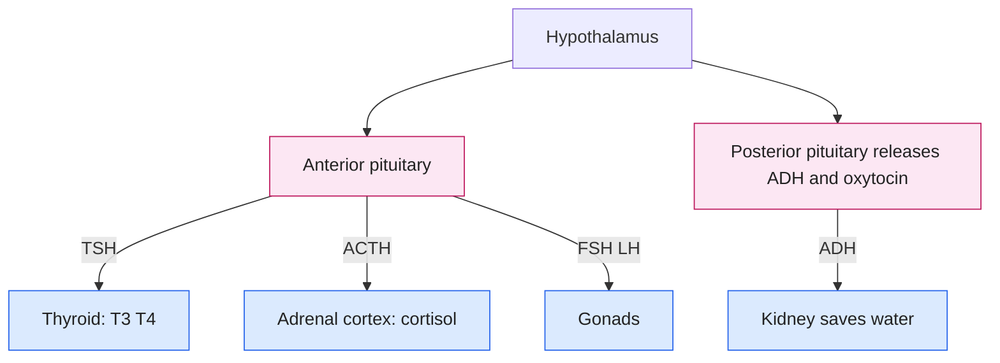
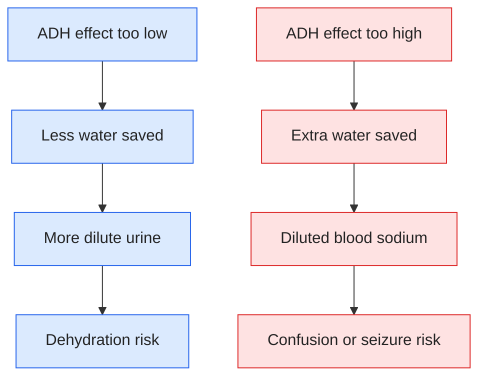
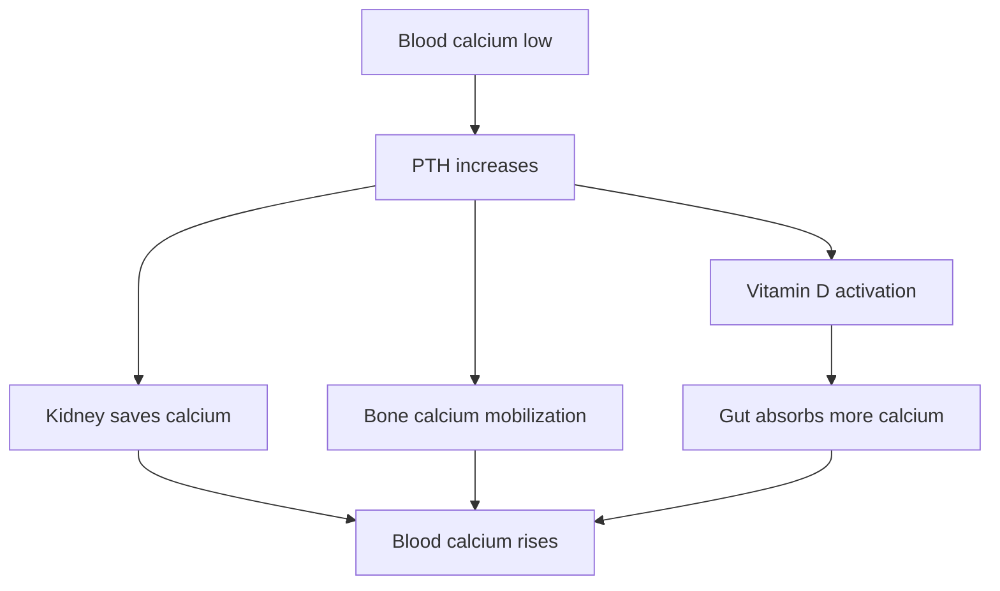
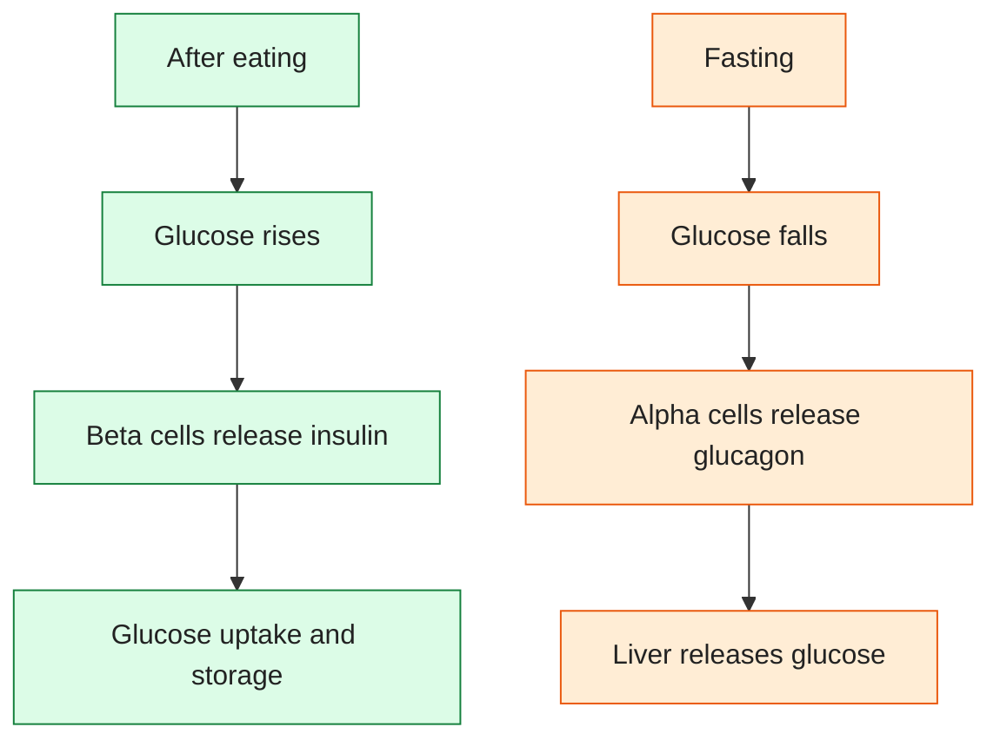
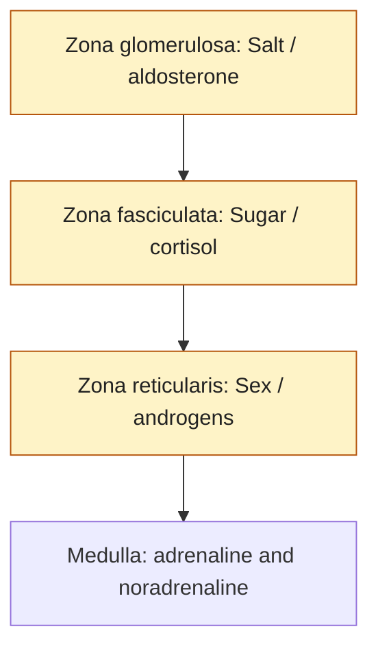

# ⚡ Endocrine one-look revision

[🏠 Chapter](../README.md) · [📖 Concepts](../Concepts/Endocrine-System-Master-Guide.md) · [📝 MCQs](../MCQs/Endocrine-Topic-Wise.md) · [🏥 Previous Year Questions](../Previous-Year-Questions/Endocrine-Previous-Year-Questions-Index.md) · [⚡ Revision](../Revision/Endocrine-Quick-Revision.md) · [References](../References.md)

## 14. 🎨 Gland-wise visual revision and priority

**Weightage note:** 🔴 Highest revision priority, 🟠 High priority, 🟡 Secondary revision, 🟢 Basic. Actual exam-wise percentage available nahi hai. Repeated question lead alag source table mein diya hai.

| Gland | 🔴 Pehle ye karo | 🟡 Baad mein revise |
|---|---|---|
| Pituitary | ADH origin/release, DI vs SIADH, post-operative monitoring | Prolactin, GH and other anterior hormones |
| Thyroid | Hypo vs hyper, thyroidectomy airway and calcium, thyroid emergencies | Nodules, thyroiditis, cancers |
| Parathyroid | PTH action, Chvostek/Trousseau, hypocalcemia | Other causes of calcium disorders |
| Adrenal | Addison vs Cushing, crisis, cortex layers, pheochromocytoma | CAH, Conn syndrome |
| Pancreas | Insulin, hypoglycemia, DKA/HHS, diagnostic values, foot care | Rare islet tumors |
| Other glands | Pineal, thymus, gonadal hormones | MEN and diffuse endocrine organs |

### Diagram — hormone map

### Diagram — DI versus SIADH

### Diagram — calcium control

### Diagram — glucose after a meal versus fasting

### Diagram — adrenal cortex outside to inside

| 🔴 Emergency clue | First priority / concept |
|---|---|
| Thyroid surgery + stridor | Airway emergency, immediate escalation |
| Cold, slow breathing, altered consciousness | Myxedema emergency |
| High fever, marked tachycardia, agitation | Thyroid storm |
| Hypotension/vomiting in adrenal failure | Crisis; urgent escalation, prescribed steroid and fluids |
| DI | Dilute polyuria, sodium may rise |
| SIADH | Low sodium, concentrated urine, seizure risk |
| Awake hypoglycemia | 15 g rapid carb, recheck 15 min |
| Unsafe swallow | No oral intake; emergency glucose/glucagon protocol |
| DKA | Ketones/acidosis; potassium safety |
| HHS | Hyperosmolality, dehydration, mental status |

**Numbers:** Fasting plasma glucose ≥126 mg/dL, 2h 75g OGTT ≥200, A1c ≥6.5%, random ≥200 with classic symptoms/crisis; confirm if not unequivocal. Hypoglycemia <70. NP-NCD age ≥30; NIDDCP renamed 1992.

**Exam tricks:** GFR = Salt/Sugar/Sex; prolactin makes milk, oxytocin ejects; Cushing disease = pituitary; PTH raises Ca and lowers phosphate; central hypothyroidism may have normal TSH.
