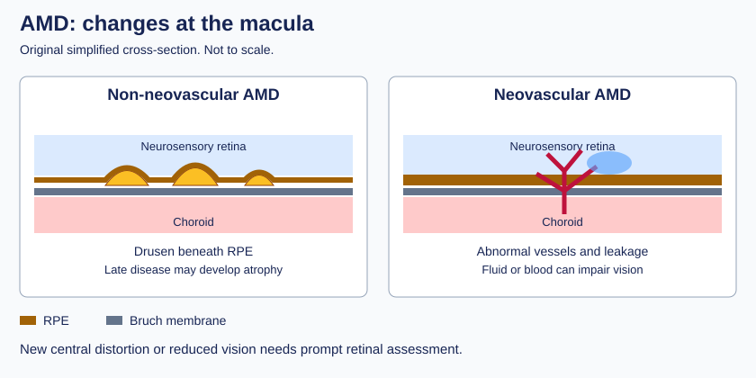

# 👁️ Age-related Macular Degeneration and Nursing

**Study-ready, unattempted.** NORCET / HP Staff Nurse / Nursing Officer. Advanced retinal imaging and new medicines are enrichment, not a claim of official exam weightage.

[Chapter](../README.md) · [30 original MCQs](../MCQs/AMD-30-MCQs.md) · [Reported exam practice](../Previous-Year-Questions/AMD-Reported-Exam-Practice.md)

[Mechanism](#mechanism) · [Recognition](#recognition) · [Monitoring](#monitoring) · [Treatment](#treatment) · [Rehabilitation](#rehabilitation)

## Mechanism

**🔴 MOST IMPORTANT**

Macula retina ka central area hai. Isko camera ke sharp focus wale center ki tarah samjho. Jab hum kisi face ko directly dekhte hain, medicine label padhte hain ya fine detail identify karte hain, toh macula ka function bahut important hota hai. Age-related macular degeneration (AMD) mein age ke saath macular tissue damage hota hai. Retinal pigment epithelium (RPE) photoreceptors ko support deta hai, outer segments recycle karta hai aur outer retinal environment maintain karta hai. RPE ke neeche extracellular material deposit ho sakta hai, jise drusen kehte hain.

| Form | Kya hota hai | Clinical importance |
|---|---|---|
| Non-neovascular (dry) | Drusen aur pigment changes ho sakte hain. Advanced stage mein RPE aur photoreceptors lose ho sakte hain. | Aksar slowly progress karti hai, lekin advanced atrophy serious disability de sakti hai. |
| Neovascular (wet) | Abnormal macular blood vessels grow karti hain. Fluid aur blood leak ho sakte hain. | Central vision faster deteriorate ho sakti hai. Prompt retinal evaluation chahiye. |

Dry AMD ko early, intermediate aur late stage mein describe kiya jaata hai. Drusen ka size aur AMD-associated pigment changes staging aur progression risk assess karne mein useful hain. Geographic atrophy (GA) late non-neovascular disease hai jahan specific areas mein RPE aur outer retinal cells lose hote hain. Wet AMD late-stage disease hai. Dono eyes ki stage alag ho sakti hai. Ek patient mein drusen, atrophy aur neovascular changes coexist bhi kar sakte hain.

**Exam clue:** Dry AMD more common hai, lekin wet AMD faster vision loss cause kar sakti hai. AMD primary optic nerve disease nahi hai. Glaucoma primarily optic neuropathy hai aur cataract lens opacity hai.

[Practice Q1–6](../MCQs/AMD-30-MCQs.md) · [AIIMS BBSR SNO 2019 reported concept](../Previous-Year-Questions/AMD-Reported-Exam-Practice.md)

## Recognition

**🔴 MOST IMPORTANT**

AMD ka main functional effect central detail loss hai. Example: patient ko saamne khada person dikh raha hai, lekin directly face ki details identify nahi kar paata. Side vision relatively preserved reh sakti hai. Isse driving safe prove nahi hoti. Early AMD mein symptoms bilkul absent ho sakte hain, isliye scheduled examination important hai.

Metamorphopsia ka matlab straight lines distorted ya wavy dikhna hai. Central scotoma visual field ke center mein dark, blank ya reduced-vision area ko kehte hain. New distortion ya new central vision reduction ko routine ageing assume mat karo. Prompt retinal review arrange karo. Sudden severe visual loss emergency pathway ke according assess karo because other acute causes bhi possible hain. Pain ka absent hona safe condition prove nahi karta.

Increasing age, family history aur tobacco smoking important risk factors hain. Smoking cessation support do. Balanced diet, physical activity aur clinician-directed cardiovascular care overall health ke liye useful hain. Genetic risk ko guarantee mat samjho. No symptom ka matlab no disease nahi hota.

[Practice Q7–11](../MCQs/AMD-30-MCQs.md)

## Monitoring

**🔴 MOST IMPORTANT**

Amsler grid central vision mein changes notice karne ka home-monitoring tool hai. Ye diagnosis ya scheduled retinal examination ka replacement nahi hai.

1. Good light mein usual reading glasses pehno aur supplied grid clinician ke instructed distance par rakho.
2. Ek eye ko bina pressure cover karo.
3. Open eye se central dot par fixation rakho. Surrounding lines ko scan karne ke liye fixation move mat karo.
4. Nayi wavy, blank, missing ya blurred areas note karo. Doosri eye separately check karo.
5. New change mile toh promptly eye-care team se contact karo. Severe sudden visual change ko emergency pathway se assess karao.

Better eye unilateral defect mask kar sakti hai. Isliye monocular testing zaroori hai. Normal grid se active AMD completely rule out nahi hoti.

Dilated examination macular appearance assess karta hai. Optical coherence tomography (OCT) retinal cross-sections deta hai. Serial scan mein fluid aur tissue changes compare kiye ja sakte hain. Fluorescein angiography dye-based vascular leakage assessment kar sakti hai. OCT angiography (OCTA) motion-based blood-flow signals use karti hai aur IV dye ki need nahi hoti. Lekin OCTA directly dye leakage nahi dikhati aur artifacts possible hain. Final interpretation retinal specialist karta hai.

[Practice Q12–16](../MCQs/AMD-30-MCQs.md)

## Treatment

**🔴 MOST IMPORTANT**

Early AMD mein monitoring aur modifiable risk management important hai. Intermediate AMD ya late disease in one eye with an appropriate fellow-eye stage mein clinician AREDS2 formulation discuss kar sakta hai. Ye studied combination advanced disease progression risk reduce karne mein help karti hai, lost macula regenerate nahi karti. Ordinary multivitamin necessarily equivalent nahi hai. Older AREDS beta-carotene formulation current aur former smokers mein lung cancer risk badha sakti hai. AREDS2 lutein aur zeaxanthin use karti hai. High-dose vitamins aur minerals other medicines ke saath interact kar sakte hain. Patient ko independent supplement dose changes advise mat karo.

Wet AMD mein vascular endothelial growth factor (VEGF) abnormal vessel growth aur leakage mein role play karta hai. Anti-VEGF intravitreal treatment is signaling ko suppress karta hai. Examples ranibizumab aur aflibercept hain. Bevacizumab selected settings mein off-label use hota hai. Drug choice, regulatory status aur regimen specialist decide karta hai. Repeat injections often needed hoti hain. Treat-and-extend approach mein clinician stable disease control ke basis par interval adjust karta hai. Patient symptoms improve hone par appointment khud cancel na kare.

Photodynamic therapy selected lesions mein use ho sakti hai. Photosensitizing medicine (for example verteporfin) ko targeted light activate karti hai. Ye routine cataract surgery ya standard laser for every AMD eye nahi hai.

**Current clinical update:** Older resources may state there is no treatment for advanced dry AMD. US mein geographic atrophy ke liye complement inhibitors pegcetacoplan aur avacincaptad pegol approved hain. Selected patients mein atrophy lesion growth slow karna objective hai, lost vision restore karna nahi. Availability and approvals in India independently established nahi kiye gaye. Individual risks, injection burden aur expected benefits discuss karna important hai. Pegcetacoplan label retinal vasculitis aur vascular occlusion warnings include karta hai. New reduced vision, pain, redness ya photophobia after ocular injection urgent review maangti hai. Intravitreal injection general asepsis aur emergency nursing already [Diabetic Retinopathy](Diabetic-Retinopathy-and-Nursing.md) mein covered hai, isliye same practice questions repeat nahi kiye gaye.

[Practice Q17–26](../MCQs/AMD-30-MCQs.md)

## Rehabilitation

**🟠 HIGH YIELD**

Vision loss se patient ki reading, medicine management, cooking aur social interaction affect ho sakti hai. Nursing assessment mein patient se poochho ki actual daily difficulty kya hai. Low-vision rehabilitation ka goal remaining vision ka maximum safe use aur independence support karna hai. Magnification, adjustable lighting, glare control, high-contrast plain surfaces aur accessible phone features useful ho sakte hain. Eccentric viewing training functioning retinal area away from damaged center ko use karna sikhati hai. Ye cure nahi hai. Specialist patient ke goals ke according intervention choose karta hai.

Severe visual impairment ke saath kuch patients complex visual images dekhte hain jab actual object present nahi hota. Isko Charles Bonnet syndrome consider kiya ja sakta hai, especially when insight preserved hai. Har hallucination ko is diagnosis se automatically explain mat karo. New medication, cognition, delirium, neurological aur psychiatric causes assess karne ke liye clinical review arrange karo. Patient ko nonjudgmental support do.

Patient ko voice se log identify karne aur comfortable communication strategies discuss karne mein support do. Mood, loneliness, functional safety aur caregiver support assess karo. Patient ki consent aur autonomy maintain karo.

[Practice Q27–30](../MCQs/AMD-30-MCQs.md)

## ▶️ Teaching and MCQ practice

| Topic | Teaching resource | Separate MCQ practice |
|---|---|---|
| Types, symptoms, treatment | [Centre For Sight — Dr Nikitha Reddy](https://www.youtube.com/watch?v=5CqAelq04vo) | Specific video pending |
| Nursing overview | [Level Up RN — Macular degeneration, retinal detachment and Ménière disease](https://www.youtube.com/watch?v=Ykl-ld0c3GM) | Specific video pending |
| Monitoring, supplements, rehabilitation | Clinical links below | Specific video pending |

Descriptions/titles indexed, direct playback and language not verified. Mixed [NCLEX eye-disorder review](https://www.youtube.com/watch?v=gKs32V6lBJY) mentions exam comparisons, but dedicated question-solving coverage not established. All 30 original items and one reported adaptation have specific MCQ-video gaps. No invented timestamps.

## Clinical references

- [NEI AMD](https://www.nei.nih.gov/eye-health-information/eye-conditions-and-diseases/age-related-macular-degeneration) and [NEI AREDS2](https://www.nei.nih.gov/eye-health-information/eye-conditions-and-diseases/age-related-macular-degeneration/nutritional-supplements-age-related-macular-degeneration) directly retrieved. The older general AMD page predates complement inhibitor approvals, so updated GA treatment information is taken from newer sources below.
- [AAO AMD](https://www.aao.org/eye-health/diseases/amd-macular-degeneration), [Amsler monitoring](https://aao.org/eye-health/tips-prevention/facts-about-amsler-grid-daily-vision-test), [retina benchmarks](https://www.aao.org/education/summary-benchmark-detail/retina-summary-benchmarks-2020), [NEI wet AMD treatment](https://www.nei.nih.gov/eye-health-information/eye-conditions-and-diseases/age-related-macular-degeneration/treatments-wet-amd-advanced-neovascular-amd).
- [Mayo Clinic GA treatment](https://www.mayoclinic.org/diseases-conditions/geographic-atrophy/diagnosis-treatment/drc-20582994), [DailyMed pegcetacoplan safety](https://dailymed.nlm.nih.gov/dailymed/lookup.cfm?setid=b4434e61-9ec9-4e0e-bd60-45aaa0a87e64), [NEI rehabilitation](https://www.nei.nih.gov/eye-health-information/vision-rehabilitation). Indexed extracts checked. Full clinical source and independent review pending.

**Quick revision:** Macula = central detail. Drusen = deposits beneath RPE. Wet AMD = abnormal vessels and leakage. New distortion = prompt review. AREDS2 = stage-specific risk reduction. Anti-VEGF = specialist treatment. Rehabilitation = remaining vision and independence.

[Chapter](../README.md) · [30 original MCQs](../MCQs/AMD-30-MCQs.md) · [Reported exam practice](../Previous-Year-Questions/AMD-Reported-Exam-Practice.md)
