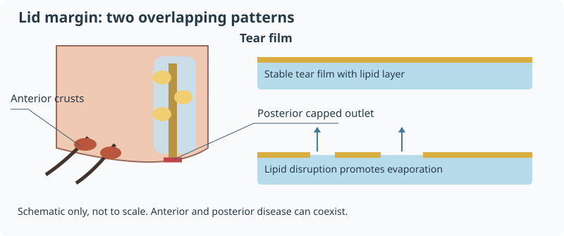

# 📚 Blepharitis — detailed Roman Hinglish nursing concepts

**Study-ready, not studied.** [Chapter](../README.md) · [30 original MCQs](../MCQs/Blepharitis-30-MCQs.md) · [Exam evidence](../Previous-Year-Questions/Blepharitis-Exam-Evidence.md)

## Mechanism and types

Blepharitis eyelid margin ki inflammation hai, often chronic aur bilateral. Stye mein focal acute gland infection aur chalazion mein localized lipogranuloma hota hai. Blepharitis mein diffuse lid margin involvement common hai. Ye diseases coexist kar sakti hain.

Anterior lid margin mein eyelashes aur follicles hain. Posterior margin mein meibomian gland openings hain. Meibum tear film ki outer lipid layer stabilize karta hai aur evaporation slow karta hai. Imagine karo water surface par thin protective oil layer hai. Agar oil supply ya quality disturb ho toh tear film jaldi break ho sakti hai. MGD chronic diffuse gland abnormality hai, commonly obstruction ya altered secretion. Not every MGD has obvious inflammation. Aqueous-deficient dry eye aur evaporative dry eye coexist kar sakte hain.

| Pattern | Clues | Mechanism |
|---|---|---|
| Anterior staphylococcal | Hard adherent crusts, red swollen margins, lash misdirection/loss | Bacterial colonization, toxins and host inflammation |
| Anterior seborrheic | Greasy loose scales, scalp/eyebrow dandruff, comparatively less inflammation | Seborrheic dermatitis association |
| Posterior/MGD | Capped gland openings, thick turbid secretion, foamy tears, telangiectasia | Altered meibum and evaporation |
| Demodex-associated | Cylindrical waxy sleeves at lash bases, itching | Mite-associated inflammation |

Patterns overlap. Crust alone se exact organism establish nahi hota. Staphylococcal disease may cause ulcerative margin changes, lash loss and marginal corneal inflammation. Seborrheic scaling generally softer and greasy. Posterior disease often ocular rosacea se associated hai, not simply acute bacterial abscess.

## Demodex

Demodex folliculorum hair follicles aur D. brevis sebaceous/meibomian glands mein inhabit kar sakte hain. Mites normal flora ke part bhi ho sakte hain. Pathological burden aur clinical findings important hain. Cylindrical collarettes lash root ko sleeve ki tarah surround karti hain, Demodex suspicion ka strong clue. Ordinary distal cosmetic debris ko automatically Demodex collarette nahi bolna. Slit lamp par upper lash roots downward gaze mein visible ho sakte hain. Selected cases mein clinician epilated lashes microscopy se assess kar sakta hai. Routine patient self-epilation unsafe hai.

Lotilaner 0.25% US FDA-approved topical ectoparasiticide hai for Demodex blepharitis (2023). US label twice daily both eyes for six weeks describe karta hai. India availability and local approval is run mein verified nahi hai. Ye enrichment hai, universal prescription nahi. Prescriber and local label follow karo. Common adverse effect instillation burning/stinging hai. Label missed dose par next scheduled dose continue karne ko bolta hai, double dose nahi. Contact lens removal and reinsertion interval product label se verify karo. Tea tree oil-based specialist formulations sometimes used, but concentrated essential oil directly eye mein apply karna harmful ho sakta hai.

## Assessment and differential

Symptoms burning, itching, gritty sensation, morning crusting, fluctuating vision and tear instability. Blink se temporary clear vision tear film problem suggest kar sakti hai. History mein duration, skin rosacea/dandruff, medicines, cosmetics, previous eye surgery and contact lens use record karo. Examine lash margin, posterior gland orifices, secretion quality, cornea and visual acuity. Severe pain, photophobia, persistent loss of acuity, corneal opacity or marked unilateral atypical findings urgent review demand karte hain.

Fluorescein tear break-up time (TBUT) complete blink ke baad first dry spot tak interval hai. Short TBUT instability indicate karti hai, cause alone identify nahi karti. Schirmer test aqueous tear production estimate karta hai. Meibography gland morphology and dropout assess kar sakti hai, function ka full replacement nahi. Meibum expressibility and quality clinician assess karta hai. Routine cultures unnecessary in typical chronic disease. Severe recurrent anterior disease or nonresponse mein clinician culture consider kar sakta hai.

## Management and nursing

Long-term lid hygiene main foundation hai. Anterior disease mein gentle lash-margin cleansing debris remove karne mein useful hai. MGD mein comfortably warm compress and appropriate gentle lid massage secretion flow support karte hain. Excessive heat, force and soap/essential oil inside eye avoid karo. Patient-specific commercial cleansing product or prescribed method use karo. Clean hands and separate clean material, closed eyelids, no scratching. Teach-back se technique verify karo. Symptoms improve hone par maintenance routine continue karna recurrence reduce karne mein help kar sakta hai. Complete permanent cure promise nahi.

Artificial tears lubrication improve kar sakti hain. Frequent use or sensitivity mein preservative-free formulations clinician recommend kar sakta hai. Selected anterior bacterial disease mein topical antibiotic ointment, posterior inflammatory MGD/rosacea mein selected systemic antibiotic (such as doxycycline or azithromycin) may be prescribed. Doxycycline choice mein pregnancy, age, indication, drug interactions and GI risks clinician review kare. This is chronic inflammatory disease, not automatic antibiotic indication. Short supervised steroid course selected severe inflammation mein useful ho sakti hai after infection assessment. Prolonged unsupervised use IOP rise, cataract and infection worsening risk create karta hai. Specialist can consider thermal pulsation, IPL or debridement for selected patients. Benefits, suitability, costs and evidence differ, not mandatory first-line nursing intervention.

## Complications and follow-up

Chronic lid margin inflammation recurrent hordeola/chalazia, trichiasis, madarosis, conjunctival inflammation and superficial punctate keratopathy cause kar sakti hai. Marginal sterile infiltrate bacterial antigen-related immune response se associated ho sakta hai. Infection exclude kiye bina steroid use mat karo. Corneal involvement vision threaten kar sakti hai.

Persistent unilateral inflammation, focal thickening, lash loss, ulceration or treatment-resistant atypical findings mein sebaceous carcinoma or other lesion exclude karne ke liye ophthalmology review. These signs are not diagnostic on their own. Record baseline and follow-up symptoms, lid appearance, ocular surface findings, adherence and visual function. Patient ko long-term self-care plan samjhao, follow-up set karo, associated dermatological disease care coordinate karo.

## ▶️ Teaching and MCQ practice

- [Santiniketan Medical College — eyelid lecture](https://www.youtube.com/watch?v=Ctj8cErbDio&t=730s), published chapter marker 12:10 for anterior/posterior blepharitis and management. Teaching only.
- [Learn MBBS — Eyelid high-yield MCQs](https://www.youtube.com/watch?v=0tTcBtFP0nU), description explicitly includes blepharitis. Supplemental topic-level practice for Q1–4, Q7 and Q19–20, not exact item verification or nursing recruitment evidence.
- [Top Eye Disorders Nursing Practice Questions](https://www.youtube.com/watch?v=BebRfEEgkQc), broad nursing practice lead, no demonstrated blepharitis-specific coverage. All 30 nursing-specific item gaps pending.

## References

- [AAO Blepharitis PPP 2024](https://www.aaojournal.org/article/S0161-6420%2824%2900008-3/fulltext) indexed.
- [EyeWiki Blepharitis](https://eyewiki.aao.org/Blepharitis) direct text.
- [Indian MGD preferred practice guideline 2023](https://pubmed.ncbi.nlm.nih.gov/37026266/) indexed abstract, PMC direct access CAPTCHA.
- [College of Optometrists updated 9 June 2026](https://www.college-optometrists.org/clinical-guidance/clinical-management-guidelines/blepharitis_lidmargindisease) indexed.
- [StatPearls 2025](https://www.ncbi.nlm.nih.gov/sites/books/NBK459305/) indexed.
- [US DailyMed lotilaner label](https://dailymed.nlm.nih.gov/dailymed/fda/fdaDrugXsl.cfm?setid=ccd9e37c-654e-4e84-8c85-6523457df979&type=display) direct text.
