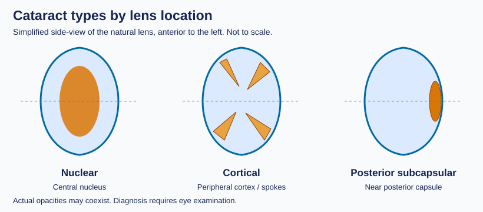
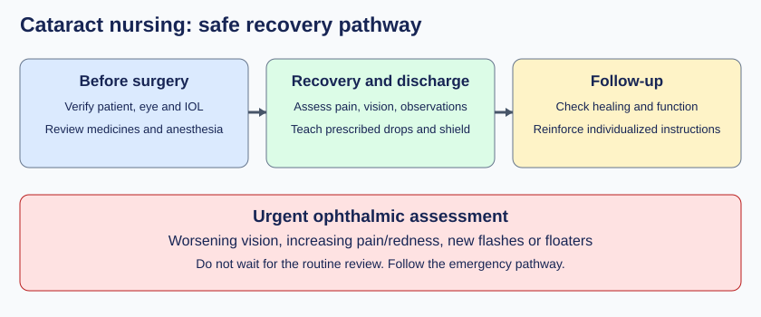

# 👁️ Cataract and Perioperative Nursing

**Study-ready, unattempted.** AIIMS NORCET / HP Staff Nurse / CHO. Easy Roman Hinglish with clinical terms in English.

[Chapter](../README.md) · [30 original MCQs](../MCQs/Cataract-30-MCQs.md) · [Reported exam practice](../Previous-Year-Questions/Cataract-Reported-Exam-Practice.md) · [Eye assessment](Eye-Assessment-and-Diagnostics.md)

## Classification

**🔴 MOST IMPORTANT**

Cataract ka matlab natural crystalline lens ka cloudy ho jaana hai. Aankh ko camera samjho. Camera ka clear lens light ko focus karta hai. Agar us lens par fog aa jaaye toh image blurry ho jaati hai. Aankh mein bhi lens ke proteins aur structure change hone se light scatter hoti hai aur retina par clear image nahi ban paati. Cataract retina par parda ya eye pressure ka naam nahi hai.

Age-related cataract ko location ke hisaab se samjho. Ek eye mein different types saath bhi ho sakte hain.

| Type | Location and common clue |
|---|---|
| Nuclear | Central lens nucleus, yellow-brown change, possible myopic shift |
| Cortical | Outer cortex, radial spoke-like opacity, glare |
| Posterior subcapsular | Just anterior to posterior capsule, glare and near-task difficulty |

Nuclear cataract mein refractive index change hone se older patient ko temporarily near reading clear lag sakti hai. Isko second sight kehte hain. Ye natural accommodation restore hona nahi hai. Distance vision worsen ho sakti hai.

Traditional maturity classification mein incipient early opacity, immature partial opacity aur mature cataract whole lens opacity describe karte hain. Hypermature cataract mein further degenerative changes ho sakte hain. Morgagnian cataract mein liquefied cortex ke andar nucleus sink kar sakta hai. Ye classification nursing exam enrichment hai. Modern surgery ke liye lens ka mature hona mandatory nahi hai.

## Risk and assessment

**🔴 MOST IMPORTANT**

Age, diabetes, prolonged corticosteroid exposure, smoking, ultraviolet exposure, trauma aur some prior eye procedures cataract risk badha sakte hain. Nurse duration of symptoms, medication history aur daily function assess karti hai. Prescribed steroids ko independently stop nahi karna.

Typical adult age-related cataract gradually painless blur, glare, light sensitivity, faded colours ya night-driving difficulty cause kar sakti hai. Har patient ka symptom pattern same nahi hota. Severe sudden eye pain, vomiting, rapidly worsening vision ya new flashes aur floaters ko uncomplicated cataract assume mat karo. Urgent eye evaluation chahiye.

Eye examination mein visual acuity, refraction, slit lamp aur indicated dilated retinal assessment useful hain. Coexisting retinal disease aur glaucoma surgical outcome affect kar sakte hain. Agar dense cataract fundus view block karti hai toh clinician additional investigation, for example ocular ultrasound where appropriate, plan kar sakta hai. Nurse visual difficulty, fall risk, mobility, reading, driving aur activities of daily living record karti hai. Adequate lighting, contrast aur assistance provide karo.

Congenital cataract birth se present ho sakti hai, aur childhood mein acquired cataract bhi develop ho sakti hai. Infant ka white pupil ya absent/asymmetric red reflex urgent pediatric ophthalmic evaluation maangta hai. White reflex cataract alone prove nahi karta, kyunki retinoblastoma aur other serious conditions bhi possible hain. Visual development ke critical period mein dense opacity deprivation amblyopia cause kar sakti hai. Early specialist care, optical rehabilitation aur long-term monitoring important hain.

## Treatment

**🔴 MOST IMPORTANT**

Early cataract mein better lighting aur updated glasses kuch functional help de sakte hain. Lekin glasses, vitamins ya exercises lens opacity remove nahi karte. Definitive removal surgery se hoti hai when clinically indicated. Patient ki visual needs, expected benefit, risks aur choice ke basis par elective surgery plan hoti hai.

| Procedure | Basic difference |
|---|---|
| Phacoemulsification | Ultrasound energy se nucleus fragments banakar aspirate kiye jaate hain |
| Manual small-incision cataract surgery (MSICS) | Nucleus manually deliver hota hai through a planned tunnel |
| Conventional ECCE | Lens contents remove hote hain, posterior capsule usually retained |
| ICCE | Lens aur capsule together remove hote hain, historical technique, uncommon today |

Modern cataract operations commonly artificial intraocular lens (IOL) implant karti hain. Natural lens absent hone ko aphakia kehte hain. Artificial IOL present ho toh pseudophakia kehte hain. Retained capsular bag suitable implant support provide kar sakti hai. IOL power biometry aur corneal measurements se plan hoti hai. Monofocal, toric aur other IOL choices individualized hain. Glasses ki need completely khatam hone ki guarantee nahi hoti. Surgery lens opacity remove karti hai, lekin pre-existing retinal ya optic nerve damage necessarily reverse nahi karti.

## Preoperative

**🔴 MOST IMPORTANT**

Patient ko simple language mein procedure ka purpose, expected outcome, risk aur postoperative plan samjhao. Informed consent according to local policy verify karo. Patient identity, intended eye, surgical site verification, documented biometry aur selected IOL details check karo. Discrepancy mile toh preparation stop karo aur team se resolve karwao.

Medication history mein allergies, diabetes medicines, antiplatelets, anticoagulants aur current/past tamsulosin include karo. Tamsulosin se intraoperative floppy iris syndrome ka risk associated hai, isliye ophthalmic team ko notify karo. Patient ki medicine independently stop ya change mat karo. Antiplatelet plan surgeon aur prescriber individual bleeding/thrombosis risk ke hisaab se decide karte hain.

Anesthesia plan confirm karo. Local anesthesia ke saath patient awake ho sakta hai. Numbing medicine aur sedation plan vary kar sakta hai. Fasting instructions anesthesia team ke specific protocol se follow karo. Prescribed preoperative dilating ya other drops right patient, right eye aur right time se administer karo. Patient ko during surgery discomfort report karne aur sudden head movement avoid karne ke liye samjhao. Home transport aur caregiver support arrange karna useful hai.

## Postoperative

**🔴 MOST IMPORTANT**

Recovery mein vital signs, consciousness if sedated, comfort, operated eye aur vision-related complaints assess karo. Mild irritation, foreign-body sensation ya temporary blur possible hain, lekin increasing pain, redness, sudden visual loss, discharge ya severe nausea/vomiting ko normal recovery assume mat karo.

Prescribed antibiotic, corticosteroid ya NSAID eye drops exact regimen ke according use hote hain. Regimen technique aur clinician ke protocol par depend karta hai. Hand hygiene karo, lower conjunctival sac mein prescribed drop administer karo aur bottle tip ko eye, lashes ya fingers se touch mat karo. Different drops ke beech common interval five minutes hota hai unless specific instructions differ. Patient se demonstration aur teach-back karao. Shield agar prescribed ho toh accidental rubbing aur pressure se protection ke liye use karo. Tight pressure apply mat karo.

Postoperative activity instructions patient ki wound, surgery type aur surgeon ke according vary karti hain. Heavy lifting, straining, rubbing, swimming aur potentially contaminating activities ke restrictions follow karo. Traditional ECCE exam advice ko har modern small-incision patient par fixed duration ke saath apply mat karo. Prescribed systemic aspirin independently stop mat karo aur postoperative pain ke liye additional aspirin self-start mat karwao. Safe analgesic plan confirm karo.

### Complications and red flags

**🔴 MOST IMPORTANT**

Endophthalmitis intraocular infection hai. Increasing pain, redness aur reduced vision ke saath suspicion ho toh urgent ophthalmic assessment chahiye. Severe pain with nausea/vomiting pressure-related ya other serious complication ho sakti hai. New flashes, floaters ya curtain-like shadow retinal pathology ka clue ho sakte hain. Routine appointment ka wait mat karo.

Posterior capsule opacification (PCO) surgery ke weeks, months ya years baad retained posterior capsule cloudy hone se gradual blur cause kar sakti hai. Isko secondary cataract bhi kehte hain, lekin natural cataract dobara grow nahi karti. Clinician other causes exclude karke Nd:YAG laser posterior capsulotomy consider kar sakta hai. Pseudophakic cystoid macular edema mein macula ke retinal layers mein fluid collect hota hai. Central blur aur OCT changes evaluation require karte hain.

Follow-up appointments healing, vision, IOP when indicated aur additional optical correction check karne ke liye important hain. Cataract surgery ke baad new spectacles ki timing treating team decide karti hai. Emergency contact instructions discharge se pehle written aur verbal format mein do.

## ▶️ Teaching and MCQ practice

| Topic | Teaching | Separate MCQ practice |
|---|---|---|
| Cataract classification and surgery | [PW Nursing Wallah — Eye Cataract and Lens Error, NORCET 6](https://www.youtube.com/watch?v=gO8oPMQd0vA) | [MCQ on Cataract Part 1](https://www.youtube.com/watch?v=GMe4BaHZXos) |
| Nursing preparation and postoperative care | [Iram Fatima Nursing — Complete Ophthalmology for NORCET](https://www.youtube.com/watch?v=YlogEu5ijnQ) | Dedicated clinically matched practice video pending |
| Pediatric cataract | [Pediatrics Eye and Ear Disorders One Shot](https://www.youtube.com/watch?v=qVPpZQ8qkvs) | Separate verified question-level practice pending |

Titles and description-level search evidence checked. Mixed-topic and optometry leads are not confirmed exact MCQ matches. No playback or timestamp authentication claimed. Q1–7 broad MCQ title lead, Q8–30 specific video gaps.

## Clinical sources

- [NEI cataract surgery](https://www.nei.nih.gov/eye-health-information/eye-conditions-and-diseases/cataracts/cataract-surgery) — directly retrieved.
- [NEI causes](https://www.nei.nih.gov/eye-health-information/eye-conditions-and-diseases/cataracts/causes-cataracts), [StatPearls cataract](https://www.ncbi.nlm.nih.gov/books/NBK539699/), [phacoemulsification](https://www.ncbi.nlm.nih.gov/books/NBK576419/), [MSICS](https://www.ncbi.nlm.nih.gov/books/NBK582123/) — indexed extracts.
- [AAO pediatric screening](https://www.aao.org/education/clinical-statement/vision-screening-infants-children-2022), [AAO tamsulosin](https://www.aao.org/eye-health/diseases/bph-medicine-cataract-surgery), [CUH postoperative advice](https://www.cuh.nhs.uk/patient-information/discharge-advice-to-patients-following-eye-surgery/), [AAO cataract benchmark](https://www.aao.org/education/summary-benchmark-detail/cataract-anterior-segment-summary-benchmark-2020) — indexed.
- [Reported exam practice](../Previous-Year-Questions/Cataract-Reported-Exam-Practice.md) includes source-traced adaptations, not authenticated official paper keys.

[Chapter](../README.md) · [MCQs](../MCQs/Cataract-30-MCQs.md) · [Reported exam practice](../Previous-Year-Questions/Cataract-Reported-Exam-Practice.md)
